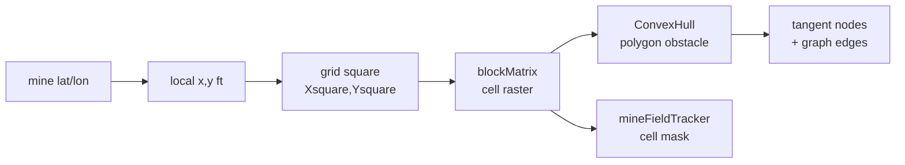
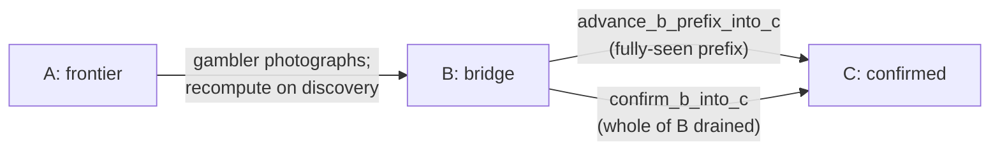
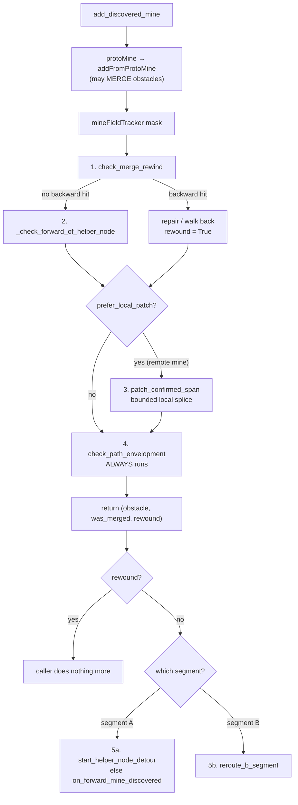
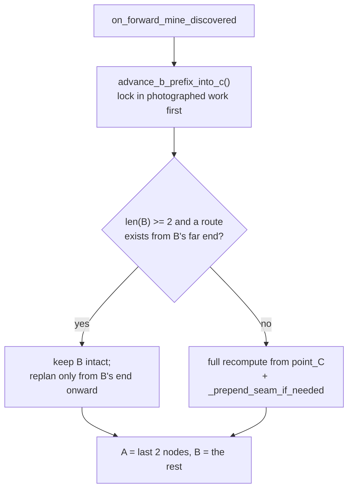
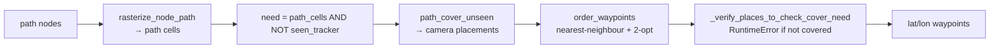
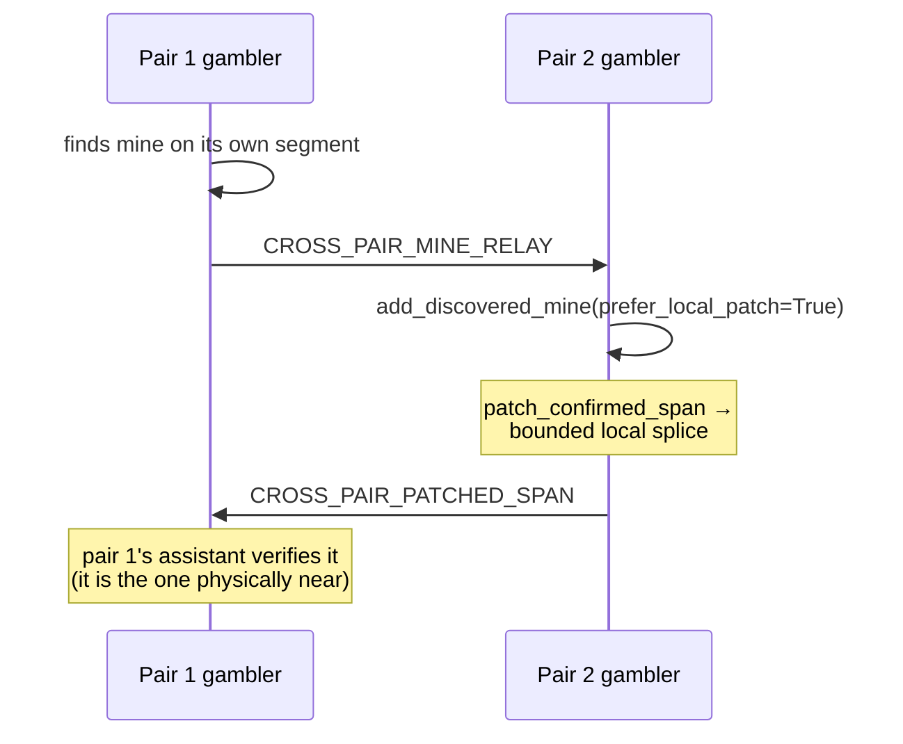
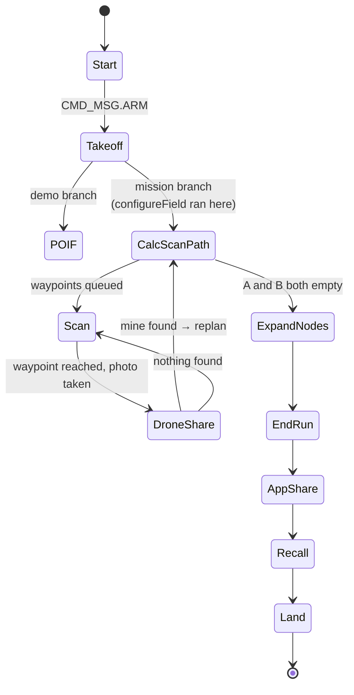

# Path planning algorithm — full walkthrough

Every claim here was checked against the source on branch `poif-test` at the time of writing.
Where behaviour was confirmed by running the simulation drivers, the measured numbers are given.
Line references will drift; treat them as starting points.

**Diagrams** are Mermaid (renders on GitHub) plus ASCII where geometry matters more than flow.

---

## 1. What the mission actually produces

Worth stating first, because it constrains every design choice below.

The deliverable is **not** a full-field survey. It is:

1. **One traversal corridor** across the field, every cell of which has been photographed, and
2. **the mine positions** discovered while verifying it,

emitted as an IARC text path: a start column, then run-length-compressed `U`/`D`/`L`/`R` grid
moves (`format_iarc_path`, `flight/pathfinder.py:174`).

```
S,20,0      <- start column 20, declared buffer width 0
U,38        <- 38 cells north
L,2
U,14
```

The arithmetic that rules out a lawnmower sweep: the field is 80 × 300 ft = 24,000 ft²; the
camera footprint with `OVERLAP = 0.1` covers roughly 44 ft² per photo, so full coverage is
~540 photos. At ~2.9 s per stop that exceeds the 420 s (`max_flight_time`) budget before
takeoff or landing. A corridor needs ~83–200 photos depending on mine density. **Corridor, not
sweep, is the correct framing** and the rest of the design follows from it.

---

## 2. Representations

Four coexist. Three are load-bearing; one is vestigial.

| Representation | Where | Role |
|---|---|---|
| **Node graph** (visibility graph) | `flight/pathfinding/nodeField/field.py` | The planner. Mines are polygon obstacles with tangent nodes; edges are line-of-sight; Dijkstra runs over it. |
| **CellField** (bit-packed grid) | `flight/pathfinding/cellField/` | Coverage bookkeeping. `seen_tracker` (photographed), `mineFieldTracker` (danger cells), and rasterisation of paths. |
| **protoMine.blockMatrix** | `flight/pathfinding/protoMine.py` | Per-mine local cell grid of which 2 ft squares the safety circle touches. The polygon hull is derived from it. |
| **BlockField** | `flight/pathfinding/blockField/` | **Vestigial.** Its only non-test importer is `protoMine.py:15`, `import *`, which uses only `np` from it. |

Grid constants: `WIDTHOFSQUARE = 2` ft, field `80 × 300` ft → a `40 × 150` cell grid.

### Coordinate flow for one discovered mine



Two things to know about this chain:

- The mine's position is **snapped to a grid square** before the polygon is built
  (`add_discovered_mine`, `pathfinder.py:559-565`), so the polygon is a hull of already-quantised
  cell centres — it is not a higher-resolution model.
- `mineFieldTracker` is **written on every discovery and read only by the GIF renderers** in
  `droneWorkflowTest.py`. It is debug state maintained on the flight path.

### The alignment invariant

`protoMine` sizes its grid as `safety_cells(radius) * 2 + 1`; `add_discovered_mine` derives the
grid's origin offset as `mid = safety_cells(radius)`. **Both must come from the same helper.**
When they diverged, every mine's danger zone — polygon and cell mask alike — landed 2 ft off
target at the live radius of 3 ft, and 4 ft at 1.5 m. `test_mine_grid_alignment` now pins this.

---

## 3. Field construction

`buildNodeField(startLocation, startEdge)` (`pathfinder.py:~438`):

- **One starting node**, a floating node at the drone's entry x, at `y = -1` for
  `startEdge="bottom"` or `y = HEIGHTOFFIELD + 1` for `"top"` — deliberately *outside* the field,
  matching the competition's "S is just outside" convention.
- **A row of 20 ending nodes** (`WIDTHOFFIELD // (WIDTHOFSQUARE * 2)`) across the far edge, at
  `x = i*4 + 1`. A redundant row, not a single target, so one walled-off column cannot strand the
  search.
- `_original_ending_nodes` keeps a copy as a fallback tier for the search.

### Two pairs: the midline boundary

For a 3- or 4-drone mission, `configureField` (`takeoff_impl.py:~230`) then calls
`set_cross_pair_home_boundary(HEIGHTOFFIELD / 2)` when `cross_pair_partner_id is not None`. That
**replaces** both `endingNodes` and `_original_ending_nodes` with a fresh 20-node row at the
midline, so each pair only targets its own half.

```
y=300  ┌────────────────────────────┐
       │   pair 2 ending row (far)  │  ← replaced
y=301  ●  pair 2 start (y=301)
       │                            │
y=150  ○──○──○──○──○──○──○──○──○──○ │  ← midline row: BOTH pairs target this
       │                            │
y=-1   ●  pair 1 start (y=-1)
y=0    └────────────────────────────┘
```

This replaced an earlier design in which each pair chased the other pair's current position by
repeated halving. That halving had no lower bound, so a pair stalled near its own start dragged
the other pair's target toward it — observed crossing the midline on 5 of 5 dense seeds, twice
all the way to the opposite edge. A fixed row has nothing to go stale.

**Known limitation, unchanged:** a pair that finishes its half early cannot help the other.
Measured load imbalance is ~21% of total work on average.

---

## 4. The A/B/C segment model

The core state. Three node lists, each with a distinct guarantee:

```
    point_C end          point_A
        │                   │
 C ═════●───── B ───────────●── A ──► (target row)
 frozen    bridge            approach
 verified  reroutable        frontier
```

| Segment | Field | Guarantee | Who flies it |
|---|---|---|---|
| **C** confirmed | `maze_confirmed_path` | Flown **and** photographed. Never rerouted. | done |
| **B** bridge | `maze_b_path` | Planned, safe against known mines, not yet fully photographed. Freely reroutable. | ASSISTANT |
| **A** approach | `maze_a_path` | The frontier — the last edge into unknown ground. | GAMBLER |

`get_maze_path()` returns `C + B + A`, dropping a duplicated boundary node only when it is
genuinely the same point. **This ordering matters**: anything appended to B still has A after it.

`start_maze_navigation()` (`pathfinder.py:950`) resets all of it and seeds `maze_a_path` with the
whole initial shortest path — the first pass treats everything as frontier.

### Progression



Only the **fully photographed** prefix of B folds into C. Partial coverage of the next edge does
not count, which is conservative in the right direction.

---

## 5. Mine discovery: the repair cascade

This is the most intricate part of the system. For **one** discovered mine, up to five repair
entry points run, in a fixed order that three separate docstrings state is load-bearing.

`add_discovered_mine(lat, lon, prefer_local_patch=False)` (`pathfinder.py:538`):



The caller-side branch is read off the waypoint name prefix (`drone_share_impl.py:116`):
`scan_A_` → Rule 1, anything else → Rule 2.

### The five repair entry points

**1. `check_merge_rewind(obstacle, was_merged)`** — the most targeted. Fires when a newly merged
obstacle invalidates a tracked helper node. Three backward triggers: node identity replaced,
node position now inside the obstacle, or the node's anchoring segment now crossed. On a hit it
tries a local repair (`_repair_helper_node_along_segment`), else walks back through earlier
entries for a safe anchor. If the affected entry is already in confirmed history it **defers** to
step 4 rather than splicing into frozen ground. Returns `rewound`.

**2. `_check_forward_of_helper_node`** — only if no backward trigger matched. A helper node's
*forward* connection can also be crossed; recompute from that node onward.

**3. `patch_confirmed_span`** — cross-pair only. For a mine relayed from the *other* pair, this
pair has usually moved well past the affected point, so a full recompute would discard real
progress. Pins the two boundary nodes around the hit and splices a local shortest path between
just those two. The resulting span is handed to the **discovering** pair to verify, since that
pair is physically nearby.

**4. `check_path_envelopment`** — the always-run catch-all, and the safety net for everything
above. Scans C, then B, then A, **index by index**, checking each node *and its outgoing edge*
together:

```
   for i in path:
       node inside new mine?           ─┐
       edge i→i+1 crossed by new mine? ─┴─► first hit in PATH ORDER wins
```

Checking them interleaved matters. Scanning all nodes first, then all edges, can find a
coincidental late node hit and leave an **earlier crossed edge sitting in confirmed history** —
observed as a real bad edge. On a node hit it strips the node's connections (`purgeConnections`
for a mine tangent node, which the obstacle still owns; `removeNode` for a floating/helper node)
so a recompute cannot pick it again. An edge hit needs no stripping — `Field`'s own
`_cleanupInvalidatedConnections` already removed it.

**5. Rule 1 / Rule 2** — the caller's own reaction, skipped entirely if `rewound`.

- **Rule 1, segment A**: try `start_helper_node_detour(obstacle)` first — a bounded detour around
  the mine from a photographed breadcrumb, capped at `MAX_CHAIN_DEPTH = 3` outstanding detours so
  the gambler cannot race arbitrarily far ahead of its assistant. If that returns False, fall
  back to `on_forward_mine_discovered()`.
- **Rule 2, segment B**: `reroute_b_segment()` — re-search C→A with **point_A held fixed**. A
  mine in B can only make the route more roundabout; it cannot move either endpoint.

### `on_forward_mine_discovered` — current behaviour



Both the fold-first step and the keep-B branch exist because the mine is on segment A — which is
*forward* of B, so B is still a valid route. Discarding it made the assistant chase a moving
target. Measured effect of the two changes together: photos relative to a solo drone covering
the same field went **1.83× → 1.58×**, and assistant distance **1857 → 1308 ft (−30%)**. The
full-recompute fallback means this can only preserve work, never strand it.

---

## 6. Coverage and waypoint generation



`get_places_to_check_maze` computes A and B separately and returns
`{"a": [...], "b": [...], "count": n}`. The role accessors slice that dict:
`get_gambler_places_to_check` → `"a"`, `get_assistant_places_to_check` → `"b"`.

**Coverage is subtracted before planning** (`path_cover_unseen`, `pathfinder.py:755`), so a
replan never re-photographs ground already in `seen_tracker`. This is why the assistant's rework
was travel and churn, not duplicate photography.

**TSP anchoring** differs between the two segments, deliberately:
- **B** anchors to `next_place_to_check_maze_b`, so a replan does not restart the tour from the
  far side.
- **A** anchors to `maze_a_path[0]` — point_A itself — *not* a remembered value. point_A is
  always A's near boundary by construction, so it cannot go stale. A stale anchor does not just
  cost one hop: `order_waypoints` seeds nearest-neighbour from it, so the tour can start at the
  far end and walk backwards (observed).

Coverage is recorded from the **true photographed footprint**, not the nominal one:
`accept_image_corner_coord` marks only cells **fully enclosed** by the ray-cast corners. `Scan`
climbs 0.5 m and retries (bounded by attempt count and `max_flight_height`) if the target cell
is not enclosed.

---

## 7. Safety checks — the full list

| Check | Where | Guards against |
|---|---|---|
| `_prepend_seam_if_needed` | `pathfinder.py:922` | An invented straight edge from point_C to a recomputed path's first node. Uses a **graph route**, because graph edges never cross known obstacles; an invented seam once cut ~38 ft through a known mine. |
| `check_path_envelopment` | always, per mine | Any node or edge in C/B/A invalidated by a new mine. The catch-all. |
| Interleaved node+edge scan | inside the above | An earlier crossed edge being missed because a later node hit short-circuited the scan. |
| `_verify_places_to_check_cover_need` | `pathfinder.py:746` | Generated camera placements failing to cover the cells they were computed for. Raises `RuntimeError` with sample missed cells. |
| `MAX_CHAIN_DEPTH = 3` | `start_helper_node_detour` | The gambler opening unbounded detours ahead of its assistant. |
| `MAX_EXPANSION_REPAIR_PASSES = 8` | `repair_path_after_expansion` | A non-terminating repair loop after the final radius expansion. **Caveat below.** |
| `PATH_HYSTERESIS_TOLERANCE = 0.03` | `_dijkstra_path_with_hysteresis` | The route flapping between near-tied ending nodes every replan, churning the drone's queue. |
| Search fallback tiers | `_dijkstra_path_with_hysteresis` | best → `_original_ending_nodes` → stable-previous, so an unreachable target row cannot collapse the path to empty. |
| `safety_cells` | `protoMine.py` | The two halves of a mine's geometry deriving different cell counts (caused a 2 ft offset). |
| Discontinuity guard | `format_iarc_path` | A reported path that silently skips real ground. Strict for sims/tests; logs for a live mission. |
| `_bad_edge_count` | test-side | The flown route's edge midpoints falling inside any live obstacle. The concrete form of "never enters a mine's danger radius". |
| `test_pair_stays_in_home_half` | test-side | A pair doing coverage work in the other pair's half. Excludes the seam run, which by design touches the boundary. |

---

## 8. Cross-pair coordination



The relayed mine has three possible effects on the receiving pair, all already handled:

1. **Crosses its confirmed history** → `patch_confirmed_span` splices locally; the discovering
   pair verifies the patch.
2. **Crosses its segment A** (not yet flown) → `record_remote_mine_on_segment_a` leaves a
   placeholder breadcrumb, no graph change. The gambler promotes it to a real detour if it
   reaches it; otherwise it goes stale harmlessly, because the mine is in the graph either way.
3. **Lands in its active segment B** → needs no new mechanism; the ordinary
   `check_merge_rewind` / `check_path_envelopment` already scan B for every mine.

### Closing the seam

Each pair stops at whichever midline ending node it reaches, so the two halves can stop in
different columns — measured as a nonzero gap in 3 of 8 seeds, up to 24 ft. For a deliverable
that must be one connected path, that is the one place a discontinuity cannot be tolerated.

`join_cross_pair_seam(other_endpoint)` closes it: no-op if already within one cell, otherwise
routes from this pair's own endpoint to the other's on the live graph, freezes the current route
as confirmed, and makes the seam the new segment B so it gets **photographed** rather than
assumed safe. Retry-bounded, because flying the seam can itself discover a mine and move the
endpoint again. Result: **0 of 8 seeds gapped**.

```
before                          after
pair1 ──────●                   pair1 ──────●══════●  seam flown + photographed
                 ●────── pair2                     ●────── pair2
        ↑ 24 ft gap ↑                       ↑ joined ↑
```

---

## 9. Mission lifecycle



Role split: **GAMBLER** flies segment A and owns the Pathfinder; **ASSISTANT** has no Pathfinder
at all and flies whatever segment-B waypoints its gambler hands it over
`SEND_SEGMENT_B_WAYPOINTS`, reporting photo footprints back via `SHARE_PHOTOS`; **SOLOGAMBLER**
flies both segments itself.

---

## 10. Known gaps in the algorithm as it stands

Stated plainly, because the walkthrough above would otherwise read as more finished than it is.
None of these are hypothetical; each was confirmed in the code or by measurement.

1. **`ExpandNodes` un-verifies the answer.** It grows every mine by
   `MINE_RADIUS_EXPANSION_FT = 2.0` (the source calls this "a placeholder guess") and repairs the
   route *after all flying is finished*. `EndRun` then reports that post-expansion route.
   Measured: mean 39.5 path cells unseen after expansion, nonzero in 15/15 seeds. The reported
   "safe" path crosses ground no camera photographed. Folding the 2 ft into
   `mine_safety_radius_ft` at discovery time would make the flown route already be the hardened
   route.
2. **`repair_path_after_expansion` cannot signal failure.** It returns `pass_num` on convergence
   **and** `MAX_EXPANSION_REPAIR_PASSES` when it exhausts the cap unconverged. The two are
   indistinguishable, and the caller only logs it.
3. **`Drone.mission_path` is not guaranteed continuous.** The new discontinuity guard caught it
   immediately in the 4-drone harness: `(15,-1) → (15,55)`, i.e. the reported path starts
   mid-field rather than at the field edge. The guard logs rather than raises on the flight path,
   so this is currently a known-wrong report, not a crash.
4. **Only drone 1 reports, and nothing merges the two halves.** Each pair's path is its own
   `mission_path`; there is no mission-level object combining them. The seam is now geometrically
   closed, but the *submitted artifact* is still one pair's half.
5. **`buffer_width` is always 0** at every call site, so the declared safety corridor is zero
   regardless of the geometry computed.
6. **Load balancing is absent.** A pair finishing early cannot help the other; ~21% mean
   imbalance, and the busiest-drone workload ranged 28–74 photos against a mean of 38.
7. **`mineFieldTracker` and `BlockField` are dead weight** on the flight path (debug-only, and
   a 454-line unused representation star-imported for `numpy` respectively).

---

## How to re-verify this document

```bash
# safety gate: both two-pair drivers, all five defect counters
python -c "import sys; sys.path[:0]=['.','flight/pathfinding/tests']; \
  import flight.pathfinder, droneWorkflowTest as d; \
  d.sweep_two_pairs(driver='rr', n_seeds=25, shape_size_ft=(6.0,4.0)); \
  d.sweep_two_pairs(driver='seq', n_seeds=25, shape_size_ft=(6.0,4.0))"

# end-to-end through the real state machine
python -m integration_tests.one_drone_sim_test
python -m integration_tests.multi_drone_sim_test
```

A clean gate is every counter `0`: `exceptions`, `hit_cap`, `coverage_fail`, `bad_edges`,
`home_half`. Anything else is a real finding — track it to a seed before trusting the code.
