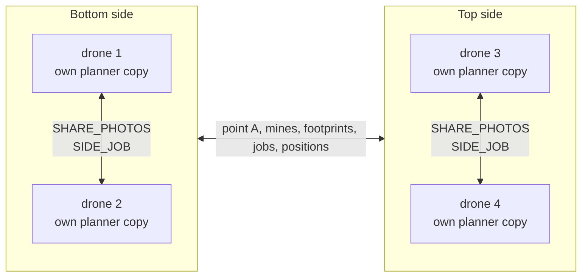
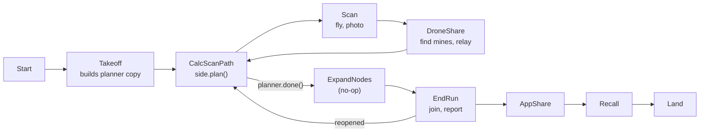
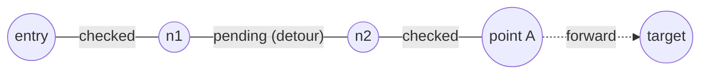
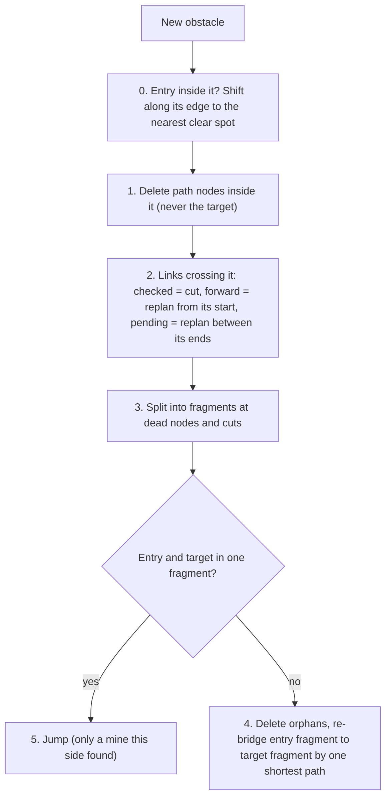
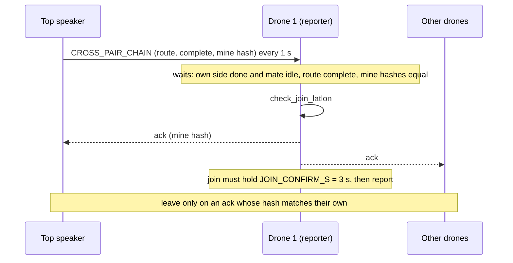
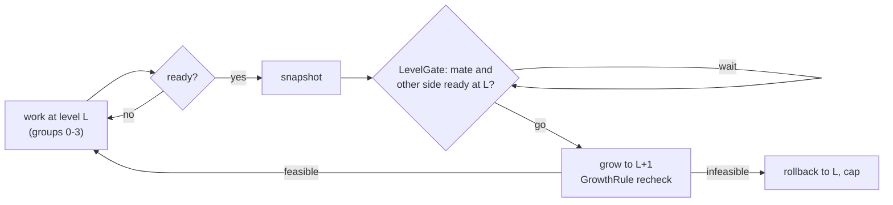
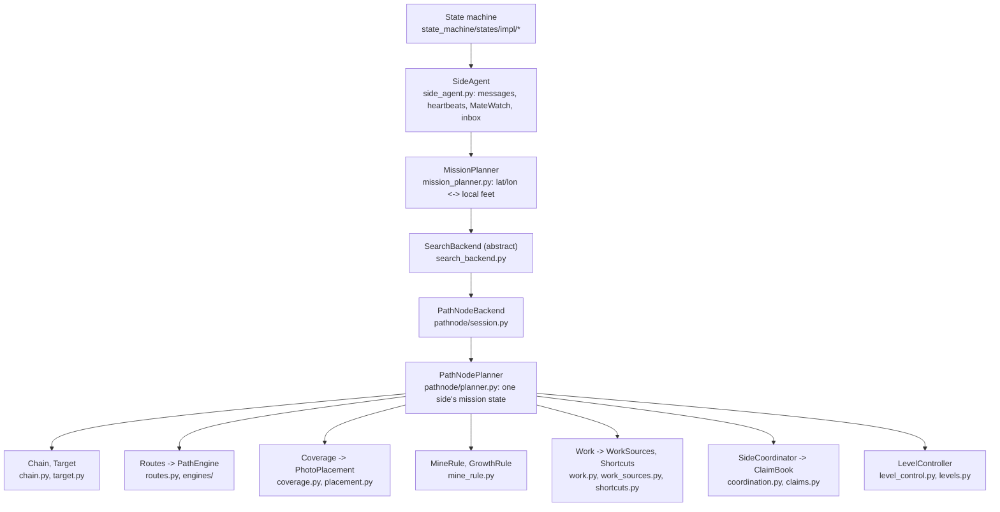

# The mine-field search algorithm

**What this is.** What the drones do to find a route across the mine field, why, and which
invariants keep it safe. For a new team member who knows Python and the competition (report a
safe, verified route across an 80 x 300 ft field) but not this code.

**Not here.** Module structure and how-to recipes: [docs/architecture.md](docs/architecture.md).
The code run state by state: [docs/walkthrough/](docs/walkthrough/README.md). Groups and claims in
depth: [docs/priority_groups.md](docs/priority_groups.md). Expanding mines design:
[docs/design/expanding_mines.md](docs/design/expanding_mines.md). Tests: [docs/testing/](docs/testing/README.md).

Paths are under `flight/pathfinding/` unless they start with `state_machine/`. Units are local
feet (origin bottom-left, x across 0-80, y along 0-300). Squares are 2 ft (`CELL`).

---

## 1. The mission and the two sides

- **Goal:** one path from one edge to the other, made only of photographed ground, clear of every
  mine found. A mine's zone = the squares a 3 ft circle around it touches (`SAFETY_RADIUS_FT`;
  13 squares). A square counts as photographed only if one photo covers all of it.
- **Sides (4 drones):** drones 1-2 = bottom side (enter at y = 0), 3-4 = top side (y = 300). Each
  side builds a route from its edge toward the other side's frontier, **point A**; the halves meet
  in the middle and are joined. With 1-2 drones there is one side, aiming at the far edge.

**No roles.** Every drone keeps its own copy of its side's planner
(`MissionPlanner` -> `pathnode/session.py` -> `PathNodePlanner`) and works out the claims for the
whole side itself. `side_agent.py` (`SideAgent`) does the messaging; the planner knows no network.

**How copies stay in agreement** (they differ only while messages are in flight):

| Mechanism | What | Where |
|---|---|---|
| Same events | Each drone applies its own photos and sends each to its mate (`SHARE_PHOTOS`); the mate applies it as its own | `SideAgent.own_photo`, `PathNodeBackend.mate_photo` |
| Announced jobs | Each drone announces its current job (`SIDE_JOB`, every 1 s); the mate's copy never hands that job to anyone else | `Heartbeats.announce_job`, `ClaimBook.update(held=)` |
| Determinism | Same events in, same chain, groups and claims out; ties by drone id, then position | section 9 |
| Speaker | Lowest-id live drone of a side speaks for it: point A (on change or every 1 s), full mine list (every 5 s) | `MateWatch.speaker`, `Heartbeats.send` |
| Mine hash | Order-independent hash of known mines and level, compared before the final join | `PathNodePlanner.level_hash` |

Messages to the other side go to all its drones (each copy hears them). Mines and footprints are
relayed by whichever drone found or took them. The receiver retargets its forward gap at the
streamed point A (`set_partner_point_a`); before the first one, the target is the partner's entry.
A side is **met** when its chain reaches the target (`PathNodePlanner.met`).

**Inbox order** (`inbox.py`, fixed): other side's mines, then the mate's photos, then the other
side's footprints, then its point A. A node must never be laid on ground about to turn unsafe.

Every drone replans after every photo (the target keeps moving). Past `max_flight_time`
(`60 * 7`, `state_machine/flight_settings.py`) the scan states go straight to `EndRun`.

---

## 2. The chain

`Chain` (`pathnode/chain.py`): the route so far, as path nodes joined by links.

| Piece | Meaning |
|---|---|
| Path node | A point on the route; `placed_by` = entry, forward, span, jump, shortcut or target (`Placer`) |
| Checked link | Photographed ground |
| Pending link | A planned detour around a mine, not yet photographed |
| Forward link | Point A to the target: the gap still to explore. At most one |
| Point A | The node before the forward link (the frontier). Once met, the target itself |
| Target | Virtual end node. Never laid, never deleted by a mine |

Invariant (`Chain.check`): `links[i]` joins `nodes[i]` to `nodes[i+1]`, polylines start and end there.

**Targets** (`pathnode/target.py`, picked by `make_target`):

| Target | When | Aims at |
|---|---|---|
| `FarEdgeTarget` | No partner side | Far edge: straight ahead if clear, else the shortest far-edge point |
| `PartnerTarget` | Partner side exists | Partner's latest point A. If that is inside an obstacle this side knows, heads for the nearest corner (the partner re-places its point A outside) and `may_close()` is False meanwhile, so the gap never closes on a stand-in |
| `LostPartnerTarget` | Partner gone | Its last point A (ground already checked), ignores later ones, then `after_met()` hands over to `FarEdgeTarget` |

**How photos advance links** (`PathNodePlanner.advance`, `Chain.advance_link`):
1. After each photo, `advance()` walks the forward link from point A and every pending link from its start.
2. The link is sampled every `SAMPLE_FT` = 0.5 ft. The longest prefix whose samples pass
   `Coverage.all_seen` becomes checked links and nodes; the rest stays the same `Link`.
3. A fully checked link converts. The gap is not closed while `target.may_close()` is False.
4. Then shortcuts update (section 4.2) and `_follow_target` hands over to the next target kind.

**What "checked" requires** (`pathnode/placement.py`, `PlannerConfig.coverage`):

| Mode | A stretch needs photographed |
|---|---|
| `CORRIDOR` (default, `CorridorPlacement`) | Every square the polyline touches |
| `BAND` (`BandPlacement`) | Those, plus the 13 squares around each from which a mine could make it unsafe (`DANGER_OFFSETS`) |

---

## 3. Mines

### 3.1 Zones and the path engine

A mine snaps to its square's centre; its zone is whole unsafe squares (convex hull). Touching
zones merge into one group (gid). Obstacles = mine zones and **blocked squares**. `Routes`
(`pathnode/routes.py`, caches) asks a `PathEngine` (`pathnode/engines/base.py`) for everything:

| Engine | Where | Status |
|---|---|---|
| `ZoneMap` | `pathnode/engines/zonemap.py` | Default (`PlannerConfig.engine`) |
| `Field` | `nodeField/field.py` | Same contract; selectable, not default |

Contract the planner relies on: **monotone** (an obstacle or a higher level never shortens a
path), **deterministic**, queries never change obstacles
([docs/design/search_backend_interface.md](docs/design/search_backend_interface.md)).

### 3.2 The mine rule

`MineRule` (`pathnode/mine_rule.py`), entry `apply(pl, gid, source)`; runs for every new mine and
blocked square, after the footprint is recorded and before `advance()`.

| Step | Detail | Method |
|---|---|---|
| 0 | No clear spot on the edge: `failure = "entry fully blocked"` | `_clear_entry`, `_shift_entry` |
| 2 | A replan with no route cuts the link instead | `_cut_checked`, `_replan_forward`, `_replan_pending` |
| 3 | Fragments connected to neither root (entry, target) are orphans, deleted even if outside the obstacle | `_split_into_fragments` |
| 4 | Bridge = a pending span, or the forward gap if the far side is just the target. Walled in: entry moves to the nearest edge spot with a way out; none: `failure` | `_rebridge`, `_reroute_from_entry` |
| 5 | Chain still whole and forward link replanned: point A **jumps** to the last corner of this mine the route bends around; the detour behind it becomes a pending span | `_jump_past_mine`, `_frontier_links` |

**Jump vs re-bridge** (`Source`, `pathnode/config.py`):

| Source | Who | Effect |
|---|---|---|
| `PAIR` | This side's own drones, including mate photos (`PathNodeBackend.mate_photo`) | May jump: the frontier moves past the mine at once |
| `PARTNER` | Relayed by the other side; also every blocked square and every growth | Only re-bridges: the other side owns that frontier |

If no route is left, `failure` is set and the planner stops planning (at level 0 that is final).

### 3.3 Blocked squares: misses

`Coverage.count_misses` (`pathnode/coverage.py`). A needed square a photo was aimed at but did not
cover (footprint turned with heading, came out smaller, camera failed) gets a **miss**. A
climb-and-retry at one waypoint counts once.

| Misses | Constant | Effect |
|---|---|---|
| 1 | `MISS_CENTRE` | Next photo of that square is centred on it |
| 3 | `MISS_BLOCK` | `_block_square`: the square becomes an obstacle (`Routes.add_square`) and the mine rule runs on it as `Source.PARTNER` |

**Aim memory** (`Coverage.plan_aim`, cap `AIM_CAP` = 5000): each photo point remembers the squares
it was planned for, so a miss is charged correctly even when a planned square sits farther than
`aim_radius` from the photo. Blocked squares never grow with levels.

---

## 4. Work

### 4.1 Priority groups

`PathNodePlanner.groups()` -> `Work` (`pathnode/work.py`) -> `WorkSource`s
(`pathnode/work_sources.py`). A group is a list of `(key, sequence)`: the photos along one path in
flying order, or one free-standing photo (`key = None`).

| Prio | `Group` | Source | Contents | Key |
|---|---|---|---|---|
| 0 | `PATH` | `PathSource` | Forward gap and every pending span: what one valid path needs | `"forward"`, `("span", end_xy)` |
| 1 | `BIG_SHORTCUT` | `ShortcutSource` | Big shortcut being tried (before `ADJACENT`, so squares beside a section about to be replaced are not photographed for nothing) | `("shortcut", a, b)` |
| 2 | `ADJACENT` | `RingSource` | Unphotographed squares within `adjacent_ring` = 1 of the checked route | `None` |
| 3 | `SHORTCUT` | `ShortcutSource` | Ordinary shortcut being tried | `("shortcut", a, b)` |
| 4 | `OUTER` | `RingSource` | Next layer out, within `outer_ring` = 2 | `None` |

**Work keys** name a job by geometry (a span by its far end, a shortcut by its two anchors), never
by object id, so every copy keys the same job the same way. Ring squares inside an obstacle are
skipped. Work is cached on `Work.state_key`; source order in `Work.__init__` is behaviour.

### 4.2 Shortcuts

`Shortcuts` (`pathnode/shortcuts.py`) replaces a fully checked section with a shorter path.
- **Anchors:** entry, jump nodes, nodes on an obstacle corner, and the target once met. Never entry + target.
- **Tiers:** `BIG` = shorter than 0.8 x the section and saves >= 20 ft (group `BIG_SHORTCUT`);
  `ORDINARY` = shorter than 0.9 x and saves >= 4 ft (`SHORTCUT_MIN_SAVING_FT`) (group `SHORTCUT`).
- **Allowance:** the larger of `shortcut_max_waypoints` (8) and one photo per `shortcut_ft_per_photo` (2 ft) saved.
- **Free shortcut:** needs no photos, so it is spliced in at once, biggest saving first (`_apply_free`).
- **Trial:** otherwise one per tier at a time, biggest saving first. The chain is untouched until
  the whole shortcut is photographed and clear of every obstacle.
- **Greedy:** recomputed after every change. A big trial no longer big drops to ordinary; one
  that no longer qualifies, or needs too many photos, is given up for good (`given_up`).

---

## 5. Who flies what

### 5.1 Claims

`ClaimBook.update` (`pathnode/claims.py`) turns groups into one queue per drone.

| Rule | What |
|---|---|
| Whole sequences | A sequence is claimed whole; splitting a path only sends the second drone to ground the first will cover |
| Soonest start | Picture a radius growing from 0. Repeatedly, the drone that can *start* an unclaimed sequence soonest takes it, measured from where it is through everything it already holds. Ties: drone order, then start point |
| Priority | Groups dealt in order; a drone flies all it holds in a higher group first, and takes from a lower group when it has nothing left higher |
| Forward last | Within a group, whole paths nearest-start first, except `"forward"` (open-ended), which goes last |
| Only the current job is sticky | Between passes only the sequence each drone's next photo belongs to (`heads`) keeps its owner; the rest is dealt afresh from current positions |
| Announced jobs held | The mate's announced job stands in for its `heads` on every copy; if two drones hold one job, the lower id keeps it |

Result: whoever is at point A holds the whole path ahead; redirections behind it tend to go to
the other drone.

### 5.2 Keeping apart

`SideCoordinator.plan` (`pathnode/coordination.py`) runs the claims, then these rules. Lower ids
keep their ground (every bottom drone is lower than every top drone), so two drones cannot block
each other.

| Distance (`PlannerConfig`) | Rule |
|---|---|
| `keep_away_ft` = 10 | A higher-id drone drops photos within 10 ft of a lower-id drone's position and next photo (when that drone is working). Also across sides |
| `keep_clear_ft` = 7.5 | A lower-id drone drops photos within 7.5 ft of a higher drone's position; also used for an idle lower drone. Must stay above the flight separation floor (`SEPARATION_ABORT_M` = 1.2 m) and the leg-hold radius (`COLLISION_RADIUS` = 2.01 m = 6.6 ft) |

- **Legs and lanes** (`_flyable`): a photo is also dropped when the leg to it passes within
  `keep_clear_ft` of another drone, or within `keep_away_ft` of a lower drone's **lane** (where it
  is, then its next `LANE_PHOTOS` = 3 photos). Dropped photos stay work for later.
- **Takeover when idle** (`_take_over`): if this copy gives `me` nothing to fly, `me` takes the
  others' queued photos, except every sequence a mate announced. The mate's copy may lack that
  work while messages are in flight, so nobody else would do it.
- **Make way** (`_make_way`): a drone with nothing it may fly moves to a spare spot (last group,
  on ground needing no photo, clear of jobs and drones) when it blocks someone: a lower drone's job
  within `keep_away_ft`, a higher drone's within `keep_clear_ft`, or it stands within
  `keep_clear_ft` of another drone's leg (which the flight code would hold forever).

### 5.3 Lost and gone mates

`MateWatch` (`mate_watch.py`). A silent drone is never assumed gone at once (a starved event loop
or a radio dropout leaves it flying).

| State | Trigger | Effect |
|---|---|---|
| lost | Silent `MATE_LOST_S` = 20 s | Its work is taken over; its last position and announced job keep blocking and that job's sequence stays reserved. Heard again: an ordinary mate at once. Does not gate level climbing |
| gone | Silent `MATE_GONE_S` = 120 s | Ignored entirely |
| landed | Announced `MISSION_END` | Lost and gone at once, for good |

The speaker is the lowest-id drone still heard from. A drone that starts after its mate waits to
hear it, and the higher id waits for its mate's first job announcement, so both never start the
same job. The other side's drones keep blocking from their last position and job until silent
`MATE_GONE_S`. When all of them have landed or gone silent, `SideAgent.partner_lost` calls
`planner.partner_lost()` once (target becomes `LostPartnerTarget`).

---

## 6. Finishing

| Check | Meaning |
|---|---|
| `met` | The forward gap is closed |
| `route_verified()` | Met and every link checked: **safe to report**, even with optional work left |
| `done()` | Met, nothing pending, no `ADJACENT` / `OUTER` work, no shortcut left to try |

`CalcScanPath` goes to `ExpandNodes` then `EndRun` on `done()`. The top side's chain message is
marked complete when `route_verified()`.

### 6.1 Joining the two halves

Handshake: `state_machine/states/impl/end_run_impl.py`. Geometry: `pathnode/join.py`, `PathNodePlanner.check_join`.

- **`join_routes`:** each side stops at the other's point A, a point on the other's route. Join =
  own route up to the first shared point, then the partner's route backwards from there.
- **Fallback bridge** (`join.join`): under heavy loss the halves may overlap without sharing a
  point. The closest pair within `MAX_BRIDGE_FT` = 30 is bridged by a straight line **only if** it
  crosses no obstacle and every square on it is photographed.
- **Crosswise meeting and reopen** (`check_join`): if both sides met on a point A the other has
  abandoned and the halves do not connect, the **bottom side yields**
  (`Edge.yields_in_crosswise_join`): it turns its target into a node and opens a forward gap to
  the partner's route end (`_reopen_toward`); `done()` goes False and `EndRun` returns to
  `CalcScanPath`. The top side only waits, so the two never chase each other.
- **Hashes must match:** no mine still in flight may lie on the joined route. A mine arriving
  after a join drops it unless it still clears every known mine. Speakers resend the full mine
  list every 1 s while waiting.
- **Timeout / partner gone:** past the flight budget (+ `JOIN_GRACE_S` = 10 s) drone 1 reports
  what it has. With the other side gone, the side first reopens to check the lost half, then
  reports its own route and sets `Drone.reported_half_route`. A relayed mine after `done()`
  reopens the side too.

### 6.2 What drone 1 reports

Drone 1 holds the app link (`REPORTER_ID`). `AppShare` writes the path in the IARC format
(`iarc_report.py`, `format_iarc_path`): `S,<start_col>,<buffer_width>` then `U,9`, `L,1`, ...
- The route is rasterized to 2 ft squares and run-length encoded as `U/D/L/R`. A virtual entry
  square just outside the nearer edge is prepended so the first command enters the field.
- A discontinuity is logged, not raised, in flight (raising out of `EndRun` would leave the drone hovering).
- **Today `buffer_width` is always 0:** `AppShare` calls `get_mission_iarc_path()` with no
  argument. It is written to the `S` line, not enforced. Section 7.4 says where it will come from.

---

## 7. Expanding mines

**Status: built in the planner, backend and simulator; NOT wired into the flight code.**
`ExpandNodes` is a no-op, `MissionPlanner.expand_margin` does nothing, and no flight state calls
`try_advance_level`. Not built: the level message and heartbeats, `SideAgent` gating, `CalcScanPath`
/ `EndRun` changes, the level field in the chain message, `buffer_width` in the report, the
partner-lost trigger for levels. Flights today run at level 0. Simulator: `pathnode/sim_levels.py`
(`Mission(levels=True)`). Design: [docs/design/expanding_mines.md](docs/design/expanding_mines.md).

**Idea.** Mines may be bigger than assumed. Once a complete route exists, every zone grows by
steps, the route is repaired and rechecked each step, and the last route that survived is reported
with its measured clearance.

| Piece | What | Code |
|---|---|---|
| Level | Growth steps done. A zone at level k = level-0 hull plus a **diamond (city-block) of radius 2k ft**: 2 ft more per axis per level, nothing extra on diagonals | `PathEngine.set_level`, `STEP_FT`; `engines/base.py` |
| Blocked squares | Never grow | `engines/base.py` |
| Absolute | `set_level(k)` depends only on (mines, squares, k): a lower k is an exact rollback; later mines are built at the current level | `engines/zonemap.py` |
| Ready | Groups 0-3 (`IMPORTANT`) empty, met, nothing pending, no shortcut trial live. `OUTER` not required | `LevelController.ready` (`pathnode/level_control.py`) |
| Snapshot | Frozen complete route at one level: level, seq, route, cell path, mine hash, time, `spans` (runs edge to edge). A late mine at the same level can force another | `Snapshot` (`levels.py`), `LevelController.snapshot` |
| Valid | No known mine on the snapshot's cell path (mines in the buffer are fine) | `SnapshotBook.valid_snapshots` |
| Unsafe counter | Squares of a snapshot that later fell inside a zone, kept beside the frozen snapshot | `SnapshotBook.unsafe` |

### 7.1 Growth rule

`GrowthRule` (`mine_rule.py`, a `MineRule`), run by `LevelController.grow` after `set_level(L+1)`:
- All zones grew at once: no gid, no jump (`Source.PARTNER`); steps 0-3 as in section 3.2.
- **Per-gap bridging:** every fragment is kept and each consecutive pair is bridged by its own
  shortest path (a pending span; the gap before the target stays forward). The single-mine rule
  would collapse orphaned stretches.
- A gap with no route makes the level **infeasible**: the chain is restored (`GrowthResult`), the
  zones go back to L and the copy is **capped** at L for good (`rollback`).
- Bridges are ordinary pending work; the copy is not ready again until they are photographed.

### 7.2 Lockstep

`LevelGate` (`levels.py`): no decider; every copy applies one rule to the announced `LevelState`s
(side, drone, level, ready, capped, seq; an older seq is ignored). For a copy, in order:
1. Not ready: `NOT_READY`. Capped: `AT_CAP`.
2. A peer capped at this level or lower: `PEER_CAPPED` (no point climbing).
3. A live side-mate not ready at L or past it: `WAIT_MATE`.
4. With a partner side, no drone of it ready at L or past: `WAIT_OTHER`. Unknown is never ready.
5. Else `GO` (the caller may also cap with `max_level`).

Sides differ by at most one working level. A lost other side is dropped from the gate
(`partner_lost`). `growth_fits(remaining)` skips a step when remaining time < `TIME_MARGIN` (1.5)
x the last growth + recheck time; the clock belongs to the caller.

### 7.3 Late mines and stuck

- **Late mine at level > 0 leaves no route** (`after_obstacle`): `recover()` steps down level by
  level, rebuilding the chain from the newest snapshot at or below it and rechecking with
  `apply_growth`, until a route survives; the copy is capped there. Level 0: the failure stands.
- **Stuck** (`LevelController.stuck`): grown level, not met, aiming at a point A it cannot close
  on, nothing left to photograph (growth walled the sides apart). After `STUCK_PASSES` = 20 passes,
  `recover()` steps down a level.

### 7.4 Reporting

- `report_route`: the **newest valid snapshot** (after the partner is lost, the newest valid one
  with `spans`). None valid: the live route if verified, else the newest snapshot, else the live route.
- `buffer_width` (`levels.clearance`): city-block distance in squares within which the reported
  cell path has no known mine = (smallest distance from a mine's square to the path) - 1. 0 = a
  mine next to the path, -1 = on it; no mine known: `cols + rows`. This is the `S` line's number.
- `join_at(level, partner_route, partner_hash)`: valid snapshot at `level` joined with the
  partner's. Equal mine-and-level hash: only the join is checked. Otherwise the joined route must
  also clear all known mines' zones at `level` (`clears_at`).
- **Lost partner:** `Target.lost()` and the gate stops waiting; this side's snapshots span the field.

---

## 8. The layers

Calls go down only. Events in (own photo, mate photo, partner mine, footprint, point A) go through
`SearchBackend`; per photo: `record_footprint`, `add_mine`, `advance()`. Plan out: `plan(...)`
returns one queue per drone. The simulator (`pathnode/sim.py`) drives the same backend. Detail and
recipes: [docs/architecture.md](docs/architecture.md).

---

## 9. Invariants and tunables

### 9.1 Invariants

- **Mines before nodes:** per photo, footprint, then mines, then `advance()` (`session.py`); the inbox applies the other side's mines first.
- **The route never crosses a known mine:** the mine rule repairs on every obstacle; `join` and `partner_route` return None for a crossing route.
- **Checked = photographed:** links turn checked only through `Chain.advance_link` over squares `Coverage.all_seen` accepts.
- **Adding an obstacle never shortens a path:** engine monotonicity; `Routes` drops only cached routes the new obstacle crosses.
- **Copies are deterministic:** same events give the same chain, groups and claims (engines, `PhotoPlacement`, geometric keys, id tie-breaks).
- **A snapshot is never modified** (frozen); changing counters live in `SnapshotBook`.
- **Rollback is exact:** `set_level` is absolute; shrinking zones keeps every existing route valid.
- **One level apart at most:** `LevelGate`.
- **A mine in an already-mined square is the same mine** (`add_mine` dedupes by square).
- **Jump only on a mine this side found** (`Source.PAIR`).
- **Only the current job is sticky; announced jobs are held** (`ClaimBook`).

### 9.2 Tunables

`PlannerConfig` (`pathnode/config.py`, frozen; flight uses the defaults except the camera footprint):

| Name | Value | Meaning |
|---|---|---|
| `shape_size_ft`, `overlap` | (6.0, 4.0) default, 0.1 | Photo footprint (along y, across x), overlap along a path. Flight passes the camera footprint from `calc_scan_path_impl.py` |
| `coverage` | `CORRIDOR` | What makes a link checked |
| `adjacent_ring`, `outer_ring` | 1, 2 | Reach of `ADJACENT`, `OUTER` |
| `shortcut_ratio`, `big_shortcut_ratio` | 0.9, 0.8 | Shortcut tiers (None = off) |
| `big_shortcut_saving_ft` | 20.0 | Big shortcut minimum saving |
| `shortcut_max_waypoints`, `shortcut_ft_per_photo` | 8, 2.0 | Shortcut photo allowance |
| `keep_away_ft`, `keep_clear_ft` | 10.0, 7.5 | Section 5.2 |
| `engine` | `"zonemap"` | Path engine |

Constants and timers:

| Name | Value | File |
|---|---|---|
| `CELL`, `SAFETY_RADIUS_FT` | 2 ft, 3 ft | `pathnode/geometry.py` |
| `SAMPLE_FT`, `TILE_MARGIN_FT` | 0.5, 0.5 ft | `pathnode/config.py` |
| `MISS_CENTRE`, `MISS_BLOCK` | 1, 3 | `pathnode/config.py` |
| `MAX_BRIDGE_FT`, `SHORTCUT_MIN_SAVING_FT` | 30 ft, 4 ft | `pathnode/config.py` |
| `MATCH_FT`, `LANE_PHOTOS` | 2 ft, 3 | `claims.py`, `coordination.py` |
| `STEP_FT`, `TIME_MARGIN`, `STUCK_PASSES` | 2 ft, 1.5, 20 | `engines/base.py`, `levels.py`, `level_control.py` |
| `MATE_LOST_S`, `MATE_GONE_S` | 20 s, 120 s | `mate_watch.py` |
| `JOB_HEARTBEAT_S`, `POINT_A_HEARTBEAT_S`, `MINE_SYNC_S` | 1 s, 1 s, 5 s (1 s in `EndRun`) | `heartbeats.py`, `end_run_impl.py` |
| `CHAIN_RESEND_S`, `JOIN_CONFIRM_S`, `JOIN_GRACE_S` | 1 s, 3 s, 10 s | `end_run_impl.py` |
| `max_flight_time` | `60 * 7` | `state_machine/flight_settings.py` |

---

## Where to read next

1. [docs/architecture.md](docs/architecture.md): modules, parent classes, how-to recipes.
2. [docs/walkthrough/](docs/walkthrough/README.md): one run, state by state (chapters 5 and 9: the mine rule and the meeting).
3. [docs/priority_groups.md](docs/priority_groups.md): groups and claims with figures.
4. [docs/design/expanding_mines.md](docs/design/expanding_mines.md): expanding-mines design (section 10 decides).
5. [docs/design/search_backend_interface.md](docs/design/search_backend_interface.md): the backend and engine contract.
6. [docs/testing/README.md](docs/testing/README.md): what to run after which change.
7. Code, in order: `pathnode/chain.py`, `mine_rule.py`, `claims.py`, `coordination.py`, `side_agent.py`, `level_control.py`.
