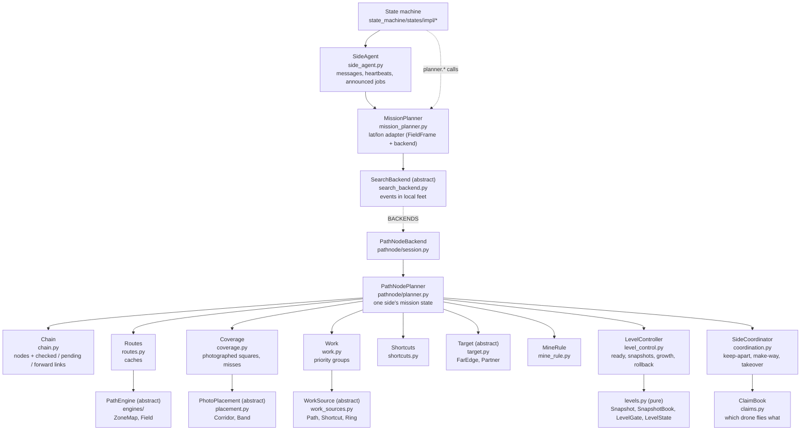

# Architecture: how the path-node planner is built

**What it does.** One side of drones (1-2 drones from one field edge) plans a safe route across a
mine field. It lays a chain of path nodes, lists the photos still needed to prove each stretch is
mine-free, splits that work between the side's drones, and repairs the route when a photo
reveals a mine. Everything runs in local feet; the flight code wraps it in lat/lon.

Each piece below is one small module. Where there is more than one way to do a job, the module
has an abstract parent class and the planner talks only to that parent.

For depth: [walkthrough](walkthrough/README.md) (the code, step by step, with toy runs),
[priority_groups.md](priority_groups.md) (work groups and claims),
[design/search_backend_interface.md](design/search_backend_interface.md) (the `PathEngine`
contract in detail). All paths below are under `flight/pathfinding/` unless noted.

## Layers

- **Top to bottom** is the call direction; nothing below `PathNodePlanner` calls back up.
- **Events in** (a photo, a mine, a partner message) go `SearchBackend` (here `PathNodeBackend`)
  -> `PathNodePlanner`:
  `record_footprint`, then `add_mine`, then `advance()`.
- **Plan out**: `PathNodePlanner.plan(...)` -> one photo queue per drone.
- `pathnode/config.py` holds the shared names (enums `Edge`, `LinkKind`, `Group`, `Tier`,
  `CoverageMode`, and `PlannerConfig`). `pathnode/geometry.py` holds only constants and cell
  helpers.

## Extension points

Each abstract class below is one decision the planner makes in more than one way.

| Parent (file) | Subclasses today | A new subclass must provide | Chosen / registered |
|---|---|---|---|
| `SearchBackend` (`search_backend.py`) | `PathNodeBackend` (`pathnode/session.py`, default) | The whole contract in the file's docstrings: events in (`own_footprint`, `own_photo`, `mate_photo`, `failed_photo`, `partner_*`), work (`assignments`, `current_job`), results (`failure`, `met`, `done`, `route_verified`, `point_a`, `route`, `join`, `crosses`, `mines`, `mine_hash`, `cell_seen_at`), the expanding-mines level API (`level`, `level_state`, `hear_level_state`, `try_advance_level`, `growth_fits`, `valid_snapshots`, `report_route`, `report_valid`, `join_at`, `buffer_width`, `partner_lost`), all in local feet | `BACKENDS` in `search_backend.py`; `make_backend(name, ...)`; `make_planner(..., backend="name")` / `MissionPlanner(..., backend=)` / `Mission(..., backend=)` |
| `PathEngine` (`pathnode/engines/base.py`) | `ZoneMap` (default), `Field` (`nodeField/field.py`) | Obstacles plus shortest paths: `add_mine`, `add_square`, `resolve`, `contains`, `crosses`, `shortest_path`, `corners`, `last_added`, `obstacle_shapes`, and growth: `set_level(k)` / `level` (zones after k steps of `STEP_FT` = 2 ft, absolute so a lower k is a rollback) (contract in the file's docstring) | `ENGINES` in `pathnode/engines/__init__.py`; `PlannerConfig.engine` is the name |
| `PhotoPlacement` (`pathnode/placement.py`) | `CorridorPlacement` (default), `BandPlacement` | `need(poly)` (squares the stretch needs photographed) and `_place(poly, need, plan)` (photo centres in walking order that cover them) | `PLACEMENTS` in `placement.py`, keyed by `CoverageMode`; `PlannerConfig.coverage` |
| `WorkSource` (`pathnode/work_sources.py`) | `PathSource`, `ShortcutSource`, `RingSource` | `group` (a `Group`), `entries()` (list of `(key, photo sequence)`), `needs()` (squares still wanted) | list built in `Work.__init__` (`pathnode/work.py`); order is behaviour |
| `Target` (`pathnode/target.py`) | `FarEdgeTarget` (1-2 drones), `PartnerTarget` (3-4 drones), `LostPartnerTarget` (partner gone: its last point A, then the far edge) | `has_partner`, `route_from(frm)`, `may_close()`, `retarget(point)`; optionally `lost()` and `after_met()` to hand over to another Target | `make_target(...)` in `target.py`, called by `PathNodePlanner.__init__` |

Not abstract, but a single place to look for each:

- **Repairing the chain on a new obstacle**: `MineRule` (`pathnode/mine_rule.py`), entry point
  `apply(pl, gid, source)`; one method per step (`_clear_entry`, `_delete_nodes_inside`,
  `_repair_links`, `_split_into_fragments`, then `_jump_past_mine` or `_rebridge`).
- **Expanding mines (levels)**: `LevelController` (`pathnode/level_control.py`, `planner.levels`)
  runs ready -> snapshot -> grow (`routes.set_level(L + 1)`, `mine_rule.apply_growth`) -> rollback
  on an infeasible level. Its pure parts are in `levels.py`: `Snapshot` (frozen), `SnapshotBook`
  (validity against the known mines, latest valid, `buffer_width`), `LevelGate` (the lockstep
  rule over announced `LevelState`s), `Step` / `LevelStep` (what a try did). The simulator side is
  `pathnode/sim_levels.py` (`Mission(..., levels=True)`). Design: [design/expanding_mines.md](design/expanding_mines.md).
- **Who flies what**: `SideCoordinator` (`pathnode/coordination.py`) over `ClaimBook`
  (`pathnode/claims.py`).
- **Link kinds**: `Link.is_checked`, `is_pending`, `is_forward`, `is_unchecked`;
  `Chain.pending_links()` (`pathnode/chain.py`). Use these, not `kind ==`.
- **Field edges**: `Edge.y(field_h)`, `Edge.opposite`, `Edge.yields_in_crosswise_join`
  (`pathnode/config.py`).

## How do I...

### Add a search backend

1. Subclass `SearchBackend` in a new module; implement every abstract method (read the
   docstrings in `search_backend.py` first: local feet, mines before routes, deterministic so
   two drones' copies agree, `join` never crosses a known mine). Take the camera footprint as
   the `shape_size_ft` / `overlap` options.
2. Register it in `BACKENDS` in `search_backend.py`: `"mybackend": "package.module:MyBackend"`
   (imported only when selected).
3. Run `PYTHONPATH=$PWD python -m flight.pathfinding.pathnode.test_search_backend`. It checks
   every registered backend; a genuine gap goes in `KNOWN_GAPS` with a message.
4. Run it in the simulator: `Mission(mines, drones=4, backend="mybackend").run()`, and
   `sweep.py` / `golden.py` use `Mission`. `Mission.planners`, `backend.planner` and the
   `record_frames` snapshots are pathnode-only, so a new backend lacks them; `summary()` adds
   `backend.stats()` (empty by default). Fly it with `make_planner(..., backend="mybackend")`
   (the state machine does not choose the name yet; mission config files do not carry it).

### Add a shortest-path engine

1. Subclass `PathEngine` in a new module (`pathnode/engines/myengine.py`); implement every
   abstract method (read the docstring of `engines/base.py` first: units, margins, gids,
   monotone and deterministic).
2. Register it in `ENGINES` in `pathnode/engines/__init__.py`: `"myengine": MyEngine`, or the lazy
   form `"package.module:MyEngine"` if it is heavy to import.
3. Run `PYTHONPATH=$PWD python -m flight.pathfinding.pathnode.test_path_engine`. It checks every
   registered engine; a genuine gap goes in `KNOWN_GAPS` with a message.
4. Select it with `PlannerConfig(engine="myengine")`, then compare with
   `python tools/testing/sweep.py --mines 90 --seeds 0 4`.

### Add a photo placement

1. Add a `CoverageMode` member in `pathnode/config.py`.
2. Subclass `PhotoPlacement` in `pathnode/placement.py`; implement `need` and `_place`. Follow
   the guarantees in the module docstring: deterministic, the batch leaves no needed square
   unphotographed, a missed square gets a photo centred on it. `tile(...)` is available for
   scattered squares.
3. Add `CoverageMode.MYMODE: MyPlacement` to `PLACEMENTS` (`placement_for` does the lookup).
4. Run `python -m flight.pathfinding.pathnode.test_coverage`, then `test_pathnode` (e.g.
   `test_band_coverage_leaves_no_route_square_in_danger` is the model for a new mode; the file takes 15-20 min).

### Add a kind of work (for example the planned expanding-mines snapshot photos)

1. If it needs its own priority, add a `Group` member in `pathnode/config.py`; its position is
   its priority (see [priority_groups.md](priority_groups.md)). Otherwise reuse an existing one.
2. Subclass `WorkSource` in `pathnode/work_sources.py`: set `group`, implement `entries()` (keys
   name a job by geometry, never by object id, so every drone's copy agrees) and `needs()`.
   Use `coverage.places_along(poly)` for a path and `coverage.placement.tile(...)` for loose
   squares.
3. Add it to the `self.sources` list in `Work.__init__` (`pathnode/work.py`). Sources run in
   that order, and a later plan for the same photo point overwrites an earlier one, so the
   position matters.
4. Run `test_pathnode`: `test_groups_cache_matches_a_fresh_computation` and the claims tests
   cover a new source; add a test of your own next to them. Then
   `python tools/testing/sweep.py --standard --jobs 6` for the regression check.

### Add a target kind

1. Subclass `Target` in `pathnode/target.py`; implement `route_from`, `may_close`, `retarget`,
   and set `has_partner`. `_far_edge_route` is available as a fallback.
2. Add the branch to `make_target(...)` (it is the one place the kind is chosen; it currently
   keys on `partner_entry_x`).
3. Run `test_pathnode` (`test_far_edge_target_routes_around_a_mine`,
   `test_cut_into_target_after_meeting_reopens_the_gap`) and the multi-drone cases in
   [testing/README.md](testing/README.md).

## After any change

- Run the checks in [testing/README.md](testing/README.md) (the "I changed X, run Y" table).
- Rebuild the walkthrough: `python docs/walkthrough/_src/build.py`. It stops and names an anchor
  if code it quotes has moved; fix the chapter source in `docs/walkthrough/_src/`, not the
  generated page.
