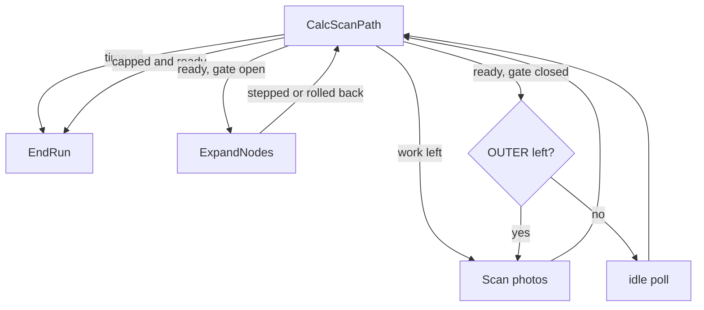
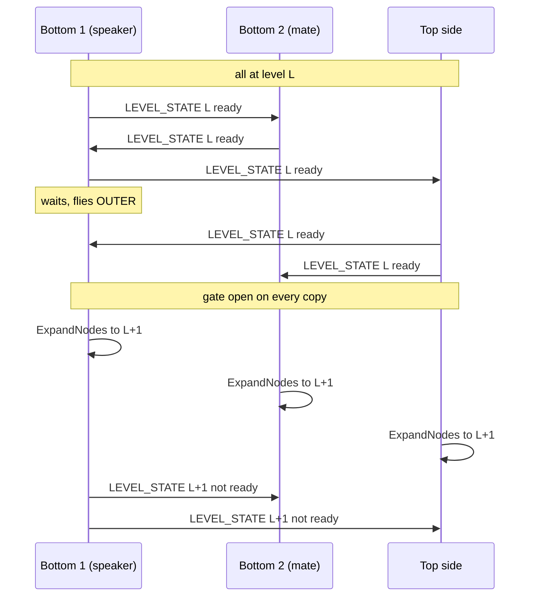

# Design: expanding mines (levels, snapshots, lockstep)

Status: stages A and B built (2026-10-26); flight stage next. Section 10 holds the user's decisions; where an earlier section disagrees, section 10 wins.
## Built so far

- **Stage A (geometry)**: `PathEngine.set_level(k)` / `level` / `STEP_FT`, `Routes.set_level`,
  `mine_rule.apply_growth` (per-gap bridging, restores the chain when infeasible).
- **Stage B (planner, backend, simulator)**, all in local feet, no flight code:
  - `flight/pathfinding/levels.py` (pure): `Snapshot` (frozen), `SnapshotBook` (validity,
    latest valid, `buffer_width`, the unsafe-squares counter kept beside the frozen snapshots),
    `LevelGate` + `Verdict` (the lockstep rule), `LevelState` (the announced fact: side, drone,
    level, ready, capped, seq), `Step` / `LevelStep`.
  - `pathnode/level_control.py`: `LevelController` (`planner.levels`): `ready`, `snapshot`,
    `try_advance` (snapshot, gate, grow), `grow`, `rollback`, `recover`, `join_at`, reporting,
    `growth_fits` (the 1.5x time rule; the clock stays the caller's).
  - `SearchBackend` level API replaces `expand_margin` (see `search_backend.py`); `MissionPlanner`
    has lat/lon passthroughs and still has a no-op `expand_margin` because `ExpandNodes` calls it.
  - `pathnode/sim_levels.py` + `Mission(levels=True, max_levels, tick_budget, expand_ticks,
    partner_lost_at)`; `sweep.py --levels`.
- **Not built (flight stage)**: the `LEVEL_STATE` message and heartbeats, `SideAgent` gating,
  `CalcScanPath` / `ExpandNodes` / `EndRun` changes, the `CROSS_PAIR_CHAIN` level field, the IARC
  `buffer_width` argument, partner-lost detection. Also the Field engine as the default.
- **Differences from sections 3-8 (section 10 decides)**:
  - A snapshot holds route, cells, mine hash, time, level, seq and `spans`; no chain copy and no
    mutable counters. Counters live in `SnapshotBook` (`unsafe(snap)` = squares that fell inside
    a zone since it was taken). `compromised` is replaced by validity: a mine on its squares.
  - `PathNodePlanner.mine_hash()` is unchanged (the Field cross-check test uses its formula);
    `level_hash()` adds the level, and the backend's `mine_hash()` returns that one.
  - Rollback after a late mine with no route (`recover`) rebuilds the chain from the latest
    snapshot at or below each lower level and rechecks it with `apply_growth`; there is no cap
    message, a `capped` flag in `LevelState` ends the other copies' climb instead.
  - Ready has no `mate_busy` term yet (flight stage). The gate's "other side ready" is any drone
    of the other side announcing ready at the level or past it.
  - The partner-lost hook is `Target.lost()` -> `LostPartnerTarget` (its last point A, then
    `after_met()` hands over to `FarEdgeTarget`), so the checked half is reused and the rest is
    photographed by this side.

Scope: the phase after the first complete route exists. Each mine's danger zone grows 2 ft
per step; the planner re-checks its route, finishes the new work, freezes a snapshot, and
grows again. Both sides do this in lockstep.

Contents: 1 Summary - 2 Terms - 3 Data - 4 Trigger and state flow - 5 The expansion step -
6 Recheck (mine rule) - 7 Lockstep protocol - 8 Reporting and join - 9 Simulator and test
plan - 10 Open questions - 11 Risks - 12 Build order.

---

## 1. Summary of key choices

- **Level** = number of expansion steps done. Zone radius at level `k` is `3 + 2k` ft
  (`SAFETY_RADIUS_FT` = 3). Level 0 is today's behaviour.
- **Expansion lives in the planner** (`PathNodePlanner.expand_level`), triggered from the
  existing `CalcScanPath` loop; `ExpandNodes` becomes a short state that performs one step
  and returns to `CalcScanPath`. Loop: `CalcScanPath -> ExpandNodes -> CalcScanPath`.
- **Snapshot** = frozen record (level, route points, cell path, mine hash, unsafe counters,
  time). Kept by the planner (`SnapshotBook`); drone 1 reports the latest usable one.
- **Ready** (per copy, per level) = groups 0-3 empty + met + nothing pending + no photo in
  flight on the side. Announced in a new tiny message `LEVEL_STATE` (611).
- **No decider.** Every copy applies the same rule to the same announced facts: expand
  `L -> L+1` when own copy, side-mate and other side are all ready at `L` (or already past it).
  Sides differ by at most one working level.
- **Mine hash includes the level**, so the join only accepts same-level snapshots.
- **One mine-rule call for the whole growth** (all zones at once, no jump), with a fix:
  bridge every gap separately instead of collapsing orphaned stretches (section 6.1).
- **Geometry**: `Field.expandField` (full rebuild) first; measure; incremental "warm start"
  and background double-buffering only if the benchmark demands it (section 5.3).
- **Rollback is cheap**: shrinking zones keeps every existing route valid. If level `L+1` is
  infeasible anywhere, cap at `L` and rebuild zones at `L`.

---

## 2. Terms

- **Level `k`**: every mine and blocked-square obstacle grown by `2k` ft (one 2 ft square per
  level). Zones at level `k` are a pure function of (mines, blocked squares, `k`).
- **Ready(k)**: this copy, working at level `k`, has a complete, fully checked route and no
  work in groups 0-3 (`Group.PATH, BIG_SHORTCUT, ADJACENT, SHORTCUT` in
  `flight/pathfinding/pathnode/config.py`). Group 4 (`OUTER`) is not required.
- **Snapshot**: a frozen copy of the ready route. Never edited; only its counters change.
- **Cap**: the highest level known to keep a route alive.
- **Copy**: one drone's own `PathNodePlanner` (see the `side_agent.py` header).

Invariant that makes several things simple: zones at level `k` are a subset of zones at
`k+1`. So a route valid at `k+1` is valid at `k`, and a cached shortest path that misses the
grown zones is still the shortest (the argument `routes.py` already uses for a new mine).

---

## 3. Data

### 3.1 Snapshot (new file `flight/pathfinding/pathnode/levels.py`)

```
@dataclass
class Snapshot:
    level: int              # zone level the route was checked at
    seq: int                # 0,1,2... per copy; a late mine can force a 2nd snapshot at a level
    route: list[(x, y)]     # Chain.route() at freeze time (local feet)
    cells: list[(c, r)]     # ordered cell path, same rasteriser as format_iarc_path
    mine_hash: str          # mine_hash() at freeze time (includes level)
    chain: Chain            # deep copy (nodes + links, all CHECKED): used for rollback
    t_flight: float         # seconds since takeoff (Drone.startTime) when frozen
    t_level_start: float    # when this level began; time per level = t_flight - t_level_start
    unsafe_now: int         # cells inside the CURRENT zones (any newer level); soft counter
    compromised: bool       # a mine learned after freezing lies on it AT ITS OWN LEVEL; hard
```

- `route`, `cells`, `mine_hash`, `chain`, `t_*` never change after creation.
- `unsafe_now` (the spec's unsafe-square counter) and `compromised` are the only mutable fields.

**Counter update (how and when)**
- Recomputed in one vectorised call whenever the zone set changes: after `Routes.grow`
  (expansion or rollback) and after `Routes.add_mine` / `add_square`.
- `unsafe_now`: `shapely.contains_xy(current_union, cell_centres)` summed over `cells`.
  Cost O(cells) per snapshot (a few hundred points): negligible.
- `compromised`: same test against `zones_at(snapshot.level)` built from all mines known now
  (pure shapely, no graph; helper `Routes.zones_at(level)` using
  `geometry.mine_zone(x, y, 3 + 2*level)` until the rebuilt `Field` replaces `ZoneMap`).
  A snapshot is compromised only by mines discovered after it was frozen.
- Cells are tested by centre, matching `Routes.in_zone`.

### 3.2 Where things live

| Thing | Owner | Why |
|---|---|---|
| `SnapshotBook`, `level`, `cap`, `expand_level()`, `rollback()` | `PathNodePlanner` (planner.py) | needs chain, routes, mines, coverage together |
| `ready()` / `finished()` | `PathNodePlanner` | pure function of planner state |
| Peer facts (mate/partner `level, ready, cap`, ages) and `LevelGate.can_expand` | `SideAgent` + pure class in `levels.py` | messaging lives in the side agent; the rule is pure so the simulator reuses it |
| Send/receive `LEVEL_STATE` | `SideAgent.send_heartbeats` / `apply_inbox` | same pattern as `SIDE_JOB` |
| `Drone.mission_path`, `mission_level`, `mission_unsafe` | drone state | what `push_mission_path` and `EndRun` read |
| `MissionPlanner.expand_level()`, `snapshot_latlon()` | `mission_planner.py` (lat/lon facade) | replaces `expand_margin` |

`SideSession` (session.py) only forwards (`expand()`, level passthroughs).

### 3.3 Mine hash

`PathNodePlanner.mine_hash()` (planner.py) becomes
`sha256(repr((self.level, sorted_cells)))`. Blocked squares are not in today's hash and stay
out (planner-local knowledge). Consequences:
- Existing hash checks (`CROSS_PAIR_CHAIN`, `CROSS_PAIR_CHAIN_ACK`, `FIELD_CHECKSUM`, EndRun's
  `partner_route_mine_hash == mine_hash`) compare level as well, for free.
- The hash changes at each expansion, so an in-flight chain or ack for the old level is
  ignored (correct: it would join routes of different levels).
- A snapshot stores its own hash at freeze time; the join compares snapshot hashes (8.2).

---

## 4. Trigger and state flow

### 4.1 The exact ready condition (per copy)

`PathNodePlanner.ready()`, evaluated after `advance()` (so anything already photographed
has closed):

```
failure is None
and met                                        # chain.forward_index() is None
and not chain.has_pending()                    # redundant with PATH empty; belt and braces
and all(no photos in groups()[g] for g in (PATH, BIG_SHORTCUT, ADJACENT, SHORTCUT))
and all(trial is None for trial in shortcuts.trials.values())
```
plus, in `SideAgent.level_ready()`: `not mate_busy` (the side-mate's announced `SIDE_JOB` is
None, the same guard `EndRun` uses) and this drone is between photos (true inside
`CalcScanPath`).

"No photos in a group" means every sequence is empty, not just "no entry": `Work.groups()`
can hold an entry whose `places_along` is empty.

Interactions:
- **Pending / forward links**: any pending span or forward gap is in `Group.PATH` until
  photographed; `advance()` converts fully seen ones to CHECKED. Ready needs none left.
- **Shortcut trials**: a live trial shows in group 1 or 3. `Shortcuts.update` gives up a trial
  whose photo need exceeds its allowance, so trials cannot block forever. Assumption to test:
  after `advance()`, empty groups 1 and 3 mean `Shortcuts.left_to_try` cannot start a new trial
  that needs photos (assert it in the unit test).
- **Misses / blocked squares**: a square stays in its group until photographed or blocked
  (`MISS_BLOCK` = 3 misses, config.py). Blocking adds an obstacle and the mine rule runs, so
  the group empties one way or the other. Ready is only delayed, never wedged.
- **Late mines**: a mine arriving after a snapshot makes the copy not ready again (new pending
  spans). It takes a new snapshot (`seq + 1`) when ready returns; the old one is flagged
  `compromised` if the mine lies on it.
- **Snapshot idempotence**: freeze only when `(level, chain.signature(), mine_hash)` differs
  from the latest snapshot's key.

### 4.2 OUTER work

- Not required to expand; it stays in `groups()[4]`, so a ready copy that waits at the gate
  keeps flying it (the "useful work while waiting" case).
- After expansion the rings are recomputed around the new checked route (`Work.band`, keyed on
  `routes.version`, refreshes automatically). Squares now inside a zone are skipped
  (`Routes.in_zone`).
- `PlannerConfig.adjacent_ring` (1) already covers one grown square, so most new bridges need
  no new photos; `outer_ring` (2) mainly pays off for the next level. Do not lower
  `adjacent_ring` below 1 while expanding.

### 4.3 Where expansion runs: a state loop, the work inside the planner

Chosen: `CalcScanPath` stays the loop and decides; `ExpandNodes` performs one step.



Why not "everything inside ExpandNodes":
- Waiting for the other side must still fly OUTER photos and still take arriving mines: that
  is `plan` then `Scan`, i.e. CalcScanPath. A waiting loop in ExpandNodes would duplicate it.
- Every replan trigger (photos, relayed mines, `replan_needed`) already lands in CalcScanPath;
  expansion is one more planner event.
- ExpandNodes then has one job that can take seconds (the rebuild). A hovering drone has no
  photo in flight, so it is a natural state boundary; the flight log shows `nodes_expanded`
  per level; one place to guard on remaining flight time.

Why not a stateless planner event: no place to log/guard the slow step.

Changes:
- `state_machine/states/impl/calc_scan_path_impl.py`: replace `if planner.done(): _finish_scan;
  return ExpandNodes` with `if planner.ready(): _freeze_and_announce(); if side.gate_open():
  return ExpandNodes` and `if planner.finished(): return EndRun`. `_finish_scan` becomes
  `_freeze_and_announce` (snapshot, `push_mission_path`, checksum). A failed level-0 start
  (`planner.failure`, no route at all) keeps today's path (`_flag_no_valid_path`).
- `state_machine/states/impl/expand_nodes_impl.py`: call `planner.expand_level()` (replaces
  `MissionPlanner.expand_margin` and the `MINE_RADIUS_EXPANSION_FT` constant); on success log
  `nodes_expanded` (level, ms, mines, corners, bridges, pending photos), on infeasible log
  `nodes_expand_capped`; always return `CalcScanPath` (never `EndRun` directly).
- `state_machine/states/impl/end_run_impl.py` `_join_with_partner`: the "reopen if not
  `planner.done()`" test becomes "reopen if this copy is not `finished()` and time remains";
  join uses snapshots (section 8).
- `finished()` = cap reached (own or partner's) and `ready()`; no OUTER requirement.

Time budget: `FlightSettings.max_flight_time` is 7 min. In practice levels stop on time, not on
cap. CalcScanPath already returns EndRun on time-out; the reported route is then the latest
snapshot, never the live half-repaired chain.

---

## 5. The expansion step (geometry)

Target geometry: `flight/pathfinding/nodeField/field.py` (`Field`, `FieldConnections`),
`BlockMine.py`, `unionObstacle.py`. Until it replaces `ZoneMap` in `routes.py`, an interim
`Routes.grow(level)` can rebuild `ZoneMap` from `mine_zone(x, y, 3 + 2*level)` (convex hulls).

### 5.1 One step

`Routes.grow(new_level)` (new; wraps `Field.expandField(2.0)`):
1. Grow every leaf (`BlockMine.expand`, plain zones by mitre buffer), clear `mergedInto`,
   `_regroup()` re-merges unions and rebuilds blocker and graph. Already implemented;
   `test_expand` and `test_expand_matches_fresh_geometry` cover grown == fresh.
2. Keep zones/corners in the field as the old code does (`Field.withinField`) so growth cannot
   swallow entry-edge columns beyond the field.
3. Invalidate caches (5.4), `version += 1`.
4. Update snapshot counters (3.1).

Invariant to test: `expand^k(mines) == fresh(mines at radius 3 + 2k)` for mines and zones
(shape and `nodeGraph` equality). This lets a mine found late at level `k` be created directly
at level `k` (`Field.add_mine(x, y, level=k)`, radius `3 + 2k`) with no replay of expansions.

### 5.2 Blocked squares (obstacles added by `Routes.add_square`)

- `expandField` grows every leaf, zones included. Recommended: keep that. Margin means
  clearance; a square we cannot photograph is treated like a mine footprint, so it gets the
  same extra clearance per level. Store blocked squares as `(c, r)` and build the zone as
  `box.buffer(2k, mitre)` so "fresh == expanded" holds for them too.
- Q3 covers the alternative: `Field.add_zone(shape, growable=False)` plus one skip in the
  `expandField` leaf loop.

### 5.3 Cost of `nodeGraph`

Facts: `FieldConnections.addObstacle` is incremental (drop covered corners, drop blocked edges,
link only the new corners); `expandField` calls `_regroup`, i.e. rebuilds. Given: adding 100
mines incrementally is about 17 s total on a PC (about 0.17 s per mine on average, rising with
corner count because each add links against all live corners).

Every corner moves on growth, so no old edge stays valid as is: growth is not incremental in
the `addObstacle` sense.

Estimate of a full rebuild per step with `N` mines:
- Same order as building from scratch: roughly 3 to 17 s per level at `N = 100` on a PC (one
  batched `_link` should beat 100 sequential adds, not by orders of magnitude). Merged unions
  have fewer corners than isolated mines, so later levels get cheaper.
- On the flight computer (unknown; assume 3 to 5 times slower) that is 10 to 90 s per level
  against a 420 s budget: too slow at 100 mines, fine at 20 to 30.
- Every drone rebuilds its own copy in parallel, so cost does not add across drones.

Staged plan, each stage gated by the benchmark `bench_expand.py` (9.3):
1. **Full rebuild** (written). Ship first; measure on target hardware at 30 / 60 / 100 mines
   and three densities.
2. **Off-thread double buffer**: build the level `k+1` `Field` in a worker while the drone keeps
   flying OUTER work at level `k`; swap when the gate opens. Late mines are added to both fields
   (`add_mine(level=k)` and `(level=k+1)`) until the swap. Costs 2x memory and 2x add cost but
   hides the rebuild inside the wait for the other side. Optional.
3. **Warm-start incremental rebuild** (only if 1 and 2 are not enough): each corner moves along
   its bisector by 2 ft, so an old edge `(a, b)` is a good candidate between the moved corners
   `(a', b')`. Reuse old edges as candidates, add ring neighbours of `a'` and `b'`, and run the
   full proposal only for obstacles that merged or changed topology. Validate all candidates
   against the grown obstacles with the existing batched shapely check. Not guaranteed complete
   on non-convex outlines, so acceptance = `nodeGraph == rebuild()` on random fields (the
   existing incremental-vs-rebuild test pattern in `test_nodefield.py`), plus a debug-build
   cross-check.
4. Last resort: lazy edges (compute a corner's edges when A* first expands it, cache until the
   next expansion). Corners still persist, route points still connect per query.

Design rule kept: only obstacle corners persist in `FieldConnections.nodeGraph`; path nodes and
route points never do; each query connects its own endpoints (`Field.shortest_path`,
`pointTangents`).

### 5.4 Route-cache invalidation (`routes.py`)

`Routes.grow` mirrors `Routes._added`, with the union of all grown zones:
- `_paths`: drop every cached path whose `LineString` intersects the grown union (vectorised
  `shapely.intersects`, as in `_added`). Paths that miss it stay: still shortest. Cached "no
  route" entries (`None`) stay valid (obstacles only grew).
- `_inside`: `True` entries stay `True`; drop the `False` ones near grown zones (simplest: all).
- Path gids: cached paths hold gids of groups that may have merged; `Routes.shortest` resolves
  them via `zones.resolve(g)`. `expandField` already sets `u.mergedInto` for old unions. Test
  that a pre-step gid resolves to a live group afterwards.
- `version += 1` so `Work.state_key`, the band cache and shortcut caches refresh.
- `Coverage` caches (`_touched`) do not depend on geometry; keep them.

**Rollback** goes the other way (zones shrink): cached "no route" and `True` inside entries are
no longer safe. Clear both `_paths` and `_inside`, rebuild the `Field` from mines and blocked
squares at the lower level.

---

## 6. Recheck: applying the mine rule to grown zones

`mine_rule.apply(pl, gid, source)` (mine_rule.py) is written for one new obstacle, but each step
is generic over all current zones (`routes.contains`, `routes.crosses`). So the growth is one
call after the geometry swap: `mine_rule.apply_growth(pl)`.

- **All at once, not one by one.** Growth changes every zone simultaneously. Applying mines
  sequentially would bridge around intermediate shapes that never exist and replan the same
  link several times. One call sees the final zones.
- **Entry inside a grown zone**: existing `_shift_entry` moves the entry to the nearest clear
  column on the entry edge (`entry_shifts`), link 0 is broken and bridged. No clear column:
  `failure = "entry fully blocked"`, treated as "cap here" (7.6).
- **Target inside a grown zone**: the last node is exempt from the dead-node test. A link into
  it that now crosses a zone is broken and the frontier logic runs (`frontier = f2 == [last]`,
  `Target.route_from`). With a partner, a `partner_a` inside a zone makes `route_from` head for
  the nearest corner (stand-in, `is_partner` False); the partner does the same. Both sides lose
  `met` until the point-A streams settle. Expected; it is why `ready` requires `met`.
- **The jump rule does NOT fire for expansions (confirmed).** `_frontier_links` jumps only when
  `source == Source.PAIR` and a gid matches. `apply_growth` passes `Source.PARTNER`, `gid=None`.
  A jump moves point A past a mine this pair just found; growth found nothing.
- **What becomes pending**: every link whose polyline now crosses a zone. CHECKED links become
  broken and are re-bridged by shortest paths (`Link(PENDING)`); FORWARD and PENDING links are
  replanned in place (`replans`). Nodes now inside a zone are dead. A bridge whose squares are
  already seen (usual for a one-square detour inside the adjacent ring) becomes CHECKED at once
  in `advance()`; the rest are `Group.PATH` photos. These pending spans are what must be
  photographed before the next snapshot.
- **Shortcuts**: `Shortcuts.update` drops a trial whose anchors or section changed and
  recomputes others around the known obstacles; new free shortcuts (all squares seen) are
  applied by `_apply_free` in the next `advance()`. Nothing extra is needed beyond calling
  `advance()` after `apply_growth`.

### 6.1 Required fix: bridge every gap, do not collapse orphans

Today `apply` keeps only `f1` (the fragment containing node 0) and `f2` (the fragment
containing the last node), discards every middle fragment as an orphan (`orphans` counter), and
joins `f1` to `f2` with ONE shortest path. Right for a single new obstacle. For growth the route
can be cut in many places by different zones at once; discarding the middle stretches throws
away checked ground and replaces it with one long, mostly unphotographed bridge.

`apply_growth` therefore: split the chain into fragments as `apply` does, then bridge each
consecutive pair (end of `f_i` to start of `f_{i+1}`) with its own shortest path
(`routes.route`), keeping every fragment. A pair with no route makes the level infeasible
(cap). Shortcuts trim waste afterwards. Extract the fragment/bridge builder from `apply` and
share it.

Add a test (9.2) that fails on the collapsed behaviour: two far-apart mines each cutting the
route; after growth the checked stretch between them survives.

---

## 7. Lockstep protocol

### 7.1 Message

New `MessageType.LEVEL_STATE = 611` in `interdrone_communication/message_types.py` (schema
pattern of `SIDE_JOB`):

```
{"id", "drones_to_send_data", "sender_id",
 "level": int,        # the level this copy is working at now
 "ready": bool,       # ready() at `level`, snapshot taken
 "cap": int}          # highest level this copy believes survives; -1 = unknown
```
- Sent by every drone to its side-mate and to all drones of the other side (like `SIDE_JOB`), on
  change and every `LEVEL_HEARTBEAT_S` (1 s). Lossy is fine: it is a state broadcast; the next
  heartbeat repairs a loss.
- Why not reuse `CROSS_PAIR_MINE_SYNC` (609): it goes speaker-to-other-side only, every 5 s (1 s
  in EndRun), and mates need the level too; extending it changes a frozen-schema message. The
  new message is small and independent. `CROSS_PAIR_CHAIN` and its ack keep `mine_hash`, which
  now carries the level (3.3).
- `Drone` stages `peer_levels: dict[drone_id, (level, ready, cap, t_received)]` like
  `peer_jobs`; the receive task never touches the planner.

### 7.2 The rule (no decider)

`LevelGate.can_expand(L)` in `levels.py`, evaluated by every copy every pass:

```
own.ready(L)
and mate_ok(L)      # no mate, or mate lost (silent >= MATE_LOST_S),
                    #   or mate.level > L, or (mate.level == L and mate.ready)
and other_ok(L)     # no partner side, or best fresh partner drone has
                    #   level > L, or (level == L and ready)
and L + 1 <= cap_min                # min of known caps, unknown ignored
```
- Inputs are monotone (level never decreases except a cap rollback, 7.6; `ready` is
  re-announced), so copies converge on the same decision from the same facts. The speaker is
  not special here (it matters only for reporting).
- A side is never more than one working level ahead: reaching `L+1` needs the other side ready
  at `L`, so both hold an `L` snapshot.
- "Partner best" = max `(level, ready)` over fresh partner drones. A partner side with every
  drone silent for `PARTNER_LOST_S` (30 s) blocks expansion (no unilateral step: a joined report
  would be impossible); the EndRun grace handles the rest.

### 7.3 Sequence (two sides, four drones)



### 7.4 Side-mate agreement

- The mate's copy expands when its own `ready(L)` holds and the mate has announced ready at
  `L` (or already `L+1`). If the mate is ahead and this copy is not ready (it still has group
  0-3 work the mate's copy lacked, since copies differ while messages are in flight), it
  finishes that work then follows. It never skips ahead unready, so it never lacks a level `L`
  snapshot.
- A mine found late at level `L` by a copy already at `L+1` is added directly at `L+1` (5.1);
  the other copy adds it at whatever level it is at when the photo arrives. Same mines, same
  level after both step, so the same hash.
- `mate_busy` in the ready condition means the mate's last photo (and its mines) has been
  announced finished before this copy expands.

### 7.5 One side cannot reach the next level in time

- Nobody waits beyond flight time. The waiting side flies OUTER (useful), then idles.
- On time-out both sides report the highest level `L*` for which both hold a snapshot (section
  8). Sides are at most one level apart, so `L* >= max(own, partner) - 1`.

### 7.6 The route does not survive an expansion

Detection:
- Before committing, `expand_level` checks feasibility on the new geometry: an entry column
  exists and a route entry -> target exists (`Target.route_from`). Otherwise nothing changes:
  `cap = L`, announced in `LEVEL_STATE.cap`, both copies stop at `L`.
- After committing, the mine rule may still set `pl.failure` (walled in, or a later mine at
  level `L+1` closes the last gap). At level `> 0` a failure is NOT fatal.

Rollback (`PathNodePlanner.rollback(to_level)`):
1. `level = L`, `cap = L`, `failure = None`.
2. Rebuild zones at `L` (`Routes.grow` rebuilding from mines and blocked squares).
3. Chain: if no failure, keep the current chain (valid at `L`, zones only shrank). After a
   `failure` the chain may be half-edited: restore `Snapshot.chain` of the latest
   non-compromised snapshot at `L` and re-apply mines/blocked squares learned since with
   `mine_rule.apply` (`Source.PARTNER`).
4. Announce `cap`. The other side, seeing `cap < its level`, rolls back too.
- After a rollback the level is final for the mission (no retry): `finished()` is true once
  ready, and both sides go to EndRun (join at `L`).
- Coverage and mines are untouched by rollback (both are monotone).

### 7.7 Message loss

- Heartbeats repair single losses; an entry older than `3 * LEVEL_HEARTBEAT_S` is treated as
  unknown (block, never assume ready).
- A copy that expanded whose announcement is lost still changed its hash, so a stale chain or
  ack for the old level cannot mis-join.
- A lost `cap`: the other side reaches the same verdict from its own expansion check, since
  geometry is a pure function of mines and level; a differing mine set converges through
  `CROSS_PAIR_MINE_SYNC`.
- No crosswise deadlock: `can_expand` needs the other side ready OR ahead, and a side only goes
  ahead after seeing the other ready.

---

## 8. Reporting and join

### 8.1 What drone 1 reports

- `Drone.mission_path` = the latest usable snapshot's route, replaced (not appended) each time
  a snapshot freezes; `push_mission_path` sends it live (as `_finish_scan` does now).
- Usable = latest snapshot that is not `compromised`; if all are, the latest (best effort,
  flagged). The spec's "latest snapshot" holds whenever no late mine hit it (Q5).
- Before the first snapshot exists: today's behaviour (live `chain.route()` at time-out, the
  half-route flag). Once a snapshot exists the live chain is never reported.
- Time-out mid level `L+1`: report the snapshot at `L`; its `unsafe_now` shows how many cells
  the growth so far put at risk. Log `reported_level` and `unsafe_now`.

### 8.2 Two-sided join at the same level

- `L* = min(own latest usable level, partner latest usable level)`; both known from
  `LEVEL_STATE`, so the top speaker also knows the bottom's level.
- `CROSS_PAIR_CHAIN` (606): add `level: int`; the top speaker sends its snapshot at `L*`, not its
  live route; `mine_hash` = that snapshot's hash; `route_verified` becomes "snapshot exists".
- Drone 1 (`EndRun._join_with_partner`) joins its snapshot at `L*` with the partner's when the
  levels are equal and `mine_hash` matches (both frozen, so this converges). If hashes differ
  because a late mine reached one side after freezing, accept the join when the joined polyline
  clears `zones_at(L*)` for the mines drone 1 knows (the same "join still clears every mine"
  check `planner.join_latlon` already does). If not, step down to `L* - 1` (both sides keep
  every snapshot).
- A late mine after the join: the existing re-check uses `zones_at(L*)`; on failure drop to
  `L* - 1` instead of only waiting.
- The bottom side's `_reopen_toward` (crosswise meet) acts on the live level only; it does not
  touch snapshots.
- Keep `JOIN_CONFIRM_S` and `JOIN_GRACE_S`. The join is attempted per level pair while the
  mission continues; EndRun is only the last step.

### 8.3 IARC report (`flight/pathfinding/iarc_report.py`)

- Format unchanged: `S,<start_col>,<buffer_width>` then U/D/L/R runs. The rasteriser
  (`CellField.path_cells`) turns points into cells; the snapshot stores the same cells so the
  report can be regenerated from the snapshot alone.
- `buffer_width` ("safety-buffer width in squares", written only, not enforced) is 0 today.
  Natural mapping: `buffer_width = level` (each level adds one 2 ft square beyond the base
  radius). Call path: `Interdrone.push_mission_path` -> `Drone.get_mission_iarc_path(
  buffer_width)`; pass `drone.mission_level`. See Q4: confirm against the competition rules.
- A shifted entry column shows up in the `S` column already (it comes from the first point).

---

## 9. Simulator support and test plan

### 9.1 Simulator (`flight/pathfinding/pathnode/sim.py`)

- `Mission(expand=False, max_levels=None, tick_budget=None, expand_ticks=3)`; default off so
  today's sweeps are unchanged.
- After a drone's photo, if its planner is `ready()`: freeze a snapshot and send
  `("level", drone, level, ready, cap)` on the existing lossy `_Bus` to its mate and the other
  side (re-sent every pass like `_relay_point_a`). Per-drone peer table (mirrors `known_jobs`).
  Use the SAME `LevelGate` as flight.
- Gate open: the drone idles `expand_ticks` (models the rebuild), then `planner.expand_level()`.
  Rollback via `cap` messages.
- `Mission.done()`: all planners `finished()`, or `tick_budget` reached (the analogue of flight
  time). `report_route()` returns the join of frozen snapshots at `L*`, not the live chain.
- `evaluate()`: per snapshot, check the route against TRUE mines at its own radius
  (`unsafe_cells(m, radius=3 + 2L)`), the level-`L` version of `route_cells_in_danger` and
  `route_mine_squares`; plus `unsafe_now` at the end.
- `_snapshot()` frames: add level and current zone polygons so `render.py` can show growth.

### 9.2 Unit tests (`test_pathnode.py` or new `test_levels.py`; `nodeField/test_nodefield.py`)

Geometry
- `expand^k == fresh at radius 3 + 2k` for mines and blocked squares (shape and nodeGraph).
- Two mines 5 ft apart merge at the expected level; union outline stable.
- `nodeGraph` after expansion == `rebuild()` (pattern exists); warm-start variant when built.
- `Routes.grow`: surviving cached paths equal a cold `Routes`' shortest paths; gids resolve.

Planner
- `ready()`: false with a pending span, a forward gap, an ADJACENT photo, a live shortcut trial;
  true with only OUTER left; false while `mate_busy`.
- Snapshot frozen: route/cells/hash unchanged after growth and late mines; `unsafe_now` grows as
  expected; `compromised` only from a late mine at its own level.
- `apply_growth`: `jumps == 0`; entry in a zone shifts; target in a zone gives a stand-in
  frontier; two separated cuts keep the middle checked stretch (6.1).
- Rollback: infeasible level leaves the chain valid; failure at level `> 0` is not fatal; the
  restored chain is all CHECKED and valid at `L`.
- Hash: differs across levels; equal for equal (mines, level) in any add order.
- Determinism: two copies given the same mines in different order reach identical geometry and
  hash at every level.

Lockstep (pure gate)
- Table-driven `LevelGate`: mate ahead/behind/lost, partner ahead/behind/silent, cap; monotone.
- Sim with drops and delays: sides never differ by more than one working level; no deadlock.

### 9.3 Sweep metrics (added to the existing sweep output)

Per run: levels reached per side, cap reason (`time` / `no_route` / `partner`); per level:
- ticks from level start to ready, photos flown, photos by group;
- expansion cost (ms of rebuild, corner and edge counts);
- snapshot route length (and delta vs the previous level);
- bridges / replans / orphans the growth caused, pending photos it created;
- snapshot `unsafe_now` at the end, `compromised` count;
- joined vs half report, level of the report, level lag between sides;
- true-mine check: `route_cells_in_danger` at the snapshot's own level is 0 for known mines.

Matrix: 1, 2 and 4 drones; three mine densities; drop 0 / 0.2; delay 0 / 3; random photo yaw.
Pass: no crash; every reported snapshot valid at its own level; level skew at most 1; expansion
time inside the budget (5.3).

Benchmark `bench_expand.py`: rebuild time vs mine count (30 / 60 / 100 / 150) and density; run
it on the flight computer.

---

## 10. Decisions (user, 2026-09-28; these override any default elsewhere in this doc)

1. **Growth rule**: a mine is the original protoMine DIAMOND (4 nodes tagged UP / LEFT /
   DOWN / RIGHT); each step moves every node 2 ft along its tag, so a diamond stays a diamond
   (city-block growth, never diagonal). Grown mines that overlap merge into the exact union.
2. **Level cap**: none, except flight time and a surviving route. No level-10 guard.
3. **Blocked squares do NOT grow** (overrides 5.2's recommendation: use the non-growing
   alternative).
4. **IARC `buffer_width`** = the city-block (Manhattan) distance, in squares, from the reported
   cell path within which there is no known mine: the clearance actually achieved, measured
   on the reported route, not the level number.
5. **Which snapshot to report**: the latest VALID one. Valid = no known mine lies directly on
   the path's squares; mines inside the buffer are fine (`buffer_width` then reports the
   smaller clearance).
6. **Late mine on the joined route at level `L*`**: keep flying to re-check / re-route at that
   level; if time runs out, report the latest valid snapshot (5).
7. **Expansion near the deadline**: skip if remaining flight time < 1.5x the last measured
   rebuild+bridge time. Accepted.
8. **Partner side lost**: do not stop. Target its last point A, then keep checking the lost
   side's half to its edge with this side's own photos.
9. **Join hash check**: strict equality first, then the geometric check (8.2). Accepted.
10. **OUTER while waiting**: fly it. Later this side may help the other side instead.
11. **Graph per level**: full rebuild first; redesign only if measured too slow.

---

## 11. Risks

- **Graph rebuild cost** on the flight computer is the main unknown (5.3). Mitigation:
  benchmark first, then double-buffering.
- **`apply` collapses orphans** (6.1): without per-gap bridging, growth wrecks checked stretches
  and floods PATH with photos. Fix before wiring growth.
- **Copies differ in flight**: a late mine or photo can make one copy's ready differ from its
  mate's. Mitigated by mate-ready gating and the level in the hash; residual risk is a level
  where mates hold different snapshots. The relaxed join check covers it.
- **Meeting point renegotiation**: growth may swallow point A on both sides at once; both lose
  `met`, work reappears, the bottom side's `_reopen_toward` may fire. Needs a sim test with a
  mine at the meeting point.
- **Rollback correctness**: restore-from-snapshot plus re-applied mines is new code in the
  failure path, the hardest to exercise. Cover with injected infeasible levels.
- **Hash change per level** interacts with EndRun's ack/confirm windows (`JOIN_CONFIRM_S`): an
  expansion during a join must drop it. Add to the join tests.
- **Time**: 7 min budget means few levels. Do not overbuild the incremental graph before
  measuring how many levels typically fit.
- **Rules risk**: what the competition scores about margin is not in the repo; Q4 depends on it.

---

## 12. Build order

1. `levels.py` (Snapshot, SnapshotBook, LevelGate) and pure tests.
2. `Routes.grow` + `zones_at`, cache invalidation, on the interim `ZoneMap` (radius rebuild).
3. `PathNodePlanner.ready / finished / expand_level / rollback`, `mine_rule.apply_growth` with
   per-gap bridging, mine hash with level.
4. Simulator support and sweep metrics; run before touching flight code.
5. `LEVEL_STATE` message, `SideAgent` heartbeats and gate, state-machine changes
   (`calc_scan_path_impl`, `expand_nodes_impl`, `end_run_impl`, `MissionPlanner`).
6. Swap `ZoneMap` for the rebuilt `Field` in `routes.py` (separate change), benchmark, then
   optimise (5.3 stages 2 to 4) only if needed.
7. IARC `buffer_width` once Q4 is answered.
