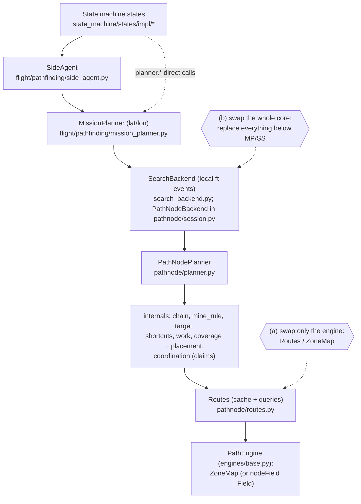
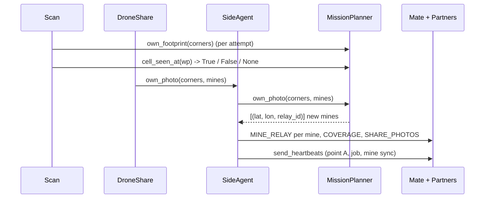
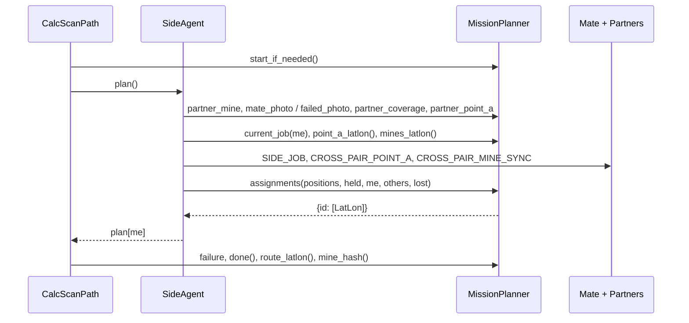

# Specification: search-backend interface (node graph vs cell grid)

Status: RESEARCH / SPEC ONLY, no code changed. Written against branch `poif-test` (working tree;
other agents were editing planner files, so line numbers may drift by a few lines).

Question: what must a cell-based (2 ft square) search accept and give so the state machine keeps
working unchanged? This document specifies the two boundaries a replacement can sit behind.

## Contents

1. [Layering](#1-layering)
2. [Conventions and shared data types](#2-conventions-and-shared-data-types)
3. [Event sequences](#3-event-sequences)
4. [Contract A: MissionPlanner](#4-contract-a-missionplanner) (32 entries)
5. [Contract B: Routes / PathEngine](#5-contract-b-routes--pathengine) (16 entries)
6. [Conformance checklist](#6-conformance-checklist)
7. [What a cell-based backend needs](#7-what-a-cell-based-backend-needs)
8. [Gaps and adaptations](#8-gaps-and-adaptations)
9. [Two options](#9-two-options)
10. [Comparing the backends fairly](#10-comparing-the-backends-fairly)
11. [Ambiguities found in the code (Open)](#11-ambiguities-found-in-the-code-open)

---

## 1. Layering



| Swap | Replaces | Boundary to honour |
|---|---|---|
| (a) engine only | `PathEngine` (`ZoneMap` today; `Routes` stays) | Contract B (section 5) |
| (b) whole core | everything below `MissionPlanner` | Contract A (section 4) |

- `SearchBackend` (`flight/pathfinding/search_backend.py`) is the abstract boundary for swap (b): its
  methods map 1:1 onto MissionPlanner's photo, partner and assignment methods, in local feet. The
  path-node implementation is `PathNodeBackend` (`pathnode/session.py`, formerly `SideSession`);
  `MissionPlanner` and the simulator (`pathnode/sim.py`) talk only to the parent, and a backend is
  registered in `BACKENDS` and made with `make_backend`. Conformance: `test_search_backend.py`.
- `nodeField/` (`Field`, `FieldConnections`, `BlockMine`) has a ZoneMap-like surface, same slot as
  swap (a), not wired in:

| nodeField `field.py` | Line | ZoneMap equivalent |
|---|---|---|
| `add_mine` | 62 | `add_mine` |
| `add_zone` | 71 | `add_zone` |
| `resolve` | 126 | `resolve` |
| `expandField` | 134 | (future level growth) |
| `vertices` | 196 | `vertices` |
| `contains` | 203 | `contains` |
| `crosses` | 207 | `crosses` |
| `clear_line` | 213 | `clear_line` |
| `shortest_path` | 216 | `shortest_path` |
| `mineHash` | 226 | (planner `mine_hash`) |

---

## 2. Conventions and shared data types

### 2.1 Frames and units

| Item | Definition |
|---|---|
| Local frame ("local ft") | True feet. Origin bottom-left = field corner 1; +x along corner 1->2 (width `field_w`); +y towards corners 3/4 (height `field_h`). |
| Frame source | `frame.field_transformer` (`frame.py:15`). Every drone builds the same frame from the same corners, so local coordinates agree across drones (jobs rely on this). |
| Square | 2 ft, `CELL = 2.0` (`geometry.py:20`). Square `(c, r)` = `[2c, 2c+2) x [2r, 2r+2)`, centre `((c+.5)*2, (r+.5)*2)`. |
| Grid | `cols = round(field_w/2)` by `rows = round(field_h/2)` (`iarc_report.py`). Default 80 x 300 ft = 40 x 150 squares. |
| lat/lon | Decimal degrees, `(lat, lon)` order. Everything sent between drones and everything crossing `MissionPlanner` is lat/lon, except jobs (local ft). |
| Examples | Illustrative only: local `(41.0, 101.0)`; lat/lon `(37.94810, -91.78120)`. |

### 2.2 Types defined once

| Type | Definition | Example |
|---|---|---|
| LatLon | `(float, float)` degrees | `(37.94810, -91.78120)` |
| Local point | `(float, float)` local ft | `(41.0, 101.0)` |
| Polyline / route | `list[point]`, straight segments, no repeated consecutive points (`polyline.dedupe`), >= 2 points once it exists. Runs from the entry (`y == 0` bottom side, `y == field_h` top side) to the side's point A or meeting point. | `[(40, 0), (44.15, 97.9), (40, 12)]` |
| Footprint corners | 4 points tracing the photo rectangle's PERIMETER: `[top_left, top_right, bottom_right, bottom_left]` (`scan_impl.py:130`; the camera helper's own order is diagonal-crossing and is reordered before use). Any simple quadrilateral, not axis-aligned. `[]` = no footprint (mines only / failed photo). | `[(37.94812,-91.78121), (37.94812,-91.78115), (37.94807,-91.78115), (37.94807,-91.78121)]` |
| Mine | A point whose identity is its SQUARE (`snap_to_cell_center`, `geometry.py:26`): mines in one square are the same mine. | `(40.3, 100.9)` -> `(41.0, 101.0)` |
| Mine relay tuple | `(lat, lon, relay_id)`; `relay_id = sha256(f"{lat:.7f},{lon:.7f}")[:16]` (`mission_planner.py:19`). Returned by `own_photo`. | `(37.94810, -91.78120, "3f9a0c11d2e4b5a6")` |
| Group | `Group` IntEnum (`config.py`): PATH 0, BIG_SHORTCUT 1, ADJACENT 2, SHORTCUT 3, OUTER 4. | `2` |
| Work key | `"forward"` (one, the open gap from point A); `("span", end_node_xy)` (pending detour, keyed by its END node); `("shortcut", a_xy, b_xy)` (anchor nodes' xy); `None` (free-standing ring photo). Must be hashable, identical on every copy, stable across replans of the same path (a claimed path keeps its owner). | `("span", (41.0, 96.0))` |
| Job | `(group, key, (x, y))` or `None`. `(x, y)` = the drone's NEXT photo centre, local ft (`claims.update`: `heads[d] = (g, key, route[0][0])`). Over the wire (SIDE_JOB, JSON) tuples arrive as lists; `claims._tupled` re-tuples. | `(0, "forward", (40.0, 12.0))`; `(0, ("span", (41.0, 96.0)), (39.0, 90.0))`; `(2, None, (30.0, 50.0))`; `(3, ("shortcut", (40.0, 10.0), (44.0, 60.0)), (42.0, 20.0))` |
| Group list (planner -> claims) | `list` of 5 groups, each `[(key, [(x, y), ...]), ...]`; a sequence = photo centres in flying order. | `[[("forward", [(40, 12), (40, 18)])], [], [], [], []]` |
| Plan (local) | `{drone_id: [(x, y, group_index), ...]}` | `{1: [(40.0, 12.0, 0)]}` |
| Plan (MissionPlanner) | `{drone_id: [LatLon, ...]}` (group dropped) | `{1: [(37.9481, -91.7812)], 2: []}` |
| Outbox (`session.py:28`) | `mines` (new mines, local), `coverage` (footprint or None), `point_a` (local, only with a partner). MissionPlanner uses only `mines`. | `Outbox(mines=[(41.0, 101.0)], coverage=None, point_a=None)` |
| Failure | `str | None`, free text; only truthiness is used. | `"no route from the entry to the target"`, `"entry fully blocked"` |
| IARC path text | `S,<start_col>,<buffer_width>` then `U/D/L/R,<count>` lines. | `"S,20,0\nU,9\nL,1"` |

---

## 3. Event sequences

### 3.1 One photo (drone 1, bottom side, mate = drone 2, partner side = 3/4)



| Step | Call | Detail |
|---|---|---|
| 1 | `planner.own_footprint(corners)` | Per capture attempt (`scan_impl.py:132`). Returns None. Marks covered squares seen; counts misses (see 11.1). |
| 2 | `planner.cell_seen_at(wp.lat, wp.long)` | `True` done; `False` climb 0.5 m and retake (back to 1); `None` off field, stop climbing (`scan_impl.py:136`). |
| 3a | No footprint and no mine: `side.failed_photo(lat, lon)` | `planner.failed_photo` (misses) and SHARE_PHOTOS `{"photos":[{"cornerCoordinates":[],"mines":[],"failedAt":(lat,lon)}]}` to the mate (`drone_share_impl.py:128`). |
| 3b | Else `side.own_photo(corners, mines)` | (`drone_share_impl.py:132`, `side_agent.py:225`) |
| 3b.i | `planner.own_photo(corners, mines)` | Mines added (PAIR), chain advanced; returns NEW mines only as relay tuples. |
| 3b.ii | Per relay tuple | `CROSS_PAIR_MINE_RELAY {mine_lat, mine_lon, relay_id}` to partners. |
| 3b.iii | If corners | `CROSS_PAIR_COVERAGE {corners}` to partners. |
| 3b.iv | Always | `SHARE_PHOTOS {"photos":[{"cornerCoordinates":corners,"mines":[...]}]}` to the mate. |
| 3b.v | Always | `send_heartbeats()` (see 3.2 step 3). |
| 4 | Return to CalcScanPath | Receivers mirror this: the mate stages `Drone.pending_photo_reports`; partners stage `pending_cross_pair_mines` / `pending_partner_coverage`. The planner is touched only when CalcScanPath drains them. |

### 3.2 One planning pass (CalcScanPath)



| Step | Call | Detail |
|---|---|---|
| 0 | `planner.start_if_needed()` | `None` (already started) / `True` / `False` (`calc_scan_path_impl.py:159`). |
| 1 | `side.plan()` -> `apply_inbox()` | FIXED order: (1) `partner_mine(lat, lon)` per staged mine; (2) per staged mate report `failed_photo(lat, lon)` if `failed_at` else `mate_photo(corners, mines)`; (3) `partner_coverage(corners)` per footprint; (4) `partner_point_a(lat, lon)` (latest only). |
| 2 | Gather inputs | `positions() = {me: LatLon, mate: LatLon | None}`; `held = {mate: job, other-side drone: job}` (lists OK); `others = {partner drone: LatLon}`; `lost = () | (mate,)`. |
| 3 | `send_heartbeats()` | `current_job(me)` -> SIDE_JOB on change / every `JOB_HEARTBEAT_S`. Speaker only: `point_a_latlon()` -> CROSS_PAIR_POINT_A on change / every `POINT_A_HEARTBEAT_S`; `mines_latlon()` -> CROSS_PAIR_MINE_SYNC every `MINE_SYNC_S` (skipped when `failure`). |
| 4 | `assignments(...)` | e.g. `{1: [(37.9481, -91.7812), ...], 2: [...]}`; then `_announce_job()` again (heads changed); returns `plan[me]`. |
| 5 | Back in `run` | `failure` -> flag no-path, ExpandNodes. Else `done()` -> `_finish_scan` (`route_latlon()`, `mine_hash()` -> FIELD_CHECKSUM), ExpandNodes. Else `drone.resetWaypoints(plan[me])` and Scan (sleep `IDLE_POLL_S` if empty). |
| 6 | Later states | ExpandNodes: `expand_margin(2.0)`. EndRun loops: `apply_inbox`, `send_heartbeats`, `failure`, `done`, `mine_hash`, `check_join_latlon` / `join_latlon`, `route_latlon`, `route_verified`. AppShare: `iarc_path` via `Drone.get_mission_iarc_path`. |

### 3.3 Inside `add_mine` (core-internal, for a backend author)

`PathNodePlanner.add_mine` (`planner.py:187`):
1. Dedupe by square; `discovered.append`.
2. `routes.add_mine(x, y)` -> gid.
3. `mine_rule.apply(pl, gid, source)`: shift entry if inside; delete path nodes inside; replan
   pending/forward links that cross (`routes.route`, `target.route_from`); cut checked links that
   cross; remove orphans; re-bridge with `routes.route`; jump (PAIR only) using `gids`.
4. `SideSession` then calls `advance()` (lay nodes over checked ground, update shortcuts).

---

## 4. Contract A: MissionPlanner

File: `flight/pathfinding/mission_planner.py`. Rules for every entry:
- Called from the flight event loop only, never from the interdrone receive task (staging in
  `Drone.pending_*`, `drone.py:129-160`). Synchronous and non-blocking (no awaits inside).
- Determinism: two copies (drone 1's and drone 2's planner) fed the same events in the same order
  must reach the same state. Where copies may legitimately differ (message in flight) it is noted.
- lat/lon in, lat/lon out; local ft only for jobs.

### 4.0 Summary table

| ID | Function | Purpose | Called from | How often |
|---|---|---|---|---|
| A1 | `MissionPlanner(...)` | Build the side's planner and frame | Takeoff (`make_planner`) | once per drone |
| A2 | `make_planner(...)` | Build A1 from FlightSettings | `takeoff_impl.py:207` | once per drone |
| A3 | `relay_id(lat, lon)` | Short id for a mine relay | `_relays` (A14) | per new mine |
| A4 | `field_w` | Field width, ft | recall, harness | on demand |
| A5 | `field_h` | Field height, ft | recall, harness | on demand |
| A6 | `latlon_to_local` | lat/lon -> local ft | recall, harness | on demand |
| A7 | `local_to_latlon` | local ft -> lat/lon | recall, harness | on demand |
| A8 | `start_if_needed` | Start; report if any route exists | CalcScanPath | every pass |
| A9 | `failure` | Why planning stopped, or None | CalcScanPath, EndRun, SideAgent | every pass / poll |
| A10 | `done` | Nothing left on this side | CalcScanPath, EndRun | every pass / poll |
| A11 | `route_verified` | Route whole and fully checked | EndRun | per chain send |
| A12 | `expand_margin` | Grow zones (currently no-op) | ExpandNodes | once |
| A13 | `own_footprint` | Record this drone's photo footprint | Scan | per capture attempt |
| A14 | `own_photo` | Apply photo's mines, advance; return new relays | DroneShare via SideAgent | per photo |
| A15 | `mate_photo` | Apply the side-mate's photo report | `apply_inbox` | per staged report |
| A16 | `failed_photo` | Count a miss for a photo with no footprint | DroneShare, `apply_inbox` | per failed photo |
| A17 | `cell_seen_at` | Is the square at a point photographed | Scan | per capture attempt |
| A18 | `partner_mine` | Apply a mine from the other side | `apply_inbox` | per staged mine |
| A19 | `partner_coverage` | Record the other side's footprint | `apply_inbox` | per staged footprint |
| A20 | `partner_point_a` | Retarget the forward gap | `apply_inbox` | <= once per drain |
| A21 | `point_a_latlon` | This side's frontier | heartbeats, `assignments` | every pass |
| A22 | `mine_hash` | Hash of the known-mine set | EndRun, `_finish_scan` | per poll |
| A23 | `mines_latlon` | All known mines | heartbeats | every `MINE_SYNC_S` |
| A24 | `assignments` | Claims: who photographs what | `SideAgent.plan` | every pass |
| A25 | `current_job` | Job a drone flies first | `_announce_job` | twice per pass |
| A26 | `route_latlon` | This side's route | `_finish_scan`, EndRun | per chain send / at end |
| A27 | `join_latlon` | Join with the partner's route | EndRun (drone 1) | per attempt |
| A28 | `check_join_latlon` | Join, reopening the gap if needed | EndRun (drone 1) | per attempt |
| A29 | `iarc_path` | Route -> IARC text | AppShare, interdrone | once per drone |
| A30 | `planner.planner.discovered` | Mine list (harness) | tests | on demand |
| A31 | `planner.planner.seen` | Seen grid (harness) | tests | on demand |
| A32 | `planner.planner.engine.crosses` | Route vs zones (harness) | tests | on demand |

### 4.1 Construction and frame

#### A1 · MissionPlanner(...)

```python
MissionPlanner(corners_latlon, start_latlon, start_edge, side_drones, has_partner,
               shape_size_ft=(6.0, 4.0), overlap=0.1)
```

| Parameter | Type | Units / frame | Example | Notes |
|---|---|---|---|---|
| `corners_latlon` | `list[LatLon]` (4) | degrees | `[(37.9480,-91.7812), ...]` | Counter-clockwise: corner 1 = origin, 2 along the start edge, then 3, then 4 (`validate_field_corners`). |
| `start_latlon` | `LatLon` | degrees | `(37.9480, -91.7810)` | Where the side enters; x clamped to `[0, field_w]`, y ignored (entry is on the edge). |
| `start_edge` | `"bottom"` / `Edge` | - | `Edge.BOTTOM` | bottom = y 0, top = y `field_h`. |
| `side_drones` | `tuple[int]` | ids | `(1, 2)` | Ascending; claim tie-break (lower id first). |
| `has_partner` | `bool` | - | `True` | 3-4 drone mission: target = partner's point A. |
| `shape_size_ft` | `(float, float)` | ft, (along-y, across-x) | `(6.0, 4.0)` | Planning photo footprint, from `SHAPE_SIZE_FT`. |
| `overlap` | `float` | fraction | `0.1` | From `OVERLAP`. |

**Returns:** the object; sets `field_w`, `field_h`, `drones`, `planner`, `session`.

**Behaviour**
1. Validate corners; build the frame; `field_h = max y of the corners`.
2. Build the planner and compute the initial route entry -> target.
3. If no route exists, `failure` is set (not raised).

**Guarantees callers rely on**
- Same corners give the same frame on every drone (jobs are in local ft).

**Errors:** `ValueError` for bad corners (not 4, repeated, clockwise, bow-tie) or bad edge string.
**Side effects:** none outside the object.
**Cost / frequency:** once per drone at Takeoff; one shortest path.

**Source:** `mission_planner.py:25`; `frame.py:15,30`.

#### A2 · make_planner(...)

```python
make_planner(flight_settings, shape_size_ft, overlap) -> MissionPlanner
```

| Parameter | Type | Units / frame | Example | Notes |
|---|---|---|---|---|
| `flight_settings` | `FlightSettings` | - | - | Uses `mission_field_corners` (dicts with `lat`, `lon`), `start_coord`, `start_side`, `side_drones`, `partner_side_drones`. |
| `shape_size_ft` | tuple | ft | `(6.0, 4.0)` | Passed through. |
| `overlap` | float | fraction | `0.1` | Passed through. |

**Returns:** a `MissionPlanner`.

**Behaviour**
- `Side.START` -> bottom edge, else top; `has_partner = bool(partner_side_drones)`.
- Imports `Side` locally to avoid an import cycle.

**Errors:** as A1. **Side effects:** none. **Cost / frequency:** once per drone.

**Source:** `mission_planner.py:199`; `takeoff_impl.py:207`.

#### A3 · relay_id(lat, lon)

```python
relay_id(lat: float, lon: float) -> str
```

| Parameter | Type | Units / frame | Example | Notes |
|---|---|---|---|---|
| `lat`, `lon` | float | degrees | `37.94810, -91.78120` | Rounded to 7 decimals. |

**Returns:** 16 hex chars, a function of position only, e.g. `"3f9a0c11d2e4b5a6"`.

**Guarantees callers rely on**
- Echoed in `CROSS_PAIR_MINE_RELAY_ACK`; backend independent, keep as is.

**Errors:** none. **Side effects:** none. **Cost / frequency:** per new mine.

**Source:** `mission_planner.py:19`.

#### A4 · field_w   /   A5 · field_h

```python
field_w: float   # ft
field_h: float   # ft
```

**Returns:** the true field size in local feet. `field_w` from the frame (base edge in ft);
`field_h` = max local y of the corners.

**Guarantees callers rely on**
- `drone.py:1104` (nearest-edge recall) and `one_drone_sim_test.py:441-446` (route check): a wrong
  value shifts recall targets and the IARC grid (`iarc_path`).

**Errors:** none. **Side effects:** none. **Cost / frequency:** on demand.

**Source:** `mission_planner.py:34-36`.

#### A6 · latlon_to_local(...)   /   A7 · local_to_latlon(...)

```python
latlon_to_local(lat: float, lon: float) -> tuple[float, float]
local_to_latlon(x: float, y: float) -> tuple[float, float]
```

| Parameter | Type | Units / frame | Example | Notes |
|---|---|---|---|---|
| `lat`, `lon` | float | degrees | `37.9481, -91.7812` | A6 input. |
| `x`, `y` | float | local ft | `41.0, 101.0` | A7 input. |

**Returns:** plain Python floats.

**Guarantees callers rely on**
- Inverse of each other within about 1e-4 ft; the round trip is NOT lossless, so `iarc_path`
  converts once, one way.
- `drone.py:1103,1112` (recall to nearest edge): frame unchanged by a backend.

**Errors:** none. **Side effects:** none. **Cost / frequency:** on demand.

**Source:** `mission_planner.py:47,51`; `drone.py:1090-1112`.

### 4.2 Lifecycle and status

#### A8 · start_if_needed()

```python
start_if_needed() -> None | bool
```

**Inputs:** none.

**Returns**

| Value | Meaning |
|---|---|
| `None` | already started |
| `True` | first call; a route exists |
| `False` | first call; no route at all |

**Behaviour**
- First call: mark started, log the failure if any, return `failure is None`.

**Guarantees callers rely on**
- CalcScanPath acts only on `is False` (`_flag_no_valid_path("no route at start")`).

**Errors:** none. **Side effects:** `_started`. **Cost / frequency:** every CalcScanPath pass.

**Source:** `mission_planner.py:69`; `calc_scan_path_impl.py:159`.

#### A9 · failure

```python
failure -> str | None   # property
```

**Returns:** `planner.failure`; truthy = no route can exist any more (walled in / entry blocked).

**Behaviour**
- Once set the planner is dead: `add_mine` returns False, `plan` returns empty queues, `groups`
  empty, `advance` a no-op.

**Guarantees callers rely on**
- CalcScanPath, EndRun and SideAgent (stops sending point A / mine sync). Must never be set
  spuriously: it aborts the mission for that side.

**Errors:** none. **Side effects:** none. **Cost / frequency:** every pass and poll.

**Source:** `mission_planner.py:79`; `calc_scan_path_impl.py:162`; `end_run_impl.py:76`;
`side_agent.py:174`.

#### A10 · done()

```python
done() -> bool
```

**Returns:** True when all hold: route met (no forward gap, `failure is None`), no pending span,
no ADJACENT or OUTER work, no shortcut left to try.

**Behaviour**
- Can return to False (new mine after done; `check_join_latlon` reopen); EndRun then returns to
  CalcScanPath.

**Guarantees callers rely on**
- CalcScanPath exit (`:165`, then `_finish_scan`) and EndRun (`:76` reopen if not done; `:102` join
  only when done and the mate is idle). True too early ends the scan with an unverified route;
  False forever hangs the state.

**Errors:** none. **Side effects:** none. **Cost / frequency:** every pass and poll.

**Source:** `mission_planner.py:83`; `planner.py:128`.

#### A11 · route_verified()

```python
route_verified() -> bool
```

**Returns:** True when met and every link is CHECKED (photographed), even if optional work (rings,
shortcuts) remains.

**Guarantees callers rely on**
- Sent as `complete` in CROSS_PAIR_CHAIN (`end_run_impl.py:128`); the bottom drone only joins a
  `complete` partner route (`:100`). Violated: an unverified half route gets joined.

**Errors:** none. **Side effects:** none. **Cost / frequency:** per chain send (`CHAIN_RESEND_S`).

**Source:** `mission_planner.py:87`; `planner.py:135`.

#### A12 -- expand_margin REPLACED by the level API

`SearchBackend.expand_margin` no longer exists. The backend contract now has `level`,
`level_state`, `hear_level_state`, `try_advance_level`, `growth_fits`, `valid_snapshots`,
`report_route`, `report_valid`, `join_at`, `buffer_width` and `partner_lost` (contract docstrings in
`search_backend.py`; design in `docs/design/expanding_mines.md`). `MissionPlanner.expand_margin`
remains as a no-op until the flight stage rewires ExpandNodes. The entry below is the old one.

#### A12 (old) · expand_margin(...)

```python
expand_margin(ft: float) -> dict | None
```

| Parameter | Type | Units / frame | Example | Notes |
|---|---|---|---|---|
| `ft` | float | ft | `2.0` | `MINE_RADIUS_EXPANSION_FT` (`expand_nodes_impl.py:20`). |

**Returns:** currently always `None` ("did nothing"; logs at info). Future: a dict for the flight
log (docs/design/expanding_mines.md).

**Guarantees callers rely on**
- A backend implementing it must keep A10/A11 semantics per level and include the level in
  `mine_hash`.

**Errors:** none. **Side effects:** none today. **Cost / frequency:** once per ExpandNodes entry.

**Source:** `mission_planner.py:170`; `expand_nodes_impl.py:52`.

### 4.3 This side's photos

#### A13 · own_footprint(...)

```python
own_footprint(corners_latlon: list[LatLon]) -> None
```

| Parameter | Type | Units / frame | Example | Notes |
|---|---|---|---|---|
| `corners_latlon` | 4 x LatLon | degrees | see 2.2 | Perimeter order. |

**Returns:** None.

**Behaviour**
1. Convert to local; compute the needed squares (if not failed).
2. Mark every square FULLY inside the quadrilateral as seen (grown outward 1e-3 ft to survive
   lat/lon round-trip noise).
3. For every needed square the photo was aimed at and still unseen, count a miss. At `MISS_BLOCK`
   = 3 misses the square becomes a blocked obstacle (`_block_square` -> `routes.add_square` ->
   `mine_rule.apply`, source PARTNER).

**Guarantees callers rely on**
- Scan (`scan_impl.py:132`) then reads `cell_seen_at`: covered squares must read True.
- Does NOT call `advance()` (that happens in `own_photo`).

**Errors:** none. **Side effects:** `seen` grid, `coverage.version`, misses, possibly the chain
(blocked squares). Re-marking is harmless; a retake may count extra misses (see 11.1).
**Cost / frequency:** per capture attempt, several per waypoint at most.

**Source:** `mission_planner.py:92`; `planner.py:159`; `coverage.py:111`.

#### A14 · own_photo(...)

```python
own_photo(corners_latlon: list[LatLon] | None, mines_latlon: list[LatLon])
    -> list[tuple[float, float, str]]
```

| Parameter | Type | Units / frame | Example | Notes |
|---|---|---|---|---|
| `corners_latlon` | `list[LatLon] | None` | degrees | `None` | Accepted but IGNORED: MissionPlanner passes `None` to the session (`:99`). |
| `mines_latlon` | `list[LatLon]` | degrees | `[(37.9481, -91.7812)]` | Mines found in this photo, usually 0 or 1. |

**Returns:** mines NEW to this side as relay tuples, or `[]`.

```python
[(37.94810, -91.78120, "3f9a0c11d2e4b5a6")]
```

**Behaviour**
1. Each mine -> `add_mine(x, y, Source.PAIR)` (dedupe by square; a new mine runs the mine rule
   and may jump point A).
2. `advance()`.
3. Return the new mines as relay tuples.

**Guarantees callers rely on**
- `side_agent.py:229`: only NEW mines returned, else each duplicate is relayed to the partner.
- Mines applied BEFORE `advance`: no path node is laid over ground that just turned unsafe.

**Errors:** none. **Side effects:** mines, chain, caches. **Cost / frequency:** once per photo.

**Source:** `mission_planner.py:96`; `side_agent.py:225`; `session.py:55`.

#### A15 · mate_photo(...)

```python
mate_photo(corners_latlon: list[LatLon], mines_latlon: list[LatLon]) -> None
```

| Parameter | Type | Units / frame | Example | Notes |
|---|---|---|---|---|
| `corners_latlon` | `list[LatLon]` | degrees | 4 points or `[]` | From a SHARE_PHOTOS entry; `[]` = mines only. |
| `mines_latlon` | `list[LatLon]` | degrees | `[(37.9481, -91.7812)]` | Mines the mate found. |

**Returns:** None.

**Behaviour**
1. Corners non-empty: record footprint, add mines (PAIR), advance.
2. Corners empty: add mines and advance only.
3. Mines are NOT relayed to the partner from here (the finder already did).

**Guarantees callers rely on**
- Both copies of the side end up with the same mines and seen squares.

**Errors:** none. **Side effects:** as A13 + A14. **Cost / frequency:** per staged report, in
arrival order.

**Source:** `mission_planner.py:102`; `side_agent.py:149`; `session.py:62`.

#### A16 · failed_photo(...)

```python
failed_photo(lat: float, lon: float) -> None
```

| Parameter | Type | Units / frame | Example | Notes |
|---|---|---|---|---|
| `lat`, `lon` | float | degrees | `37.9481, -91.7812` | Planned photo centre that produced no footprint. |

**Returns:** None.

**Behaviour**
- Counts a miss for every needed square aimed at within `aim_radius` (`record_failed_photo`;
  no-op on failure).

**Guarantees callers rely on**
- Both copies count the same misses (SideAgent shares it via SHARE_PHOTOS `failedAt`). Without it
  an untakeable photo is handed out forever.

**Errors:** none. **Side effects:** misses, possibly blocked squares. **Cost / frequency:** per
failed photo.

**Source:** `mission_planner.py:109`; `drone_share_impl.py:128`; `side_agent.py:244`.

#### A17 · cell_seen_at(...)

```python
cell_seen_at(lat: float, lon: float) -> bool | None
```

| Parameter | Type | Units / frame | Example | Notes |
|---|---|---|---|---|
| `lat`, `lon` | float | degrees | `37.9481, -91.7812` | A waypoint. |

**Returns**

| Value | Meaning |
|---|---|
| `True` | the square containing the point is photographed |
| `False` | not photographed |
| `None` | point outside the field grid |

**Guarantees callers rely on**
- Scan uses `is not False` to stop retrying (`scan_impl.py:136`); a wrong `False` makes the drone
  climb until its altitude limit.

**Errors:** none. **Side effects:** none (pure read). **Cost / frequency:** per capture attempt.

**Source:** `mission_planner.py:113`; `planner.py:155`.

### 4.4 The partner side

#### A18 · partner_mine(...)

```python
partner_mine(lat: float, lon: float) -> None
```

| Parameter | Type | Units / frame | Example | Notes |
|---|---|---|---|---|
| `lat`, `lon` | float | degrees | `37.9481, -91.7812` | Mine relayed from the other side (also from MINE_SYNC, may repeat every `MINE_SYNC_S`). |

**Returns:** None.

**Behaviour**
1. `add_mine(..., Source.PARTNER)`: dedupe by square; mine rule with re-bridge only, NO jump.
2. `advance()`.

**Guarantees callers rely on**
- Dedupe is required: the full mine list is resent periodically.
- `side_agent.py:143`: applied before anything else in the inbox.

**Errors:** none. **Side effects:** mines, chain. **Cost / frequency:** per staged mine.

**Source:** `mission_planner.py:118`; `session.py:75`.

#### A19 · partner_coverage(...)

```python
partner_coverage(corners_latlon: list[LatLon]) -> None
```

| Parameter | Type | Units / frame | Example | Notes |
|---|---|---|---|---|
| `corners_latlon` | 4 x LatLon | degrees | see 2.2 | A partner photo footprint. |

**Returns:** None.

**Behaviour**
- Record as coverage (seen squares), then `advance()`; lets a route that meets the partner count
  the shared ground as checked.

**Guarantees callers rely on**
- Losing one only costs a re-photo.

**Errors:** none. **Side effects:** `seen`, misses (see 11.2), chain. **Cost / frequency:** per
staged footprint.

**Source:** `mission_planner.py:121`; `side_agent.py:155`; `session.py:79`.

#### A20 · partner_point_a(...)

```python
partner_point_a(lat: float, lon: float) -> None
```

| Parameter | Type | Units / frame | Example | Notes |
|---|---|---|---|---|
| `lat`, `lon` | float | degrees | `37.9490, -91.7811` | The partner's point A. |

**Returns:** None.

**Behaviour**
1. No partner, or failed: nothing. Equal to the stored point: nothing (heartbeat resends).
2. Else store it as the target, re-route the forward gap toward it (stand-in corner logic in
   `target.py`), then `advance()`.

**Guarantees callers rely on**
- At most once per inbox drain (latest wins).

**Errors:** none. **Side effects:** target, forward link, chain. **Cost / frequency:** <= once per
drain.

**Source:** `mission_planner.py:124`; `side_agent.py:158`; `planner.py:202`.

#### A21 · point_a_latlon()

```python
point_a_latlon() -> LatLon
```

**Returns:** this side's frontier: start of the forward gap (end of the checked route); once met,
the meeting point (last node).

**Guarantees callers rely on**
- Stable while nothing changes: SideAgent compares with `!=` to decide whether to resend
  CROSS_PAIR_POINT_A.
- A point the partner can route to (not inside an obstacle).
- `assignments` defaults a missing position to it.

**Errors:** none. **Side effects:** none. **Cost / frequency:** every pass.

**Source:** `mission_planner.py:127`; `side_agent.py:177`; `chain.py:72`.

#### A22 · mine_hash()

```python
mine_hash() -> str
```

**Returns:** sha256 hex of `repr(sorted(snapped square centres of every known mine))`.

**Behaviour**
- Function of the mine SET only: independent of order, source and timing. Blocked squares are NOT
  included.

**Guarantees callers rely on**
- Compared between drones/sides: FIELD_CHECKSUM (`interdrone.py:1885`), CHAIN `mine_hash`,
  CHAIN_ACK (`end_run_impl.py:82,122,139,144`).
- Two copies with the same mines give the same string; a copy missing one gives a different one
  (EndRun waits for the mine that way).

**Errors:** none. **Side effects:** none. **Cost / frequency:** every EndRun poll
(`JOIN_POLL_S`), `_finish_scan`; sort of about 100 tuples.

**Source:** `mission_planner.py:130`; `planner.py:147`.

#### A23 · mines_latlon()

```python
mines_latlon() -> list[LatLon]
```

**Returns:** every known mine in discovery order (order differs between copies; receivers dedupe
by square). Each is the ORIGINAL reported point, not the snapped centre.

**Guarantees callers rely on**
- Sent as CROSS_PAIR_MINE_SYNC so the two sides' mine sets converge (`side_agent.py:183`).

**Errors:** none. **Side effects:** none. **Cost / frequency:** every `MINE_SYNC_S`, speaker only.

**Source:** `mission_planner.py:133`.

### 4.5 Work

#### A24 · assignments(...)

```python
assignments(positions: dict[int, LatLon | None], held: dict[int, Job | None] | None = None,
            me: int | None = None, others: dict[int, LatLon] | None = None,
            lost: tuple[int, ...] = ()) -> dict[int, list[LatLon]]
```

| Parameter | Type | Units / frame | Example | Notes |
|---|---|---|---|---|
| `positions` | `dict[int, LatLon | None]` | degrees | `{1: (37.9481,-91.7812), 2: (37.9482,-91.7810)}` | Side's drones. `None` = gone (ignored: no claims, no keep-apart). Missing or falsy = taken to be at point A. |
| `held` | `dict[int, Job | None]` | local ft | `{2: (0, "forward", (40.0, 12.0))}` | Announced jobs, side-mates AND other-side drones. Lists tolerated. Default `{}`. |
| `me` | `int | None` | id | `1` | This copy's drone. If it gets nothing to fly (no work, or only work it must keep clear of, while mates announced no job) it takes work others queue, except sequences a mate announced. |
| `others` | `dict[int, LatLon]` | degrees | `{3: (37.9490,-91.7811)}` | Other side's positions (last known if quiet); keep-clear only. |
| `lost` | `tuple[int]` | ids | `(2,)` | Silent side-mates: work redistributed, last position/job keep blocking. |

**Returns:** a dict with EVERY id in `planner.drones` as key (empty list if none); photo centres in
FLYING ORDER; group index dropped.

```python
{1: [(37.94810, -91.78120), (37.94812, -91.78118)], 2: []}
```

**Behaviour**
1. `advance()`; compute groups; exclude sequences of lost drones' announced jobs.
2. `claims.update`: priority groups, nearest start first, growing radius; only a drone's CURRENT
   job stays claimed.
3. `_keep_apart` (`keep_away_ft` 10, `keep_clear_ft` 7.5): drop photos too near a lower-id drone,
   its next photo, or other-side drones.
4. Take-over for `me`; `_make_way` (send `me` to a spare photo on empty ground if it must give
   way).
5. Set `claims.heads[d]` = the job each drone will actually fly first.

**Guarantees callers rely on**
- Determinism: same `(events, positions, held, others, lost)` -> same plan on any copy; ties by
  drone order then sequence start. Violated: two drones fly the same photo, or keep-apart aborts at
  1.2 m.
- `plan[me]` becomes the waypoint list (`calc_scan_path_impl.py:161,170`; `_build_waypoints` names
  them `scan_i`). A photo inside an obstacle, or nearer than 7.5 ft to a peer, is held then aborts
  after 15 s.

**Errors:** none.
**Side effects:** `last_plan`, `claims.claims`, `claims.heads`, coverage aims (`_aim`, later used
to attribute misses), version-keyed caches. Calling twice with the same input is safe.
**Cost / frequency:** every CalcScanPath pass (hundreds per mission); dominated by `work.groups()`
(cached by `state_key` = coverage version, routes version, chain signature, shortcuts signature)
and `places_along` (cached photo counts, `Coverage.photos_needed`).

**Source:** `mission_planner.py:138`; `planner.py:285`; `claims.py:137`; `side_agent.py:203-224`.

#### A25 · current_job(...)

```python
current_job(drone: int) -> Job | None
```

| Parameter | Type | Units / frame | Example | Notes |
|---|---|---|---|---|
| `drone` | int | id | `1` | Any drone id. |

**Returns:** `claims.heads.get(drone)`: the job `drone` flies first per the last `assignments`, or
the job announced by that drone if it was in `held`; `None` = idle or unknown drone.

```python
(0, ("span", (41.0, 96.0)), (39.0, 90.0))
```

**Guarantees callers rely on**
- `_announce_job` (twice per pass) compares with `!=` against the last sent value: stable when
  nothing changed (same tuple, same key, same coordinates to the float). Sent as SIDE_JOB.
- `(x, y)` equals the first photo of the drone's own queue; group in 0..4.

**Errors:** none. **Side effects:** none. **Cost / frequency:** twice per pass.

**Source:** `mission_planner.py:165`; `session.py:96`; `side_agent.py:194`.

### 4.6 Results

#### A26 · route_latlon()

```python
route_latlon() -> list[LatLon]
```

**Returns:** the side's route `[entry, ..., end]`: polyline vertices (not one point per cell); first
point on the entry edge; straight obstacle-free segments; never empty (>= 1 point).

```python
[(37.9480, -91.7812), (37.9490, -91.7811), ...]
```

**Behaviour**
- Once `done()` it is the reported half route (`Drone.mission_path`); before that a working route
  (part checked, part pending/forward). Changes only through events.

**Guarantees callers rely on**
- Reported by `_finish_scan`, sent as CROSS_PAIR_CHAIN, joined and reported by EndRun.

**Errors:** none. **Side effects:** none. **Cost / frequency:** `_finish_scan`; EndRun every
`CHAIN_RESEND_S` and at the end.

**Source:** `mission_planner.py:176`; `calc_scan_path_impl.py:107`; `end_run_impl.py:128,144,158,205`.

#### A27 · join_latlon(...)

```python
join_latlon(partner_route_latlon: list[LatLon]) -> list[LatLon] | None
```

| Parameter | Type | Units / frame | Example | Notes |
|---|---|---|---|---|
| `partner_route_latlon` | `list[LatLon]` | degrees | `[(37.9550,-91.7811), ...]` | Partner route, from ITS entry to where it stopped (`Drone.partner_route`). |

**Returns:** the joined route (entry-to-entry, bottom edge to top edge), or `None` if the halves do
not connect or the joined route crosses any known zone.

**Behaviour**
1. Splice this route with the partner's reversed at the FIRST shared point along this route
   (vertex within 0.01 ft, or on a partner segment within 0.01 ft).
2. Else a straight bridge (<= 30 ft, obstacle-free, all squares photographed) between the closest
   points.
3. Reject if the result crosses a zone (`zones.crosses`).

**Guarantees callers rely on**
- Drone 1 in EndRun (`:91,:113`), also on timeout with an unverified partner.

**Errors:** none. **Side effects:** none (pure). **Cost / frequency:** per EndRun attempt.

**Source:** `mission_planner.py:179`; `join.py`; `planner.py:224`.

#### A28 · check_join_latlon(...)

```python
check_join_latlon(partner_route_latlon: list[LatLon]) -> list[LatLon] | None
```

| Parameter | Type | Units / frame | Example | Notes |
|---|---|---|---|---|
| `partner_route_latlon` | `list[LatLon]` | degrees | as A27 | Stored as `partner_route`. |

**Returns:** as A27; `None` also when this side is not `met` or the partner route has < 2 points.

**Behaviour**
1. Store the partner route; require `met` and `len >= 2`.
2. Try the join (A27).
3. If it fails AND this is the bottom side: re-open the gap toward `partner_route[-1]` (meeting node
   becomes an ordinary node; add a forward link and target); `done()` is then False.
4. The top side never re-opens (prevents chasing).

**Guarantees callers rely on**
- EndRun (`end_run_impl.py:107`): on `None` with `not done()` it returns to CalcScanPath.

**Errors:** none. **Side effects:** `partner_route`, chain (reopen), `reopens` counter.
**Cost / frequency:** once per EndRun attempt.

**Source:** `mission_planner.py:186`; `planner.py:228,250`; `session.py:86`.

#### A29 · iarc_path(...)

```python
iarc_path(route_latlon: list[LatLon], buffer_width: int = 0) -> str
```

| Parameter | Type | Units / frame | Example | Notes |
|---|---|---|---|---|
| `route_latlon` | `list[LatLon]` | degrees | `Drone.mission_path` | Must be non-empty and on the field. |
| `buffer_width` | int | squares | `0` | Written in the S line only, never enforced. |

**Returns:** IARC text, e.g. `"S,20,0\nU,9\nL,1"`.

**Behaviour**
1. Convert to local once; call `format_iarc_path(pts, buffer_width, strict=False, field_w, field_h)`.
2. Rasterise to cells (`CellField.path_cells`, cardinal steps only); prepend a virtual cell
   outside the entry edge; run-length encode U/D/L/R.
3. A non-unit step is logged and skipped, not raised.

**Errors:** `ValueError` if points are empty or entirely off the field; `Drone.get_mission_iarc_path`
raises `ValueError` first if there is no planner or path.
**Side effects:** none. **Cost / frequency:** once per drone at AppShare.

**Source:** `mission_planner.py:194`; `iarc_report.py`; `drone.py:589-604`; `app_share_impl.py:100`;
`interdrone.py:940`.

### 4.7 Harness-only reach-ins (tests depend on them)

#### A30 · planner.planner.discovered   /   A31 · planner.planner.seen   /   A32 · planner.planner.engine.crosses

| ID | Type | Meaning |
|---|---|---|
| A30 | `list[(x, y)]` local ft | every known mine |
| A31 | `CellField` (`.on_cells()`) | photographed squares |
| A32 | `crosses(pts) -> bool` | whether a polyline enters any grown zone |

**Guarantees callers rely on**
- A replacement core keeps these names or the harness changes.

**Source:** `multi_drone_sim_test.py:422-425`; `one_drone_sim_test.py:448,472`.

### 4.8 Messages that carry planner data

| Message | Payload | Planner source / sink |
|---|---|---|
| SIDE_JOB (610) | `{"job": None | (group:int, key, (x, y))}` | `current_job` out; `peer_jobs` -> `held` in |
| SHARE_PHOTOS (575) | `{"photos": [{"cornerCoordinates": [4x(lat,lon)] | [], "mines": [(lat,lon)], "failedAt": (lat,lon) optional}]}` | `mate_photo` / `failed_photo` in |
| CROSS_PAIR_MINE_RELAY (599) | `{mine_lat, mine_lon, relay_id}` | `own_photo` out; `partner_mine` in |
| CROSS_PAIR_MINE_RELAY_ACK (600) | `{relay_id}` | echo of `relay_id` |
| CROSS_PAIR_POINT_A (604) | `{lat, lon}` | `point_a_latlon` out; `partner_point_a` in |
| CROSS_PAIR_COVERAGE (605) | `{corners: [(lat, lon)]}` | `own_photo` corners out; `partner_coverage` in |
| CROSS_PAIR_CHAIN (606) | `{route: [(lat, lon)], complete: bool, mine_hash: str}` | `route_latlon`, `route_verified`, `mine_hash` out; `check_join_latlon` in |
| CROSS_PAIR_CHAIN_ACK (607) | `{mine_hash}` | `mine_hash` |
| CROSS_PAIR_MINE_SYNC (609) | `{mines: [(lat, lon)]}` | `mines_latlon` out; `partner_mine` in |
| FIELD_CHECKSUM (580) | `{checksum}` | `mine_hash` |

A new core may invent job keys but must keep: hashable after `_tupled`; stable across replans of
the same path; the same key on both copies.

### 4.9 Summary of Contract A

- Entries: 32 (29 functions/methods/attributes + 3 harness reach-ins).

| # | Guarantee | Breaks if violated |
|---|---|---|
| 1 | `route_latlon()` / `join_latlon()`: entry-edge start, straight obstacle-free segments, join entry-to-entry | wrong reported path |
| 2 | Determinism of `assignments`, `current_job`, `mine_hash` across copies | duplicate photos, keep-apart aborts |
| 3 | Event order: footprint, then mines, then advance; partner mines drained first | nodes laid over new mines |
| 4 | `done()`, `route_verified()`, `failure` gate transitions and joining | early exit or hang |
| 5 | Mines dedupe by square; `own_photo` returns only new mines; `mine_hash` = function of the set | relay spam, hash mismatch |

---

## 5. Contract B: Routes / PathEngine

**Definition:** the abstract class `PathEngine` in `pathnode/engines/base.py`. Its module docstring
is the contract a new shortest-path implementation must meet (method list, inputs, outputs,
invariants). Subclass it, register it in `pathnode/engines/__init__.py` (`ENGINES`), select it with
`PlannerConfig.engine`, and run `python -m flight.pathfinding.pathnode.test_path_engine`.

Files: `pathnode/routes.py` (`Routes`, the caching wrapper; takes a `PathEngine` as
`Routes(engine)`, stored as `routes.engine`) over an engine: `pathnode/engines/zonemap.py` (`ZoneMap`,
default `"zonemap"`; `geometry.py` holds only its shared constants and cell helpers) or `nodeField/field.py` (`Field`, `"field"`, not the default). `Routes` uses
ONLY the `PathEngine` interface. The table below lists the `Routes` surface the core calls, all in
local ft. Rules for every entry:
- Obstacles only ADD during a mission (future "level" growth is a rebuild: clear caches).
- List outputs are COPIES (callers mutate them: `link.poly = route[0]`).
- Deterministic: same obstacles in the same order give the same answers.
- Margins: `VISIBILITY_MARGIN_FT = 0.05`, `VERTEX_INFLATE_FT = 0.1` (`geometry.py:22-23`).

### 5.0 Summary table

| ID | Function | Purpose | Called from | How often |
|---|---|---|---|---|
| B1 | `Routes(engine)` | Wrap an empty engine | `PathNodePlanner.__init__` | once |
| B2 | `add_mine(x, y)` | Add a mine's zone | `planner.add_mine` | per new mine |
| B3 | `add_square(c, r)` | Add a blocked square | `planner._block_square` | per blocked square |
| B4 | `version` | Obstacle counter for caches | `shortcuts`, `work` | every key build |
| B5 | `contains(x, y)` | Point inside a grown zone | `mine_rule`, `target` | very often |
| B6 | `in_zone(c, r)` | Square centre inside a zone | `work.band` | per ring build |
| B7 | `crosses(poly)` | Polyline enters a grown zone | `mine_rule`, `join`, `MissionPlanner`, `sim` | per link per new mine |
| B8 | `clear_line(p, q)` | Straight line clear | `target.route_from` | per forward reroute |
| B9 | `shortest(a, b)` | Shortest path + gids | `target`, `shortcuts`, `mine_rule` | hot path |
| B10 | `route(a, b)` | `shortest` with `(None, None)` | `mine_rule`, `target` | hot path |
| B11 | `corners()` | Obstacle corner points | `target`, `shortcuts.anchors` | per reroute / anchor build |
| B12 | `cached_pairs()` | Cache keys | tests | diagnostics |
| B13 | `engine.resolve(gid)` | Current group of a gid | `shortest`, `mine_rule` | per gid |
| B14 | `engine.last_added` | Newest zone, grown | `Routes._added` | per new obstacle |
| B15 | `engine.obstacle_shapes()` | Group outlines | renderer, `sim`, tests | on demand |
| B16 | `engine` (attribute) | The `PathEngine`, for B13-B15 | `MissionPlanner`, `sim`, tests | on demand |

#### B1 · Routes(engine)

```python
Routes(engine: PathEngine)
```

| Parameter | Type | Units / frame | Example | Notes |
|---|---|---|---|---|
| `engine` | `PathEngine` | local ft | `make_engine("zonemap", 80.0, 300.0)` | An empty engine (`engines.make_engine`). |

**Returns:** the wrapper holding `self.engine`, `version = 0`, empty caches.

**Errors:** none. **Side effects:** none. **Cost / frequency:** once per planner.

**Source:** `routes.py:20`; `planner.py` (`PathNodePlanner.__init__`).

#### B2 · add_mine(x, y)

```python
add_mine(x: float, y: float) -> int
```

| Parameter | Type | Units / frame | Example | Notes |
|---|---|---|---|---|
| `x`, `y` | float | local ft | `40.3, 100.9` | Any point; snapped to its square centre. |

**Returns:** gid (int, fresh number) of the possibly merged group; older gids resolve to it.

**Behaviour**
1. Zone = convex hull of every square the 3.0 ft safety circle touches
   (`geometry.unsafe_cells`, 21 squares for a mine at a square centre).
2. Merge with every group within 0.05 ft (overlap or touch, INCLUDING touching at a point).
3. Rebuild the visibility graph; `version += 1`.
4. Drop cached paths intersecting the new zone (grown by 0.05) and cached "inside" answers near it.

**Guarantees callers rely on**
- `planner.add_mine` (`:198`): the gid feeds `mine_rule.apply` (jump rule).

**Errors:** none. **Side effects:** zones, graph, caches, `version`.
**Cost / frequency:** per NEW mine; rebuild is O(V^2) shapely segment tests (V = corner count),
design point about 100 mines.

**Source:** `routes.py:27`; `engines/zonemap.py:47,55,105` (`add_mine`, `add_zone`, `_rebuild`).

#### B3 · add_square(c, r)

```python
add_square(c: int, r: int) -> int
```

| Parameter | Type | Units / frame | Example | Notes |
|---|---|---|---|---|
| `c`, `r` | int | square indices | `20, 50` | `0 <= c < cols`, `0 <= r < rows`. |

**Returns:** gid, as B2; the zone is that 2 x 2 ft box.

**Guarantees callers rely on**
- `planner._block_square` (`:184`) when a square reaches `MISS_BLOCK` misses; source PARTNER.

**Errors:** none. **Side effects:** as B2. **Cost / frequency:** per blocked square.

**Source:** `routes.py:31`.

#### B4 · version

```python
version: int   # attribute
```

**Returns:** +1 per added obstacle (`_added`).

**Guarantees callers rely on**
- Cache keys in `shortcuts.candidates` (`shortcuts.py:101`) and `work.state_key` (`work.py:42`).
  Must change iff the obstacle set changed: stale value = stale shortcut/work lists; a spurious
  bump only costs recomputation.

**Source:** `routes.py:36`.

#### B5 · contains(x, y)

```python
contains(x: float, y: float) -> bool
```

| Parameter | Type | Units / frame | Example | Notes |
|---|---|---|---|---|
| `x`, `y` | float | local ft | `41.0, 101.0` | A point; outside the field counts as not inside. |

**Returns:** True iff inside any zone GROWN by 0.05 ft (boundary counts as inside).

**Guarantees callers rely on**
- `mine_rule.py:28` (entry blocked), `:35` (nodes to delete), `:136,:154` (entry shifts, per
  candidate x), `target.py:39,50,56` (point A / far-edge candidate usable), `shortest_path`
  (endpoints). A node laid where this is True would sit in a mine.

**Errors:** none. **Side effects:** none. **Cost / frequency:** very often; keep about O(1).

**Source:** `routes.py:53`; `engines/zonemap.py:91`.

#### B6 · in_zone(c, r)

```python
in_zone(c: int, r: int) -> bool
```

| Parameter | Type | Units / frame | Example | Notes |
|---|---|---|---|---|
| `c`, `r` | int | square indices | `20, 50` | |

**Returns:** True iff the square's CENTRE is inside an obstacle (cached per square, invalidated
near new obstacles).

**Guarantees callers rely on**
- `work.band` (`work.py:72`): ring photos skip squares inside obstacles. Differs from B5 (centre
  only, no partial overlap).

**Errors:** none. **Side effects:** fills the `_inside` cache. **Cost / frequency:** per ring build.

**Source:** `routes.py:82`.

#### B7 · crosses(poly)

```python
crosses(poly: list[tuple[float, float]]) -> bool
```

| Parameter | Type | Units / frame | Example | Notes |
|---|---|---|---|---|
| `poly` | polyline | local ft | `[(40,0), (40,300)]` | Fewer than 2 points -> `False`. |

**Returns:** True iff any segment touches a zone grown by 0.05 ft.

**Guarantees callers rely on**
- `mine_rule.py:43` (does a link cross the NEW obstacle: decides replans/cuts), `join.py:44`
  (bridge), `MissionPlanner.join_latlon:182` / `check_join_latlon:190`, `sim.evaluate`,
  `one_drone_sim_test:448`.
- Exactly consistent with what `shortest` treats as blocked, else a route reports itself as
  crossing.

**Errors:** none. **Side effects:** none. **Cost / frequency:** per link per new mine.

**Source:** `routes.py:56`; `engines/zonemap.py:95`.

#### B8 · clear_line(p, q)

```python
clear_line(p: tuple, q: tuple) -> bool
```

| Parameter | Type | Units / frame | Example | Notes |
|---|---|---|---|---|
| `p`, `q` | point | local ft | `(40, 0), (40, 300)` | |

**Returns:** `not crosses([p, q])`.

**Guarantees callers rely on**
- `target.py:50`: straight shot to the far edge.

**Errors:** none. **Side effects:** none. **Cost / frequency:** per forward reroute.

**Source:** `engines/zonemap.py:143`.

#### B9 · shortest(a, b)

```python
shortest(a: tuple[float, float], b: tuple[float, float])
    -> tuple[list[tuple[float, float]], list[int | None]] | None
```

| Parameter | Type | Units / frame | Example | Notes |
|---|---|---|---|---|
| `a`, `b` | point | local ft | `(40.0, 0.0)`, `(40.0, 300.0)` | A chain node, entry-edge point, far-edge cell centre, partner point A, or obstacle corner. |

**Returns**

| Value | Meaning |
|---|---|
| `None` | `a` or `b` inside a zone (B5), or no obstacle-free route |
| `(points, gids)` | equal-length lists, length >= 2 |

```python
([(40, 0), (44.15, 97.9), (40, 300)], [None, 7, None])
```

**Behaviour**
1. `points[0] == a`, `points[-1] == b` exactly (floats); interior points = polyline vertices where
   the path bends, each a corner of an obstacle group pushed out by 0.1 ft, no collinear filler.
2. `gids[0]` and `gids[-1]` are `None`; `gids[i]` = gid of the group whose corner `points[i]` is,
   RESOLVED to the current merged id.
3. A clear straight line returns `([a, b], [None, None])`.
4. Length is minimal over paths keeping >= 0.05 ft from every zone; ties any but deterministic.
5. Cache keyed by exact `(a, b)` floats: a cached route the new obstacle does not intersect stays;
   "no route" stays; cleared beyond `CACHE_CAP = 50_000`.

**Guarantees callers rely on**
- `target.route_from` (`target.py:40,46,58`), `shortcuts.route` (`shortcuts.py:76`), `mine_rule`
  (via B10). The jump rule needs the gids; `Chain.check` needs exact endpoints.

**Errors:** none for valid input; unreachable = `None`.
**Side effects:** fills the path cache.
**Cost / frequency:** per new mine, every pending/forward link that crosses it; per
`shortcuts.candidates` rebuild one call per anchor pair passing the straight-line prefilter
(O(A^2), A = anchors); `target.route_from` up to 1 + 8 + 40 calls when the far edge is blocked
(40 = `field_w // CELL`); rebuilt on `advance()` whenever (`routes.version`, anchors, sections)
changed.

**Source:** `routes.py:59`; `engines/zonemap.py:146`.

#### B10 · route(a, b)

```python
route(a: tuple, b: tuple) -> tuple[list, list] | tuple[None, None]
```

**Inputs:** as B9. **Returns:** B9 with the `None` case unpacked to `(None, None)`.

**Guarantees callers rely on**
- `mine_rule.py:48,94`, `target.py`, `_reroute_from_entry` test `route[0] is None`.

**Errors:** none. **Side effects:** as B9. **Cost / frequency:** as B9.

**Source:** `routes.py:74`.

#### B11 · corners()

```python
corners() -> list[tuple[float, float]]
```

**Returns:** every obstacle-group vertex the graph has (mitre-inflated 0.1 ft, inside the field, not
inside a zone), local ft.

**Guarantees callers rely on**
- `target.route_from` (`target.py:44`): sorted by distance to the partner's point A, the first 8
  tried as stand-in targets.
- `shortcuts.anchors` (`shortcuts.py:62`): chain nodes whose coordinates rounded to 1e-6 equal a
  corner are anchors. The coordinates must be the SAME ones `shortest` puts in `points`, else
  anchors are missed.

**Errors:** none. **Side effects:** none. **Cost / frequency:** per reroute and per anchor build.

**Source:** `routes.py:89`.

#### B12 · cached_pairs()

```python
cached_pairs() -> list[tuple[tuple, tuple]]
```

**Returns:** keys of the path cache. Diagnostics only (tests).

**Source:** `routes.py:79`.

#### B13 · engine.resolve(gid)

```python
resolve(gid: int) -> int
```

**Returns:** the group a possibly-merged gid belongs to now.

**Guarantees callers rely on**
- Used inside `shortest` and by `mine_rule` (gid comparison).

**Source:** `engines/zonemap.py:85`.

#### B14 · engine.last_added

```python
last_added  # shapely geometry
```

**Returns:** the newest zone grown by 0.05 ft; used for cache pruning in `Routes._added`. A
replacement may use its own invalidation.

**Source:** `engines/zonemap.py:73`; `routes.py:36`.

#### B15 · engine.obstacle_shapes()

**Returns:** `{gid: shapely geometry}` of every live (merged) group.

**Guarantees callers rely on**
- Read by the renderer, `docs/img/make_figures.py` and tests; NOT by the planner core. Raw
  `vertices` / `groups` / `blocker` are no longer part of the contract (`corners()` replaces `vertices`).

**Source:** `path_engine.py` (`obstacle_shapes`).

#### B16 · engine

```python
engine  # attribute of Routes; also PathNodePlanner.engine (property)
```

**Returns:** the `PathEngine`; exposes B13-B15 plus `crosses` / `contains` to `MissionPlanner`,
`sim` and tests, through the `PathEngine` interface only.

**Source:** `routes.py` (`Routes.__init__`); `planner.py` (`engine` property).

### 5.1 Invariants callers assume

| # | Invariant | Where it matters |
|---|---|---|
| 1 | Adding an obstacle only lengthens or blocks paths | cache rule, `Routes._added` |
| 2 | Paths clear grown zones by 0.05 ft; zones touching at a point merge and block the gap | `shortest`, `crosses` |
| 3 | `points[0]==a`, `points[-1]==b`; polyline endpoints match nodes to 1e-6 | `Chain.check` (`chain.py:60`) |
| 4 | gids identify the group each interior vertex bends around; the LAST vertex with `gids[k] == gid` becomes point A | `mine_rule._frontier_links` |
| 5 | `contains` (point) and `in_zone` (square centre) differ and both are relied on | `mine_rule`, `work.band` |
| 6 | No raises for valid inputs; unreachable = `None` | all callers |

---

## 6. Conformance checklist

Each row is a test a new backend must pass. "NEW" = no existing test found. Test paths: T =
`flight/pathfinding/pathnode/test_pathnode.py`, N = `flight/pathfinding/nodeField/test_nodefield.py`.

| # | Check | Applies to | Existing test (file::test) or NEW |
|---|---|---|---|
| 1 | `shortest(a, b)` with `b` inside an obstacle returns None | B | NEW (partial: N::test_zonemap_surface, `:152`; verify it asserts this) |
| 2 | `shortest` returns `points[0]==a`, `points[-1]==b`, `len(gids)==len(points)`, end gids None | B | N::test_zonemap_surface (partial); T::test_far_edge_target_routes_around_a_mine (`:153`) |
| 3 | Adding an obstacle never shortens a cached path; an uncrossed cached path survives | B | T::test_kept_routes_are_still_shortest_after_new_mines (`:604`) |
| 4 | Result equals brute force / fresh rebuild; no query point in graph | B | N::test_completeness_vs_bruteforce (`:252`), test_incremental_graph_equals_rebuild (`:329`), test_no_query_point_in_graph (`:350`) |
| 5 | Merge semantics and gid resolve | B | N::test_merge_exact_union_resolve_and_hash (`:104`) |
| 6 | Mine squares / zone shape match the planner | B | N::test_protomine_squares_match_unsafe_cells (`:46`), test_diamond_geometry (`:62`) |
| 7 | Hash formula equals the planner's | A | N::test_mine_hash_formula_matches_planner (`:141`) |
| 8 | Zones do not grow unless asked; expand | B | N::test_zones_do_not_grow (`:425`), test_expand (`:362`) |
| 9 | Two obstacles touching at a corner point merge and block the diagonal gap | B | NEW |
| 10 | `crosses(poly)` agrees with `shortest` (a returned path never crosses) | B | NEW (implied by sweep `bad_edges_known`) |
| 11 | `corners()` coordinates appear in `shortest` interior points | B | NEW |
| 12 | Jump rule: last vertex with the new gid becomes point A; relayed mines only re-bridge | B / A | T::test_frontier_orphan_deleted_and_gambler_jumps (`:90`), test_assistant_finds_jump_but_relayed_mines_only_rebridge (`:106`) |
| 13 | Same events -> same `assignments` on two copies | A | T::test_claims_are_deterministic (`:194`), test_work_keys_are_the_same_in_every_copy (`:507`), test_groups_cache_matches_a_fresh_computation (`:593`) |
| 14 | An announced job is honoured by the other copy | A | T::test_an_announced_job_is_honoured_by_the_other_copy (`:488`) |
| 15 | lat/lon wrapper matches local planner; frame in true feet; bad corners rejected | A | T::test_latlon_planner_matches_the_local_planner (`:442`), test_local_frame_is_in_true_feet (`:431`), (`:414`) |
| 16 | Duplicate mine ignored | A | T::test_duplicate_mine_is_ignored (`:145`) |
| 17 | Footprint marks only fully covered squares; quadrilateral OK | A | T (`:51`, `:61`) |
| 18 | Repeatedly missed square is blocked, not reissued | A | T (`:548`) |
| 19 | Walled-in entry moves along the edge | A | T (`:538`) |
| 20 | Join at first shared point; crosswise meeting repaired only by the bottom side; cut after meeting reopens | A | T::test_join_routes_splices_at_first_shared_point (`:162`), (`:574`), test_check_join_reopens_only_the_bottom_side (`:583`), (`:135`) |
| 21 | Lost / returning mate, keep-apart, make-way | A | T (`:186`, `:707`, `:731`, `:627`, `:649`, `:665`, `:695`, `:750`) |
| 22 | Every drone count completes with a valid route; lossy relays | system | T (`:376`, `:388`) |
| 23 | `done()` False while any span is pending, True only when met | A | NEW (implied by `sim.Mission`) |
| 24 | `mine_hash` same for two copies with the same mines in different order | A | NEW |
| 25 | `own_photo` returns only new mines (second call with the same mine returns `[]`) | A | NEW |
| 26 | `current_job` stable across two `assignments` calls with equal input | A | NEW |
| 27 | `iarc_path` cell walk contiguous, starts at entry column; equal between backends on the same route | A | `flight/pathfinding/tests/cellFieldTest.py` + `one_drone_sim_test.check_reported_route`; equality test NEW |
| 28 | `sweep.py --standard`: 90 missions incl. lossy d/e/f, `0 BAD` (BAD = failed/unfinished, not spanning, crosses known mine, over true mine square, unphotographed ground) | system | `tools/testing/sweep.py` |
| 29 | `benchmark.py` seed 76: `complete=True`, `danger=0`, `on_mine=0` | system | `tools/testing/benchmark.py` |
| 30 | Whole ladder passes; flight harness `RESULT: PASS`, one-drone `route check : ok` | system | `tools/testing/verify.py`, `integration_tests/` (WSL) |
| 31 | `golden.py` / `golden_compare.py`: behaviour-preserving refactors only; expect DIFFERENT for a new backend | system | `tools/testing/golden*.py` |

---

## 7. What a cell-based backend needs

### 7.1 Input

| Input | Detail |
|---|---|
| Field | `cols = round(field_w / 2)`, `rows = round(field_h / 2)` |
| Unsafe squares per mine | `geometry.unsafe_cells(x, y, 3.0)`: squares the 3 ft circle touches (21 for a centre mine; a diamond-ish blob, not 5 x 5) |
| Level `k` growth | radius `3 + 2k`, one more ring per level; `protoMine.py` builds the same squares |
| Blocked squares | 1 square each (coverage misses) |
| Group ids | connected components of unsafe squares; ZoneMap merges within 0.05 ft, so corner touching merges: 8-connected |
| Entry / target | entry x on the bottom/top edge (may shift); far-edge point or partner point A |
| Start / goal | snapped to a cell; a cell inside an unsafe square gives None |

### 7.2 Cost model options

| Model | Pros | Cons |
|---|---|---|
| 4-connected, unit cost | Matches IARC U/D/L/R exactly | Staircases, up to about 41% longer in ft on diagonals |
| 8-connected, octile | Shorter | `format_iarc_path` re-rasterises to cardinal steps: a diagonal costs 2 reported steps |
| Any-angle (Theta*, A* + string pulling) | Closest to the visibility-graph result; turns are corner cells | Needs grid line-of-sight |

IARC scoring (`format_iarc_path` -> `CellField.path_cells`):
- Cardinal cell walk (ties at exact grid corners pick one of two routes), run-length encoded into
  `S,<start_col>,<buffer>` + `U|D|L|R,count`; a virtual entry cell outside the field (row -1 or
  `n_rows`) is prepended.
- `buffer_width` is in squares, written on the S line only and NOT enforced (the planner keeps its
  own 0.05 ft margin).
- Measure reported length in squares (sum of counts).

### 7.3 Output needed to satisfy Contract B

| Call | Requirement |
|---|---|
| `shortest(a, b)` | Polyline of turning points in local ft; first/last = exact `a`, `b`; collinear cell runs collapsed; every segment obstacle-free under the same `crosses` test |
| `gids` | Per interior turn, the id of the obstacle component it bends around (nearest unsafe square's component); stable under merge via `resolve` |
| `corners()` | Convex-corner free cells, as points the paths actually use |
| `contains`, `in_zone`, `crosses`, `clear_line` | Cell lookups + segment traversal (existing `CellField.mark_path` walker) |
| `version`, `add_mine`, `add_square`, `resolve` | Plus an invalidation hook |
| Fully cell-based core (option B) | Contract A only; the polyline layer disappears |

---

## 8. Gaps and adaptations

| Node-geometry assumption | Where | On a grid |
|---|---|---|
| Jump rule: "last bend around this mine" | `mine_rule._frontier_links` | 4-connected paths make false turns along a diamond edge: use turns after string-pulling; a run hugging the component with no turn gives no gid, so no jump (as today) |
| Shortcut anchors: corner equality via float rounding | `shortcuts.anchors` | Exact but MORE numerous (every diamond step): more anchor pairs, more `shortest` calls (O(A^2)) |
| Target stand-in: 8 corners nearest partner point A | `target.route_from` | Stand-in must be a free cell centre; the partner applies the same rule |
| `touched(poly)` rasterises a polyline both ways | `coverage.py:60` | Identity with cell routes |
| 0.5 ft sampling along a link | `polyline.samples`, `chain.advance_link` (`chain.py:129`) | Sample per cell |
| Join: shared point (`ROUTE_MATCH_FT = 0.01`, `on_segment`); bridge (`MAX_BRIDGE_FT = 30`) | `join.py` | Shared cell; bridge needs grid line-of-sight |
| Rings: Chebyshev around `route_cells` | `work.band` | Already cell-based; `in_zone` becomes a lookup |
| Keep-apart | `plan`, `_keep_apart`, `_make_way` | Euclidean on photo centres; engine independent |
| Photo placement on polylines in ft | `placement.py` `CorridorPlacement._place` (via `Coverage.places_along`) -> `path_cover_unseen` | Feed cell-centre polylines |
| `sim.evaluate` uses `mine_zone` hulls | `sim.py:309` | Union of squares; hull fills diamond notches, so today's check is slightly stricter |
| Cache invariant: obstacles only add | `Routes._added` | Validate cached cell paths against new unsafe cells |
| Expand-by-level | design doc | Dilation of the unsafe mask (cheap) vs full visibility rebuild |
| Safety margin 0.05 ft from the zone | `geometry.py` (constants), `engines/zonemap.py` | Path through free-cell centres keeps >= 1 ft from unsafe squares: more conservative, slightly longer |

- Open: any-angle cutting a free square touching a diagonal unsafe pair (today blocked by merging).
- Open: `iarc_path` of any-angle routes hits `path_cells`'s tie-break; cardinal output avoids it.

---

## 9. Two options

| | Option A: swap `Routes` (B1-B16) for a grid engine | Option B: fully cell-based core behind SideSession / MissionPlanner |
|---|---|---|
| Change | New engine class implementing section 5, polyline output (7.3); everything above unchanged | Rewrite chain (cell-path links), mine_rule (repair by cell reachability), target, shortcuts, work/coverage, join, sim adapter |
| Keep | Chain, mine rule, shortcuts, work, claims, coverage, session, MissionPlanner, states, messages | `MissionPlanner`/`SideSession` signatures, `claims.py`, `SideAgent`, states, messages, `iarc_report`, `path_cover.py`, the `seen` CellField |
| Also adapt | `sim.evaluate` and geometry-specific tests (hull vs cell tolerance) | Sweep/golden parity |
| Effort (my estimate) | about 1-2 weeks incl. tuning | about 3-5 weeks incl. sweep/golden parity |
| Risk | MEDIUM: drift in jumps and shortcuts (gids on staircases, more corners), not interface risk | HIGH: partner point A retargeting, reopen-toward, entry shifts, lost/late messages are encoded in tests |
| Gain | Cheap to try behind a flag | Exact IARC accounting, cheap expansion levels, no float geometry |

- Recommendation: A first behind a flag, measure (section 10); B only if the grid wins on reported
  length and A's adaptation hurts.

---

## 10. Comparing the backends fairly

| Metric | Existing tool | Add |
|---|---|---|
| Pass/fail over many seeds | `sweep.py --standard` | - |
| makespan, photos, route ft, danger, on_mine, blocked, complete, CPU | `benchmark.py` | - |
| Reported length in squares | - | `format_iarc_path(..., strict=True)` U/D/L/R sum next to `poly_len` ft |
| `shortest` call count and time | - | counters in the engine |
| Paired seeds / fields / shapes behind one switch | - | e.g. a `PlannerConfig` field |
| Lossy configs d/e/f | `sweep.py --standard` | - |
| Pure path quality | - | final-route comparison on the SAME full mine set |
| Expansion-level CPU | - | once `expand_margin` is real |

- `danger` and `on_mine` must stay 0. `golden*` is for refactors only.
- Open: grade both backends with the same cell-based crossing rule (recommended).

---

## 11. Ambiguities found in the code (Open)

| # | Finding | Location |
|---|---|---|
| 1 | Miss counting on retakes: `count_misses` says "once per waypoint, with its final photo", but `record_footprint` counts misses on EVERY `own_footprint`, and Scan calls it once per altitude retry. One waypoint can add several misses (`MISS_BLOCK = 3`). Intent unverified. | `coverage.py`; `planner.py:159`; `scan_impl.py:132` |
| 2 | `partner_coverage` and `mate_photo` also go through `record_footprint`, so they count misses near the OTHER drone's photo centre via `aimed_at` (which includes every square within `aim_radius`, not just planned targets). A partner photo not aimed at a square could block it. | `planner.py:159` |
| 3 | `MissionPlanner.own_photo` accepts `corners_latlon` but passes `None`, so `Outbox.coverage` is always None; `SideAgent` relays coverage itself. The `SideSession` docstring suggests the Outbox drives relaying. | `mission_planner.py:99`; `side_agent.py:231` |
| 4 | `mate_photo` with empty corners calls `session.own_photo`: skips `record_footprint`, still advances. | `mission_planner.py:102` |
| 5 | `mines_latlon()` returns ORIGINAL reported points while `mine_hash` uses snapped centres: copies agree on the hash but not on `mines_latlon`. | `planner.py:147` |
| 6 | `current_job` returns `claims.heads`, overwritten from `held` at the start of `claims.update` and recomputed at the end of `plan`; between calls it can be an announced job. A backend must replicate this two-source behaviour. | `claims.py:137` |
| 7 | `join_latlon` checks `zones.crosses(joined)` itself (`planner.join` does not); `check_join_latlon` checks after the possible re-open. A join rejected for crossing a zone does not re-open (join returned non-None first). Low impact; note for equivalence tests. | `mission_planner.py:179,186` |
| 8 | `start_if_needed` returns `False` only on its first call; later failures show only through `failure`. | `mission_planner.py:69` |
| 9 | No explicit CPU budget is written anywhere; `assignments` runs on the flight loop each pass. Measure with `benchmark.py` CPU and the flight harness. | - |
| 10 | `expand_margin` is a documented no-op; its future contract exists only in `docs/design/expanding_mines.md`. | `mission_planner.py:170` |
