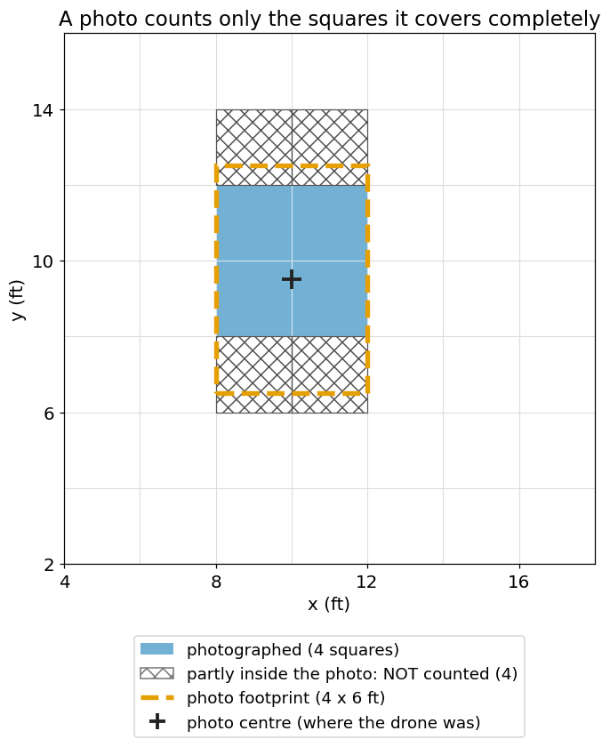
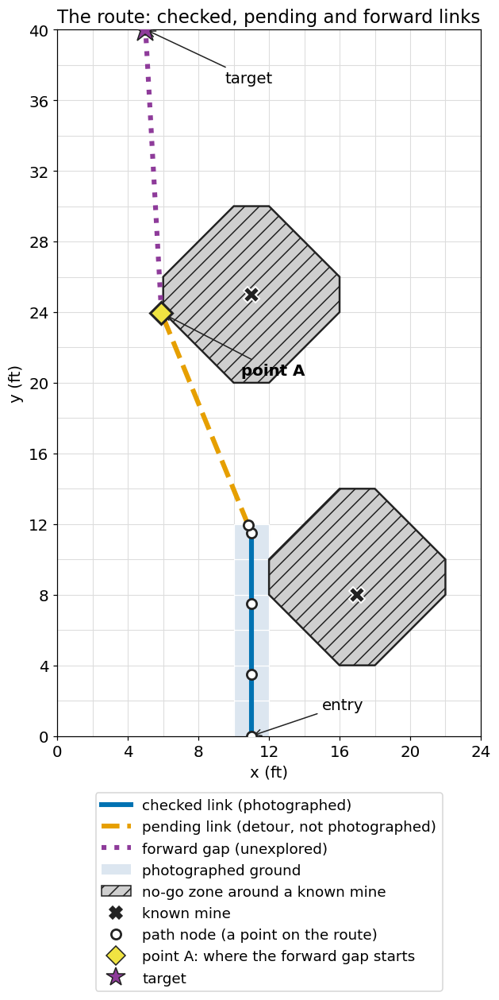
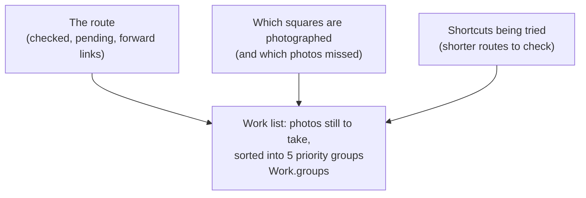
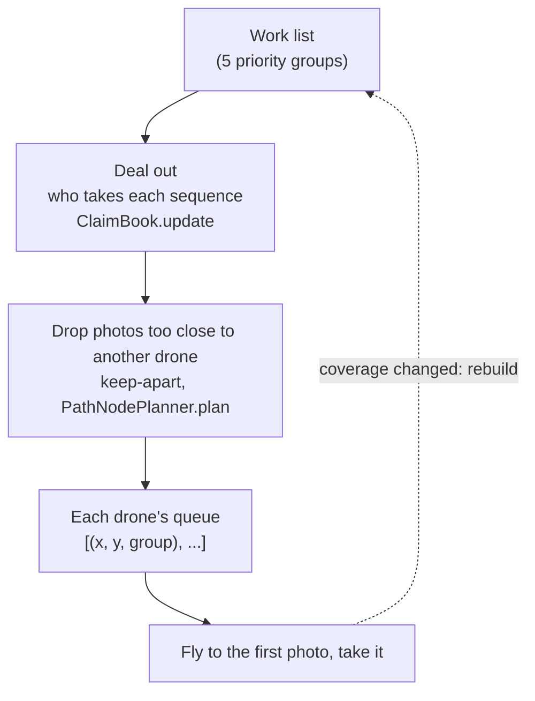
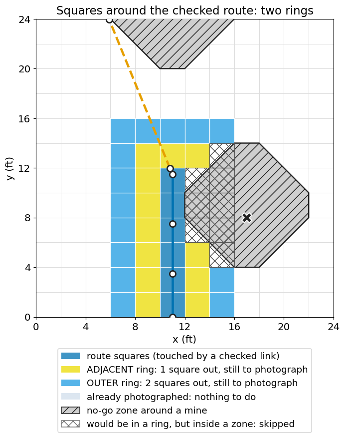
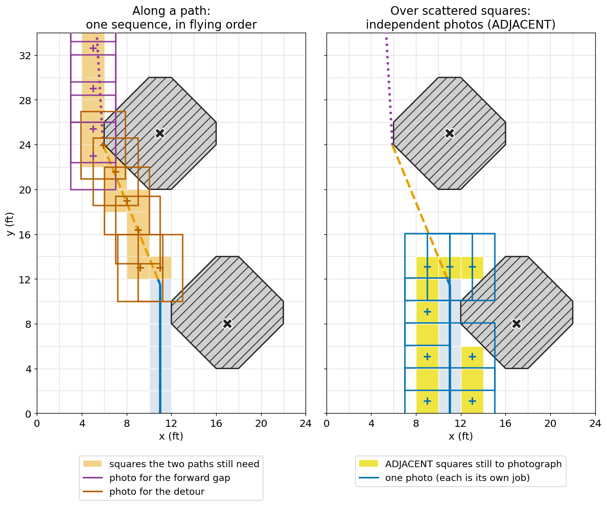
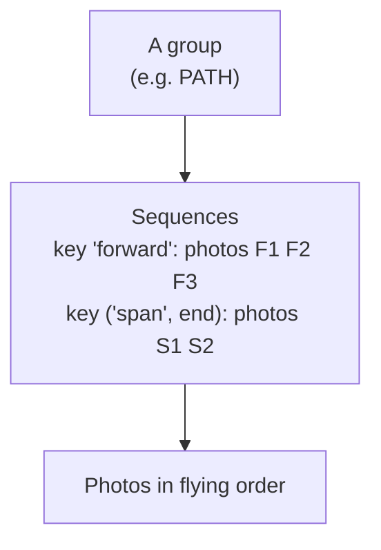
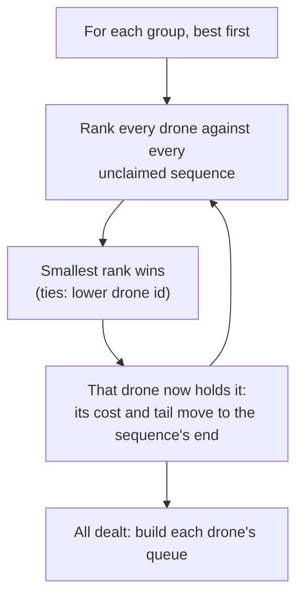
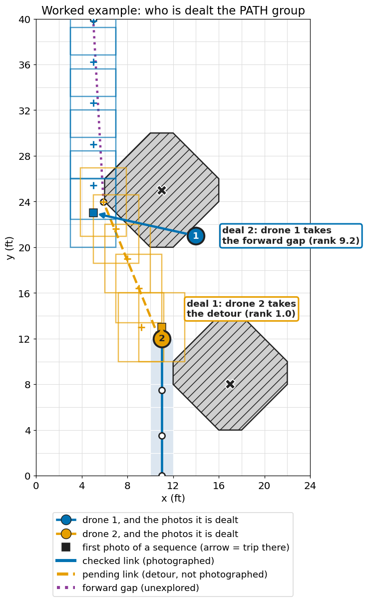
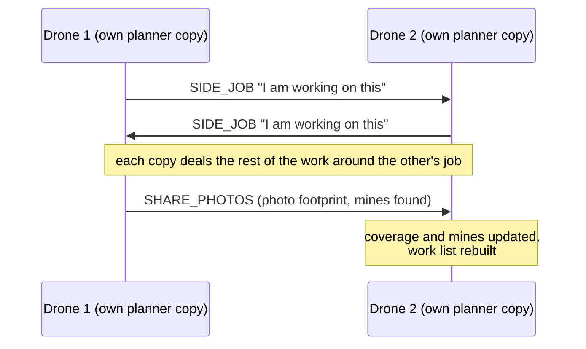

# Priority groups: how photo work is generated, split and handed to drones

**In short.** Drones cannot cross the field safely until the ground ahead has been photographed
and searched for mines. The planner keeps a list of photos still to take and sorts them into
**five priority groups** (route-critical photos first, "nice to have" photos last). It cuts each
group into **sequences** (a run of photos along one path, or one lone photo). Then it hands
whole sequences to the drones of a side: best group first, nearest drone first. Every drone runs
this same computation on its own copy of the planner, so all copies agree on who does what
without a boss. Each drone flies its own queue and re-plans after every photo.

Figures are generated from the real planner code by `docs/img/make_figures.py`
(see [Regenerating the figures](#regenerating-the-figures)).

Contents: **Before you start** (vocabulary and pictures) - 1 The big picture - 2 The five groups -
3 How photos are generated - 4 How work is split - 5 How work is distributed - 6 When it runs and
where it lives - 7 Glossary - Open questions.

> Scope: this document starts from "the route, the photo record and the shortcut trials already
> exist". How the obstacle geometry works is out of scope; it appears only as **"the shortest
> path around known mines"**. Expanding mines and the end-of-run join of the two sides' routes are
> not covered either.

---

## Before you start

Everything below assumes only that you know Python and roughly what the competition is: drones
fly over a mine field, photograph it, and a safe route across is found past the buried mines.
Each idea here is defined once, in plain words, with its code name in `backticks`.

### The field and its squares

The field is **80 ft wide and 300 ft long**. All planner coordinates are **local feet**:
`(0, 0)` is the bottom-left corner, `x` grows to the right, `y` grows up the field.

The planner divides the field into **squares** 2 ft on a side (`CELL = 2.0` in
`pathnode/geometry.py`). A square is named `(col, row)`, counted from the bottom-left: the
square `(5, 3)` covers x from 10 to 12 ft and y from 6 to 8 ft. Squares are the unit of
"photographed or not".

### A photo and its footprint

A drone takes a photo from above. The patch of ground the photo shows is its **footprint**.
The planner assumes a rectangle: by default 6 ft along the field (y) by 4 ft across (x)
(`PlannerConfig.shape_size_ft`). The flight camera's real footprint comes from the camera
configuration and is larger.

**A square counts as photographed only when one photo covers all of it.** A square that two
photos each cover half of is still unphotographed. Why so strict: a mine hides in one square,
and a half-seen square could hide it.

*Figure A: one photo (dashed orange rectangle) fully covers 4 squares (blue). The 4 squares it
only partly covers (hatched) do not count.*

### The route

**The route** is what the planner is building: a safe path from where this side's drones enter
the field to a **target** on the far side. It is a chain of **path nodes** (points on the map)
joined by **links** (the stretches between two neighbouring nodes). Code name: `Chain`
(`pathnode/chain.py`).

Every link is one of three kinds (`LinkKind`):

| Kind | Meaning | Photos still needed? |
|---|---|---|
| **checked** | Ground that has been photographed and found free of known mines. | No |
| **pending** | A planned **detour** around a mine that has been found, but not yet photographed. | Yes |
| **forward gap** | The unexplored stretch ahead, from **point A** to the target. There is at most one. | Yes |

Two special points:
- **Point A** is where the forward gap starts: the frontier of what has been planned. It is
  usually where the route has been photographed up to. After a mine is found ahead it is the far
  end of the detour, since the forward gap now starts there.
- **The target** is where the forward gap is heading. With one side it is a point on the far edge
  of the field. With two sides (below) it is the other side's point A.

When every link is checked and there is no forward gap, the route is complete.

*Figure B: a route on a small 24 x 40 ft window. The drones photographed up the middle (blue
checked links), found a mine straight ahead, and the planner laid a detour around its no-go
zone (orange pending link). Point A (yellow diamond) is the detour's far end; from there the
forward gap (purple) heads for the target. A second mine beside the route is also shown.*

### Known mines and no-go zones

A **known mine** is one a photo has revealed. Around each one the planner draws a **no-go zone**:
the squares within roughly 3 ft of the mine, wrapped in a simple outline. Routes never enter a
no-go zone. Finding a mine on the route is what creates a pending detour. (The zone's exact size
is a tunable constant, `SAFETY_RADIUS_FT` in `pathnode/geometry.py`.)

**"The shortest path around known mines"** is what the planner computes between any two points
while avoiding every no-go zone. How it is built is out of scope here.

### Sides and drones

A **side** is one or two drones that work together from one end of the field (the bottom edge
has `y = 0`, the top edge `y = 300`).
- 1 to 2 drones: one side, working from the bottom toward the far edge.
- 3 to 4 drones: two sides, one from each end, heading toward each other. Each side's target
  is the other side's point A.

**Each drone keeps its own copy of its side's planner** (`PathNodePlanner`). Drones do not ask a
central computer what to do: they share what they see (photos, mines, what job each is doing),
apply it to their own copy, and compute the same answer. Drones on a side are numbered; the
lowest id is the **lead**, and ids break ties.

You now have all the vocabulary needed. The rest of this document is about **the list of photos
still to take**.

---

## 1. The big picture

**Takeaway: the work list is rebuilt from three inputs and flows through one deal-out step to
each drone's queue.**

First, what feeds the work list:

*Diagram 1: the three inputs of the work list.*

Then, how the work reaches a drone:

*Diagram 2: how work reaches a drone. The dotted arrow is why the work list is rebuilt after
every photo.*

Key facts:
- **Five groups**, highest priority first: `PATH`, `BIG_SHORTCUT`, `ADJACENT`, `SHORTCUT`, `OUTER`.
- **A work item** is `(key, sequence)`. The sequence is a run of photos in flying order; the key
  names the path it belongs to (or is `None` for one lone photo).
- **A sequence is claimed whole** by one drone.
- **Claiming rule**: the drone that can *start* an unclaimed sequence *soonest* takes it (ties
  go to the lower drone id).
- **Only the job a drone is flying now is sticky.** Everything else is re-dealt every pass.
- **Nobody waits for a higher group to finish** before taking lower work: a drone with nothing
  left in a higher group is dealt lower work straight away.

---

## 2. The five groups

**Takeaway: the groups are ordered by "how much does this matter for a safe route", and each
group has a reason for its place.**

| Priority | Group (`Group`) | What is in it | Why this priority |
|---|---|---|---|
| 0 | `PATH` | Photos to finish **one valid path**: the forward gap and every pending detour | Without these there is no safe route at all. |
| 1 | `BIG_SHORTCUT` | Photos for the big shortcut being tried (see below) | Above `ADJACENT`, so squares beside a section that is about to be replaced are not photographed for nothing. |
| 2 | `ADJACENT` | Unphotographed squares in the **first ring** around the checked route | A cheap safety margin around the route we will actually fly. |
| 3 | `SHORTCUT` | Photos for the ordinary shortcut being tried | An optional saving; below the safety margin. |
| 4 | `OUTER` | Unphotographed squares in the **second ring** | Nice to have; last. |

### The rings

The two rings are bands of squares around the **checked route**. "The route" here means every
square touched by a checked link (`Work.route_cells`).
- **ADJACENT ring**: squares within 1 square of the route, in any direction, diagonals included
  (`adjacent_ring = 1`).
- **OUTER ring**: squares 2 squares out, beyond the ADJACENT ring (`outer_ring = 2`).

Only squares that still need photographing become work. A square is dropped when it is already
photographed, outside the field, or has its centre inside a no-go zone (nobody will fly there,
so a photo would be wasted; `Work.band`).

*Figure C: the checked route (dark blue squares) and the two rings still to photograph (yellow =
ADJACENT, light blue = OUTER). Hatched squares would be ring squares but lie inside the no-go
zone of the mine beside the route, so they are skipped.*

Settings: `adjacent_ring = 0` means no `ADJACENT` group; `outer_ring <= adjacent_ring` means no
`OUTER` group; `shortcut_ratio = None` means no shortcuts. Defaults are in `PlannerConfig`
(`pathnode/config.py`).

### What feeds `PATH`

- **Forward gap**: the one `FORWARD` link from point A to the target. It can be re-routed as
  new mines appear, since it is only a plan.
- **Pending detour** (code: **pending span**): a `PENDING` link, already planned around a mine
  but not photographed. There can be several.
- Once photographed, a link becomes `CHECKED` and leaves `PATH`. The forward gap shrinks from
  its start as it is photographed. When the gap is closed and nothing is pending, `PATH` is
  empty and the side has `met` its target.

### Shortcut trials

**A shortcut trial** is a proposal to replace a fully checked section of the route with a
shorter path (the shortest path around known mines between the section's two end nodes). It is
only worth trying if it is short enough, saves enough, and needs few enough new photos:

| Tier | Group | Must be shorter than | Must save at least |
|---|---|---|---|
| big | `BIG_SHORTCUT` | `big_shortcut_ratio` (0.8) x the section | `big_shortcut_saving_ft` (20 ft) |
| ordinary | `SHORTCUT` | `shortcut_ratio` (0.9) x the section | `SHORTCUT_MIN_SAVING_FT` (2 squares = 4 ft) |

The photo allowance is the larger of `shortcut_max_waypoints` (8) and one photo per
`shortcut_ft_per_photo` (2 ft) saved. One trial per tier is tried at a time (the biggest
saving). **The route is not touched while a trial is photographed**: the section is replaced only
once the whole shortcut is photographed and clear of every known mine. A shortcut that needs no
photos at all is used at once. Details (anchors, re-evaluation, giving up a pair for good) are
in `pathnode/shortcuts.py`.

---

## 3. How the photos of each group are generated

**Takeaway: photos are placed one of two ways: spaced along a path, or tiled over scattered
squares.**

Both live in `pathnode/placement.py` (`PhotoPlacement`; `Coverage.places_along` delegates to it) and are called by the work sources (`pathnode/work_sources.py`) that `Work.groups()` collects:

| Group | Work items | Method |
|---|---|---|
| `PATH` | one item per unchecked link: key `"forward"` or `("span", end)` | `PathSource` -> `Coverage.places_along(link.poly)` |
| `BIG_SHORTCUT`, `SHORTCUT` | one item, key `("shortcut", a, b)` | `ShortcutSource` -> `Coverage.places_along(trial.poly)` |
| `ADJACENT`, `OUTER` | many items, key `None`, one photo each | `RingSource` -> `PhotoPlacement.tile(squares, key)` |

Why two methods: a path is a line, so photos can be spaced along it in walking order and flown as
one smooth sweep. Ring squares are scattered around it, so no line joins them; it is better to
cover as many as possible per photo and treat each photo as its own small job.

*Figure D: left, the photos (footprint rectangles, centres marked +) planned along the two
unchecked paths of Figure B: 6 for the forward gap, 6 for the detour. Right, the ADJACENT
squares: 12 scattered squares covered by 8 independent photos.*

### 3a. Photos along a path (`places_along`)

1. **Work out what the stretch needs** (`need(poly)`). In the default `CORRIDOR` mode that is the
   squares the path touches. (`BAND` mode also adds every square a mine could endanger the path
   from, and then uses tiling instead.) Only **unphotographed** squares count.
2. **Space photos along the path** (`path_cover_unseen`, in `flight/pathfinding/path_cover.py`)
   by the camera footprint and an `overlap` (0.1).
3. **Keep a photo** only if it fully covers a still-needed square that no earlier photo covers.
4. **Safety net**: any needed square no photo encloses, or that has been **missed** (3c), gets a
   photo centred on it. So a batch always finishes the stretch.
5. **Sort** by position along the path, so the sequence is in flying order.

A half-checked path only gets photos for the rest, because photographed squares are skipped.

### 3b. Free-standing photos for scattered squares (`tile`)

Ring squares are tiled greedily, one photo at a time:
1. Take the next needed square in order: **nearest the entry edge first**.
2. Try 9 candidate photo centres: the square's centre and 8 nudges of `tile_offset` around it.
   (A missed square gets only the centred candidate.)
3. Pick the candidate whose footprint fully encloses the **most still-needed squares**.
4. Remove everything it covers; repeat.

Why the nudge is limited: `tile_offset()` keeps the target square inside the footprint's
inscribed circle (the largest circle that fits in the rectangle), so the photo covers the square
**at any drone heading** (the direction the drone faces). The real footprint turns with the heading; a rectangle nudged
too far would stop covering the square when it turned. The offset shrinks with a smaller footprint
(about 0.09 ft for the config default 6 x 4 ft, more for the larger flight-camera footprint). Each
resulting photo becomes its own item `(None, [p])`.

### 3c. What counts as "needed", and misses

- **Needed squares** (`Work.needed_squares`) = unphotographed squares some group wants: the
  squares of every unchecked link and shortcut trial, plus the ADJACENT and OUTER squares.
- A square becomes **photographed** when a photo's real footprint fully covers it
  (`Coverage.record`; the footprint is grown by `FOOTPRINT_SLACK_FT` = 1e-3 ft to absorb
  lat/lon rounding noise).
- A **miss** is a photo aimed at a needed square that did not cover it (the footprint turned
  with the heading, came out smaller than planned, or the camera failed). Counted in
  `record_footprint` / `record_failed_photo` -> `Coverage.count_misses`.

| Misses | Constant | What happens |
|---|---|---|
| 1 | `MISS_CENTRE = 1` | The square gets a photo **centred on itself**. |
| 3 | `MISS_BLOCK = 3` | The square is **blocked**: treated as a tiny obstacle (`PathNodePlanner._block_square`), so paths re-route around it and the same photo is never handed out forever. |

---

## 4. How the work is split

**Takeaway: work is split into sequences, and a sequence is never divided between drones.**

Shape of the work list, for a small case:

*Diagram 3: a group is a list of sequences; a sequence is one path's photos in order (or one
photo). Claims are made per sequence.*

**Keys** (`pathnode/work_sources.py`) name a sequence by geometry, never by an object id. So every drone's
separate copy of the planner gives the *same key for the same path*. That is how one drone can
honour a job its side-mate announced.

| Key | Names | Why this form |
|---|---|---|
| `"forward"` | the forward gap | at most one exists |
| `("span", end)` | a pending detour, by its far end node's (x, y) | its start moves as it gets photographed; its end does not |
| `("shortcut", a, b)` | a shortcut trial, by its two end nodes' (x, y) | the same pair is the same trial |
| `None` | a lone photo | claimed by its position (internally `("loose", point)`) |

**Why a sequence is claimed whole**:
- Splitting a path between two drones only sends the second one ahead to ground the first is
  about to cover anyway.
- The far end of a path is the part most likely to be re-routed before anyone gets there.

**Order inside a drone's queue** (`ClaimBook._queue`): group by group; within a group, its claimed
sequences nearest-start-first, **except the forward gap, which goes last of its group**. Why: it
is open-ended, and short detours near point A are cheaper to clear on the way than to come back
for.

---

## 5. How work is distributed

**Takeaway: for each group in turn, the sequence goes to whichever drone could start it
soonest, counting everything that drone already holds.**

### 5a. The claiming rule (`ClaimBook.update`)

Two terms first. A drone's **cost so far** is the distance it would fly to do everything already
dealt to it (including trips between sequences). Its **tail** is where it would end up. The
**rank** of a (drone, sequence) pair is `cost so far + straight-line distance from tail to the
sequence's first photo`: roughly "how far would this drone have flown when it arrives to start
this sequence".

The rule is a **growing radius**: imagine a circle growing from 0; a drone may take a sequence
once it could reach its start within the radius. The code does the same without stepping the
radius: repeatedly hand the smallest rank to its drone.

*Diagram 4: repeat until the group is fully dealt. A drone just given a sequence has a longer
route, so the next one tends to go to its side-mate.*

Consequences:
- **A drone's claims raise its own threshold**, so nothing is sent across the field while another
  drone is nearer.
- **No roles**: whichever drone is at point A holds the path ahead; a detour behind it tends to go
  to the other drone. Either drone may pioneer.
- **Deterministic**: ties go by drone order (ascending id), then by start point. The same inputs
  give the same claims on every copy.
- **A lost drone** (position unknown, `None`) holds nothing and is dealt nothing.
- **Lower groups are costed as if the higher-group work were already done.** A drone that will
  finish soon is dealt lower work near where it will then be.

### 5b. Worked example

A real run of `ClaimBook` on the route of Figure B, with two drones placed by hand: drone 1
(lead) at (14, 21) near point A, drone 2 at (11, 12) at the end of the checked route. The
example is produced by `make_figures.py`, which also asserts that this hand replay of the rule
agrees with `ClaimBook`.

*Figure E: the two `PATH` sequences (forward gap and detour). Arrows are the trips to each
sequence's first photo (squares); the rank of each winning pair is in the labels. Drone 2 is
dealt the detour first, then drone 1 takes the forward gap.*

`PATH` has two unclaimed sequences. Both drones start with cost 0 and tail at their positions.

| Pair (drone, sequence) | Rank in deal 1 |
|---|---|
| drone 1, forward gap | 9.2 |
| drone 1, detour | 8.5 |
| drone 2, forward gap | 12.5 |
| drone 2, detour | **1.0** (smallest) |

- **Deal 1**: drone 2 takes the detour (rank 1.0). Its cost becomes 14.4 (1.0 + the detour's
  length), its tail the detour's far end.
- **Deal 2**: only the forward gap is left. Drone 1: 9.2. Drone 2: 14.4 + 1.3 = 15.7, since it is
  now committed to the detour. **Drone 1 takes the forward gap.**

Result: drone 2 clears the detour, drone 1 explores ahead; nobody crosses the field.

Lower groups (same run): all 8 `ADJACENT` photos go to drone 2, whose queue continues with them
after the detour, because it finishes near them and drone 1 will be far up the field. Drone 1's
next lower work is `OUTER`. Nobody waited for `PATH` to be finished.

### 5c. Stickiness (only the current job)

`ClaimBook.heads[d]` = `(group, key, point)` of the first photo in drone `d`'s queue: its
**head**, or current **job**.
- At the next update, `_inherit` first gives each active drone back the sequence its head belongs
  to. Paths are matched by **key** (a re-plan may shift every photo of a path; it must not flip to
  whoever is a foot nearer its new start). A lone photo is matched to the nearest regenerated lone
  photo within `MATCH_FT` = 2 ft.
- **Everything else is dealt fresh**, because a claim made from across the field is stale once the
  drones move.
- If two drones hold the same job, the first in drone order keeps it.

### 5d. Idle drones and lower groups

Two mechanisms, in different places:
1. **In the deal** (5a): a drone that will finish its higher-group work soon is dealt lower-group
   work.
2. **In `PathNodePlanner.plan(..., me=...)`**: if this copy gives drone `me` *nothing*, `me`
   takes its side-mate's queued work **except the job the mate announced**. Why: the mate's own
   copy of the planner may differ while messages are in flight, so nobody else would do that work.

### 5e. Announced jobs between side-mates

Each drone announces the job it is working on, so its side-mate's copy never deals that job to
anyone else.

*Diagram 5: `SIDE_JOB` says "this is mine" (sent on change and every 1 s); `SHARE_PHOTOS` keeps both
copies' photo record and mines identical so their work lists match.*

- The mate's announced job (`held` in `ClaimBook.update(..., held)`) **replaces** this copy's own
  record of the mate's job, so every copy honours it. `SideAgent.plan` builds it from
  `drone.mate_job`, set by `interdrone.py` on `MessageType.SIDE_JOB`.
- The announced job is what the drone will **actually fly next**, after keep-apart (5f), so a
  photo it had to skip is not announced for nothing.
- Messages lag, so copies can briefly disagree; the announced job plus stickiness bring them
  back together at the next exchange.

### 5f. Keep-apart (`SideCoordinator._keep_apart`)

The deal keeps drones on *different work*, not physically apart, so a second filter drops photos
that are too close to another drone. Dropped photos stay work for later.

- The rule is **asymmetric so drones cannot block each other**: the drone with the higher id
  keeps a larger distance from the lower-id drone's position and next photo; the lower-id drone
  only keeps a small clear distance from the higher-id drone's position.
- It applies to the other side's drones as well as to the side-mate.
- The small distance must stay above the flight code's drone-separation abort distance; both
  distances are tunable (`keep_away_ft`, `keep_clear_ft` in `PlannerConfig`) and **may change**.
- If work is left but every queue was emptied, `_make_way` sends a drone to a spare photo on
  ground where none is needed, so the standoff is broken. That spare photo is put in the last
  group so it is never mistaken for a real job.

### 5g. A lost drone

- `SideAgent._check_mate`: a side-mate silent for `MATE_LOST_S` = 20 s (once the mission has run
  that long) becomes `mate_lost`.
- Its position becomes `None`, it is dropped from the announced jobs, and it gets no more
  `SIDE_JOB` messages.
- `ClaimBook.update` gives it an empty queue; every sequence it held is unclaimed and is dealt to
  the remaining drone.
- Before it is declared lost, a stale position falls back to its last photo report, then the
  side's start point (`SideAgent.positions`; a position report older than
  `MATE_POSITION_MAX_AGE_S` = 2 s is not trusted).

---

## 6. When it runs and where it lives

**Takeaway: the whole computation runs after every photo, and is cached so that is cheap.**

**When**
- **Every planning pass.** In flight, the `CalcScanPath` state (the flight state machine's planning step) runs after every photo (the `Scan` state returns to it)
  and whenever relayed data sets `drone.replan_needed`. It calls `side.plan()`, then
  `resetWaypoints` with this drone's queue, then enters `Scan`.
- The simulator does the same per drone per tick (`sim.py: _step`): it asks for the queue, sends
  its job to its mates, flies only the first photo of `queue[0]`, records it and shares it. Flight
  and simulator both go through `SideSession` -> `PathNodePlanner.plan`.
- **Caching**: `Work.groups()` is cached on `Work.state_key()` = (photo-record version, obstacle
  version, route signature, shortcut signature); equal keys give equal work. Every photo or miss
  bumps the photo-record version, so the work is rebuilt after each photo and only then.

**Where**

| Concept | File : function |
|---|---|
| Group enum, tunables, `PlannerConfig` | `flight/pathfinding/pathnode/config.py` : `Group`, `PlannerConfig`, `MISS_CENTRE`, `MISS_BLOCK` |
| Building the five groups, rings, cache | `pathnode/work.py` : `Work.groups`, `Work.band`, `Work.needed_squares` |
| One producer of work per group, keys | `pathnode/work_sources.py` : `WorkSource`, `PathSource`, `ShortcutSource`, `RingSource` |
| Photos along a path, tiles | `pathnode/placement.py` : `PhotoPlacement.places_along`, `tile`, `tile_offset`, `CorridorPlacement`, `BandPlacement` |
| Photographed state, misses | `pathnode/coverage.py` : `Coverage.record`, `count_misses` |
| Route: forward gap, pending detour | `pathnode/chain.py` : `Chain`; `config.py` : `LinkKind` |
| Shortcut trials | `pathnode/shortcuts.py` : `Shortcuts`, `Trial` |
| Claiming, stickiness, queues | `pathnode/claims.py` : `ClaimBook.update`, `_inherit`, `_queue` |
| Idle takeover, keep-apart, make-way | `pathnode/coordination.py` : `SideCoordinator.plan`, `_take_over`, `_keep_apart`, `_make_way` (called by `PathNodePlanner.plan`) |
| Per-drone copy, events in | `pathnode/session.py` : `SideSession.assignments`, `own_photo`, `mate_photo` |
| Announcements, mate lost, inbox | `flight/pathfinding/side_agent.py` : `SideAgent.plan`, `_announce_job`, `_check_mate` |
| SIDE_JOB receive | `state_machine/interdrone.py` : `MessageType.SIDE_JOB` -> `drone.mate_job` |
| Queue to waypoints, each pass | `state_machine/states/impl/calc_scan_path_impl.py` : `run` |
| Simulator | `pathnode/sim.py` : `Mission`, `_step` |

### Regenerating the figures

From the repo root: `PYTHONPATH=. python docs/img/make_figures.py` (PowerShell:
`$env:PYTHONPATH="."; python docs/img/make_figures.py`). Needs matplotlib, shapely and numpy. It
builds a 24 x 40 ft example with the real `PathNodePlanner`, `ClaimBook` and `Coverage`, and
writes `fig_a` to `fig_e` PNGs into `docs/img/`. If the planner's behaviour changes, rerun it and
recheck the numbers quoted in 5b and under Figure D.

---

## 7. Glossary

- **Field / square**: the 80 x 300 ft field, divided into 2 ft squares named `(col, row)`.
- **Photo footprint**: the ground a photo shows; a square counts as photographed only when one
  footprint covers it entirely.
- **Route (`Chain`)**: this side's path so far: path nodes joined by links.
- **Checked / pending / forward link**: photographed / planned detour not yet photographed / the
  unexplored gap from point A to the target.
- **Point A**: where the forward gap starts.
- **Target**: where the forward gap heads: the other side's point A, or a far-edge point.
- **Known mine, no-go zone**: a mine a photo revealed, and the area around it routes must avoid.
- **The shortest path around known mines**: the planner's shortest route between two points that
  stays out of every no-go zone.
- **Side**: the one or two drones working from one field edge; each keeps its own planner copy.
- **Forward gap / pending span (detour)**: see the link kinds.
- **Shortcut trial**: a proposed shorter path for a checked section, photographed before it
  replaces anything.
- **Group**: one of five priority levels of work (`Group`).
- **Sequence**: the photos along one path in flying order, or a single photo.
- **Key**: geometric name of a sequence (`"forward"`, `("span", end)`, `("shortcut", a, b)`, `None`).
- **Claim**: one drone owning one sequence; claims are per sequence, whole.
- **Rank**: cost so far plus straight-line distance to a sequence's start; the smallest wins.
- **Head / job**: the first photo in a drone's queue as `(group, key, point)`; what it announces.
- **Held job**: a job announced by the side-mate that this copy must not deal to anyone else.
- **Ring (ADJACENT / OUTER)**: squares 1 / 2 squares away from the checked route.
- **Tile**: a lone photo covering several scattered squares.
- **Miss**: a photo aimed at a needed square that did not cover it.
- **Blocked square**: a square given up on after `MISS_BLOCK` misses; treated as an obstacle.
- **Keep-apart**: the filter that drops photos too near another drone.

---

## Open questions found in the code

1. **Stale docstring in `claims.py`** (may be fixed): it says a key is "a redirection's id";
   `work.py` now keys pending detours by `("span", end)`.
2. **Wording vs behaviour in `claims.py`** (may be fixed): it says a group is handed out only
   once every higher group is fully claimed. `ClaimBook.update` deals all groups every pass, in
   order, each costed from the higher-group claims. Same effect (a higher group is always claimed
   first), but the wording can mislead.
3. **Forward gap claimed first, flown last**: it is often claimed first (soonest start) but moved
   to the end of its group in the drone's queue. Intentional per the docstring; easy to misread.
4. **Point A wording**: `chain.py` defines point A as "the node before the forward link". After a
   mine is found ahead that node is the far end of a *pending* detour, not the end of the
   photographed route. Older docs described it as "the end of the checked route".
