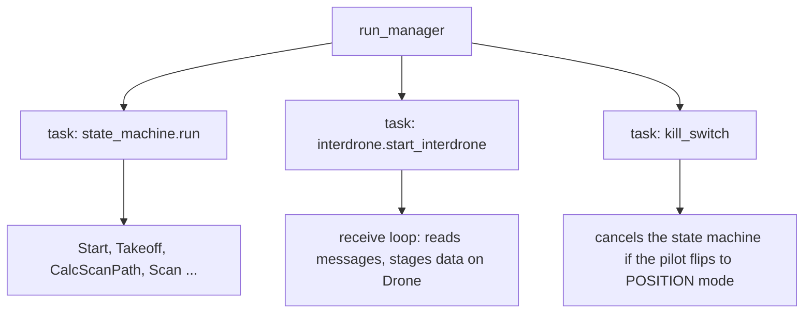
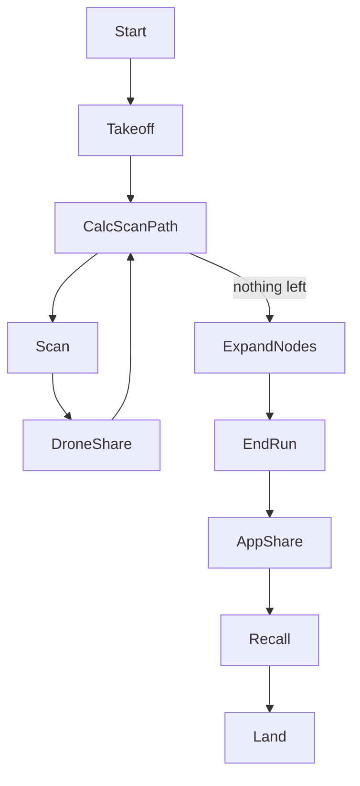

# 1. Process start: two loops, one drone, and the Start state

> Part of the [execution walkthrough](README.md). Next: [2. Takeoff and planner setup](02-takeoff-and-planner-setup.md).

**What this chapter covers.** What happens between typing `python run.py -i 1` and the drone being armed: how the program is split into things that run at the same time, how a drone learns which *side* of the field it belongs to, and what the first state (`Start`) does.

The story we follow in every chapter: **4 drones**. Drones 1 and 2 start on the bottom edge of the field, drones 3 and 4 on the top edge. We tell it from **drone 1's point of view** and add side notes where drones 2, 3 and 4 differ.

## 1.1 The program starts

`run.py` is the entry point. One copy of it runs on each drone (each drone is a separate computer and process; `-i N` tells the copy which drone it is).

```python
# run.py:20-27
        settings: FlightSettings = FlightSettings.from_mission_config()

        log_dir = flight_log.configure(settings.current_drone_ID)
        print(f"Logging drone {settings.current_drone_ID} to {log_dir}")

        logging.info("Starting processes")
        flight_manager: FlightManager = FlightManager()
        asyncio.run(flight_manager.run_manager(settings))
```

- `FlightSettings.from_mission_config()` reads `mission_config.json` (or the file given with `--config`) plus the command-line flags `-i/--id`, `-s/--sim`, `-a/--airsim`.
- `flight_log.configure(...)` opens this drone's own event log (one JSON line per event). Later chapters mention `flight_log.event("...")` calls; those are these lines.
- `asyncio.run(flight_manager.run_manager(settings))` starts the **asyncio event loop**. From here on, almost everything is an `async def` function that runs on that one loop.

**Goes next to ->** `FlightSettings` (section 1.2), then `FlightManager.run_manager` (section 1.3).

## 1.2 FlightSettings: who am I, and who is on my side?

`FlightSettings` is a bag of mission facts. Two matter most here: **which drone am I** and **which drones are on my side of the field**.

A **side** is the one or two drones that work from one edge of the field. There are **no roles** (no "lead" and "member"): the drones of a side are equals, and every drone keeps its own copy of its side's planner (chapter 2).

```python
# state_machine/flight_settings.py:40-47
def mission_sides(n_drones: int) -> list[list[int]]:
    """The mission's sides, START edge first: 1-2 drones work one side; 3-4 split into two
    (1/2 from the START edge, 3/4 from the END edge). A side's drones are equals: each keeps
    its own copy of the side's planner (flight/pathfinding/side_agent.py) -- there are no
    roles."""
    if n_drones <= 2:
        return [list(range(1, n_drones + 1))]
    return [[1, 2], list(range(3, n_drones + 1))]
```

- 1 or 2 drones: one side, `[[1]]` or `[[1, 2]]`, and the target of the search is the far edge of the field.
- 3 or 4 drones: two sides, `[[1, 2], [3, 4]]` (or `[[1, 2], [3]]`). The two sides work toward each other from opposite edges and must meet in the middle.

The constructor turns that into per-drone facts:

```python
# state_machine/flight_settings.py:191-207
        # Sides below are assigned by drone id, so the mission's drones must be exactly
        # 1..n: fielding [1, 3, 4] would silently pair the wrong drones.
        if sorted(self.__drones_in_mission) != list(range(1, len(self.__drones_in_mission) + 1)):
            raise ValueError(
                f"drones_in_mission must be 1..n (got {self.__drones_in_mission}): sides are"
                " assigned by drone id"
            )

        # This drone's side (see mission_sides).
        self.__start_side: Side = Side.START
        self.__paired_drone: int | None = None
        for side_index, side in enumerate(mission_sides(len(self.__drones_in_mission))):
            if drone_ID in side:
                self.__start_side = Side.START if side_index == 0 else Side.END
                others = [d for d in side if d != drone_ID]
                self.__paired_drone = others[0] if others else None
        self.max_flight_time = 60 * 7
```

- The drone ids in `drones_in_mission` must be exactly `1..n`; sides are computed from the id, so `[1, 3, 4]` is rejected.
- `start_side` is `Side.START` for the first side (bottom edge) and `Side.END` for the second (top edge).
- `paired_drone` is my **side-mate**: the other drone in my side, or `None` if I am alone.
- `max_flight_time` is 7 minutes (`60 * 7`). After that the mission is cut short (chapter 10).

The two properties the messaging code uses:

```python
# state_machine/flight_settings.py:504-506, 510-513
    def side_drones(self) -> list[int]:
        """This drone's side: itself and its side-mate, ascending."""
        return next(side for side in mission_sides(len(self.__drones_in_mission))
    ...
    def partner_side_drones(self) -> list[int]:
        """The other side's drones (empty with one side): where cross-side messages go."""
        sides = mission_sides(len(self.__drones_in_mission))
        return next((side for side in sides if self.__current_drone_ID not in side), [])
```

For the 4-drone mission:

| drone | `start_side` | `side_drones` | `partner_side_drones` | `paired_drone` |
|---|---|---|---|---|
| 1 | START (bottom) | `[1, 2]` | `[3, 4]` | 2 |
| 2 | START (bottom) | `[1, 2]` | `[3, 4]` | 1 |
| 3 | END (top) | `[3, 4]` | `[1, 2]` | 4 |
| 4 | END (top) | `[3, 4]` | `[1, 2]` | 3 |

Every message to the other side goes to *all* of `partner_side_drones`, so each copy of that side's planner hears it.

Note: `mission_config.json` checked into the repo currently lists only `drones_in_mission: [1]`, so a plain `python run.py` is a solo flight. The 4-drone layout is `mission_config_full.json` (`"drones_in_mission": [1, 2, 3, 4]`, `"mission_type": "Competition"`).

**Goes next to ->** `FlightManager.run_manager`.

## 1.3 FlightManager: three things running at once

```python
# state_machine/flight_manager.py:60-83
        self.drone.id = flight_settings.current_drone_ID
        self.drone.use_settings(flight_settings.sim_mode)

        logging.info("Initializing drone connection")
        await self.drone.connect_drone()

        if flight_settings.sim_mode is SimMode.AIRSIM:
            self.drone.remove_arming_check()

        interdrone_state: Interdrone = Interdrone(flight_settings, self.drone)

        logging.info("Starting processes")
        state_machine: StateMachine = StateMachine(
            Start(self.drone, flight_settings, interdrone_state),
            self.drone,
            flight_settings,
            interdrone_state,
        )
        state_machine_task: asyncio.Task[None] = asyncio.ensure_future(state_machine.run())
        interdrone_state_task: asyncio.Task[None] = asyncio.ensure_future(
            interdrone_state.start_interdrone()
        )
        # TODO START INTERDRONE TASK IN STATE MACHINE TOO
        asyncio.ensure_future(self.kill_switch(state_machine_task))
```

- `Drone` (`state_machine/drone.py`) wraps the flight controller connection (dronekit) and holds all the per-drone mission data that states hand to each other (waypoint queue, planner, staged messages...). It is created empty in `FlightManager.__init__`.
- `Interdrone(...)` (constructed here, defined in `state_machine/interdrone.py`) starts a **networking thread** in its constructor (`NetworkingThread.run_networking_thread`). That thread owns the sockets; the rest of the code only talks to it through two queues (`queue_client_message` to send, `try_get_server_message` to receive).
- `StateMachine(Start(...), ...)` is the loop that runs the states (section 1.4).
- Three asyncio tasks are started:



**Why this matters for everything that follows.** The state machine task and the receive-loop task share **one event loop**. Python only switches between them at an `await`. So:

- while a state is running between two `await`s, no message handler can run;
- the receive loop must never change the planner directly (a state could be half-way through using it at the next `await`). It only **stages** incoming data on the `Drone` (`pending_photo_reports`, `pending_cross_pair_mines`, ...), and the next `CalcScanPath` pass applies it in a fixed order (chapters 3 and 7).

Note: the two tasks are cooperative, and the receive loop is not fully polite. It polls the networking thread with `try_get_server_message(timeout=0.02)`, which is a **blocking** wait on a `concurrent.futures.Future` (and `queue_client_message` blocks the same way until the networking thread has queued the message):

```python
# interdrone_communication/networking_interface.py:26-28, 35-45
    def queue_client_message(self, message: Message, timeout: float | None = None) -> None:
        future = asyncio.run_coroutine_threadsafe(self.client_in.put(message), self.loop)
        future.result(timeout=timeout)
    ...
    def try_get_server_message(self, timeout: float = 0.0) -> Message | None:
        if self._server_out_future is None:
            self._server_out_future = asyncio.run_coroutine_threadsafe(
                self.server_out.get(), self.loop
            )
        try:
            result = self._server_out_future.result(timeout=timeout)
            self._server_out_future = None
            return result
        except concurrent.futures.TimeoutError:
            return None
```

So whenever no message is waiting, each pass of the receive loop freezes the whole event loop (state machine included) for up to 20 ms, then sleeps 0.1 s. Nothing breaks (legs are polled every 0.25 s), but it is why the loop drains up to 25 messages per pass and why timing-sensitive code should not assume it can run during those 20 ms.

The kill switch:

```python
# state_machine/flight_manager.py:130-135
        while self.drone.vehicle.mode.name != "POSITION":
            await asyncio.sleep(0.5)

        logging.critical("Kill switch activated. Terminating state machine.")

        state_machine_process.cancel()
```

- If the pilot switches the vehicle into `POSITION` mode, the state machine task is cancelled and the drone is left under manual control.
- The tail of `run_manager` (the `while True` loop) waits until the state machine is idle and has stayed idle for `RESTART_GRACE_S` (2 s), because `EMERGENCY_LAND` cancels and restarts the state machine (section 1.6).

**Goes next to ->** `StateMachine.run`.

## 1.4 StateMachine: a loop that swaps one state for the next

```python
# state_machine/state_machine.py:133-137
    async def _run(self) -> None:
        """Runs the flight code specific to each state until completion."""
        while self.current_state:
            self.interdrone.update_state(self.current_state)
            self.current_state = await self.current_state.run()
```

- Every state is an object with an `async run()` that **returns the next state object** (or `None` to stop).
- `interdrone.update_state(...)` tells the receive loop which state is current (needed to cancel it, section 1.6).
- The whole mission is therefore this cycle of `return NextState(self.drone, self.flight_settings, self.interdrone)` calls. The state classes (`state_machine/states/*.py`) are empty shells; the code is in `state_machine/states/impl/*_impl.py`, plugged in by lines like `Start.run_callable = run`.



(`Takeoff` also has a POIF demo branch and a plain-takeoff branch; this walkthrough follows the **mission** branch.)

## 1.5 The Start state

`start_impl.py` `run()` is the first thing that runs.

```python
# state_machine/states/impl/start_impl.py:42-48
        update_state("Start")
        update_drone(self.drone)
        update_flight_settings(self.flight_settings)
        logging.info("Start state running")

        await self.drone.connect_drone()
        self.drone.vehicle.mode = dronekit.VehicleMode("GUIDED")
```

- `update_state/update_drone/update_flight_settings` (in `state_tracker.py`) write the current state name and settings to a small JSON file that the kill switch tooling reads.
- `connect_drone()` opens the dronekit connection; the vehicle is put in `GUIDED` mode, meaning "fly where the software says".

Then it waits until this drone can arm **and** every other drone answers a ping:

```python
# state_machine/states/impl/start_impl.py:54-78
        ping_ok: bool = False
        ever_armable: bool = False
        prev_armable: bool = False
        wait_started: float = time.monotonic()
        while True:
            armable: bool = self.drone.vehicle.is_armable
            if armable and not ever_armable:
                ever_armable = True
                logging.info(
                    "Drone %s became armable after %.1fs -- starting pings",
                    self.drone.id,
                    time.monotonic() - wait_started,
                )
            elif prev_armable and not armable:
                # EKF/GPS can fall back out of a converged state. Without this the
                # regression is indistinguishable from a ping failure in the log.
                logging.warning("Drone %s is no longer armable", self.drone.id)
            prev_armable = armable
            if armable:
                ping_ok = await self.interdrone.ping_drones()
                if ping_ok:
                    break
            logging.info("Waiting to start -- armable: %s, ping: %s", armable, ping_ok)
            await asyncio.sleep(1.0)
        logging.info("All drones connected and armable")
```

- `is_armable` (the autopilot's own "GPS/EKF is good" flag) is checked first because it is free; pinging costs network traffic, so it only starts once the drone is armable.
- `ping_drones()` sends a `PING` to every other drone and waits up to 2 s for `PING_ACK`s:

```python
# state_machine/interdrone.py:260-269, 284-292, 332-335
    async def ping_drones(self, timeout_sec: float = 2.0) -> bool:
        """
        All drones run this function.
        Sends PING and waits (with a timeout) until every other drone has ACK/NACK.
        Returns True only if all responded with ACK; drones that don't answer within
        timeout_sec are treated as failures rather than blocking forever.
        """
        # If only drone in test, return true for ping_drones
        if self.flight_settings.other_drones_in_mission == []:
            return True
    ...
        ping_message: Message = Message.create(
            id=MessageType.PING,
            drones_to_send_data=tuple(
                self.flight_settings.other_drones_in_mission,
            ),
            sender_id=self.flight_settings.current_drone_ID,
            data={},
        )
        self.send(ping_message)
    ...
        all_ack: bool = all(result is True for result in ping_by_id.values())

        logging.debug("Return %s from ping_drones. Ping status is: %s", all_ack, ping_by_id)
        return all_ack
```

  With no other drones it returns `True` at once. A drone that does not answer counts as a failure, and the loop retries once per second. On the *other* side, the `PING` is answered in the receive loop by `case MessageType.PING:` (an unconditional `PING_ACK`).

Then it waits for the command to arm:

```python
# state_machine/states/impl/start_impl.py:82-107
        if self.flight_settings.mission_type == "Prompted":
            # A prompted run can be started from the console *or* from the app.
            # The app's ARM only ever lands in interdrone.cmd_msg, so waiting on
            # the console alone leaves the drone parked at this prompt with the
            # command already delivered and nothing looking at it.
            def armed_by_app() -> bool:
                return self.interdrone.get_cmd_msg() == CMD_MSG.ARM

            msg: str | None = await get_input_or(
                "Type 'arm' to arm the drone and start the mission: ", armed_by_app
            )
            while msg is not None and msg.strip().lower() != "arm":
                msg = await get_input_or(
                    "Invalid input. Type 'arm' to arm the drone and start the mission: ",
                    armed_by_app,
                )
            if msg is not None:
                # Armed from the console. Publish it the same way the app's ARM
                # would have, since later states and the app's swarm status both
                # read cmd_msg to decide what this drone is doing.
                self.interdrone.set_cmd_msg(CMD_MSG.ARM)
        else:
            while self.interdrone.get_cmd_msg() != CMD_MSG.ARM:
                await asyncio.sleep(0.1)

        await self.drone.arm()
```

- In `"Prompted"` mode a human types `arm` (or the app sends `ARM`). In every other mode (`"Automatic"`, `"Competition"`) the drone waits for `interdrone.cmd_msg` to become `CMD_MSG.ARM`; nothing in `start_impl.py` sets that itself, so it must arrive as an `ARM` **message** (from the app, or relayed by drone 1).
- `interdrone.cmd_msg` is a small mailbox the receive loop writes and the states read. It is how the app's commands (ARM, TAKEOFF, MISSION, LAND...) reach the state machine.

Finally drone 1 fans the arm command out and waits for the others:

```python
# state_machine/states/impl/start_impl.py:109-117
        if self.drone.id == 1:
            for drone_id in self.flight_settings.drones_in_mission:
                if drone_id != self.drone.id:
                    await self.interdrone.send_ARM((drone_id,))
        while not await self.interdrone.all_armed():
            logging.info("Waiting for all drones to be armed...")
            await asyncio.sleep(0.1)

        return Takeoff(self.drone, self.flight_settings, self.interdrone)
```

- `send_ARM` goes to every other drone. Their receive loop's `case MessageType.ARM:` sets their own `cmd_msg = ARM` (only if their pings all succeeded) and replies `ARM_ACK`.
- `all_armed()` (drone 1 only; it returns `True` for other drones) turns true when every `DroneState.armed` flag has been set by an `ARM_ACK`.
- Drone 2/3/4: same code, but they skip the `send_ARM` block and `all_armed()` is immediately true. They proceed to `Takeoff` as soon as they are armed themselves.

Note: `await self.drone.arm()` (in `drone.py`) waits for `is_armable`, sets `GUIDED`, sets `armed = True`, then polls until the autopilot confirms. So "armed" is real by the time `ARM_ACK` is sent... but note that the `ARM` handler sends the ACK when the message arrives, *before* this drone's own `Start` state has called `arm()`. `ARM_ACK` therefore means "I got the command and my pings are fine", not "my motors are armed".

**Goes next to ->** [Chapter 2: `Takeoff`](02-takeoff-and-planner-setup.md).

## 1.6 Side note: how a command can interrupt the state machine

`EMERGENCY_LAND` and `LAND` messages must take effect *now*, even in the middle of `Scan`. The receive loop calls `start_emergency_land()` / `start_land()`, which run `Interdrone.interrupt_into`:

```python
# state_machine/interdrone.py:1244-1273, 1275-1300
    async def cancel_state(self) -> None:
        """
        Cancels the current state being executed.
        If the current state is in an atomic context,
        waits for the lock to release before cancelling.

        Raises
        ------
        RuntimeError
            If there is no running state/task to cancel.
        """
        if not self._current_state or not self._current_task:
            raise RuntimeError("No running state/task to cancel")

        # Check if the state is in an atomic context before cancelling
        # If so, wait for the lock to release then cancel task
        task_to_cancel = self._current_task
        async with self._current_state.atomic:
            task_to_cancel.cancel()
            self._current_state = None
            self._current_task = None

        # We need to wait for the task to actually be cancelled before
        # doing anything useful, which we can do by awaiting the task after
        # it has already been scheduled for cancellation
        # This will always raise the CancelledError
        try:
            await task_to_cancel
        except asyncio.CancelledError:
            pass
    ...
    async def restart_state_machine(self, state: "State | None") -> None:
        """
        Restarts the state machine with the given state, or if none is
        provided, the last state that was running

        Parameters
        ----------
        state : State | None
            The state to restart the state machine with.

        Raises
        ------
        RuntimeError
            If there is a running task or the state machine has not been registered.
        """
        if self._current_state or self._current_task:
            raise RuntimeError("Cannot restart state while a task is running")

        if not self._restart_callback:
            raise RuntimeError("Cannot restart state machine without a registered callback")

        # Start the restart callback as a separate task but do not wait for it
        restart_task: Task = asyncio.ensure_future(self._restart_callback(state))
        # Nothing awaits that task, so without this a failure to restart is
        # visible only as the state machine mysteriously not running.
        restart_task.add_done_callback(_log_restart_failure)
```

- The running state's task is cancelled (waiting for the state's `atomic` lock if it is inside a critical section) and a new state (`EmergencyLand` or `Land`) is started through the callback registered by `StateMachine.__init__` (`self.interdrone.register_state_machine(self.run)`).
- This is why `run_manager` waits `RESTART_GRACE_S` before deciding the flight is over.
