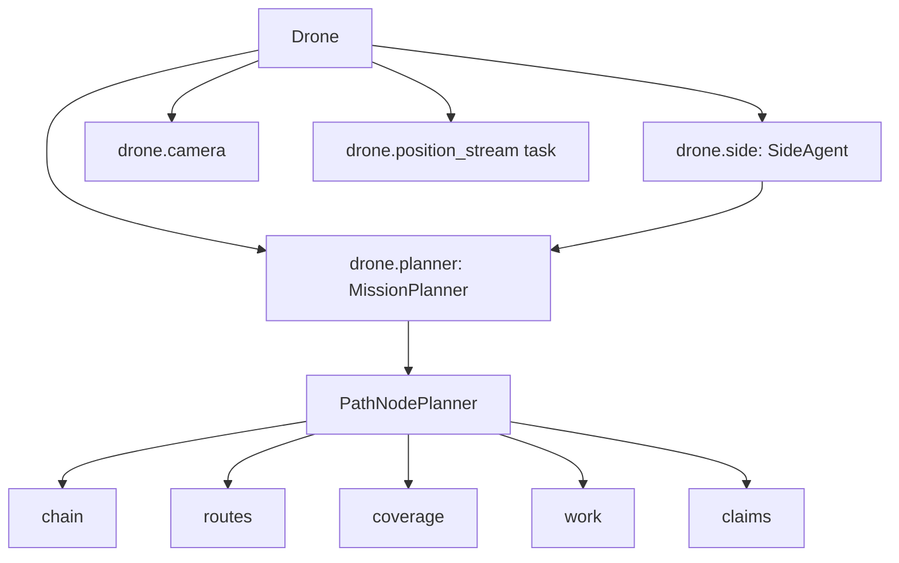

# 2. Takeoff: building the planner, the camera and the position stream

> Part of the [execution walkthrough](README.md). Previous: [1. Process start](01-process-start.md). Next: [3. The first CalcScanPath pass](03-first-calcscanpath.md).

**What this chapter covers.** The `Takeoff` state's **mission branch**. Before the drone leaves the ground it builds everything it will plan with: a local map frame, its own copy of its side's **planner** (`PathNodePlanner`), a **side agent** that talks to the side-mate, and the camera. Then it takes off and starts telling the other drones where it is.

> **Status.** The per-drone planner code (copies, claims, keep-apart) is in final verification; sections 2.4 and 2.5 describe it as read. The obstacle geometry underneath the planner is a `PathEngine` (`ZoneMap` by default; `Field` is selectable, see 2.4, "the geometry underneath").

## 2.1 The Takeoff state waits for a command

Takeoff is a loop that waits for the operator (or the app) to say what kind of flight this is:

```python
# state_machine/states/impl/takeoff_impl.py:68-71, 73-74
        app_commands: tuple[CMD_MSG, ...] = (CMD_MSG.TAKEOFF, CMD_MSG.DEMO, CMD_MSG.MISSION)

        def commanded_by_app() -> bool:
            return self.interdrone.get_cmd_msg() in app_commands
    ...
        while True:
            logging.debug("Takeoff waiting -- cmd msg: %s", self.interdrone.get_cmd_msg())
```

- `interdrone.get_cmd_msg()` is the mailbox from chapter 1. The three interesting values are `DEMO` (fly the POIF circles), `MISSION` (the mapping mission, this walkthrough) and `TAKEOFF` (just go up and land).
- The app sends `START_MISSION` to drone 1. Drone 1's receive loop sets `cmd_msg = MISSION` and forwards `START_MISSION` to the others, who set their own `cmd_msg` and reply `START_MISSION_ACK`. In `"Prompted"` mode, typing `mission` at the console does the same thing.

## 2.2 The mission branch

```python
# state_machine/states/impl/takeoff_impl.py:112-113, 119-133, 134-146, 147-158
            if self.interdrone.get_cmd_msg() == CMD_MSG.MISSION or action_type.lower() == "mission":
                configureField(self)
    ...
                if self.flight_settings.sim_mode is SimMode.AIRSIM:
                    from vision.Cameras.AirSimCamera.AirSimCamera import AirSimCamera

                    with open(AIRSIM_VISION_CONFIG_PATH) as vision_config_file:
                        vision_config = json.load(vision_config_file)
                    camera = AirSimCamera(vision_config)
                    camera.initialize_camera()
                else:
                    from vision.Cameras.RPICamera.RPICamera import RPICamera

                    with open(VISION_CONFIG_PATH) as vision_config_file:
                        vision_config = json.load(vision_config_file)
                    camera = RPICamera(vision_config)
                    camera.initialize_camera()
                self.drone.camera = camera
    ...
                if self.drone.id == 1:

                    await self.interdrone.send_start_mission(
                        tuple(self.flight_settings.other_drones_in_mission)
                    )

                    while not await self.interdrone.all_mission_start():

                        logging.info("Waiting for all drones to start the mission...")
                        await asyncio.sleep(0.1)
                else:
                    await self.interdrone.send_start_mission(tuple([1]))
                await self.drone.takeoff(MISSION_ALTITUDE_M)
    ...
                self.drone.startTime = monotonic()
                # Peers avoid us, and our side-mate claims work, from where we actually are.
                peers = tuple(self.flight_settings.other_drones_in_mission)
                if peers and self.drone.position_stream is None:
                    self.drone.position_stream = asyncio.create_task(
                        self.interdrone.stream_positions(peers)
                    )
                await asyncio.sleep(5)

                # CalcScanPath starts the planner the first time it runs
                # (planner.start_if_needed) -- no separate "initial" state.
                return CalcScanPath(self.drone, self.flight_settings, self.interdrone)
```

In order:

1. **`configureField(self)`** builds the planner (2.3 to 2.5). It runs *on the ground*, on every drone, so a bad field definition fails before takeoff.
2. **Camera.** In AirSim (simulator) mode an `AirSimCamera` is built; otherwise an `RPICamera` (Raspberry Pi camera with on-camera mine detection). Both are imported inside the branch so `run.py` still imports on a laptop without `picamera2`. The camera is stored on `self.drone.camera`; `Scan` and `DroneShare` read it from there.
3. **Start handshake.** Drone 1 sends `START_MISSION` to the others and waits until each has answered (`all_mission_start()`); the other drones send theirs to drone 1.
4. **`takeoff(MISSION_ALTITUDE_M)`.** The mapping mission flies at `MISSION_ALTITUDE_M = 2.0` metres (`state_machine/drone.py`). Everything about photo size comes from that: the planner assumes a photo taken at 2 m covers a fixed rectangle on the ground (2.2b below).
5. **`startTime = monotonic()`**: starts the 7-minute mission clock (`Drone.time_exceeded`, chapter 10).
6. **Position stream.** Every peer needs to know where this drone really is (to keep apart, and so the side-mate can work out claims). `interdrone.stream_positions(peers)` sends `POSITION_REPORT` at 5 Hz until `Land` cancels it:

```python
# state_machine/interdrone.py:888-899
    async def stream_positions(self, peers: tuple[int, ...], hz: float = 5.0) -> None:
        """Send POSITION_REPORT to peers every 1/hz s until cancelled (the mapping mission's
        stream; POIF runs its own). A failed report is logged and the stream goes on."""
        while True:
            try:
                position = self.drone.vehicle.location.global_relative_frame
                await self.report_position(peers, position.lat, position.lon, position.alt)
            except asyncio.CancelledError:
                raise
            except Exception as ex:
                logging.warning("Position report failed, continuing: %s", ex)
            await asyncio.sleep(1.0 / hz)
```

7. **`asyncio.sleep(5)`**, then `return CalcScanPath(...)`. Note the comment in the source: CalcScanPath starts the planner the first time it runs (`planner.start_if_needed`); there is no separate "initial" state.

Note: `Drone.takeoff(takeoff_alt, margin=1.5)` commands `takeoff_alt + margin` (3.5 m here) but returns as soon as the drone is above `takeoff_alt` (2.0 m). The `DEMO` branch passes `margin=0.0` for exactly this reason (its comment explains); the mission branch does not, so the drone keeps climbing toward 3.5 m during the `sleep(5)` and the first leg of `Scan` brings it back down to 2 m.

**2.2b: the assumed photo size.** `configureField` imports `SHAPE_SIZE_FT` and `OVERLAP` from `calc_scan_path_impl.py`. Where do they come from?

```python
# state_machine/states/impl/calc_scan_path_impl.py:63-66, 75-76
    altitude_ft = altitude_m * _METERS_TO_FT
    along_ft = 2 * altitude_ft * math.tan(math.radians(h_fov_deg) / 2)
    across_ft = 2 * altitude_ft * math.tan(math.radians(v_fov_deg) / 2)
    return (along_ft, across_ft)
    ...
SHAPE_SIZE_FT = _camera_footprint_ft(MISSION_ALTITUDE_M, VISION_CONFIG_PATH)
OVERLAP = 0.1
```

- The formula is `2 * altitude * tan(fov / 2)` for a camera looking straight down at flat ground. With `hFovDeg`/`vFovDeg` from `vision/config.json` at 2 m, the code's own comment says the result is about **(8.52, 6.44) ft**.
- `along` (8.52 ft) is the extent along the field's y axis (the direction the drones travel, bottom to top) and `across` (6.44 ft) is the extent along x. The comment in the source admits the h_fov/v_fov to along/across assignment is unconfirmed against the real camera mount.
- This is only used to **plan** where to hover. When a photo is actually taken, `Scan` measures the *real* footprint from the camera geometry (chapter 4).
- `OVERLAP = 0.1`: consecutive photos along a path overlap by 10 %.

## 2.3 configureField -> MissionPlanner

```python
# state_machine/states/impl/takeoff_impl.py:195-209
def configureField(state: Takeoff) -> None:
    """
    Builds this drone's copy of its side's planner (Drone.planner) and the agent that drives
    it (Drone.side, flight/pathfinding/side_agent.py) from the mission config. Every drone
    gets both: a side's drones are equals.

    Raises ValueError here, on the ground, if the field corners don't trace a simple
    counter-clockwise quadrilateral (see flight/pathfinding/frame.py).
    """
    # Local import: calc_scan_path_impl's footprint constants are the planner's too.
    from state_machine.states.impl.calc_scan_path_impl import OVERLAP, SHAPE_SIZE_FT

    state.drone.planner = make_planner(state.flight_settings, SHAPE_SIZE_FT, OVERLAP)
    state.drone.side = SideAgent(state.drone.planner, state.drone, state.flight_settings,
                                 state.interdrone)
```

`make_planner` turns the flight settings into a `MissionPlanner`:

```python
# flight/pathfinding/mission_planner.py:199-207
def make_planner(flight_settings, shape_size_ft, overlap):
    """This drone's copy of its side's planner."""
    from state_machine.flight_settings import Side   # local: avoids an import cycle
    corners = [(c["lat"], c["lon"]) for c in flight_settings.mission_field_corners]
    start = (flight_settings.start_coord["lat"], flight_settings.start_coord["lon"])
    edge = Edge.BOTTOM if flight_settings.start_side == Side.START else Edge.TOP
    return MissionPlanner(corners, start, edge, tuple(flight_settings.side_drones),
                          bool(flight_settings.partner_side_drones),
                          shape_size_ft=shape_size_ft, overlap=overlap)
```

- `corners`: the four field corners in lat/lon from `mission_field_corners`.
- `edge`: `Edge.BOTTOM` for the START side (drones 1, 2) and `Edge.TOP` for the END side (drones 3, 4).
- `side_drones`: this side's drone ids (`(1, 2)` for drone 1). These are the keys of the **claims** (chapter 3).
- `has_partner`: `True` when `partner_side_drones` is non-empty, i.e. in a 3- or 4-drone mission.

`MissionPlanner` is a **lat/lon wrapper**. Everything outside it (states, messages) speaks (lat, lon). Everything inside (`PathNodePlanner`) speaks **local feet**. Its `__init__`:

```python
# flight/pathfinding/mission_planner.py:25-44
    def __init__(self, corners_latlon, start_latlon, start_edge, side_drones, has_partner,
                 shape_size_ft=(6.0, 4.0), overlap=0.1):
        """
        - corners_latlon: the field corners, counter-clockwise from corner 1 (frame.py).
        - start_latlon, start_edge: where this side enters, and on which edge.
        - side_drones: this side's drone ids, ascending (the claim keys; ties go to the first).
        - has_partner: whether a partner side works from the other edge.
        """
        validate_field_corners(corners_latlon)
        self._t, self.field_w = field_transformer(corners_latlon)
        pts = [self._t.latlon_to_local(lat, lon) for lat, lon in corners_latlon]
        self.field_h = max(y for _x, y in pts)
        entry_x = min(max(self._t.latlon_to_local(*start_latlon)[0], 0.0), self.field_w)
        self.drones = tuple(side_drones)
        self.planner = PathNodePlanner(
            self.field_w, self.field_h, entry_x, Edge(start_edge),
            partner_entry_x=entry_x if has_partner else None, drones=self.drones,
            config=PlannerConfig(shape_size_ft=shape_size_ft, overlap=overlap))
        self.session = SideSession(self.planner)
        self._started = False
```

### The field frame (`frame.py`)

```python
# flight/pathfinding/frame.py:1-5, 31-39, 48-55
"""The field's local frame: lat/lon <-> feet.

Corner 1 is the origin (moved along the 1->2 edge if the 2-1-4 angle is obtuse), the 1->2 edge
is +x, and +y runs towards corners 3/4. Distances are true feet: the base edge is measured, not
assumed. Every drone builds the same frame from the same corners, so local coordinates agree
    ...
def validate_field_corners(corners_latlon):
    """
    Raise ValueError unless the corners trace a simple, counter-clockwise quadrilateral:
    origin, +x, the diagonal corner, +y. Listing them in a "Z" (the last two swapped) traces a
    bow-tie that encloses almost nothing, and clockwise corners put the field below the x
    axis -- both silently wreck the plan, so they fail here, at config load.
    """
    if len(corners_latlon) != 4:
        raise ValueError(f"mission_field_corners needs 4 corners, got {len(corners_latlon)}")
    ...
    hull = quad.convex_hull
    if not quad.is_valid or quad.area < 0.8 * hull.area:
        swapped = shapely.Polygon([pts[0], pts[1], pts[3], pts[2]])
        hint = (" -- the last two corners look swapped (the list reads as a 'Z', it should go"
                " around the edge)" if swapped.is_valid else "")
        raise ValueError(
            f"mission_field_corners do not trace a simple quadrilateral (encloses "
            f"{quad.area:.0f} sq ft of a {hull.area:.0f} sq ft hull){hint}")
```

- The frame is a flat **x/y grid in feet**. Corner 1 is the origin, the edge from corner 1 to corner 2 is +x (the bottom edge), and +y runs toward corners 3 and 4 (the top).
- Every drone builds the same frame from the same corners, so a point like "(42.6, 130.0)" means the same place on every drone. Anything sent between drones is still lat/lon; each drone converts on arrival (`latlon_to_local`).
- `field_transformer` measures the true length of the bottom edge first, so one foot in the planner is one foot on the ground.
- `validate_field_corners` runs at planner construction: the corners must go **counter-clockwise** (origin, +x corner, the far corner on the +x side, then the far corner above the origin). A bow-tie ("Z" order) or a clockwise list raises `ValueError` here, on the ground.

For the golf-field corners in `mission_config.json`, once ordered 1, 2, 4, 3 (see the Note below), the frame is about **82 ft wide and 300 ft long** (`field_w`, `field_h`). The bottom edge is y = 0, the top edge y = `field_h`.

Note: as of writing, the corners in the working-tree `mission_config.json` and in `mission_config_full.json` are listed in the order 1, 2, 3, 4 which traces a bow-tie, and `validate_field_corners` **rejects** them with "the last two corners look swapped". Swapping the last two makes them valid (the toy run below does that). Until the config is fixed, the mission branch of `Takeoff` would raise `ValueError` inside `configureField`.

### Entry point and edge

Back in `MissionPlanner.__init__`: `entry_x` is where this side enters, taken from `start_coord` in the mission config and **clamped into the field's x range**. Both sides use the same `start_coord`, so the bottom side's entry is `(entry_x, 0)` and the top side's is `(entry_x, field_h)`.

Note: in the checked-in `mission_config.json` the `start_coord` (lat 36.02, lon -95.94) is nowhere near the field corners (lat 34.62, lon -86.81), so the clamp silently pins `entry_x` to a field edge. This is a config oddity, not a code bug, but it means the planner's entry would not be where the drones actually stand.

**Goes next to ->** `PathNodePlanner.__init__` (2.4).

## 2.4 PathNodePlanner: what one drone plans with

`PathNodePlanner` (`flight/pathfinding/pathnode/planner.py`) is one side's route-and-work planner in local feet. Each drone owns a **private copy** for its side. Its constructor builds nine parts:

```python
# flight/pathfinding/pathnode/planner.py:72-95
        self.config = config or PlannerConfig(**options)
        self.field_w, self.field_h = float(field_w), float(field_h)
        self.start_edge = Edge(start_edge)
        self.discovered = []            # every known mine, (x, y)
        self.blocked = set()            # squares given up on (see coverage.py)
        self.partner_route = []         # the partner's latest route (check_join)
        self.failure = None
        self.log = PlannerLog()
        self.routes = Routes(make_engine(self.config.engine, self.field_w, self.field_h))
        self.target = make_target(self.field_w, self.field_h, self.start_edge, partner_entry_x,
                                  self.routes)
        self.coverage = Coverage(self.field_w, self.field_h, self.config)
        entry = PathNode(float(entry_x), self.start_edge.y(self.field_h), Placer.ENTRY)
        self.chain = Chain([entry], [])
        route, _gids = self.target.route_from(entry.xy)
        if route is None:
            self.failure = "no route from the entry to the target"
        else:
            self.chain = Chain([entry, PathNode(*route[-1], Placer.TARGET)],
                               [Link(LinkKind.FORWARD, route)])
        self.shortcuts = Shortcuts(self.chain, self.routes, self.coverage, self.config, self.log)
        self.work = Work(self.chain, self.routes, self.coverage, self.shortcuts, self.config)
        self.coordinator = SideCoordinator(drones, self.config, self.work, self.coverage,
                                           self.field_w, self.field_h)
```

| Part | File | What it is, in plain words |
|---|---|---|
| `config` | `config.py` | The tunable settings (`PlannerConfig`), see below. |
| `routes` | `routes.py` | Known obstacles and "shortest path around them", over a swappable `PathEngine` (`engines/`, see "The geometry underneath"). |
| `target` | `target.py` | What the forward gap aims at: `FarEdgeTarget` (no partner side) or `PartnerTarget` (the partner side's point A), picked by `make_target`. |
| `coverage` | `coverage.py` | Which 2 ft squares have been photographed, and the misses. It holds a `placement` (`placement.py`: `CorridorPlacement` or `BandPlacement`, picked by `PlannerConfig.coverage`) that decides which squares a stretch needs and where its photos go. |
| `chain` | `chain.py` | The route so far: path nodes joined by links. |
| `shortcuts` | `shortcuts.py` | Replaces long checked stretches with shorter paths (chapter 8). |
| `work` | `work.py` | The photos still to take, in priority groups; an ordered list of `WorkSource`s (`work_sources.py`). |
| `coordinator` | `coordination.py` | `SideCoordinator`: owns the **ClaimBook** (`claims.py`, which drone of the side flies which photos), keep-apart, make-way and idle takeover. |
| `log` | `log.py` | Counters and a bounded event log (a debugging aid). |

For the map of all the parts and the classes to subclass, see [docs/architecture.md](../../architecture.md).

### The chain: how the route is stored

```python
# flight/pathfinding/pathnode/chain.py:1-12
"""The chain: one side's route as path nodes joined by links.

    nodes:  [entry] --link0-- [n1] --link1-- [n2] ... [point A] --forward-- [target]

- Invariant: links[i] joins nodes[i] to nodes[i + 1]; len(links) == len(nodes) - 1; a link's
  polyline starts at its first node and ends at its second (Chain.check).
- A link is CHECKED (photographed), PENDING (a planned detour, still to photograph) or
  FORWARD (point A -> target, the gap still to explore; at most one).
- Point A is the node before the forward link. With no forward link the side has met its
  target, and point A is the target itself.
- The target is virtual: the partner's latest point A, or a far-edge point. Never laid, never
  deleted by a mine.
```

Key words (also in the [glossary](11-glossary.md)):

- **Path node**: a corner point of the route.
- **Link**: the stretch between two consecutive nodes. It is one of three kinds:
  - **CHECKED**: photographed ground we know is safe.
  - **PENDING**: a planned detour around a mine that still has to be photographed.
  - **FORWARD**: the single "gap still to explore": from **point A** to the **target**.
- **Point A**: the frontier, the last node before the forward link. "How far this side has got."
- **Target**: a virtual end node the forward gap aims at. With a partner side it is the partner's latest point A; without one it is a point on the far edge.

At the very start (this is what the constructor builds):

```python
# flight/pathfinding/pathnode/planner.py:84-91
        entry = PathNode(float(entry_x), self.start_edge.y(self.field_h), Placer.ENTRY)
        self.chain = Chain([entry], [])
        route, _gids = self.target.route_from(entry.xy)
        if route is None:
            self.failure = "no route from the entry to the target"
        else:
            self.chain = Chain([entry, PathNode(*route[-1], Placer.TARGET)],
                               [Link(LinkKind.FORWARD, route)])
```

So the chain is `[entry] --forward-- [target]`: entry and target only, joined by one straight FORWARD link (nothing is known yet, so the shortest path is straight). The toy run below prints this for the golf field:

```text
--- drone 1 (bottom side, has a partner side)
field 82.3 x 299.7 ft, cells 42 x 150
nodes : [('entry', 42.6, 0.0), ('target', 42.6, 299.7)]
links : [('forward', [(42.6, 0.0), (42.6, 299.7)])]
target: partner = True partner_a = (42.614664072920554, 299.7155912142725) may_close = True
claims: (1, 2) | failure: None
--- drone 3 (top side, has a partner side)
field 82.3 x 299.7 ft, cells 42 x 150
nodes : [('entry', 42.6, 299.7), ('target', 42.6, 0.0)]
links : [('forward', [(42.6, 299.7), (42.6, 0.0)])]
target: partner = True partner_a = (42.614664072920554, 0.0) may_close = True
claims: (3, 4) | failure: None
--- solo/2-drone mission (no partner side)
field 82.3 x 299.7 ft, cells 42 x 150
nodes : [('entry', 42.6, 0.0), ('target', 42.6, 299.7)]
links : [('forward', [(42.6, 0.0), (42.6, 299.7)])]
target: partner = False partner_a = None may_close = True
claims: (1, 2) | failure: None
```

- For drone 1 the target is `(42.6, 299.7)` at the top edge, directly above the entry: "aim at the partner's entry until they tell me where they really are". Drone 3 mirrors it.
- With no partner (`partner = False`) the target is a `FarEdgeTarget`: a point on the far edge, chosen by `route_from` (straight ahead if clear). With a partner it is a `PartnerTarget`.
- `may_close() = True` means the target is really the partner's point A (or the far edge), so the gap may be declared closed against it (chapter 9). Against a *stand-in* (when the partner's point A lies inside an obstacle this side knows) it stays `False`.

### Settings (`PlannerConfig`)

```python
# flight/pathfinding/pathnode/config.py:122-133
    shape_size_ft: tuple = (6.0, 4.0)
    overlap: float = 0.1
    coverage: CoverageMode = CoverageMode.CORRIDOR
    adjacent_ring: int = 1
    outer_ring: int = 2
    shortcut_ratio: float | None = 0.9
    big_shortcut_ratio: float | None = 0.8
    big_shortcut_saving_ft: float = 20.0
    shortcut_max_waypoints: int = 8
    shortcut_ft_per_photo: float = 2.0
    keep_away_ft: float = 10.0
    keep_clear_ft: float = 7.5
```

`MissionPlanner` only overrides `shape_size_ft` and `overlap`; every other value is the default shown. The ones that matter most:

- `coverage = CORRIDOR`: a link counts as checked once the 2 ft squares it *touches* are photographed (`BAND` would also require every square a mine could endanger it from).
- `adjacent_ring = 1`, `outer_ring = 2`: after the path itself is checked, optional extra photos cover squares up to 1 (then 2) squares away from the checked route, as a safety margin.
- `shortcut_*`: when to try a shortcut (chapter 8).
- `keep_away_ft = 10.0`, `keep_clear_ft = 7.5`: how close a drone may plan a photo to another drone (chapter 3, keep-apart). Both are `PlannerConfig` fields, chosen to stay above the flight code's collision hold radius (`COLLISION_RADIUS` 2.01 m = 6.6 ft, chapter 4); `keep_away_ft` > `keep_clear_ft` so a tie has a winner.

Fixed constants (also `config.py`): `CELL = 2 ft` (in `geometry.py`, which now holds only shared constants and cell helpers), `MISS_CENTRE = 1` and `MISS_BLOCK = 3` (chapter 4), `MAX_BRIDGE_FT = 30`.

### The geometry underneath (a swappable `PathEngine`)

`Routes` (`routes.py`) is the interface the planner uses for obstacles:

```python
# flight/pathfinding/pathnode/routes.py:19-25, 53-57, 62-75
class Routes:
    def __init__(self, engine):
        """Takes: a PathEngine instance (see engines.make_engine)."""
        self.engine = engine
        self.version = 0
        self._paths = {}        # ((ax, ay), (bx, by)) -> (points, gids, LineString) or None
        self._inside = {}       # square -> whether its centre is inside a zone
    ...
    def contains(self, x, y):
        return self.engine.contains(x, y)

    def crosses(self, poly):
        return self.engine.crosses(poly)
    ...
    def shortest(self, a, b):
        """Shortest path a -> b around every obstacle, as (points, gids), or None. Returns
        copies, with gids resolved to the groups they have since merged into."""
        key = ((float(a[0]), float(a[1])), (float(b[0]), float(b[1])))
        if key not in self._paths:
            if len(self._paths) > CACHE_CAP:
                self._paths.clear()
            route = self.engine.shortest_path(*key)
            self._paths[key] = (None if route is None else
                                (route[0], route[1], shapely.LineString(route[0])))
        route = self._paths[key]
        if route is None:
            return None
        return list(route[0]), [None if g is None else self.engine.resolve(g) for g in route[1]]
```

- `add_mine(x, y)` / `add_square(c, r)`: register a new obstacle (a mine's **danger zone**, or a 2 ft square the planner gave up on).
- `contains(x, y)`: is this point inside a known obstacle?
- `crosses(poly)`: does this polyline cut through an obstacle?
- `shortest(a, b)`: **the shortest path from a to b around every known obstacle**, as a list of points plus, for each corner it bends around, the id of the obstacle group it wraps.
- It caches paths and only drops the ones a new obstacle crosses.

> **Engine behind `Routes`.** `Routes(engine)` holds a `PathEngine` (`pathnode/engines/base.py`: the abstract class whose docstring is the contract). `PathNodePlanner` builds it with `make_engine(config.engine, w, h)` (`pathnode/engines/__init__.py`): `"zonemap"` (`ZoneMap`, `pathnode/engines/zonemap.py`) is the default; `"field"` (`flight/pathfinding/nodeField/`: `Field`, `FieldConnections.nodeGraph`, `MineNode`, `PolygonObstacle`, `unionObstacle`, `BlockMine`; and `protoMine.py`) also implements it but is not the default. This walkthrough treats path-finding as "shortest path around known obstacles" through `Routes` and does not describe either engine's internals.
>
> What the planner relies on from the geometry, whatever implements it: the danger zone of a mine is the whole set of 2 ft squares within `SAFETY_RADIUS_FT = 3` of the mine's square (snapped to the square's centre); overlapping zones merge into one group with an id; shortest paths bend only around zone corners.

## 2.5 SideAgent: the drone's messenger

Back in `configureField`, the last line builds `SideAgent(planner, drone, flight_settings, interdrone)` and stores it as `drone.side`. The planner never sends a message; the side agent does everything the drone says to and hears from others.

```python
# flight/pathfinding/side_agent.py:41-45, 50-64
POINT_A_HEARTBEAT_S = 1.0      # point A is resent at least this often (a lossy stream)
JOB_HEARTBEAT_S = 1.0          # this drone's job is re-announced at least this often
MINE_SYNC_S = 5.0              # the speaker sends its full mine list this often
MATE_POSITION_MAX_AGE_S = 2.0  # a position report older than this isn't trusted
MATE_LOST_S = 20.0             # a side-mate silent this long is lost (its work comes here)
    ...
    def __init__(self, planner, drone, flight_settings, interdrone):
        """planner: this drone's MissionPlanner (its copy of the side's planner)."""
        self.planner = planner
        self.drone = drone
        self.fs = flight_settings
        self.interdrone = interdrone
        self.me = flight_settings.current_drone_ID
        self.mate = flight_settings.paired_drone            # None: working the side alone
        self.partners = tuple(flight_settings.partner_side_drones)
        self.mate_lost = False
        self.mate_gone = False
        self._mate_photo_at = None      # (lat, lon) of the mate's last photo report
        self._point_a_sent = None       # ((lat, lon), time)
        self._job_sent = None           # (job, time)
        self._mines_synced_at = None
```

- `me`, `mate`, `partners`: this drone's id, its side-mate's id (or `None`), and the other side's drone ids.
- Timing constants: point A is resent at least every 1 s, this drone's job is re-announced at least every 1 s, the full mine list every 5 s; a position report older than 2 s is not trusted; a side-mate silent for 20 s is **lost** and its work goes to this drone.
- `speaker`: the lowest-id drone of the side still heard from. It is the one that talks *for the side* to the other side (point A, the full mine list).

```python
# flight/pathfinding/side_agent.py:92-94
    def speaker(self):
        """Whether this drone speaks for its side: the lowest id still heard from."""
        return self.mate is None or self.mate_lost or self.me < self.mate
```

- Drone 1 (the lower id) is always its own side's speaker (`self.me < self.mate`). Drone 2 speaks only when `mate_lost` is true, i.e. from drone 2's point of view drone 1 has been silent for 20 s. The same holds for drone 3 (speaker) and drone 4 (only if 3 is lost). While alone (`mate is None`) a drone is always its side's speaker.

The whole fixed inbox/outbox order of the agent is described in chapters 3 and 7.

**Goes next to ->** [Chapter 3: `CalcScanPath`](03-first-calcscanpath.md).

## 2.6 Summary of what exists after Takeoff


