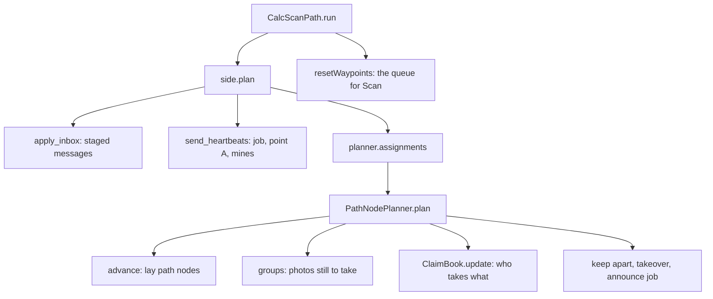

# 3. The first CalcScanPath pass: from "nothing known" to a queue of waypoints

> Part of the [execution walkthrough](README.md). Previous: [2. Takeoff](02-takeoff-and-planner-setup.md). Next: [4. Scan](04-scan.md).

**What this chapter covers.** `CalcScanPath` is the **planning step**: "given everything I know right now, which photo spots should *this* drone visit next, in what order?" This is the core of the mission, so we go deep. We follow **drone 1's first pass**, when nothing has been photographed yet. Chapter 6 revisits the same functions after a mine is found.

> **Status.** The per-drone planner code (claims, keep-apart including cross-side keep-apart, idle takeover, `_make_way`) is in final verification; the text describes the code as read. The numbers in the toy runs are real output of that code at the time of writing.

## 3.0 The whole pass on one page



Definitions used below:

- **Photo spot / waypoint**: a lat/lon where the drone hovers and takes one photo.
- **Group**: photo spots are sorted into five priority groups (PATH, BIG_SHORTCUT, ADJACENT, SHORTCUT, OUTER). Lower number = more urgent.
- **Claim**: the decision that "drone X takes this path". Each drone works out the claims itself, from where both side-mates are and what each announced.
- **Job**: the path (or single photo) a drone is working on right now. It **announces** its job to its side-mate (`SIDE_JOB` message) so the mate's copy does not hand out the same job.

## 3.1 CalcScanPath.run

`Takeoff` returned `CalcScanPath(...)`; the state machine calls its `run()`:

```python
# state_machine/states/impl/calc_scan_path_impl.py:150-173
        if self.drone.time_exceeded(self.flight_settings.max_flight_time):
            flight_log.event("calc_scan_path_time_exceeded")
            return EndRun(self.drone, self.flight_settings, self.interdrone)

        # Whatever triggered this entry is accounted for by the recompute below. Clear it
        # before anything else can re-set it.
        self.drone.replan_needed = None

        side, planner = self.drone.side, self.drone.planner
        if planner.start_if_needed() is False:
            _flag_no_valid_path(self, "no route at start")
        own = await side.plan()
        if planner.failure:
            _flag_no_valid_path(self, planner.failure)
            return ExpandNodes(self.drone, self.flight_settings, self.interdrone)
        if planner.done():
            await _finish_scan(self, planner)
            return ExpandNodes(self.drone, self.flight_settings, self.interdrone)

        self.drone.resetWaypoints(_build_waypoints(self.drone.id, own))
        if not own:
            # Waiting on the partner's point A or the side-mate's photos.
            await asyncio.sleep(IDLE_POLL_S)
        return Scan(self.drone, self.flight_settings, self.interdrone)
```

Line by line:

- **Time check.** If the 7-minute budget is gone, skip everything and go to `EndRun` (chapter 10).
- **`replan_needed = None`.** `Drone.replan_needed` is a flag the *receive loop* sets when data arrives that could invalidate the current queue (chapter 7). Clearing it here says "whatever set it is about to be handled by the recompute below".
- **`planner.start_if_needed()`.** First call: marks the planner started and returns `False` only if no route exists at all (fully blocked); then `_flag_no_valid_path` sets `Drone.no_valid_path_found`, which later makes `AppShare` report "no path" instead of an empty success.
- **`own = await side.plan()`.** *The* planning call (3.2). Returns this drone's queue of `(lat, lon)` spots in flying order.
- **`planner.failure`**: planning gave up (no route left). Go to `ExpandNodes`.
- **`planner.done()`**: nothing left to do on this side. `_finish_scan` (chapter 10) then `ExpandNodes`.
- **`resetWaypoints(_build_waypoints(...))`**: replace the drone's whole waypoint queue with fresh `Waypoint` objects:

```python
# state_machine/states/impl/calc_scan_path_impl.py:99-101
def _build_waypoints(drone_id: int, places) -> list[Waypoint]:
    """Waypoints for (lat, lon) places, in flying order."""
    return [Waypoint(drone_id, lat, lon, name=f"scan_{i}") for i, (lat, lon) in enumerate(places)]
```

  A `Waypoint` (`flight/waypoint.py`) has a random `waypoint_id`, the drone id, lat/long and a name `scan_<i>`. **Every pass creates a brand-new queue**; nothing is edited in place. That matters for `Scan` (chapter 4): it removes a waypoint from the queue by *identity* (the object it flew to), not by position.
- **Empty queue.** If `own` is empty the drone waits `IDLE_POLL_S = 0.1` s before `Scan` bounces straight back (waiting for the partner's point A or its mate's photos).

**Goes next to ->** `SideAgent.plan()`.

## 3.2 SideAgent.plan: one planning pass

```python
# flight/pathfinding/side_agent.py:202-219
    async def plan(self):
        """Apply the inbox, send the heartbeats, and work out the side's claims. Returns this
        drone's queue, [(lat, lon)] in flying order."""
        self._check_mate()
        self.apply_inbox()
        await self.send_heartbeats()
        peer_jobs = self.drone.peer_jobs
        # A mate not yet heard from is left out (unknown), not held as "no job" (idle). A lost
        # one's last announced job is kept: the planner reserves it and keeps clear of it.
        held = ({self.mate: peer_jobs[self.mate]}
                if self.mate is not None and not self.mate_gone and self.mate in peer_jobs
                else {})
        others = self.other_side_positions()
        held.update({d: peer_jobs[d] for d in others if d in peer_jobs})
        plan = self.planner.assignments(self.positions(), held, self.me, others,
                                        self.lost_mates())
        await self._announce_job()
        return plan[self.me]
```

Five steps:

1. `_check_mate()`: updates `mate_lost` (mate silent for 20 s once the mission has been running 20 s).
2. `apply_inbox()`: applies everything the receive loop **staged** since the last pass (3.2a).
3. `send_heartbeats()`: sends this drone's job announcement, and (if it is the speaker) point A and the mine list to the other side (3.2b).
4. Builds the inputs for the planner: `held` (the jobs the mate and the other side announced), `others` (where the other side's drones are), and `self.positions()` (where this side's drones are).
5. `planner.assignments(...)` (3.3), then announce the (possibly changed) job again.

### 3.2a apply_inbox: staged messages, in a fixed order

```python
# flight/pathfinding/side_agent.py:136-158
    def apply_inbox(self):
        """Everything staged since the last pass, in a fixed order: the other side's mines
        first (no path node may be laid over ground about to turn out unsafe), then the mate's
        photos, then the other side's coverage and point A."""
        planner, drone = self.planner, self.drone
        mines, drone.pending_cross_pair_mines = drone.pending_cross_pair_mines, []
        for report in mines:
            planner.partner_mine(report.lat, report.lon)
        photos, drone.pending_photo_reports = drone.pending_photo_reports, []
        for report in photos:
            if report.failed_at is not None:
                planner.failed_photo(*report.failed_at)
                continue
            planner.mate_photo(report.corner_coordinates, report.mines)
            corners = report.corner_coordinates
            self._mate_photo_at = (sum(lat for lat, _ in corners) / len(corners),
                                   sum(lon for _, lon in corners) / len(corners))
        coverage, drone.pending_partner_coverage = drone.pending_partner_coverage, []
        for corners in coverage:
            planner.partner_coverage(corners)
        point_a, drone.pending_partner_point_a = drone.pending_partner_point_a, None
        if point_a is not None:
            planner.partner_point_a(*point_a)
```

Order matters: **the other side's mines come first**, so no path node is laid over ground about to turn out unsafe; then the side-mate's photos (each is `mate_photo`); then the other side's photo footprints and finally its point A. On the very first pass most of this is empty; the exception is drone 1's first `CROSS_PAIR_POINT_A` from drone 3, which may already be waiting. Chapter 7 walks through each of these stages with a concrete case.

### 3.2b send_heartbeats: telling others what I'm doing

```python
# flight/pathfinding/side_agent.py:168-185, 187-199
    async def send_heartbeats(self, mine_sync_s=MINE_SYNC_S):
        """Everyone's job announcement (resent every JOB_HEARTBEAT_S, so a lost "no job" cannot
        keep the mate waiting), then the speaker's streams to the other side: point A (on
        change, and every POINT_A_HEARTBEAT_S) and the full mine list (every mine_sync_s)."""
        self._check_mate()
        await self._announce_job()
        if not self.partners or not self.speaker or self.planner.failure:
            return
        now = time.monotonic()
        point_a = self.planner.point_a_latlon()
        last = self._point_a_sent
        if last is None or last[0] != point_a or now - last[1] >= POINT_A_HEARTBEAT_S:
            await self.interdrone.send_cross_pair_point_a(*point_a, self.partners)
            self._point_a_sent = (point_a, now)
        if self._mines_synced_at is None or now - self._mines_synced_at >= mine_sync_s:
            await self.interdrone.send_cross_pair_mine_sync(self.planner.mines_latlon(),
                                                            self.partners)
            self._mines_synced_at = now
    ...
    async def _announce_job(self):
        """Tell the mate and the other side which job this drone holds (on change, and every
        JOB_HEARTBEAT_S)."""
        to = ((() if self.mate is None or self.mate_lost else (self.mate,))
              + tuple(self.partners))
        if not to:
            return
        job = self.planner.current_job(self.me)
        now = time.monotonic()
        last = self._job_sent
        if last is None or last[0] != job or now - last[1] >= JOB_HEARTBEAT_S:
            await self.interdrone.send_side_job(job, to)
            self._job_sent = (job, now)
```

- **Job announcement (everyone).** `current_job(me)` is `claims.heads[me]`: the `(group, key, (x, y))` of the next photo this drone will fly, or `None`. It is sent to the side-mate *and* to the other side's drones (`SIDE_JOB`) when it changes and at least once per second, so a lost "I have no job" cannot keep a mate waiting forever. On the first pass it is `None` (nothing planned yet), so drone 1 sends "no job".
- **Speaker's streams (only the speaker, only with a partner side).** The speaker sends `CROSS_PAIR_POINT_A` (this side's frontier) to the other side when it changes and every second, and `CROSS_PAIR_MINE_SYNC` (every mine it knows) every 5 s. Drone 1 is its side's speaker. Drone 2 sends only its job.
- The messages are built in `Interdrone.send_side_job`, `send_cross_pair_point_a`, `send_cross_pair_mine_sync`; each ends in `Interdrone.send()`, which hands the `Message` to the networking thread. Only `SHARE_PHOTOS` and `CROSS_PAIR_MINE_RELAY` are resent if the socket fails; the others are best-effort streams.

### 3.2c Where are the drones? (`positions`, `other_side_positions`)

```python
# flight/pathfinding/side_agent.py:100-120, 122-133
    def positions(self):
        """Where the side's drones are (drone id -> (lat, lon)). The mate: a fresh position
        report, else its last photo report, else the side's start point. Lost: its last
        known position (the newest report, however old), which keeps blocking; None once
        gone."""
        positions = {self.me: self.drone.currentPosition()}
        if self.mate is None:
            return positions
        state = self._mate_state()
        if self.mate_gone:
            positions[self.mate] = None
            return positions
        live = state is not None and state.live_position is not None
        if live and (self.mate_lost or not state.position_is_stale(MATE_POSITION_MAX_AGE_S)):
            positions[self.mate] = state.live_position
        elif self._mate_photo_at is not None:
            positions[self.mate] = self._mate_photo_at
        else:
            start = self.fs.start_coord
            positions[self.mate] = (start["lat"], start["lon"])
        return positions
    ...
    def other_side_positions(self):
        """Where the other side's drones are, for keeping clear of them (drone id -> (lat, lon)):
        the last reported position, however old, until the drone has been silent for
        MATE_GONE_S -- a stale report is the best guess, and ignoring it lets a drone that
        only went quiet be flown into. Never heard from: left out."""
        out = {}
        for d in self.partners:
            state = self.interdrone.get_drone_state_from_id(d)
            if (state is not None and state.live_position is not None
                    and not state.is_stale(MATE_GONE_S)):
                out[d] = state.live_position
        return out
```

- Own position: the live GPS value from the autopilot.
- Side-mate: its latest `POSITION_REPORT` if fresher than 2 s; else where its last **photo** was taken; else the side's start point. `None` if it is lost.
- Other side: only **fresh** position reports; a stale or silent drone is left out (ignored).

**Goes next to ->** `MissionPlanner.assignments`.

## 3.3 MissionPlanner.assignments: lat/lon in, lat/lon out

```python
# flight/pathfinding/mission_planner.py:138-154
    def assignments(self, positions, held=None, me=None, others=None, lost=()):
        """
        Takes:
        - positions: drone id -> (lat, lon) for this side's drones; None for a drone that is
          gone (ignored). A drone left out is taken to be at point A.
        - held: drone id -> the job it announced (current_job on its own copy); the other
          side's drones too.
        - me: the drone this copy belongs to (it takes others' work when it has none).
        - others: drone id -> (lat, lon) for the other side's drones (last known if quiet);
          the plan keeps clear of them (planner.plan). Left out: ignored.
        - lost: side drones gone quiet: their work goes to the others, but their last known
          position (in positions) and last announced job (in held) keep blocking (planner.plan).

        Returns: drone id -> [(lat, lon)] in flying order (claims.py).
        """
        local = {}
        for d in self.drones:
```

- Converts all positions from lat/lon to local feet (`latlon_to_local`). A drone missing from `positions` is treated as being at **point A**; one mapped to `None` is lost.
- Calls `session.assignments(...)`, which is one line: `SideSession.assignments` returns `self.planner.plan(positions, held, me, others)`.
- Converts each drone's queue of `(x, y, group)` back to lat/lon, dropping the group.

**Goes next to ->** `PathNodePlanner.plan` (3.4).

## 3.4 PathNodePlanner.plan

This is the heart. In order: `advance` -> `groups` -> `claims.update` -> keep-apart -> takeover -> job announcement.

`PathNodePlanner.plan` does the first two itself and hands the rest to its `SideCoordinator` (`coordination.py`), which owns the ClaimBook and the keep-apart / make-way / takeover policy:

```python
# flight/pathfinding/pathnode/planner.py:337-338
        self.advance()      # anything already checked must close before we plan more photos
        return self.coordinator.plan(self.groups(), positions, held, me, others, lost)
```

and `SideCoordinator.plan` is steps 3-6:

```python
# flight/pathfinding/pathnode/coordination.py:60-71
        plan = self.claims.update(self._without(groups, reserved), claim_pos, side_held)
        idle = {d for d, job in side_held.items() if job is None and d not in lost}
        kept = self._keep_apart(plan, positions, idle, others, other_held, lost, side_held)
        if me is not None and (not plan.get(me) or (not kept.get(me)
                                                    and idle >= set(self.drones) - {me})):
            self._take_over(me, plan, side_held, lost)
            kept = self._keep_apart(plan, positions, idle, others, other_held, lost, side_held)
        self.last_plan = kept
        if me is not None:
            self._make_way(me, plan, positions, {**side_held, **other_held}, others)
        self._announce_heads(me, plan)
        return self.last_plan
```

### Step 1: advance() (nothing photographed yet)

```python
# flight/pathfinding/pathnode/planner.py:287-300
    def advance(self):
        """Lay path nodes over everything now checked -- the forward gap from point A and
        every pending span from its start -- then update the shortcuts."""
        if self.failure:
            return
        chain = self.chain
        seen = self.coverage.all_seen
        f = chain.forward_index()
        # Never close the gap against a stand-in target (see target.py).
        if f is not None and self.target.may_close():
            chain.advance_link(chain.links[f], Placer.FORWARD, seen)
        for link in chain.pending_links():
            chain.advance_link(link, Placer.SPAN, seen)
        self.shortcuts.update(self.met)
```

`advance` lays **path nodes over everything now checked**: the forward gap from point A, and every pending span from its start. It uses `coverage.all_seen`, "are all the squares this stretch touches photographed?". `chain.advance_link` walks along the link's polyline in 0.5 ft steps and stops at the first unphotographed step:

```python
# flight/pathfinding/pathnode/chain.py:160-188
    def advance_link(self, link, placer, all_seen):
        """Lay path nodes over the photographed prefix of `link`, from its start (all_seen:
        polyline -> whether it is all photographed). The same Link object stays as the
        unchecked remainder. Returns True once it is fully checked."""
        i = next((j for j, k in enumerate(self.links) if k is link), None)
        if i is None:
            return False
        poly = link.poly
        pts = samples(poly)
        good = 0
        for k in range(1, len(pts)):
            if not all_seen([pts[k - 1][0], pts[k][0]]):
                break
            good = k
        if good == 0:
            return False
        if good == len(pts) - 1:
            self.convert_checked(i, placer)
            return True
        end_pt, seg = pts[good]
        head = dedupe(poly[:seg + 1] + [end_pt])
        tail = dedupe([end_pt] + poly[seg + 1:])
        if len(head) < 2 or len(tail) < 2:
            return False
        link.poly = tail
        self.splice(i, [PathNode(x, y, placer) for x, y in head[1:]],
                    [Link(LinkKind.CHECKED, [head[k], head[k + 1]]) for k in range(len(head) - 1)]
                    + [link])
        return False
```

- `good == 0`: nothing at the start is checked yet, so nothing changes. That is the case now.
- Some prefix checked: the link is **split** into a new CHECKED head (with new path nodes laid along it) and the unchecked tail, which stays the same `Link` object.
- Everything checked: `convert_checked` turns the whole link into CHECKED links.
- `Never close the gap against a stand-in target`: `advance` only closes the forward gap when the target is the partner's real point A (`target.may_close()`) or there is no partner (chapter 9).
- Finally `shortcuts.update(met)` (chapter 8). On the first pass there are no candidates.

So on the first pass `advance()` does nothing and the chain is still `entry --forward-- target`.

### Step 2: groups(): what photos are still to take?

```python
# flight/pathfinding/pathnode/work.py:95-105
    def groups(self):
        """The photos still to take, one list per Group (see the module doc)."""
        key = self.state_key()
        if self._groups is not None and self._groups[0] == key:
            return _copy(self._groups[1])
        out = {g: [] for g in Group}
        for source in self.sources:
            out[source.group].extend(source.entries())
        groups = [out[g] for g in Group]
        self._groups = (key, _copy(groups))
        return groups
```

Read this as five lists, one per priority group:

`Work` is an ordered list of **work sources** (`work_sources.py`, abstract `WorkSource` with `group`, `entries()`, `needs()`); each fills one group:

- **PATH** (group 0), `PathSource`: for every *unchecked* link (the forward gap, and every pending span), `coverage.places_along(k.poly)`: the ordered list of photo spots that would check it. The key names the path: `"forward"` or `("span", end_node_xy)`.
- **ADJACENT / OUTER**, `RingSource`: free-standing photo spots for squares 1 ring (then 2 rings) out from the *checked* route. Empty now: no checked route yet.
- **BIG_SHORTCUT / SHORTCUT**, `ShortcutSource` (one per tier): the shortcut being tried (chapter 8). Empty now.
- The result is cached on `state_key()` = (coverage version, obstacles version, chain signature, shortcut signature), so a pass that changed nothing is nearly free. `_copy` returns copies so callers can't mutate the cache.

**How photo spots are placed** (`Coverage.places_along` delegates to its `PhotoPlacement`, `placement.py`; `PlannerConfig.coverage` picks `CorridorPlacement` or `BandPlacement`):

```python
# flight/pathfinding/pathnode/coverage.py:55-69
    def touched(self, poly):
        """Every square the polyline touches, traced in BOTH directions: CellField.mark_path
        breaks ties differently by direction for a segment exactly on a grid line, and joining
        two halves walks the partner's half backwards."""
        key = as_key(poly)
        cells = self._touched.get(key)
        if cells is None:
            if len(self._touched) > CACHE_CAP:
                self._touched.clear()
            self._scratch.clear_all()
            self._scratch.mark_path(poly)
            self._scratch.mark_path(poly[::-1])
            cells = frozenset(self._scratch.on_cells())
            self._touched[key] = cells
        return cells
```

```python
# flight/pathfinding/pathnode/placement.py:56-63, 100-104, 106-129
    def places_along(self, poly, plan=True):
        """Takes a polyline. Returns photo centres in walking order covering every
        unphotographed needed square (see the module doc for what a batch must guarantee).
        plan=False: only asking, so no photo point is remembered as planned."""
        need = self.cov.unseen(self.need(poly))
        if not need:
            return []
        return self._place(poly, need, plan)
    ...
class CorridorPlacement(PhotoPlacement):
    """Check only the squares the stretch touches, with photos laid along it."""

    def need(self, poly):
        return self.cov.touched(poly)
    ...
    def _place(self, poly, need, plan):
        """path_cover_unseen lays photos along the polyline; any square no placement fully
        encloses (or that has been missed) gets a photo centred on it."""
        cov = self.cov
        key = lambda p: arc_position(poly, p)            # noqa: E731
        placed, covered = [], set()
        missed = {c for c in need if cov.missed(c)}
        for p in path_cover_unseen(poly, cov.seen, cov.config.shape_size_ft,
                                   overlap=cov.config.overlap):
            got = (cov.footprint_cells(*p) & need) - missed
            if got - covered:
                placed.append(p)
                if plan:
                    cov.plan_aim(p, got - covered)
                covered |= got
        for c, r in sorted(need - covered, key=lambda cr: key(cell_centre(*cr))):
            if (c, r) in covered:
                continue
            p = cell_centre(c, r)
            placed.append(p)
            if plan:
                cov.plan_aim(p, {(c, r)})
            covered |= cov.footprint_cells(*p)
        return sorted(placed, key=key)
```

- The map is a grid of **2 ft squares** (`CELL`). `touched(poly)` is every square the polyline passes through (traced both directions, to be deterministic).
- `need(poly)` (the placement's) is what must be photographed for the stretch to count as checked. In the default `CORRIDOR` mode (`CorridorPlacement`) this is just the touched squares.
- `places_along` (shared by all placements) keeps the still-unseen needed squares and asks the placement's `_place`. `CorridorPlacement._place` lets `path_cover_unseen` (`path_cover.py`) return photo centres whose footprints cover the unseen stretches, keep only centres that add something, then give any square still uncovered (or one a previous photo **missed**, chapter 4) a photo centred on it. The result is sorted by arc length along the path, so it is in **walking order from the path's start**.
- A photo only counts a square as covered if the square is **entirely** inside the footprint (`footprint_cells`).

In the toy run below (a 20 ft x 60 ft field, one side of two drones) the forward gap is one straight line and yields 11 photo spots about 5.8 ft apart.

```text
groups (same on both copies):  {0: [('forward', 11)]}
first photos of the forward gap: [(10.9, 2.7), (11.0, 8.5), (11.0, 14.3), (11.0, 20.1), (11.0, 25.9), (11.0, 31.7)] ...
pass 1: drone 1's copy -> drone 1 flies [(10.9, 2.7), (11.0, 8.5), (11.0, 14.3), (11.0, 20.1), (11.0, 25.9)]   (drone 2 in that copy: [])
        drone 2's copy -> drone 2 flies [(11.0, 8.5), (11.0, 14.3), (11.0, 20.1), (11.0, 25.9), (11.0, 31.7)]   (drone 1 in that copy: [])
        announced jobs: drone 1 (0, 'forward')  drone 2 (0, 'forward')
pass 2: drone 1's copy -> drone 1 flies [(10.9, 2.7), (11.0, 8.5), (11.0, 14.3), (11.0, 20.1), (11.0, 25.9)]   (drone 2 in that copy: [])
        drone 2's copy -> drone 2 flies [(15.3, 13.4)]   (drone 1 in that copy: [(10.9, 2.7), (11.0, 8.5), (11.0, 14.3), (11.0, 20.1), (11.0, 25.9)])
        announced jobs: drone 1 (0, 'forward')  drone 2 None
pass 3: drone 1's copy -> drone 1 flies [(10.9, 2.7), (11.0, 8.5), (11.0, 14.3), (11.0, 20.1), (11.0, 25.9)]   (drone 2 in that copy: [])
        drone 2's copy -> drone 2 flies [(15.3, 13.4)]   (drone 1 in that copy: [(10.9, 2.7), (11.0, 8.5), (11.0, 14.3), (11.0, 20.1), (11.0, 25.9)])
        announced jobs: drone 1 (0, 'forward')  drone 2 None
```

### Step 3: ClaimBook.update: who takes which path?

The planner passes `self.groups()` to the **ClaimBook**. Its rules, from the top of `claims.py`:

- A **sequence** is the photos along one path, in flying order. It is claimed **whole** by one drone.
- Groups are dealt in priority order; a drone flies everything it holds in a higher group before anything lower.
- Picture a radius growing from 0: a drone may claim a sequence once its route to the sequence's start (from where it is, through everything it already holds) is within the radius. Implemented without stepping the radius: **repeatedly, the drone that can start an unclaimed sequence soonest takes it.**
- Within a group a drone flies its paths nearest-start first, except the forward gap, which goes **last** (it is open-ended).
- **Deterministic**: ties go by drone order, then by sequence start. Two drones with the same inputs compute the same claims.

First the input is normalised and held jobs are recorded:

```python
# flight/pathfinding/pathnode/claims.py:137-171
    def update(self, groups, positions, held=None):
        """
        Takes:
        - groups: list of groups, highest priority first; each a list of
          (key, [(x, y), ...]) (see module doc).
        - positions: drone key -> (x, y), where each drone is now; None for a drone that is
          absent (gone). Every drone of the side must have an entry.
        - held: drone -> (group, key, (x, y)), the job another drone has announced it is
          working on. It stands in for this book's own record of that drone's job, so every
          copy honours it; if two drones hold the same job, the first in drone order keeps it.

        Does: keeps valid claims, then hands out every unclaimed sequence (see module doc).

        Returns: drone key -> [(x, y, group index), ...] in flying order.
        """
        norm = []
        for seqs in groups:
            out, loose_starts = [], set()
            for key, seq in seqs:
                seq = list(dict.fromkeys(seq))
                if not seq:
                    continue
                if key is None:
                    if seq[0] in loose_starts:
                        continue            # the same free-standing photo twice
                    loose_starts.add(seq[0])
                out.append((key, seq))
            norm.append(out)
        groups = norm
        self._groups = groups
        active = [d for d in self.drones if positions[d] is not None]
        for d, job in (held or {}).items():
            if d in self.drones:
                self.heads[d] = None if job is None else _tupled(job)
        self._inherit(groups, active)
```

- Duplicate points inside a sequence are dropped (`dict.fromkeys`), as are duplicate free-standing photos.
- `active` = drones whose position is not `None`. A lost drone holds nothing.
- `held`: the job announced by the side-mate (from `SIDE_JOB`) **replaces this copy's own record** of that drone's job (`self.heads[d]`). `_tupled` turns JSON lists back into tuples.
- `_inherit` keeps each active drone's **current job**: the path (by key) or free-standing photo (matched within `MATCH_FT = 2` ft) its next photo belonged to. A kept path keeps its owner however much its photos move, so a replan doesn't hand it to whoever happens to be a foot nearer.

Then every group is dealt:

```python
# flight/pathfinding/pathnode/claims.py:172-194
        for g, seqs in enumerate(groups):
            open_seqs = sorted(((key, seq) for key, seq in seqs
                                if (g, _sid(key, seq)) not in self.claims),
                               key=lambda ks: ks[1][0])
            if not open_seqs:
                continue
            if not active:
                break
            tail, cost = {}, {}
            for d in active:
                route, cost[d] = self._queue(d, positions[d], g)
                tail[d] = route[-1][0] if route else positions[d]
            while open_seqs:
                best = None
                for order, d in enumerate(active):
                    for i, (_key, seq) in enumerate(open_seqs):
                        rank = (cost[d] + math.dist(tail[d], seq[0]), order, seq[0])
                        if best is None or rank < best[0]:
                            best = (rank, d, i)
                (start, _order, _p), d, i = best
                key, seq = open_seqs.pop(i)
                self.claims[(g, _sid(key, seq))] = d
                cost[d], tail[d] = start + path_length(seq), seq[-1]
```

- For each group, `open_seqs` are the sequences nobody holds yet.
- For each active drone, `_queue(d, positions[d], g)` builds its route through everything it already holds in groups `0..g`; `tail[d]` is where that route ends, `cost[d]` its length.
- The `while open_seqs` loop finds the best (drone, sequence) pair: `rank = (cost[d] + dist(tail[d], seq_start), order, seq_start)`. The **smallest rank wins**: the drone that can reach that sequence's start soonest, counting the work it already holds. That drone's tail moves to the sequence's end, so its next claim is measured from there.
- Effect: "nothing is sent across the field while another drone is nearer".

Finally each drone's queue is built, and its **head** (next photo) recorded:

```python
# flight/pathfinding/pathnode/claims.py:115-135, 195-208
    def _queue(self, drone, start, upto):
        """This drone's claims in groups 0..upto, in flying order (see module doc).
        Returns (route [((x, y), group, key), ...], length)."""
        route, cur, length = [], start, 0.0
        for g in range(upto + 1):
            units, last = [], []
            for key, seq in self._groups[g]:
                if self.claims.get((g, _sid(key, seq))) != drone:
                    continue
                (last if key == "forward" else units).append((key, seq))
            while units:
                key, seq = min(units, key=lambda u: (math.dist(cur, u[1][0]), u[1][0]))
                units.remove((key, seq))
                length += math.dist(cur, seq[0]) + path_length(seq)
                route.extend((p, g, key) for p in seq)
                cur = seq[-1]
            for key, seq in last:
                length += math.dist(cur, seq[0]) + path_length(seq)
                route.extend((p, g, key) for p in seq)
                cur = seq[-1]
        return route, length
    ...
        out = {}
        last = len(groups) - 1
        for d in self.drones:
            if positions[d] is None:
                out[d], self.heads[d] = [], None
                continue
            route, _length = self._queue(d, positions[d], last)
            out[d] = [(x, y, g) for (x, y), g, _key in route]
            if route:
                p, g, key = route[0]
                self.heads[d] = (g, key, p)
            else:
                self.heads[d] = None
        return out
```

- `_queue` orders a drone's claims: within each group, nearest-start-first, with the `"forward"` path last.
- `heads[d] = (group, key, (x, y))`: the job that is announced next.

In the toy run, **pass 1**: drone 1 is at (10, 0), drone 2 at (19.5, 0). The only sequence is `"forward"` (11 photos). Drone 1's copy gives all of it to drone 1 (its start is nearer): drone 2's queue in that copy is empty. *Drone 2's own copy* first has the same result, then hits step 5 below.

### Step 4: keep-apart

Claims keep the two side-mates on **different work**, not physically apart. `_keep_apart` drops photos that would put two drones too close:

```python
# flight/pathfinding/pathnode/coordination.py:188-234
    def _keep_apart(self, plan, positions, idle=(), others=None, other_held=None, lost=(),
                    side_held=None):
        """Keep the drones physically apart; the photos dropped here stay work for later.
        Ties go to the lower id (every drone of the bottom side is lower than any of the
        top side), so two drones can never block each other:
        - a higher-id drone skips photos within keep_away_ft of a lower-id drone's position
          and of its next photo (of its position only within keep_clear_ft if that drone has
          nothing queued, or announced it has no job -- its own copy has no work, so the
          queue this copy gives it is never flown). A lower drone of the other side has
          no queue here: its announced job stands in for its next photo, and it counts as
          working until it announces none. A lost side-mate counts as working, at its last
          known position and last announced job;
        - a lower-id drone skips only photos within keep_clear_ft of a higher-id drone's
          position (just over the flight code's 1.2 m separation floor)."""
        gap, clear = self.config.keep_away_ft, self.config.keep_clear_ft
        others, other_held, side_held = others or {}, other_held or {}, side_held or {}
        if not gap or (len(self.drones) < 2 and not others):
            return plan
        out = {}
        for d, queue in plan.items():
            near = []           # (point, distance to keep from it)
            for o in self.drones:
                if o == d or positions.get(o) is None:
                    continue
                if self.drones.index(o) < self.drones.index(d):
                    # An idle lower drone stays put, so only the clear distance is needed:
                    # else a job within gap of it, and of the higher drone, is never flown.
                    working = o in lost or (bool(plan.get(o)) and o not in idle)
                    near.append((positions[o], gap if working else min(gap, clear)))
                    if o in lost:
                        if side_held.get(o) is not None:
                            near.append((side_held[o][2], gap))
                    elif working:
                        near.append((plan[o][0][:2], gap))
                else:
                    near.append((positions[o], min(gap, clear)))
            for o, pos in others.items():
                if o < d:
                    job = other_held.get(o)
                    working = o not in other_held or job is not None
                    near.append((pos, gap if working else min(gap, clear)))
                    if job is not None:
                        near.append((job[2], gap))
                else:
                    near.append((pos, min(gap, clear)))
            out[d] = [q for q in queue if all(math.dist(q[:2], p) >= r for p, r in near)]
        return out
```

- `gap = keep_away_ft = 10 ft`, `clear = keep_clear_ft = 7.5 ft` (both `PlannerConfig` fields, chosen to stay above the flight code's hold radius `COLLISION_RADIUS` = 2.01 m = 6.6 ft: a photo nearer than that to a peer would make `gotoWaypoint` hold, and abort after 15 s, chapter 4). Ties go to the **lower id**, so two drones can never block each other.
- A **higher-id** drone skips photos within 10 ft of a lower drone's position and of its next photo (only within 7.5 ft if that lower drone is idle).
- A **lower-id** drone skips only photos within 7.5 ft of a higher drone's position.
- `others` (the *other side's* drones, from fresh `POSITION_REPORT`s) are handled the same way: a lower-id other-side drone counts like a lower side-mate, using its announced job (`other_held`) as its "next photo". This is the cross-side keep-apart: drones 1 and 2 keep clear of 3 and 4 by the same rule.
- Dropped photos stay work for later; they are only missing from *this pass's queue*.

### Step 5: idle takeover

Back in `plan`: a drone whose copy gave it **nothing to fly** takes its side-mate's queued work, **except the job the mate announced**:

- Why: the mate's copy may not know about that work (the copies can differ while messages are in flight), so nobody else would fly it.
- `announced` is the set of **head photo points** of the mate's announced job. Only *that single next photo* is protected; everything after it in the mate's queue is taken.
- The taken photos are removed from the mate's entry in this copy, and keep-apart is re-run.

In the toy run (passes 2 and 3) this reaches a steady state: drone 1's copy lists the whole forward path for drone 1 starting at (10.9, 2.7); drone 2's copy has drone 2 flying the same path from (11.0, 14.3) onward, since it announced drone 1's head photo as protected and keep-apart dropped (11.0, 8.5). Effectively **both drones work the forward gap, drone 2 starting further up**. As photos are shared (chapter 7) each copy stops listing ground the mate has covered.

Note: the two copies' queues overlap in steady state by design of the takeover rule; it is resolved by `SHARE_PHOTOS`, not by claims. A side-mate **not yet heard from** is now left out of `held` (unknown), rather than treated as having announced "no job": `SideAgent.plan` only puts the mate in `held` once `peer_jobs` has an entry for it. Only a mate that actually announced `None` lands in `idle`.

### Step 6: _make_way

When a drone has nothing it may fly because of keep-apart, `_make_way` moves it aside instead of letting it hover in a standoff:

```python
# flight/pathfinding/pathnode/coordination.py:128-162
    def _make_way(self, me, plan, positions, held, others):
        """Break a keep-apart standoff by moving out of the way. The drone is sent to a spare
        photo on ground where none is needed, clear of the job and of the other drones (the
        last group, so it is not a job). Whoever must give way:
        - the higher-id drone, when a lower-id drone announced a job within keep_away_ft of
          it (a lower id keeps its ground: ties go that way); or
        - a drone that is not the side's lowest id, when every drone's queue was emptied by
          _keep_apart while work is left; or
        - any drone with nothing to do itself, when a higher-id drone announced a job within
          keep_clear_ft of it -- that drone cannot fly a photo next to it, and no other move
          would free the job."""
        gap, clear = self.config.keep_away_ft, self.config.keep_clear_ft
        spot_gap = max(gap, clear) + 0.5
        if (not self.config.keep_away_ft or positions.get(me) is None
                or self.last_plan.get(me)):
            return
        here = positions[me]
        # A lower drone's next photo is kept keep_away_ft clear of this drone (_keep_apart);
        # a higher drone's only keep_clear_ft from an idle one.
        jobs = [tuple(map(float, job[2])) for d, job in held.items()
                if job is not None and d < me and math.dist(job[2], here) < gap]
        if not jobs and not plan.get(me):
            jobs = [tuple(map(float, job[2])) for d, job in held.items()
                    if job is not None and d > me and math.dist(job[2], here) < clear]
        if (not jobs and self.drones.index(me) != 0
                and not any(self.last_plan.values())):
            jobs = [tuple(q[:2]) for queue in plan.values() for q in queue]
            jobs = [min(jobs, key=lambda j: (math.dist(j, here), j))] if jobs else []
        if not jobs:
            return
        around = [p for d, p in positions.items() if d != me and p is not None]
        around += list(others.values())
        spot = self._spare_spot(jobs[0], here, around + jobs, spot_gap)
        if spot is not None:
            self.last_plan[me] = [(spot[0], spot[1], len(GROUPS) - 1)]
```

- It fires only when `me` has an empty queue after keep-apart. The "who gives way" rules are in the docstring; the first is now: the higher-id drone yields when a **lower-id drone's announced job** (its next photo) is within `keep_away_ft` of it, not only its next photo as before. Announced jobs of the other side's drones count too (`held` includes them).
- The chosen spot is on ground where no photo is needed, clear of the job and other drones, at radius `max(keep_away, keep_clear) + 0.5` plus 1, 4 or 8 ft around the job. It is queued in the *last* group (`len(GROUPS) - 1`) so it is never mistaken for a job.

### Step 7: announcing the job

The last lines of `plan` set `claims.heads[d]` to what each drone will **actually fly first** (after keep-apart), except that a drone held back by keep-apart announces the job it *waits for*, so the other drone makes way. Those heads are what `SideAgent._announce_job` sends as `SIDE_JOB` on the next call.

**Goes next to ->** back in `CalcScanPath.run`.

## 3.5 Back to CalcScanPath: the queue for Scan

`plan[self.me]` (drone 1's queue) comes back through `MissionPlanner` as `[(lat, lon), ...]`. `run` builds `Waypoint` objects, `resetWaypoints`, and returns `Scan(...)`. The first pass produced, for the toy field:

- `own` = the forward-gap photo spots for drone 1 (up to keep-apart), in order from the entry.
- `heads[1]` = `(0, 'forward', (x, y))`, announced to drone 2, 3 and 4 by the second `_announce_job` call in `plan`.

**Goes next to ->** [Chapter 4: Scan](04-scan.md).

## 3.6 How drones 2, 3 and 4 differ

- **Drone 2** runs the same code with `side_drones = (1, 2)`. Its planner is an independent copy; it gets the same `groups`, and its claims can differ from drone 1's (it holds drone 1's *announced* job). It is not the speaker, so it sends only `SIDE_JOB`.
- **Drone 3/4** run on `Edge.TOP`: the entry is at `y = field_h` and photos are ordered from there (ADJACENT/OUTER use "nearest the entry edge first": `tiles()` sorts by `abs(y - y0)`). Drone 3 is the top side's speaker and sends **its** point A to drones 1 and 2.
- In a mission with no partner side the `target` is the far edge and no cross-side messages are sent.
