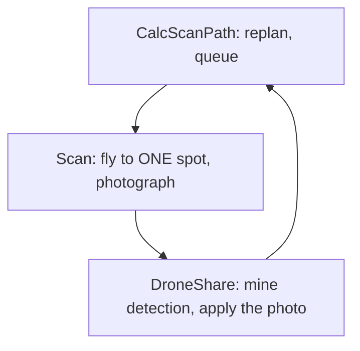

# 4. Scan: flying to one photo spot and taking the picture

> Part of the [execution walkthrough](README.md). Previous: [3. The first CalcScanPath pass](03-first-calcscanpath.md). Next: [5. DroneShare and the mine rule](05-droneshare-and-mine-rule.md).

**What this chapter covers.** `Scan` flies to the **first** waypoint in the queue that `CalcScanPath` built, takes a photo, and works out what the camera *really* saw. It records that as coverage. It also covers how the drone avoids the other drones while flying.

`Scan` handles **one waypoint per visit**. The mission loop is a cycle through the state machine:



## 4.1 Scan.run

```python
# state_machine/states/impl/scan_impl.py:231-273
        if self.drone.time_exceeded(self.flight_settings.max_flight_time):
            flight_log.event("scan_time_exceeded")
            return EndRun(self.drone, self.flight_settings, self.interdrone)

        if self.drone.replan_needed is not None or not self.drone.waypoints:
            # An empty queue with nothing to replan around yet (waiting on the
            # other side's point A or the side-mate's photos) bounces straight back to
            # CalcScanPath with no other await in between -- across two
            # concurrently-running drones sharing one event loop, that is
            # a tight loop with no suspension point, which starves every
            # OTHER drone's task (including the very interdrone_loop that
            # would deliver the message this drone is waiting on). A
            # single real drone process never notices this (nothing else
            # is competing for its event loop); asyncio.sleep(0) costs it
            # nothing and fixes the concurrent-drones-in-one-process case.
            await asyncio.sleep(0)
            return CalcScanPath(self.drone, self.flight_settings, self.interdrone)

        # drone_states is read-only peer state this drone already
        # maintains for collision avoidance (see conflictsForLeg's own
        # docstring on why it applies to non-formation, maze-mode
        # waypoints too) -- not a new interdrone send.
        # MISSION_ALTITUDE_M, not gotoWaypoint's own POIF-oriented default
        # (LEG_ALTITUDE_M) -- this is the mapping-mission scan loop.
        try:
            reached = await self.drone.gotoWaypoint(
                self.interdrone.drone_states, altitude_m=MISSION_ALTITUDE_M
            )
        except FormationLost as ex:
            # Measured separation from a peer fell below the floor (or a hold never
            # cleared): the avoidance guarantee is gone. Land, as POIF does, rather
            # than let the exception kill the state machine with the drone in GUIDED.
            flight_log.event("scan_separation_lost", reason=str(ex))
            logging.critical("drone %d: scan aborted -- %s", self.drone.id, ex)
            return Land(self.drone, self.flight_settings, self.interdrone)
        self.drone.last_reached_waypoint = reached
        flight_log.event("scan_waypoint_reached", waypoint=flight_log.waypoint_brief(reached))

        # Records the photo's real footprint on this drone's planner, climbing to retry
        # while it misses the waypoint's square; DroneShare then applies the photo.
        await _capture_and_mark_seen(self, self.drone.planner, reached)

        return DroneShare(self.drone, self.flight_settings, self.interdrone)
```

- **Time check** (again): straight to `EndRun` if the budget is gone.
- **Back to CalcScanPath instead of flying** if `replan_needed` is set *or* the queue is empty. `replan_needed` is only checked **here, at the start of a Scan visit**; it is **not** polled during the flight. In practice `DroneShare` sends every drone back to `CalcScanPath` after every photo anyway, so the flag mainly matters for a message that arrives *between* `CalcScanPath` clearing it and `Scan` starting (chapter 7). The `asyncio.sleep(0)` is deliberate: several drones in one process would otherwise starve the receive loop.
- **`gotoWaypoint`**: fly to the head of the queue (4.2). `MISSION_ALTITUDE_M` (2 m) is passed explicitly; the function's default is the POIF altitude (6 m).
- **`FormationLost`**: the collision-avoidance code decided the swarm is no longer safe. `Scan` logs it and returns `Land`.
- `last_reached_waypoint = reached`: hands the waypoint to `DroneShare` (each state's `run()` starts fresh, with no shared variables).
- **`_capture_and_mark_seen`**: the photo (4.3).

Note: `Scan` only catches `FormationLost`. If `move_to` raises `LegStalled` (the drone stopped closing on the waypoint) or `FlightInterrupted` (the autopilot left `GUIDED`), nothing in the mapping states catches it (the POIF state does), so the exception ends the state machine task with the drone still airborne.

**Goes next to ->** `Drone.gotoWaypoint`.

## 4.2 gotoWaypoint: fly the leg, but only if it is clear

The queue is `Drone.waypoints`. `gotoWaypoint` always flies to `waypoints[0]`.

```python
# state_machine/drone.py:931-934, 953-961
        peer_states = list(peer_states)
        curWaypoint = self.waypoints[0]
        target = (curWaypoint.lat, curWaypoint.long)
        leg_from = self.currentPosition()
    ...
        conflicts = self.conflictsForLeg(
            leg_from,
            target,
            peer_states,
            log_reason="pre_leg",
            points_per_lap=points_per_lap,
            my_progress=my_progress,
        )
        if conflicts:
```

`conflictsForLeg` asks: **is any other drone too close to the straight line I am about to fly?** The peers are `interdrone.drone_states`, one `DroneState` per other drone, filled by the receive loop.

```python
# state_machine/drone.py:703-704, 768-794
            occupied = state.believed_occupancy(PEER_STALE_S)
            stale = state.is_stale(PEER_STALE_S)
    ...
            clearance = segment_distance(leg_start, leg_end, occupied[0], occupied[1])
            entry["clearance"] = clearance
            entry["occupied"] = occupied
            considered.append(entry)

            if stale:
                if clearance < COLLISION_RADIUS:
                    collision_log.warning(
                        "drone %d: ignoring conflict with silent drone %d "
                        "(last belief %.2fm from leg) — no message in over %.0fs",
                        self.id,
                        state.drone_id,
                        clearance,
                        PEER_STALE_S,
                    )
                continue

            if clearance < COLLISION_RADIUS:
                conflicts.append(
                    LegConflict(
                        peer_id=state.drone_id,
                        clearance_m=clearance,
                        peer_from=occupied[0],
                        peer_to=occupied[1],
                        reason="swept_path",
                    )
                )
```

- `believed_occupancy` (in `drone_state.py`) is "where is this drone right now?":

```python
# state_machine/drone_state.py:227-245
    def believed_occupancy(
        self, max_age_s: float
    ) -> tuple[tuple[float, float], tuple[float, float]] | None:
        """Best available answer to "where is this drone right now?".

        A fresh position report is a measurement of where the drone is, good to
        however far it can travel between reports — far better than the whole
        waypoint-to-waypoint segment its plan permits, which at the start of the
        demo is five metres long. Using the plan instead is what let two drones
        reach 0.12 m in the 2026-08-07 5 m run: the drone that was still parked
        on its hover point was modelled at the waypoint it had been *sent to*,
        five metres away, so its neighbour flew straight onto it.

        Falls back to the planned segment when no recent report exists, since a
        conservative guess beats no guess.
        """
        if self._live_position is not None and not self.position_is_stale(max_age_s):
            return (self._live_position, self._live_position)
        return self.occupied_segment()
```

  In the mapping mission **nobody sends `NEW_WAYPOINTS` or `REACHED_WAYPOINT`** (only POIF does; the only `send_new_waypoints` callers are in `poif_impl.py`), so `occupied_segment()` is `None` and the only usable information is the **live position** from `POSITION_REPORT`. A peer with no position report in the last 12 s (`PEER_STALE_S`) is skipped entirely ("holding on a frozen belief is its own deadlock").
- `in_formation` is always false here (`points_per_lap` is `None`), so every peer takes the "outside the window" branch: the peer counts as occupying that point.
- `clearance` is the distance from the leg (a segment) to that point. A **conflict** is `clearance < COLLISION_RADIUS`:

```python
# flight/waypoint.py:12, 17, 19, 33
MIN_SEPARATION_M: float = 32 * 0.0254  # 32 inches
    ...
POSITION_UNCERTAINTY_M: float = 0.6
    ...
COLLISION_RADIUS: float = MIN_SEPARATION_M + 2 * POSITION_UNCERTAINTY_M
    ...
SEPARATION_ABORT_M: float = 1.2
```

  So `COLLISION_RADIUS` = 32 in (0.81 m) + 2 x 0.6 m = about **2.01 m**. The hard floor `SEPARATION_ABORT_M` is 1.2 m.

  **Tie to keep-apart:** `COLLISION_RADIUS` is about 6.6 ft. The planner's `keep_away_ft` (10 ft) and `keep_clear_ft` (7.5 ft) are deliberately above it, so a queued photo is never one the flight code would hold on: a photo planned closer than 6.6 ft to a peer would make `gotoWaypoint` hold until the peer moves and abort with `FormationLost` after 15 s (chapter 3, step 4).

**If there is a conflict, the drone holds** in the air and re-checks 10 times a second until the leg is clear:

```python
# state_machine/drone.py:978-982, 993-1005
            while conflicts:
                await asyncio.sleep(HOLD_POLL_INTERVAL_S)
                self._check_still_ours()
                self.checkSeparation(peer_states)
                now = time.monotonic()
    ...
                if conflicts and now - hold_started >= HOLD_ABORT_S:
                    flight_log.event(
                        "hold_abort",
                        held_for=now - hold_started,
                        target=flight_log.waypoint_brief(curWaypoint),
                        conflicts=[c._asdict() for c in conflicts],
                    )
                    raise FormationLost(
                        f"held {now - hold_started:.0f}s short of waypoint"
                        f" {curWaypoint.waypoint_id}: "
                        + "; ".join(_describe_conflict(c) for c in conflicts)
                    )

```

- `_check_still_ours()` raises `FlightInterrupted` if the autopilot left `GUIDED` or disarmed.
- A hold that lasts 15 s (`HOLD_ABORT_S`) raises `FormationLost`: two drones "can't block each other", so a hold that long means a peer has stopped moving; `Scan` lands.

**If clear, fly.** `move_to` commands the flight controller and polls:

```python
# state_machine/drone.py:1048-1064
        def leg_guard() -> None:
            """Keep watching the swarm while the leg is in the air."""
            self.checkSeparation(peer_states)
            if self.formation_abort is not None:
                raise FormationLost(self.formation_abort)

        move_started = time.monotonic()
        await move_to(
            self.vehicle,
            curWaypoint.lat,
            curWaypoint.long,
            altitude_m,
            groundspeed=LEG_GROUNDSPEED_M_S,
            tolerance=LEG_TOLERANCE_M,
            max_tolerance=LEG_MAX_TOLERANCE_M,
            abort_check=leg_guard,
        )
```

- `move_to` (`flight/pathfinding/utils/goto.py`) sends `simple_goto` at 2 m/s (`LEG_GROUNDSPEED_M_S`) and polls every 0.25 s. Arrival means: horizontal distance under `LEG_TOLERANCE_M = 0.35 m` **and** altitude within tolerance. If the drone stops closing for 5 s (`STALL_TIMEOUT_S`) but is within `LEG_MAX_TOLERANCE_M = 0.6 m`, that counts as arrived; otherwise it re-sends the goto once, then raises `LegStalled`. A leg may take at most 60 s.
- `leg_guard` runs on every poll: `checkSeparation` measures the real distance to every peer with a fresh position report and, if any is under 1.2 m, **latches** `formation_abort` and raises `FormationLost`:

```python
# state_machine/drone.py:845-856, 858-871
        me = self.currentPosition()
        closest: float | None = None
        breaches: list[dict[str, Any]] = []
        for state in peer_states:
            peer = state.live_position
            if peer is None or state.position_is_stale(PEER_STALE_S):
                continue
            distance = segment_distance(me, me, peer, peer)
            if closest is None or distance < closest:
                closest = distance
            if distance < SEPARATION_ABORT_M:
                breaches.append({"peer": state.drone_id, "separation": distance, "at": peer})
    ...
        if breaches and self.formation_abort is None:
            nearest = min(breaches, key=lambda b: b["separation"])
            self.formation_abort = (
                f"measured separation from drone {nearest['peer']} fell to"
                f" {nearest['separation']:.2f}m (floor {SEPARATION_ABORT_M:.2f}m)"
            )
            flight_log.event(
                "separation_breach",
                floor=SEPARATION_ABORT_M,
                breaches=breaches,
                at=me,
            )
            collision_log.critical("drone %d ABORTING: %s", self.id, self.formation_abort)

```

**Removing the waypoint.** After arrival:

```python
# state_machine/drone.py:1079-1086
        # The queue can be replaced mid-leg (a replan while flying): return the waypoint
        # this leg flew, and drop it only if it is still queued -- never pop whatever is at
        # the head now (another waypoint, or nothing at all).
        for i, queued in enumerate(self.waypoints):
            if queued is curWaypoint:
                del self.waypoints[i]
                break
        return curWaypoint
```

- **By identity, not by position.** The source comment says the queue "can be replaced mid-leg (a replan while flying)", so the code deletes the very object this leg flew to, and only if it is still queued, never "whatever is at the head now". In the flow described here the only caller of `resetWaypoints` is `CalcScanPath`, which cannot run while `Scan` is awaiting the leg, so this is a safety measure rather than something that happens today.
- The function returns the waypoint; `Scan` stores it as `drone.last_reached_waypoint`.

## 4.3 The photo: what did the camera *really* cover?

`CalcScanPath` planned with a fixed rectangle (8.52 x 6.44 ft). The real footprint depends on altitude, attitude and heading, so `Scan` measures it:

```python
# state_machine/states/impl/scan_impl.py:82-86, 88-108, 110-129
        image = camera.capture_image(only_metadata=False)
        if image is None or image.image is None:
            logging.warning("drone %d: camera capture failed -- skipping photo", self.drone.id)
            return
        self.drone.last_captured_image = image
    ...
        location = vehicle.location.global_relative_frame
        attitude = vehicle.attitude
        altitude_agl_m = self.drone.rangefinder_altitude_agl_m
        if altitude_agl_m is None:
            logging.warning(
                "drone %d: no fresh rangefinder3 reading -- falling back to %.1fm for"
                " this photo's footprint math",
                self.drone.id,
                MISSION_ALTITUDE_M,
            )
            altitude_agl_m = MISSION_ALTITUDE_M

        drone_pose = DronePose(
            lat=location.lat,
            lon=location.lon,
            altitude=altitude_agl_m,
            # dronekit's Attitude is in radians; DronePose expects degrees.
            yaw=math.degrees(attitude.yaw),
            pitch=math.degrees(attitude.pitch),
            roll=math.degrees(attitude.roll),
        )
    ...
        width, height = image.image.size
        top_left, top_right, bottom_left, bottom_right = camera.get_image_corner_coordinates(
            width, height, drone_pose
        )
        if None in (top_left, top_right, bottom_left, bottom_right):
            logging.warning(
                "drone %d: a corner ray never reached the ground -- skipping footprint marking",
                self.drone.id,
            )
            return

        # get_image_corner_coordinates returns (top_left, top_right,
        # bottom_left, bottom_right) -- a diagonal-crossing order, not a
        # perimeter walk. The coverage fill is a simple-polygon test, so the
        # corners must be reordered to trace the rectangle's actual edges
        # (top_left, top_right, bottom_right, bottom_left) or the "polygon"
        # self-intersects and the coverage test is wrong.
        corners = [top_left, top_right, bottom_right, bottom_left]
        planner.own_footprint(corners)
        self.drone.last_photo_corners_latlon = corners
```

- `capture_image` takes the picture. If it fails (no camera, no image), the function returns and `last_photo_corners_latlon` stays `None`. That is a **failed photo** (chapter 5).
- The altitude for the geometry is the **rangefinder** (real height above ground), falling back to `MISSION_ALTITUDE_M` with a warning; attitude comes from the autopilot in radians and is converted to degrees.
- `camera.get_image_corner_coordinates(...)` ray-casts the four image corners to the ground and returns lat/lon. If any ray does not reach the ground, no footprint is recorded.
- The four corners are reordered to walk the perimeter (top-left, top-right, bottom-right, bottom-left), or the coverage fill's polygon test would see a self-crossing shape.
- **`planner.own_footprint(corners)`** hands the footprint to the planner. Call chain: `MissionPlanner.own_footprint` -> `SideSession.own_footprint` -> `PathNodePlanner.record_footprint`:

```python
# flight/pathfinding/mission_planner.py:92-94
    def own_footprint(self, corners_latlon):
        """A photo this drone just took (Scan; may repeat while it climbs to retry)."""
        self.session.own_footprint(self._local(corners_latlon))
```

```python
# flight/pathfinding/pathnode/planner.py:159-164, 173-175, 177-184
    def record_footprint(self, corners):
        """A photo's ground footprint (any quadrilateral, corners in order) as coverage; a miss
        for any needed square it was aimed at and didn't cover (see coverage.py)."""
        needed = self.work.needed_squares() if not self.failure else set()
        cx, cy = self.coverage.record(corners)
        self._misses(cx, cy, needed)
    ...
    def _misses(self, x, y, needed):
        for c, r in self.coverage.count_misses(x, y, needed):
            self._block_square(c, r)
    ...
    def _block_square(self, c, r):
        """Give up on square (c, r): make it an obstacle and apply the mine rule to it."""
        if (c, r) in self.blocked or self.failure:
            return
        self.blocked.add((c, r))
        self.log.count("blocked_squares")
        self.log.event("blocked", c, r)
        mine_rule.apply(self, self.routes.add_square(c, r), Source.PARTNER)
```

- `needed = self.work.needed_squares()` **before** recording: every not-yet-photographed square any group still wants (unchecked links, shortcut trials, and both rings).
- `coverage.record(corners)` marks every 2 ft square **fully inside** the footprint as seen (grown by 1/1000 ft to absorb lat/lon round-off) and returns the footprint centre:

```python
# flight/pathfinding/pathnode/coverage.py:100-115
    def record(self, corners):
        """Mark every square fully inside a photo's footprint (any quadrilateral, corners in
        order). Grown by FOOTPRINT_SLACK_FT first: a lat/lon round trip can move an edge that
        sits exactly on a grid line by ~1e-4 ft and un-cover the square. Returns the
        footprint's centre."""
        pts = list(corners)
        cx = sum(x for x, _y in pts) / len(pts)
        cy = sum(y for _x, y in pts) / len(pts)
        grown = []
        for x, y in pts:
            d = math.hypot(x - cx, y - cy) or 1.0
            grown.append((x + (x - cx) / d * FOOTPRINT_SLACK_FT,
                          y + (y - cy) / d * FOOTPRINT_SLACK_FT))
        self.seen.fill_polygon_covered(grown)
        self.version += 1
        return cx, cy
```

- `_misses` then counts a **miss** for each *needed* square this photo was *aimed at* (centre within `aim_radius` of the photo centre) but that is **still unphotographed**:

```python
# flight/pathfinding/pathnode/coverage.py:117-134
    def count_misses(self, x, y, needed):
        """A photo centred at (x, y) was taken (or failed). Count a miss for every square in
        `needed` it was aimed at (centre within aim_radius) that is still unphotographed.
        Returns the squares that have now reached MISS_BLOCK."""
        self.version += 1
        reach = self.aim_radius()
        c0, r0 = self.seen.real_to_cell(x, y)
        n = math.ceil(reach / CELL) + 1
        hopeless = []
        for c in range(c0 - n, c0 + n + 1):
            for r in range(r0 - n, r0 + n + 1):
                if ((c, r) not in needed or self.seen.get(c, r)
                        or math.dist(cell_centre(c, r), (x, y)) > reach + 1e-9):
                    continue
                self.misses[(c, r)] = self.misses.get((c, r), 0) + 1
                if self.misses[(c, r)] >= MISS_BLOCK:
                    hopeless.append((c, r))
        return hopeless
```

- **1 miss** (`MISS_CENTRE`): from the next `places_along`, that square gets a photo **centred on itself** instead of a normal placement.
- **3 misses** (`MISS_BLOCK`): the square is **given up**: it becomes an obstacle (`routes.add_square`) and the **mine rule** runs on it with `Source.PARTNER` (so it only re-bridges the route, it does not make point A jump; chapter 5). This is what stops the same photo being handed out forever when the camera keeps missing a square.

### The climb-retry loop

If the footprint still does not cover the square this waypoint was sent to check, the drone climbs and photographs again:

```python
# state_machine/states/impl/scan_impl.py:132-139, 161-169
        if planner.cell_seen_at(waypoint.lat, waypoint.long) is not False:
            return

        attempts += 1
        next_altitude_agl_m = altitude_agl_m + CAMERA_CLIMB_STEP_M
        if attempts >= MAX_CAMERA_CLIMB_ATTEMPTS or next_altitude_agl_m > self.flight_settings.max_flight_height:
            flight_log.event(
                "photo_coverage_incomplete",
    ...
        await move_to(
            vehicle,
            current.lat,
            current.lon,
            target_relative_alt,
            groundspeed=LEG_GROUNDSPEED_M_S,
            tolerance=LEG_TOLERANCE_M,
            altitude_tolerance=_CLIMB_ALTITUDE_TOLERANCE_M,
        )
```

- `cell_seen_at` returns `True` (covered), `False` (still unphotographed) or `None` (the square is off the field: no altitude can fix that). Only `False` triggers a retry.
- Each retry climbs `CAMERA_CLIMB_STEP_M = 0.5 m`, up to `MAX_CAMERA_CLIMB_ATTEMPTS = 8` or `max_flight_height` (from the mission config), then logs `photo_coverage_incomplete` and continues.
- The drone does **not** come back down; the next `gotoWaypoint` leg targets 2 m again.

Note: every retry calls `planner.own_footprint` again, and **every call counts misses** (`record_footprint` -> `count_misses`). A square that stays uncovered through three captures reaches `MISS_BLOCK = 3` and is blocked as an obstacle, even though the loop allows up to eight attempts. Whether that is intended is not stated anywhere (the `MissionPlanner.own_footprint` docstring only says the call "may repeat while it climbs").

**A worked example (toy run).** In the toy field of chapter 3, drone 1 photographs the first spot, (10.9, 2.7). Its footprint spans y = -1.56 to 6.96. Whole 2 ft squares are seen up to y = 6 (rows 0 to 2). `advance()` then checks the forward link in 0.5 ft steps and stops at the first step that would touch an unseen square: the step from 6.0 to 6.5 touches row 3, so the checked prefix ends at **y = 5.5**. Result: the chain becomes `entry --checked-- (10.0, 5.5) --forward-- target`, with a new path node laid at (10.0, 5.5). The `toy_after_mine` run printed in [chapter 6](06-calcscanpath-after-mine.md) shows exactly this ("pass 2").

**Goes next to ->** [Chapter 5: `DroneShare`](05-droneshare-and-mine-rule.md).

## 4.4 How the other drones differ

- All four drones run this identical `Scan` code. Drones on the top side simply fly toward lower y.
- `POSITION_REPORT`s from *all* other drones (both sides) feed the collision check, because `stream_positions(peers)` sends to `other_drones_in_mission`.
