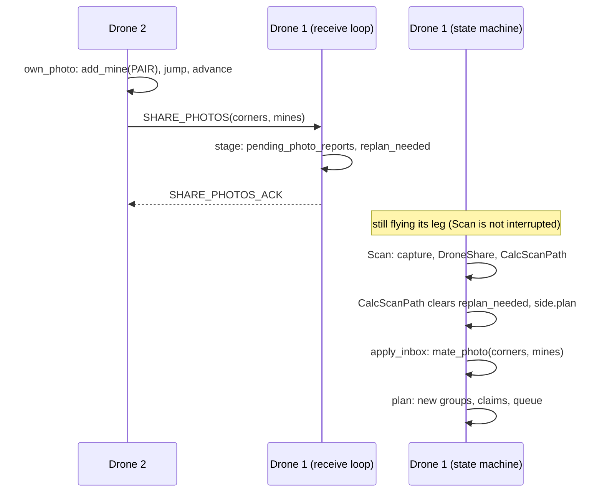

# 7. Messages from other drones: staging, then applying on the next pass

> Part of the [execution walkthrough](README.md). Previous: [6. CalcScanPath after a mine](06-calcscanpath-after-mine.md). Next: [8. Shortcuts](08-shortcuts.md).

**What this chapter covers.** How a message from another drone changes what `CalcScanPath` does *next*. There are two halves that never touch each other directly: the **receive loop** (`Interdrone.interdrone_loop`) writes incoming data into **staging fields on the `Drone`**; the **side agent** (`SideAgent.apply_inbox`, called by `CalcScanPath`) reads and applies them, in a fixed order, at the start of the next planning pass.

> **Status.** The per-drone code (`side_agent.py`, `session.py`, `planner.py`, including cross-side handling) is in final verification; the text describes it as read.

## 7.1 The receive loop

The loop runs as its own asyncio task (chapter 1). Every pass it drains up to 25 queued messages, handles each, then sleeps 0.1 s:

```python
# state_machine/interdrone.py:1459-1482, 2161
    async def interdrone_loop(self) -> None:
        startTime = time.time()
        try:
            while True:
                # Check for server messages, draining what is already queued this tick.
                # Handling only one per iteration caps throughput at ~10 msg/sec (one per
                # sleep below), which lets bursts of traffic build a backlog. Draining
                # without a cap is the opposite failure: under a sustained stream -- three
                # peers broadcasting POSITION_REPORT during POIF is enough -- this loop
                # never reaches the sleep, and most cases below contain no await at all, so
                # nothing else on the event loop gets to run. That includes the background
                # tasks started from inside this very loop, so a REQUEST_SWARM_STATUS could
                # be handled here and gather_swarm_status() still never execute, leaving the
                # app waiting on a response that was never going to be sent.
                messages_this_tick: int = 0
                while messages_this_tick < self.max_messages_per_tick and (
                    message := self.networking.try_get_server_message(timeout=0.02)
                ) is not None:
                    messages_this_tick += 1
                    # Adds the new message to its respective message queue
                    self.interdrone_messages.setdefault(message.id, queue.Queue()).put(
                        message
                    )  # TODO GET RID OF THIS SOON
                    match message.id:
    ...
                await asyncio.sleep(0.1)
```

- Every message is also appended to a per-type `queue.Queue` (`interdrone_messages`); a few request/response helpers (`ping_drones`, `distribute_gps_offset`, `gather_swarm_status`) read them from there. The mission messages below are handled directly in the `match`.
- `max_messages_per_tick = 25` bounds how long the loop can hold the event loop, since most cases contain no `await`.

**The rule for mission data: stage and flag, never touch the planner from here.** The planner is only ever used from the state machine's task. The staging fields (all on `Drone`, declared in `Drone.__init__`):

```python
# state_machine/drone.py:296-304
        self.pending_cross_pair_mines: list[CrossPairMineReport] = []
        # - the side-mate's photos (SHARE_PHOTOS);
        self.pending_photo_reports: list[SharedPhotoReport] = []
        # - the other side's latest point A (latest wins) and its photo footprints;
        self.pending_partner_point_a: tuple[float, float] | None = None
        self.pending_partner_coverage: list[list[tuple[float, float]]] = []
        # - the job each other drone last announced (SIDE_JOB; latest wins), by sender id:
        #   the side-mate's is held from it (claims.py), the other side's steers clear of it.
        self.peer_jobs: dict[int, Any] = {}
```

## 7.2 What each message does

| Message | Sent by | Handler stages... | Applied by (next pass) | Planner call | Effect |
|---|---|---|---|---|---|
| `SHARE_PHOTOS` | side-mate, after each of its photos | `pending_photo_reports` (+ `replan_needed`); `SHARE_PHOTOS_ACK` sent | `apply_inbox`, 2nd | `mate_photo` / `failed_photo` | mate's footprint recorded, its mines added as `Source.PAIR`, `advance()` |
| `SIDE_JOB` | any other drone | `peer_jobs[sender]` | `SideAgent.plan` builds `held` | `assignments(held=...)` | mate's job is held from claims; other side's job only steers keep-apart |
| `CROSS_PAIR_MINE_RELAY` | a drone of the other side that found a mine | `pending_cross_pair_mines` (+ `replan_needed`); ack sent at once | `apply_inbox`, **1st** | `partner_mine` | mine added as `Source.PARTNER`, `advance()` |
| `CROSS_PAIR_MINE_SYNC` | other side's speaker, every ~5 s | `pending_cross_pair_mines` (no flag) | `apply_inbox`, 1st | `partner_mine` per mine | catches mines a lost relay dropped (planner dedupes by square) |
| `CROSS_PAIR_COVERAGE` | a drone of the other side, per photo | `pending_partner_coverage` | `apply_inbox`, 3rd | `partner_coverage` | their footprint counts as photographed here |
| `CROSS_PAIR_POINT_A` | other side's speaker | `pending_partner_point_a` (latest wins) | `apply_inbox`, 4th | `partner_point_a` | the forward gap is re-aimed at it (chapter 9) |
| `CROSS_PAIR_CHAIN` / `_ACK` | top speaker -> drone 1 / drone 1 -> top side | `partner_route*`, `partner_route_ack_hash` | `EndRun` | `check_join_latlon` | chapter 10 |
| `POSITION_REPORT` | every drone, 5 Hz | `DroneState.set_live_position` (directly) | read live | none | positions for claims (`positions()`), keep-apart, collision holds |
| `FIELD_CHECKSUM` | drone 1's side, when finished | *answered in the loop*: `planner.mine_hash()` compared | not staged | none | a pure read, safe to do here; mismatch is logged |

The handlers themselves:

```python
# state_machine/interdrone.py:1724-1729, 1775-1783
                        case MessageType.SIDE_JOB:
                            # Latest wins; read by this drone's side agent when it plans.
                            state = self.get_drone_state_from_id(message.sender_id)
                            if state is not None:
                                state.touch()
                            self.drone.peer_jobs[message.sender_id] = message.data["job"]
    ...
                        case MessageType.POSITION_REPORT:
                            state = self.get_drone_state_from_id(message.sender_id)
                            if state is not None:
                                state.touch()
                                state.set_live_position(
                                    message.data["lat"],
                                    message.data["lon"],
                                    message.data["alt"],
                                )
```

```python
# state_machine/interdrone.py:1810-1815, 1847-1861, 1864-1870
                        case MessageType.SHARE_PHOTOS:
                            state = self.get_drone_state_from_id(message.sender_id)
                            if state is not None:
                                state.touch()

                            photos = message.data.get("photos", [])
    ...
                                failed_at = photo.get("failedAt")
                                if failed_at is not None:
                                    # A photo that produced no footprint: a miss in this
                                    # copy too, so a dead camera can't be sent back forever.
                                    self.drone.pending_photo_reports.append(
                                        SharedPhotoReport(
                                            [], [],
                                            failed_at=(float(failed_at[0]), float(failed_at[1])),
                                        )
                                    )
                                elif corner_coordinates or mines:
                                    self.drone.pending_photo_reports.append(
                                        SharedPhotoReport(corner_coordinates, mines)
                                    )
                                    self.drone.replan_needed = "share_photos"
    ...
                            share_ack: Message = Message.create(
                                id=MessageType.SHARE_PHOTOS_ACK,
                                drones_to_send_data=(message.sender_id,),
                                sender_id=self.flight_settings.current_drone_ID,
                                data={},
                            )
                            self.send(share_ack)
```

- `SHARE_PHOTOS` carries a list of `{"cornerCoordinates": [...], "mines": [...]}` entries (or `"failedAt": (lat, lon)` for a photo with no footprint). A photo with corners or mines becomes a `SharedPhotoReport`; the receiver sets `replan_needed = "share_photos"`. The ack is sent once after all photos in the message are queued. `SHARE_PHOTOS` and `CROSS_PAIR_MINE_RELAY` are the two message types the client **resends** if the socket fails.

```python
# state_machine/interdrone.py:1909-1962
                        case MessageType.CROSS_PAIR_MINE_RELAY:
                            # Stage + flag, never mutate the planner from
                            # this loop's own (concurrent) task -- see
                            # CrossPairMineReport's own docstring.
                            # CalcScanPath drains this synchronously.
                            self.drone.pending_cross_pair_mines.append(
                                CrossPairMineReport(
                                    lat=message.data["mine_lat"],
                                    lon=message.data["mine_lon"],
                                )
                            )
                            self.drone.replan_needed = "cross_pair_mine_relay"
                            await self.send_cross_pair_mine_relay_ack(
                                message.data["relay_id"], drones_to_send_data=(message.sender_id,)
                            )
                        case MessageType.CROSS_PAIR_MINE_RELAY_ACK:
                            # No resend-on-timeout mechanism exists yet for
                            # CROSS_PAIR_MINE_RELAY to cancel -- logged for
                            # visibility only.
                            logging.debug(
                                "drone %d: CROSS_PAIR_MINE_RELAY_ACK from drone %d for mine %s",
                                self.flight_settings.current_drone_ID,
                                message.sender_id,
                                message.data["relay_id"][:12],
                            )
                        case MessageType.CROSS_PAIR_POINT_A:
                            # Latest wins; applied by CalcScanPath (never touch the planner
                            # from this task). No replan flag: every drone replans after
                            # every photo anyway.
                            self.drone.pending_partner_point_a = (
                                message.data["lat"],
                                message.data["lon"],
                            )
                        case MessageType.CROSS_PAIR_COVERAGE:
                            self.drone.pending_partner_coverage.append(list(message.data["corners"]))
                        case MessageType.CROSS_PAIR_CHAIN:
                            # Always kept, even after joining: EndRun drops a join whose
                            # mine hash the partner no longer has.
                            self.drone.partner_route = list(message.data["route"])
                            self.drone.partner_route_complete = message.data["complete"]
                            self.drone.partner_route_mine_hash = message.data["mine_hash"]
                            if self.drone.route_joined:
                                await self.send_cross_pair_chain_ack(
                                    self.drone.joined_mine_hash, (message.sender_id,)
                                )
                        case MessageType.CROSS_PAIR_CHAIN_ACK:
                            self.drone.partner_route_ack_hash = message.data.get("mine_hash")
                        case MessageType.CROSS_PAIR_MINE_SYNC:
                            # Staged like a relay (the planner dedupes by square). No replan
                            # flag: every drone drains relays on every pass anyway.
                            for mine_lat, mine_lon in message.data["mines"]:
                                self.drone.pending_cross_pair_mines.append(
                                    CrossPairMineReport(lat=float(mine_lat), lon=float(mine_lon))
                                )
```

- The relay's ack (`CROSS_PAIR_MINE_RELAY_ACK`) is sent the moment the mine is **queued**, not when the planner has applied it. It is only logged by the sender (nothing resends on a missing ack; `CROSS_PAIR_MINE_SYNC` is the safety net).

## 7.3 How the next pass applies them

`SideAgent.apply_inbox` (chapter 3, 3.2a) swaps each staging list for an empty one and applies, in this order:

1. the other side's **mines** (`partner_mine`): first, "no path node may be laid over ground about to turn out unsafe";
2. the **side-mate's photos** (`mate_photo`, or `failed_photo` for a failed one), also remembering where the mate's last photo was (`_mate_photo_at`, a position fallback);
3. the other side's **photo footprints** (`partner_coverage`);
4. the other side's **point A** (`partner_point_a`).

What each planner call does:

```python
# flight/pathfinding/mission_planner.py:102-107
    def mate_photo(self, corners_latlon, mines_latlon):
        """A SHARE_PHOTOS report from the side-mate (corners may be empty: mines only)."""
        if corners_latlon:
            self.session.mate_photo(self._local(corners_latlon), self._local(mines_latlon))
        else:
            self.session.own_photo(None, self._local(mines_latlon))
```

```python
# flight/pathfinding/pathnode/session.py:62-69, 75-84
    def mate_photo(self, corners, mines):
        """A photo report from the side's other drone. Its mines were relayed to the partner
        side by the drone that found them; the Outbox is for completeness (both copies of the
        side's planner learn a mine, and the partner dedupes by square)."""
        self.planner.record_footprint(corners)
        new = self._add_pair_mines(mines)
        self.planner.advance()
        return self._outbox(None, new)
    ...
    def partner_mine(self, x, y):
        self.planner.add_mine(x, y, Source.PARTNER)
        self.planner.advance()

    def partner_coverage(self, corners):
        self.planner.record_footprint(corners)
        self.planner.advance()

    def partner_point_a(self, x, y):
        self.planner.set_partner_point_a(x, y)
```

- `mate_photo`: record the footprint (`record_footprint`, which may count misses), add the mate's mines as `Source.PAIR` (so they can make **this** copy's point A jump too, exactly as on the copy that found them), `advance()`. If the report has no corners (mines only) it applies just the mines.
- `partner_mine`: `add_mine(x, y, Source.PARTNER)` then `advance()`: the mine rule only re-bridges.
- `partner_coverage`: record the footprint and `advance()`.
- `partner_point_a`: retarget the forward gap (chapter 9).

## 7.4 A concrete case: the side-mate finds a mine while drone 1 is mid-leg

The toy run below sets the scene: drone 2 pioneers the forward gap (it announced that job); drone 1 is behind it flying ring photos. Drone 2 photographs (11.0, 21.5) and finds a mine at (12.0, 22.5). We watch drone 1's copy.



```text
drone 1's copy, before anything arrives
  chain: entry(10.0,0.0) -checked- forward(10.0,5.5) -checked- forward(10.0,13.5) -forward- target(10.0,60.0)
  drone 1 queue: [(9.0, 16.3), (7.0, 14.3), (7.0, 8.3), (7.0, 2.3), (15.0, 2.3), (15.0, 8.3)] | drone 2 queue: [(11.0, 29.5), (11.0, 35.3), (11.0, 41.1), (11.0, 46.9), (11.0, 52.7), (10.5, 58.4)]

drone 2 photographs (11.0, 21.5) and finds a mine at (12.0, 22.5)
  drone 2's own copy:  entry(10.0,0.0) -checked- forward(10.0,5.5) -checked- forward(10.0,13.5) -checked- span(9.9,14.0) -pending- jump(7.9,22.0) -forward- target(7.0,60.0)
  drone 2 stages for drone 1: SHARE_PHOTOS(corners, mines=[(12.0, 22.5)])

(drone 1 finishes its leg, photographs, then CalcScanPath runs apply_inbox -> mate_photo)
  drone 1's copy:      entry(10.0,0.0) -checked- forward(10.0,5.5) -checked- forward(10.0,13.5) -checked- span(9.9,14.0) -pending- jump(7.9,22.0) -forward- target(7.0,60.0)
  same mine set on both copies: True
  drone 1 queue now:   [(9.0, 17.0), (7.9, 22.0), (11.0, 16.3), (7.0, 12.3), (5.0, 14.3), (9.0, 18.3)] | drone 2 queue: [(7.0, 30.3), (7.0, 36.1), (7.0, 41.9), (7.0, 47.7), (7.0, 53.5), (7.0, 59.3)]
  group path: key=('span', (7.9, 21.958578643762692)) 2 photo(s), first (9.0, 17.0)
  group path: key=forward                    8 photo(s), first (7.0, 21.0)
  drone 1 stats: {'jumps': 1, 'replans': 1}
```

Timeline:

1. **Drone 2's side.** Its `DroneShare` runs `side.own_photo`: its own copy adds the mine (`Source.PAIR`), the frontier jumps (the toy prints the chain: a `span` node, a **pending** link, a **jump** node at (7.9, 22.0), then the forward link), and `send_heartbeats()` announces the new point A. It sends `SHARE_PHOTOS` to drone 1 and `CROSS_PAIR_MINE_RELAY` / `CROSS_PAIR_COVERAGE` to the other side (if any).
2. **Drone 1's receive loop** runs while drone 1 is flying (the loop only gets the event loop when a state awaits: mostly the 0.25 s poll in `move_to`). The `SHARE_PHOTOS` handler appends a `SharedPhotoReport` and sets `replan_needed`; the ack goes back.
3. **Drone 1 is not interrupted.** `Scan` does not poll the flag during a leg. The leg that was queued *before* the mine was known is flown to its end, and the photo is taken. This is a deliberate limit: at worst one leg is flown on old information. (As far as the code shows, a mine's danger zone constrains the *route being reported*, not where a drone may hover; nothing in `Scan` checks a queued spot against zones.)
4. **`DroneShare`** applies drone 1's own photo, then returns `CalcScanPath`.
5. **`CalcScanPath`** clears `replan_needed`, then `side.plan()` -> `apply_inbox` -> `mate_photo(corners, mines)`. Drone 1's copy now runs the mine rule on the same mine: the toy shows drone 1's chain **identical** to the one drone 2 computed, and `mine_hash()` equal on both copies.
6. **The plan changes.** Before: drone 1's queue was ring photos (ADJACENT/OUTER), and drone 2 held the forward gap. After: the new **span** (2 photos near (9.0, 17.0) to (7.9, 22.0)) is PATH work (group 0) and outranks rings; drone 2 still holds `forward`, so the span goes to drone 1, the nearer, free drone. Drone 1's queue becomes `[(9.0, 17.0), (7.9, 22.0), ...]`.

The important consequence: **every drone of a side ends with the same chain from the same events**, but each applies them at its own pace. In the toy, drone 2's copy applied the mine the moment drone 2 photographed; drone 1's copy applies it one pass later. The claims tolerate this: each drone's announced job (`SIDE_JOB`) is held from the other's copy, so both do not fly the same path.

Note: the order in which events reach a copy is not chronological across drones. Drone 1's own photo (taken mid-way) was applied *before* the mate's earlier photo arrived. The route is a function of the *set* of mines and photos (the mine rule and `advance` are re-run after each event), but the intermediate chain shapes may differ between copies. `mine_hash()` compares the mine sets only.

## 7.5 `replan_needed`: what it really does today

The receive loop sets `Drone.replan_needed` for `SHARE_PHOTOS` (with content) and `CROSS_PAIR_MINE_RELAY`. `CalcScanPath` clears it; `Scan` bounces to `CalcScanPath` if it is set on entry. Reading the code:

- The state machine only yields the event loop when something awaits. `SideAgent.plan()`, `DroneShare` and the `Interdrone.send_*` coroutines contain no suspension (the send functions just call `Interdrone.send`, which is synchronous). So in the busy path `DroneShare -> CalcScanPath -> Scan` there is no gap in which a message can arrive between "cleared" and "checked".
- The one gap is `CalcScanPath`'s idle `sleep(0.1)` when the queue is empty, but then `Scan` bounces back anyway because the queue is empty (`or not self.drone.waypoints`).
- Messages arrive mid-leg and the flag is set then, but `CalcScanPath` clears it before it could matter.

So as read, the flag is effectively redundant: **the real mechanism is that `CalcScanPath` runs after every photo and always drains the staging fields.** Worth knowing if you expect a message to abort a leg: it does not.

## 7.6 SIDE_JOB and POSITION_REPORT in the next pass

- `SideAgent.plan` builds `held = {mate: peer_jobs[mate]}` (only once the mate has announced something: a mate not yet heard from is left out as unknown, not held as "no job"; also left out if there is no mate or it is lost) plus the other side's announced jobs for the drones it currently hears from (`others`). The mate's job replaces that drone's record in the ClaimBook; the other side's only feed keep-apart (`other_held`).
- `positions()` reads the mate's `DroneState.live_position` (if the last `POSITION_REPORT` is under 2 s old), and `other_side_positions()` the other side's, the same way. Reports older than that are ignored: a silent drone stops constraining the plan.
- `mate_lost` after 20 s of silence (`DroneState.is_stale`): its position becomes `None`, it is dropped from `held`, and this drone's copy hands the mate's work to whoever is nearest (this drone, if alone). This is also why the lower-id drone of a side is always the speaker and the higher becomes one only when the lower is lost (chapter 2).
