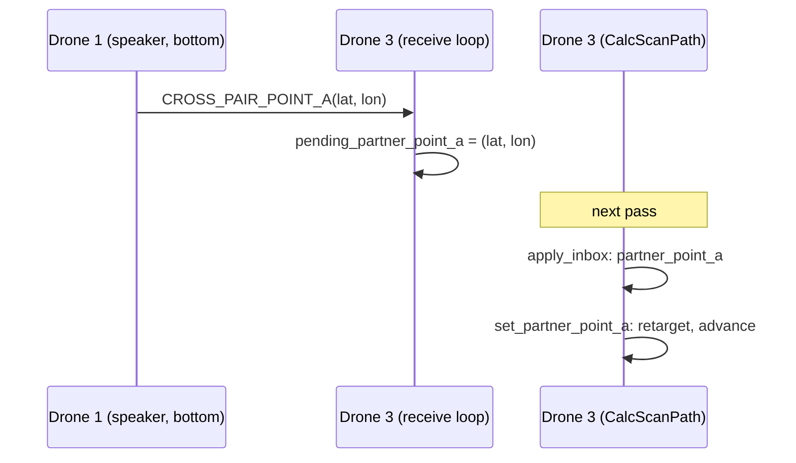

# 9. Two sides meeting: point A, the target, and closing the gap

> Part of the [execution walkthrough](README.md). Previous: [8. Shortcuts](08-shortcuts.md). Next: [10. Finishing](10-finishing.md).

**What this chapter covers.** In a 3- or 4-drone mission the two sides start at opposite edges and each aims its **forward gap** at the *other side's* current **point A**. This chapter follows that: what point A is, how it travels between sides, how the target moves, how the gap closes into a single route, and what happens when the two sides meet at slightly different places.

> **Status.** Cross-side traffic and the speaker logic are in final verification; the text describes the code as read.

## 9.1 Recap: the pieces

- **Point A** is this side's frontier: the node before its forward link (`Chain.point_a`). With no forward link it is the target itself.
- **Target** (`target.py`): what the forward gap aims at. With a partner side it is **the partner's latest point A**; at the start (before any relay) it is the partner's *entry*, `(entry_x, far edge)`.
- The **speaker** of each side (lowest id still heard from: drone 1 and drone 3) streams the side's point A to *all* drones of the other side, on change and at least once per second.

## 9.2 The target: `Target.route_from`

```python
# flight/pathfinding/pathnode/target.py:11-61
class Target:
    def __init__(self, field_w, field_h, start_edge, partner_entry_x, routes):
        """
        - start_edge: this side's entry edge; the target is on or towards the other one.
        - partner_entry_x: set when there is a partner side. Its point A starts at its entry
          until the first relay arrives. None aims at the far edge.
        """
        self.field_w = field_w
        self.far_y = field_h if Edge(start_edge) == Edge.BOTTOM else 0.0
        self.partner = partner_entry_x is not None
        self.partner_a = (float(partner_entry_x), self.far_y) if self.partner else None
        # False while heading for a stand-in (see route_from): the gap must not be declared
        # closed against it.
        self.is_partner = False
        self._routes = routes

    def route_from(self, frm):
        """Shortest route from `frm` to the target, as (points, gids) -- (None, None) if none.

        Far edge: straight ahead when that is clear, else the far-edge point with the
        shortest route.

        Partner: its point A. If that is inside an obstacle this side knows about, head for
        the obstacle corner nearest it -- the partner applies the same rule and re-places
        its point A just outside -- and is_partner goes False meanwhile."""
        routes = self._routes
        self.is_partner = False
        if self.partner:
            if not routes.contains(*self.partner_a):
                r = routes.route(frm, self.partner_a)
                if r[0] is not None:
                    self.is_partner = True
                    return r
            corners = sorted(routes.corners(), key=lambda v: math.dist(v, self.partner_a))
            for v in corners[:8]:
                r = routes.route(frm, v)
                if r[0] is not None:
                    return r
        straight = (min(max(frm[0], 0.0), self.field_w), self.far_y)
        if not routes.contains(*straight) and routes.zones.clear_line(frm, straight):
            return [tuple(frm), straight], [None, None]
        best = (None, None)
        best_len = math.inf
        for k in range(int(self.field_w // CELL)):
            cand = ((k + 0.5) * CELL, self.far_y)
            if routes.contains(*cand):
                continue
            r = routes.shortest(frm, cand)
            if r is not None and poly_len(r[0]) < best_len:
                best, best_len = r, poly_len(r[0])
        return best
```

- `route_from(frm)` returns the shortest route (points, obstacle group ids) from a point to the target, or `(None, None)`.
- **With a partner**: first try a route to `partner_a` itself. If `partner_a` is not inside an obstacle this side knows about and a route exists, `is_partner = True`: the target is real.
- **Stand-in**: if the partner's point A lies **inside an obstacle this side knows** (for instance a mine this side found and the partner has not heard yet), the route heads for the **nearest obstacle corner** to it instead (up to 8 corners tried), and `is_partner` stays `False`. The partner applies the same rule and re-places *its* point A just outside the obstacle; when the relay arrives, the stand-in is replaced by the real thing.
- **Without a partner**: straight ahead to the far edge if clear, else the far-edge point (one per 2 ft cell) with the shortest route.
- `is_partner` matters in `advance()`:

```python
# flight/pathfinding/pathnode/planner.py:264-274
    def advance(self):
        """Lay path nodes over everything now checked -- the forward gap from point A and
        every pending span from its start -- then update the shortcuts."""
        if self.failure:
            return
        chain = self.chain
        seen = self.coverage.all_seen
        f = chain.forward_index()
        # Never close the gap against a stand-in target (see target.py).
        if f is not None and (not self.target.partner or self.target.is_partner):
            chain.advance_link(chain.links[f], Placer.FORWARD, seen)
```

  "Never close the gap against a stand-in target": a side never declares itself met while the target is a stand-in.

## 9.3 A message's path: partner point A



1. Drone 1's `send_heartbeats` (chapter 3, 3.2b) sends `CROSS_PAIR_POINT_A` to drones 3 and 4 when its point A changes (the mine-rule jump changes it immediately) and every second otherwise.
2. The receive loop just stores it, **latest wins** (chapter 7): `pending_partner_point_a`. There is no replan flag: every drone replans after every photo anyway.
3. `apply_inbox` (last step of the inbox) calls `MissionPlanner.partner_point_a` -> `SideSession.partner_point_a` -> `PathNodePlanner.set_partner_point_a`:

```python
# flight/pathfinding/pathnode/planner.py:202-222
    def set_partner_point_a(self, x, y):
        """Retarget the forward gap at the partner's latest point A. Once met, only stored."""
        target = self.target
        if not target.partner or self.failure:
            return
        if (float(x), float(y)) == target.partner_a:
            return      # the heartbeat resends an unchanged point A; new mines replan on their own
        target.partner_a = (float(x), float(y))
        f = self.chain.forward_index()
        if f is None:
            return
        route, _ = target.route_from(self.chain.nodes[f].xy)
        if route is None:
            self.log.event("stale-target", target.partner_a)
            return
        self.chain.nodes[f + 1] = PathNode(*route[-1], Placer.TARGET)
        self.chain.links[f].poly = route
        # The new target can land on ground that is already checked -- or exactly on our own
        # point A once the partner has reached it. Nothing else would advance the chain then
        # (no photo is left to take), so the gap would never close.
        self.advance()
```

- An **unchanged** point A (the heartbeat) is ignored.
- Otherwise the target moves; the **forward link is re-routed** to it from this side's point A (`route_from`) and the virtual target node replaced. If no route exists the event `stale-target` is logged and the old target is kept.
- `advance()` at the end: the new target may lie on ground that is *already checked*, or exactly on this side's own point A once the partner reached it. Nothing else would advance the chain in that case (no photo is left to take), so the gap would never close.

The **other** stream that lets the gap close is `CROSS_PAIR_COVERAGE`: every footprint the other side photographs is relayed and recorded here (`partner_coverage`), so the ground *between* the two sides counts as photographed no matter who photographed it. Without it each side would have to photograph the other's ground again.

## 9.4 Closing the gap

Each side's forward link runs from its point A to the *other side's* point A. Photos taken anywhere along it (by this side, or relayed from the other) let `advance()` lay path nodes over the checked prefix, so **point A creeps forward**, which the speaker streams to the other side, which re-aims and advances too. The gap is squeezed from both ends:

```text
tick  0: bottom side A=( 12.0,  0.0) gap= 80.0 ft | top side A=( 12.0, 80.0) gap= 80.0 ft
tick  1: bottom side A=(  7.9, 22.0) gap= 59.0 ft | top side A=( 16.1, 62.0) gap= 63.0 ft
tick  2: bottom side A=( 18.1, 22.0) gap= 40.0 ft | top side A=( 16.1, 62.0) gap= 40.0 ft
tick  3: bottom side A=( 17.8, 28.0) gap= 28.2 ft | top side A=( 16.4, 56.1) gap= 28.2 ft
tick  4: bottom side A=( 17.4, 35.9) gap= 16.3 ft | top side A=( 20.1, 52.0) gap= 16.3 ft
tick  5: bottom side A=( 18.4, 41.7) gap=  6.4 ft | top side A=( 19.4, 48.1) gap=  6.4 ft
tick  6: bottom side A=( 19.4, 48.1) gap= closed | top side A=( 18.4, 41.7) gap= closed
bottom met: True | top met: True
top route as sent in CROSS_PAIR_CHAIN: [(12.0, 80.0), (14.0, 71.3), (16.1, 62.0), (19.9, 54.5)] ... to [18.4, 41.7]
bottom route: [(12.0, 0.0), (15.6, 11.9), (17.4, 17.6), (18.1, 20.0)] ... to [19.4, 48.1]
joined (bottom entry -> top entry): [(12.0, 0.0), (15.6, 11.9), (17.4, 17.6), (18.1, 20.0), (18.1, 22.0), (17.8, 28.0), (17.4, 35.9), (18.4, 41.7), (19.4, 48.1), (20.1, 52.0), (20.1, 54.0), (19.9, 54.5), (16.1, 62.0), (14.0, 71.3), (12.0, 80.0)]
```

- **ticks 0 to 6:** both sides' gaps shrink together (they are the same gap, seen from each end). Each jump (ticks 2 to 4: the mine rule moving point A past a mine) moves that side's point A sideways and the other side re-aims.
- **tick 6:** 0.5 ft apart, each side's target is the other's point A.
- **tick 7:** both forward links are gone (`gap closed`): `chain.forward_index()` is `None`, so `PathNodePlanner.met` is true on both sides:

```python
# flight/pathfinding/pathnode/planner.py:124-126, 140-142
    def met(self):
        """The forward gap is closed: the chain reaches the target."""
        return self.failure is None and self.chain.forward_index() is None
    ...
    def point_a(self):
        """This side's point A -- the frontier. Once met, the meeting point."""
        return self.chain.point_a()
```

  Note that at tick 7 each side's point A is the *other's previous* point A: the two sides crossed. This is normal (each closes on a point A that the other has since moved beyond) and is what `join` handles below.

`met` does not mean *done*: rings, pending spans and shortcuts may remain (`done()` requires all of them to be finished; chapter 10). The meeting changes two things immediately: `Shortcuts.anchors` now includes the target, and `done()` can become true.

## 9.5 Joining the two routes

Each side's route runs from its own entry to where it stopped. Because each side stops at the other's point A, which is on the other's route, the two share at least one point. `join.py`:

```python
# flight/pathfinding/pathnode/join.py:9-24, 27-47
def join_routes(own, partner):
    """
    Takes: own and partner routes, each from its own entry to where it stopped. Each side
    stops at the other's point A, a point on the other's route, so they share at least one
    point -- on a partner vertex or anywhere on a partner segment.

    Returns: the joined route, spliced at the first shared point along `own`; None if they
    share no point.
    """
    for i, p in enumerate(own):
        for j in range(len(partner)):
            if math.dist(p, partner[j]) <= ROUTE_MATCH_FT:
                return list(own[:i + 1]) + list(partner[:j])[::-1]
            if j + 1 < len(partner) and on_segment(p, partner[j], partner[j + 1], ROUTE_MATCH_FT):
                return list(own[:i + 1]) + list(partner[:j + 1])[::-1]
    return None
    ...
def join(own, partner, routes, coverage, log):
    """
    join_routes, with a fallback. Under heavy relay loss both sides can stop against point
    As the other has since abandoned, leaving two checked halves that overlap but share no
    point. Then bridge the closest pair of points -- only with a straight line clear of every
    obstacle AND whose squares are all photographed, so the bridge is as verified as any
    checked link.

    Returns: the joined route, or None.
    """
    joined = join_routes(own, partner)
    if joined is not None:
        return joined
    pairs = sorted((math.dist(p, q), i, j) for i, p in enumerate(own)
                   for j, q in enumerate(partner) if math.dist(p, q) <= MAX_BRIDGE_FT)
    for _d, i, j in pairs:
        p, q = own[i], partner[j]
        if not routes.crosses([p, q]) and coverage.all_seen([p, q]):
            log.event("bridged-join", p, q)
            return list(own[:i + 1]) + list(partner[:j + 1])[::-1]
    return None
```

- `join_routes`: find the first point along **own** that matches (within `ROUTE_MATCH_FT` = 0.01 ft) a vertex of **partner** or lies on a partner segment; the result is `own[:i+1]` followed by the partner's points before that spot, **reversed** (so the joined route reads bottom entry to top entry).
- `join` adds a fallback when relay loss left the two halves overlapping but sharing no point: bridge the closest pair of points **within 30 ft** (`MAX_BRIDGE_FT`), only with a straight line that crosses no obstacle *and* whose squares are all photographed, "so the bridge is as verified as any checked link".
- `MissionPlanner.join_latlon` also rejects a joined route that `zones.crosses`: it must not touch any obstacle *this* copy knows.

The last line of the toy output shows the joined route from bottom entry (12, 0) to top entry (12, 80).

## 9.6 When the halves don't connect: reopening

`PathNodePlanner.check_join` is what drone 1's `EndRun` calls (chapter 10):

```python
# flight/pathfinding/pathnode/planner.py:228-262
    def check_join(self, partner_route):
        """
        Takes: the partner side's latest route.

        Does: once met, checks this side's route joins it. Under relay loss both sides can
        meet crosswise -- each closing on a point A the other has since abandoned -- and then
        neither route contains the other's end. The bottom side yields: it re-opens its gap
        toward the partner's route end, which is on the partner's route by definition. The top
        side only waits, so the two never chase each other.

        Returns: the joined route, or None.
        """
        self.partner_route = [tuple(p) for p in partner_route]
        if not self.met or len(self.partner_route) < 2:
            return None
        joined = self.join(self.partner_route)
        if joined is None and self.start_edge == Edge.BOTTOM:
            self._reopen_toward(self.partner_route[-1])
        return joined

    def _reopen_toward(self, point):
        """Turn the met target into an ordinary node and open a forward gap to `point`."""
        self.target.partner_a = (float(point[0]), float(point[1]))
        end = self.chain.nodes[-1]
        route, _gids = self.target.route_from(end.xy)
        if route is None:
            self.log.event("reopen-failed", self.target.partner_a)
            return
        self.chain.nodes[-1] = PathNode(end.x, end.y, Placer.FORWARD)
        self.chain.nodes.append(PathNode(*route[-1], Placer.TARGET))
        self.chain.links.append(Link(LinkKind.FORWARD, route))
        self.log.count("reopens")
        self.log.event("reopen", end.xy, self.target.partner_a)
        self.advance()

```

- Under relay loss, both sides can meet **crosswise**: each closes on a point A that the other has since abandoned, and neither route contains the other's end.
- **The bottom side yields**: `_reopen_toward(partner_route[-1])` sets the target to the partner route's end (which is on the partner's route by definition), turns the met target into an ordinary FORWARD-placed node and opens a **new forward gap** to it; `advance()` then continues normally. `met` goes false and `done()` goes false, so `EndRun` returns to `CalcScanPath` to fly the gap.
- **The top side only waits**, so the two never chase each other.
- The `reopens` counter and the events `reopen` / `reopen-failed` are logged.

## 9.7 Mines across sides

- **A mine found by drone 1 or 2**: `own_photo` adds it as `Source.PAIR` (the finder's point A may jump) and sends it to drones 3 and 4 as `CROSS_PAIR_MINE_RELAY`; there it is added as `Source.PARTNER` (only re-bridges; it never jumps *their* point A).
- **`CROSS_PAIR_MINE_SYNC`** (speaker, every ~5 s; every 1 s while waiting in `EndRun`): the full mine list, so a relay lost in transit cannot keep the two mine sets apart. The receiver dedupes by square.
- **Agreement check**: when a side finishes, `_finish_scan` sends `FIELD_CHECKSUM` (`mine_hash`) to the other side; a mismatch is logged (`FIELD_CHECKSUM_ACK` with `matched = False`).

## 9.8 Keeping apart across sides

Drones of different sides share the same middle of the field at the end. `SideAgent.other_side_positions()` gives fresh `POSITION_REPORT`s of the other side's drones, and their announced jobs come from `SIDE_JOB` (`peer_jobs`). `PathNodePlanner.plan(..., others=...)` runs `_keep_apart` with the **same rule as within a side** (lower id keeps its ground; every drone of side 1 is lower than any of side 2). Work is **not** shared across sides (each side's planner is its own): the other side only steers where a photo may be flown (`keep_away_ft` = 10 ft from a lower-id drone's position or announced job, `keep_clear_ft` = 7.5 ft from a higher-id one; `_make_way` also yields to a lower-id drone's announced job within `keep_away_ft`, including the other side's). See chapter 3 (step 4).
