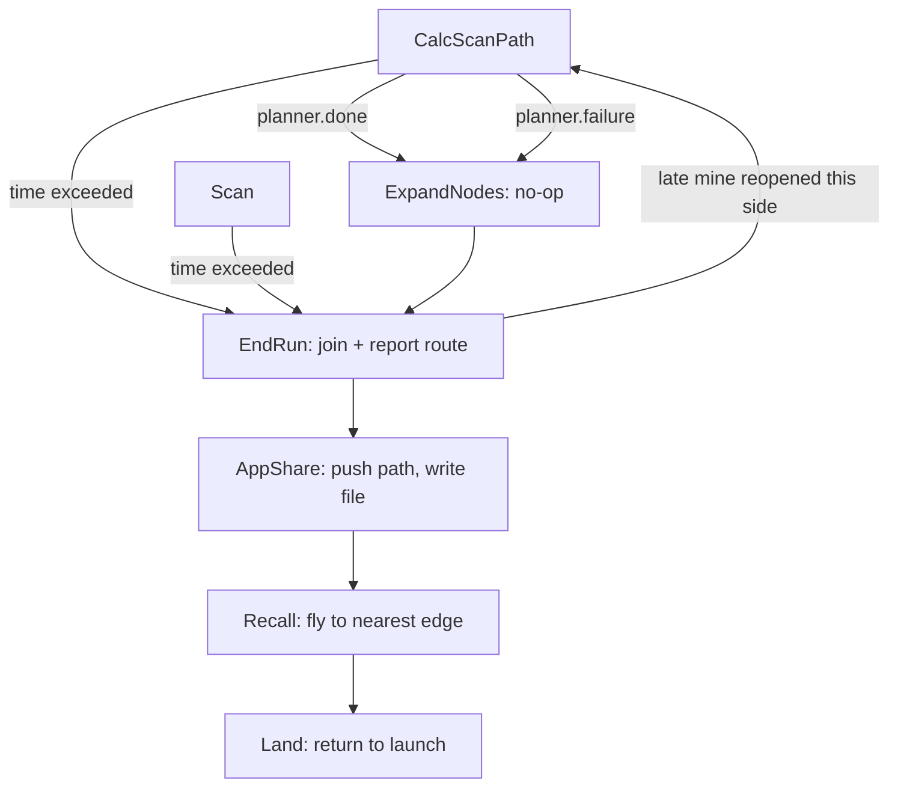

# 10. Finishing: done(), ExpandNodes, EndRun, AppShare, Recall, Land

> Part of the [execution walkthrough](README.md). Previous: [9. Two sides meeting](09-two-sides-meeting.md). Next: [11. Glossary](11-glossary.md).

**What this chapter covers.** How the mapping loop ends (three ways), what each ending state does, how the two sides' routes become one report, and how the drones get home.

> **Status.** `ExpandNodes` is a **no-op** today (expanding mines is not implemented yet, see 10.2). `EndRun`'s join protocol relies on the per-drone planner copies, which are in final verification.



## 10.1 How the loop ends

Three exits from `CalcScanPath` / `Scan` (chapters 3 and 4):

1. **`planner.failure`**: no route exists any more (fully blocked, or the entry is walled in). `CalcScanPath` flags `Drone.no_valid_path_found` and goes to `ExpandNodes`.
2. **`planner.done()`**: the normal finish.
3. **Time limit**: `FlightSettings.max_flight_time` = 7 minutes since `Drone.startTime` (set in `Takeoff`). Checked at the top of `CalcScanPath` and of `Scan`; jumps **straight to `EndRun`** (skipping `ExpandNodes`).

`done()` is a strong condition:

```python
# flight/pathfinding/pathnode/planner.py:128-133, 135-138
    def done(self):
        """Nothing left to do on this side: met, nothing pending, rings photographed, no
        shortcut left to try."""
        return (self.met and not self.chain.has_pending()
                and not self.work.adjacent() and not self.work.outer()
                and not self.shortcuts.left_to_try(self.met))
    ...
    def route_verified(self):
        """The route is whole and every link of it checked -- safe to report, even with
        optional work (rings, shortcuts) left."""
        return self.met and self.chain.all_checked()
```

- **met**: the forward gap is closed (chapter 9).
- **no pending spans** (`chain.has_pending()` is false).
- **rings photographed**: no ADJACENT and no OUTER work left.
- **no shortcut** left to try or in trial.
- `route_verified()` is weaker: the route is whole and *every link is checked*, even with optional rings or shortcuts outstanding.

When `done()` first turns true, `CalcScanPath` calls `_finish_scan`:

```python
# state_machine/states/impl/calc_scan_path_impl.py:105-115
async def _finish_scan(self: CalcScanPath, planner) -> None:
    """Nothing left to check: settle Drone.mission_path (pushed live to the app by drone 1)
    and check mine agreement with the other side (FIELD_CHECKSUM)."""
    mission_path = planner.route_latlon()
    if mission_path != self.drone.mission_path:
        self.drone.mission_path = mission_path
        await self.interdrone.push_mission_path()
    flight_log.event("calc_scan_path_complete")
    partners = tuple(self.flight_settings.partner_side_drones)
    if partners:
        await self.interdrone.send_checksum(planner.mine_hash(), partners)
```

- `Drone.mission_path` is set to the current route (lat/lon) and, on **drone 1 only**, pushed to the app (`push_mission_path`, 10.4).
- With a partner side, the mine hash is sent as `FIELD_CHECKSUM`. The other side's receive loop compares it with its own `mine_hash()` and replies `FIELD_CHECKSUM_ACK(matched)`; a mismatch is only logged.

## 10.2 ExpandNodes (currently a no-op)

```python
# state_machine/states/impl/expand_nodes_impl.py:50-56
        planner = self.drone.planner
        if planner is not None:
            expanded = planner.expand_margin(MINE_RADIUS_EXPANSION_FT)
            if expanded is not None:
                flight_log.event("nodes_expanded", **expanded)

        return EndRun(self.drone, self.flight_settings, self.interdrone)
```

```python
# flight/pathfinding/mission_planner.py:169-172
    def expand_margin(self, ft):
        """ExpandNodes. Returns a dict for the flight log, or None if it did nothing."""
        logging.info("path-node planner: ExpandNodes margin not applied (next phase)")
        return None
```

- The intent (from the module comments): grow every known mine's danger zone by `MINE_RADIUS_EXPANSION_FT = 2.0` ft as a final, deliberately conservative margin for the route about to be reported.
- **Reality**: `MissionPlanner.expand_margin` logs "ExpandNodes margin not applied (next phase)" and returns `None`, so `nodes_expanded` is never logged and the state always returns `EndRun`. The constant's own comment calls the value "a placeholder guess".
- A future implementation will need to re-run the mine rule (chapter 5) for the larger zones, which is why `ExpandNodes` sits between the last `done()` and the report.

## 10.3 EndRun

`EndRun.run` has two branches:

```python
# state_machine/states/impl/end_run_impl.py:196-214
        planner = self.drone.planner
        if planner is not None:
            if self.flight_settings.partner_side_drones:
                reopened = await _join_with_partner(self, planner)
                if reopened is not None:
                    return reopened
            else:
                # A wholesale REPLACE: CalcScanPath's mission_path updates are progress
                # snapshots, and shortcuts can change the route after them.
                self.drone.mission_path = planner.route_latlon()

        flight_log.event(
            "end_run",
            mission_path_len=len(self.drone.mission_path),
            reported_half_route=self.drone.reported_half_route,
            time_exceeded=self.drone.time_exceeded(self.flight_settings.max_flight_time),
        )

        return AppShare(self.drone, self.flight_settings, self.interdrone)
```

- **No partner side** (1 or 2 drones): `mission_path = planner.route_latlon()`, the chain's whole route (all links, including any PENDING or FORWARD stretch left when a time-out cut the scan short; nothing marks those as unverified in this branch).
- **Partner side**: `_join_with_partner` (below). It returns `CalcScanPath` if a late relayed mine re-opened this side, else `None` with `mission_path` set.

### The join protocol

Who does what (4-drone mission):

| Drone | Role at the join | Leaves EndRun when |
|---|---|---|
| **1** | *reporter* (holds the app link): joins the halves | its join has stayed valid `JOIN_CONFIRM_S` = 3 s |
| **3** | top side's **speaker**: sends its route (`CROSS_PAIR_CHAIN`, resent every 1 s) | it gets a `CROSS_PAIR_CHAIN_ACK` whose mine hash matches its own, and its mate is not busy |
| **2**, **4** | send nothing; keep applying relayed data | same ack rule as drone 3 |

Constants:

```python
# state_machine/states/impl/end_run_impl.py:21-31
CHAIN_RESEND_S = 1.0
# - once the flight time budget is gone, how long either still waits for the other before
#   giving up (drone 1 then reports only its own half, flagged);
JOIN_GRACE_S = 10.0
# - how often the wait loop polls;
JOIN_POLL_S = 0.2
# - how often each side's speaker sends its full mine list while waiting (CROSS_PAIR_MINE_SYNC);
MINE_SYNC_S = 1.0
# - drone 1: how long a join must stay valid (same mine hash on both sides) before it is
#   reported -- a mine still in flight from the partner's pair lands inside this window.
JOIN_CONFIRM_S = 3.0
```

Setup and the loop head (every drone, every 0.2 s):

```python
# state_machine/states/impl/end_run_impl.py:62-70, 71-79
    drone, fs, side = self.drone, self.flight_settings, self.drone.side
    partners = tuple(fs.partner_side_drones)
    is_reporter = fs.current_drone_ID == 1
    sends_chain = fs.start_side == Side.END and side.speaker
    ack_to = partners + ((fs.paired_drone,) if fs.paired_drone is not None else ())
    timed_out_at = None
    last_chain_sent = None
    joined = None
    joined_at = None
    ...
    while True:
        side.apply_inbox()
        await side.send_heartbeats(MINE_SYNC_S)
        if drone.time_exceeded(fs.max_flight_time):
            timed_out_at = timed_out_at or time.monotonic()
        elif not planner.failure and not planner.done():
            drone.route_joined = False
            flight_log.event("end_run_reopened", drone=fs.current_drone_ID)
            return CalcScanPath(drone, fs, self.interdrone)
```

- `side.apply_inbox()` and `side.send_heartbeats(MINE_SYNC_S)`: **the same inbox and heartbeat code as `CalcScanPath`**, so mines and photos still flow (here the full mine list every 1 s).
- If time is not up and `not planner.failure and not planner.done()`, this side has **been reopened** (a late relayed mine, or the halves did not connect): `route_joined = False`, event `end_run_reopened`, and back to `CalcScanPath` to finish scanning.
- Once time **is** up, `timed_out_at` starts a `JOIN_GRACE_S` = 10 s countdown after which everyone leaves regardless.

**Drone 1, the reporter:**

```python
# state_machine/states/impl/end_run_impl.py:81-120
        if is_reporter:
            mine_hash = planner.mine_hash()
            if joined is not None and drone.partner_route_mine_hash != drone.joined_mine_hash:
                # The partner has a mine the join didn't: wait for its route around it (it
                # can't leave -- our ack no longer matches its hash).
                flight_log.event("join_dropped", reason="partner mine hash changed")
                joined, joined_at, drone.route_joined = None, None, False
            elif joined is not None and drone.joined_mine_hash != mine_hash:
                # A mine reached this side after the join. Keep the join only if it still
                # clears every mine known here (the partner may already have left).
                joined = planner.join_latlon(drone.partner_route)
                if joined is None:
                    flight_log.event("join_dropped", reason="a new mine is on the route")
                    joined_at, drone.route_joined = None, False
                else:
                    drone.joined_mine_hash = mine_hash
                    await self.interdrone.send_cross_pair_chain_ack(mine_hash, ack_to)
            if joined is None and (
                drone.partner_route
                and drone.partner_route_complete
                and drone.partner_route_mine_hash == mine_hash
                and ((planner.done() and not side.mate_busy) or timed_out_at is not None)
            ):
                # Join only a complete partner route planned around exactly the mines this
                # side knows: otherwise a mine still in flight to either side could lie on it.
                if timed_out_at is None:
                    joined = planner.check_join_latlon(drone.partner_route)
                    if joined is None and not planner.done():
                        flight_log.event("end_run_reopened", drone=fs.current_drone_ID,
                                         reason="halves don't connect")
                        return CalcScanPath(drone, fs, self.interdrone)
                else:
                    joined = planner.join_latlon(drone.partner_route)
                if joined is not None:
                    joined_at = time.monotonic()
                    drone.route_joined = True
                    drone.joined_mine_hash = mine_hash
                    await self.interdrone.send_cross_pair_chain_ack(mine_hash, ack_to)
            if joined is not None and time.monotonic() - joined_at >= JOIN_CONFIRM_S:
                break
```

- `partner_route`, `partner_route_complete` and `partner_route_mine_hash` were stored by the receive loop when `CROSS_PAIR_CHAIN` arrived (chapter 7).
- A join is attempted only when: a partner route arrived, it is **complete** (the top side verified it), it was planned around **exactly the mines drone 1 knows** (equal `mine_hash`), and drone 1's own side is done and its mate is not busy (or time is up). This avoids joining across a mine still in flight to either side.
- `check_join_latlon` (chapter 9, 9.6) joins them, or re-opens drone 1's side toward the partner's route end if they do not connect (drone 1 then returns to `CalcScanPath`).
- On success, drone 1 sets `route_joined`, sends `CROSS_PAIR_CHAIN_ACK(mine_hash)` to the other side **and its own mate**, and must keep the join valid for 3 s: a mine arriving meanwhile that lands on the joined route (`join_dropped`), or a change of the partner's mine hash, drops it.
- Later `CROSS_PAIR_CHAIN` resends are acked directly by the receive loop (`if self.drone.route_joined: send_cross_pair_chain_ack`), so a lost ack cannot strand the other side.

**Everyone else:**

```python
# state_machine/states/impl/end_run_impl.py:122-130, 132-134
            if drone.partner_route_ack_hash == planner.mine_hash() and not side.mate_busy:
                break
            now = time.monotonic()
            if sends_chain and (last_chain_sent is None
                                or now - last_chain_sent >= CHAIN_RESEND_S):
                await self.interdrone.send_cross_pair_chain(
                    planner.route_latlon(), planner.route_verified(), planner.mine_hash(), partners
                )
                last_chain_sent = now
    ...
        if timed_out_at is not None and time.monotonic() - timed_out_at >= JOIN_GRACE_S:
            break
        await asyncio.sleep(JOIN_POLL_S)
```

- Non-reporters leave when the ack's mine hash equals their own **and** their side-mate is not busy (`mate_busy`: the mate announced a job and is not lost, so its photos may still add mines).
- The speaker of the top side (`sends_chain = start_side == END and side.speaker`) sends `route_latlon()`, `route_verified()` (as `complete`), and `mine_hash()`.

After the loop:

```python
# state_machine/states/impl/end_run_impl.py:137-159
        # Ack even when the join failed: the partner can't fix it, and should go home.
        drone.route_joined = True
        drone.joined_mine_hash = planner.mine_hash()
        await self.interdrone.send_cross_pair_chain_ack(drone.joined_mine_hash, ack_to)
        if joined is not None:
            drone.mission_path = joined
        else:
            drone.mission_path = planner.route_latlon()
            drone.reported_half_route = True
            flight_log.event(
                "reported_half_route",
                partner_route_received=drone.partner_route is not None,
                partner_route_complete=drone.partner_route_complete,
            )
            logging.error(
                "drone 1: could not join the partner's route (%s) -- reporting only this"
                " side's half of the field",
                "it never arrived complete" if not drone.partner_route_complete
                else "the two halves don't connect",
            )
    else:
        drone.mission_path = planner.route_latlon()
    return None
```

- Drone 1 **always acks** (even a failed join, "the partner can't fix it, and should go home"), then reports the joined route, or, if none, its own half with `Drone.reported_half_route = True` and an error log.
- Every other drone reports its own side's route (nobody but drone 1's is read externally).

## 10.4 AppShare

```python
# state_machine/states/impl/app_share_impl.py:61-62
        await self.interdrone.push_mission_path()
        _write_path_file(self.drone)
```

`push_mission_path` (drone 1 only):

```python
# state_machine/interdrone.py:925-942
    async def push_mission_path(self) -> None:
        """Sends this drone's own current Drone.mission_path to the app
        (SEND_PATHS_TO_APP) -- a no-op for anything but drone 1 (the
        mission's own "parent" -- see Drone.mission_path's own docstring
        on why only drone 1's copy is meant to be read externally).

        Called PROACTIVELY, not just in reply to REQUEST_MAP_DATA:
        CalcScanPath's _finish_scan calls this when this side's route is
        done, and AppShare calls it once more with the mission's final
        route (EndRun's wholesale resync) -- so the app sees the path
        without having to ask.
        """
        if self.flight_settings.current_drone_ID != 1:
            return
        if self.drone.mission_path:
            await self.send_paths_to_app(self.drone.get_mission_iarc_path(), map_data_ready=True)
        else:
            await self.send_paths_to_app("", map_data_ready=False)
```

- `Drone.get_mission_iarc_path()` -> `MissionPlanner.iarc_path` -> `format_iarc_path`: converts the lat/lon route to local feet and rasterises it onto the 2 ft grid, then run-length encodes it as `S,<start column>,<buffer width>` followed by `U/D/L/R,<squares>` lines. A virtual entry cell **outside** the field is prepended so the first command enters it. A discontinuity is logged, not raised (`strict=False`), "raising out of EndRun/AppShare would leave the drone hovering".
- `send_paths_to_app` sends `SEND_PATHS_TO_APP` to the app (address `0`).
- With no path (`mission_path` empty) it sends `map_data_ready = False`. If `no_valid_path_found` is set, `_write_path_file` writes "NO VALID PATH FOUND" instead. Every drone (not just drone 1) writes `drone_<id>_path.txt` into its log directory.

The toy 4-drone mission's report (real output):

```text
joined route has 15 points, from (12.0, 0.0) to (12.0, 80.0)
--- format_iarc_path (each line: direction, number of 2 ft squares) ---
S,6,0
U,4
R,1
U,3
R,1
U,3
R,1
U,3
L,1 
... (22 lines in all)
```

## 10.5 Recall and Land

```python
# state_machine/drone.py:1089-1116
    async def recall(self) -> None:
        """Flies to the nearest of the four field edges (in the planner's local frame) at
        MISSION_ALTITUDE_M -- exits the field along the shortest path
        before Land's own return_to_launch takes over for the rest of the
        way home, rather than cutting straight back across ground that
        might not be fully swept. Only ever reached from the mapping
        mission's own EndRun -> AppShare -> Recall tail (see recall_impl.py),
        never POIF, hence MISSION_ALTITUDE_M and not LEG_ALTITUDE_M here.
        A no-op if this drone has no planner (a test harness that
        skipped Takeoff)."""
        planner = self.planner
        if planner is None:
            return
        lat, lon = self.currentPosition()
        x, y = planner.latlon_to_local(lat, lon)
        w, h = planner.field_w, planner.field_h
        # (distance to the edge, the point on it) for left, right, bottom, top. The old
        # version only compared the right and top edges, so a drone near the left or
        # bottom edge flew across the field to leave it.
        _dist, (target_x, target_y) = min(
            (x, (0.0, y)), (w - x, (w, y)), (y, (x, 0.0)), (h - y, (x, h)),
            key=lambda edge: edge[0],
        )
        target_lat, target_lon = planner.local_to_latlon(target_x, target_y)
        self.commandPoint(target_lat, target_lon, MISSION_ALTITUDE_M, groundspeed=LEG_GROUNDSPEED_M_S)
        target = (target_lat, target_lon)
        while segment_distance(self.currentPosition(), self.currentPosition(), target, target) > LEG_TOLERANCE_M:
            await asyncio.sleep(0.5)
```

- `Recall` flies (`Drone.recall`) to the **nearest of the four field edges** in the planner's local frame, at `MISSION_ALTITUDE_M`, and exits the field along that shortest path instead of cutting back across ground that may not be fully swept.
- `Land` then cancels the position stream, sets airspeed and calls `Drone.return_to_launch`, which flies to the home lat/lon at **23 m** relative altitude (`LocationGlobalRelative(home.lat, home.lon, 23)`), switches to `RTL` and waits until below 0.2 m.

```python
# state_machine/states/impl/land_impl.py:37-43
        if self.drone.position_stream is not None:
            self.drone.position_stream.cancel()
            self.drone.position_stream = None

        # Instruct the drone to land
        self.drone.vehicle.airspeed = 20
        await self.drone.return_to_launch()
```

- `Land.run` returns `None` (not `Start`, despite its docstring), so `StateMachine._run` ends, `state_machine_task` is done, and after `RESTART_GRACE_S` (2 s) `run_manager` returns: the process exits.
- `Land` is also entered from `Scan` on `FormationLost`, from the app's `LAND`, and (as `EmergencyLand`, which descends in place) from `EMERGENCY_LAND`. Those interrupt the machine as described in chapter 1, 1.6.

## 10.6 The time-limit path in one paragraph

At 7 minutes, `CalcScanPath` or `Scan` (whichever is next to run; a leg in the air is not aborted) returns `EndRun`. In `_join_with_partner`, `timed_out_at` is set on the first loop pass. Drone 1 no longer waits for `done()` or a quiet mate (`timed_out_at is not None` satisfies that part of the condition) and uses `join_latlon` rather than `check_join_latlon`, so it never re-opens. It **still needs** a partner route that is marked complete and was planned around the same mines (`mine_hash` equal); without one it keeps waiting. Everyone leaves at the latest `JOIN_GRACE_S` = 10 s after the time-out. Drone 1 then reports the joined route if it has one, else its own half flagged `reported_half_route`.
