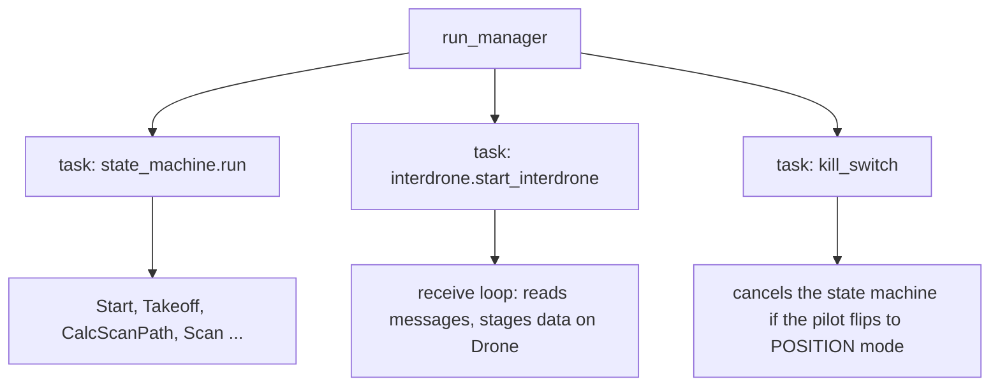
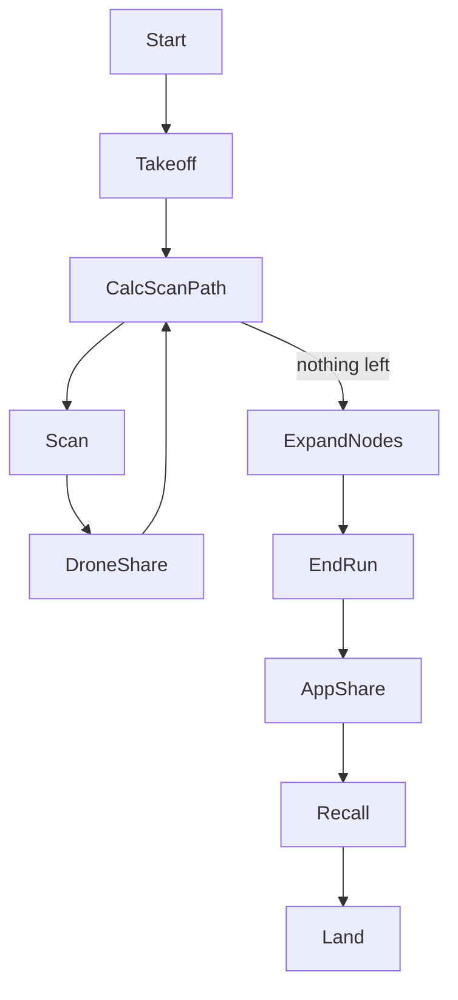

# 1. Process start: two loops, one drone, and the Start state

> Part of the [execution walkthrough](README.md). Next: [2. Takeoff and planner setup](02-takeoff-and-planner-setup.md).

**What this chapter covers.** What happens between typing `python run.py -i 1` and the drone being armed: how the program is split into things that run at the same time, how a drone learns which *side* of the field it belongs to, and what the first state (`Start`) does.

The story we follow in every chapter: **4 drones**. Drones 1 and 2 start on the bottom edge of the field, drones 3 and 4 on the top edge. We tell it from **drone 1's point of view** and add side notes where drones 2, 3 and 4 differ.

## 1.1 The program starts

`run.py` is the entry point. One copy of it runs on each drone (each drone is a separate computer and process; `-i N` tells the copy which drone it is).

{{snip: run.py :: settings: FlightSettings => asyncio.run(flight_manager}}

- `FlightSettings.from_mission_config()` reads `mission_config.json` (or the file given with `--config`) plus the command-line flags `-i/--id`, `-s/--sim`, `-a/--airsim`.
- `flight_log.configure(...)` opens this drone's own event log (one JSON line per event). Later chapters mention `flight_log.event("...")` calls; those are these lines.
- `asyncio.run(flight_manager.run_manager(settings))` starts the **asyncio event loop**. From here on, almost everything is an `async def` function that runs on that one loop.

**Goes next to ->** `FlightSettings` (section 1.2), then `FlightManager.run_manager` (section 1.3).

## 1.2 FlightSettings: who am I, and who is on my side?

`FlightSettings` is a bag of mission facts. Two matter most here: **which drone am I** and **which drones are on my side of the field**.

A **side** is the one or two drones that work from one edge of the field. There are **no roles** (no "lead" and "member"): the drones of a side are equals, and every drone keeps its own copy of its side's planner (chapter 2).

{{snip: state_machine/flight_settings.py :: def mission_sides => return [[1, 2]}}

- 1 or 2 drones: one side, `[[1]]` or `[[1, 2]]`, and the target of the search is the far edge of the field.
- 3 or 4 drones: two sides, `[[1, 2], [3, 4]]` (or `[[1, 2], [3]]`). The two sides work toward each other from opposite edges and must meet in the middle.

The constructor turns that into per-drone facts:

{{snip: state_machine/flight_settings.py :: # Sides below are assigned by drone id => self.max_flight_time}}

- The drone ids in `drones_in_mission` must be exactly `1..n`; sides are computed from the id, so `[1, 3, 4]` is rejected.
- `start_side` is `Side.START` for the first side (bottom edge) and `Side.END` for the second (top edge).
- `paired_drone` is my **side-mate**: the other drone in my side, or `None` if I am alone.
- `max_flight_time` is 7 minutes (`60 * 7`). After that the mission is cut short (chapter 10).

The two properties the messaging code uses:

{{snip: state_machine/flight_settings.py :: def side_drones => return next(side :: def partner_side_drones => return next((side}}

For the 4-drone mission:

| drone | `start_side` | `side_drones` | `partner_side_drones` | `paired_drone` |
|---|---|---|---|---|
| 1 | START (bottom) | `[1, 2]` | `[3, 4]` | 2 |
| 2 | START (bottom) | `[1, 2]` | `[3, 4]` | 1 |
| 3 | END (top) | `[3, 4]` | `[1, 2]` | 4 |
| 4 | END (top) | `[3, 4]` | `[1, 2]` | 3 |

Every message to the other side goes to *all* of `partner_side_drones`, so each copy of that side's planner hears it.

Note: `mission_config.json` checked into the repo currently lists only `drones_in_mission: [1]`, so a plain `python run.py` is a solo flight. The 4-drone layout is `mission_config_full.json` (`"drones_in_mission": [1, 2, 3, 4]`, `"mission_type": "Competition"`).

**Goes next to ->** `FlightManager.run_manager`.

## 1.3 FlightManager: three things running at once

{{snip: state_machine/flight_manager.py :: self.drone.id = flight_settings.current_drone_ID => asyncio.ensure_future(self.kill_switch}}

- `Drone` (`state_machine/drone.py`) wraps the flight controller connection (dronekit) and holds all the per-drone mission data that states hand to each other (waypoint queue, planner, staged messages...). It is created empty in `FlightManager.__init__`.
- `Interdrone(...)` (constructed here, defined in `state_machine/interdrone.py`) starts a **networking thread** in its constructor (`NetworkingThread.run_networking_thread`). That thread owns the sockets; the rest of the code only talks to it through two queues (`queue_client_message` to send, `try_get_server_message` to receive).
- `StateMachine(Start(...), ...)` is the loop that runs the states (section 1.4).
- Three asyncio tasks are started:

**Why this matters for everything that follows.** The state machine task and the receive-loop task share **one event loop**. Python only switches between them at an `await`. So:

- while a state is running between two `await`s, no message handler can run;
- the receive loop must never change the planner directly (a state could be half-way through using it at the next `await`). It only **stages** incoming data on the `Drone` (`pending_photo_reports`, `pending_cross_pair_mines`, ...), and the next `CalcScanPath` pass applies it in a fixed order (chapters 3 and 7).

Note: the two tasks are cooperative, and the receive loop is not fully polite. It polls the networking thread with `try_get_server_message(timeout=0.02)`, which is a **blocking** wait on a `concurrent.futures.Future` (and `queue_client_message` blocks the same way until the networking thread has queued the message):

{{snip: interdrone_communication/networking_interface.py :: def queue_client_message => future.result(timeout=timeout) :: def try_get_server_message => return None}}

So whenever no message is waiting, each pass of the receive loop freezes the whole event loop (state machine included) for up to 20 ms, then sleeps 0.1 s. Nothing breaks (legs are polled every 0.25 s), but it is why the loop drains up to 25 messages per pass and why timing-sensitive code should not assume it can run during those 20 ms.

The kill switch:

{{snip: state_machine/flight_manager.py :: while self.drone.vehicle.mode.name != "POSITION" => state_machine_process.cancel()}}

- If the pilot switches the vehicle into `POSITION` mode, the state machine task is cancelled and the drone is left under manual control.
- The tail of `run_manager` (the `while True` loop) waits until the state machine is idle and has stayed idle for `RESTART_GRACE_S` (2 s), because `EMERGENCY_LAND` cancels and restarts the state machine (section 1.6).

**Goes next to ->** `StateMachine.run`.

## 1.4 StateMachine: a loop that swaps one state for the next

{{snip: state_machine/state_machine.py :: async def _run(self) => self.current_state = await self.current_state.run()}}

- Every state is an object with an `async run()` that **returns the next state object** (or `None` to stop).
- `interdrone.update_state(...)` tells the receive loop which state is current (needed to cancel it, section 1.6).
- The whole mission is therefore this cycle of `return NextState(self.drone, self.flight_settings, self.interdrone)` calls. The state classes (`state_machine/states/*.py`) are empty shells; the code is in `state_machine/states/impl/*_impl.py`, plugged in by lines like `Start.run_callable = run`.

(`Takeoff` also has a POIF demo branch and a plain-takeoff branch; this walkthrough follows the **mission** branch.)

## 1.5 The Start state

`start_impl.py` `run()` is the first thing that runs.

{{snip: state_machine/states/impl/start_impl.py :: update_state("Start") => self.drone.vehicle.mode = dronekit.VehicleMode("GUIDED")}}

- `update_state/update_drone/update_flight_settings` (in `state_tracker.py`) write the current state name and settings to a small JSON file that the kill switch tooling reads.
- `connect_drone()` opens the dronekit connection; the vehicle is put in `GUIDED` mode, meaning "fly where the software says".

Then it waits until this drone can arm **and** every other drone answers a ping:

{{snip: state_machine/states/impl/start_impl.py :: ping_ok: bool = False => logging.info("All drones connected and armable")}}

- `is_armable` (the autopilot's own "GPS/EKF is good" flag) is checked first because it is free; pinging costs network traffic, so it only starts once the drone is armable.
- `ping_drones()` sends a `PING` to every other drone and waits up to 2 s for `PING_ACK`s:

{{snip: state_machine/interdrone.py :: async def ping_drones => return True :: ping_message: Message = Message.create( => self.send(ping_message) :: all_ack: bool = all( => return all_ack}}

  With no other drones it returns `True` at once. A drone that does not answer counts as a failure, and the loop retries once per second. On the *other* side, the `PING` is answered in the receive loop by `case MessageType.PING:` (an unconditional `PING_ACK`).

Then it waits for the command to arm:

{{snip: state_machine/states/impl/start_impl.py :: if self.flight_settings.mission_type == "Prompted": => await self.drone.arm()}}

- In `"Prompted"` mode a human types `arm` (or the app sends `ARM`). In every other mode (`"Automatic"`, `"Competition"`) the drone waits for `interdrone.cmd_msg` to become `CMD_MSG.ARM`; nothing in `start_impl.py` sets that itself, so it must arrive as an `ARM` **message** (from the app, or relayed by drone 1).
- `interdrone.cmd_msg` is a small mailbox the receive loop writes and the states read. It is how the app's commands (ARM, TAKEOFF, MISSION, LAND...) reach the state machine.

Finally drone 1 fans the arm command out and waits for the others:

{{snip: state_machine/states/impl/start_impl.py :: if self.drone.id == 1: => return Takeoff(}}

- `send_ARM` goes to every other drone. Their receive loop's `case MessageType.ARM:` sets their own `cmd_msg = ARM` (only if their pings all succeeded) and replies `ARM_ACK`.
- `all_armed()` (drone 1 only; it returns `True` for other drones) turns true when every `DroneState.armed` flag has been set by an `ARM_ACK`.
- Drone 2/3/4: same code, but they skip the `send_ARM` block and `all_armed()` is immediately true. They proceed to `Takeoff` as soon as they are armed themselves.

Note: `await self.drone.arm()` (in `drone.py`) waits for `is_armable`, sets `GUIDED`, sets `armed = True`, then polls until the autopilot confirms. So "armed" is real by the time `ARM_ACK` is sent... but note that the `ARM` handler sends the ACK when the message arrives, *before* this drone's own `Start` state has called `arm()`. `ARM_ACK` therefore means "I got the command and my pings are fine", not "my motors are armed".

**Goes next to ->** [Chapter 2: `Takeoff`](02-takeoff-and-planner-setup.md).

## 1.6 Side note: how a command can interrupt the state machine

`EMERGENCY_LAND` and `LAND` messages must take effect *now*, even in the middle of `Scan`. The receive loop calls `start_emergency_land()` / `start_land()`, which run `Interdrone.interrupt_into`:

{{snip: state_machine/interdrone.py :: async def cancel_state => pass :: async def restart_state_machine => restart_task.add_done_callback}}

- The running state's task is cancelled (waiting for the state's `atomic` lock if it is inside a critical section) and a new state (`EmergencyLand` or `Land`) is started through the callback registered by `StateMachine.__init__` (`self.interdrone.register_state_machine(self.run)`).
- This is why `run_manager` waits `RESTART_GRACE_S` before deciding the flight is over.
