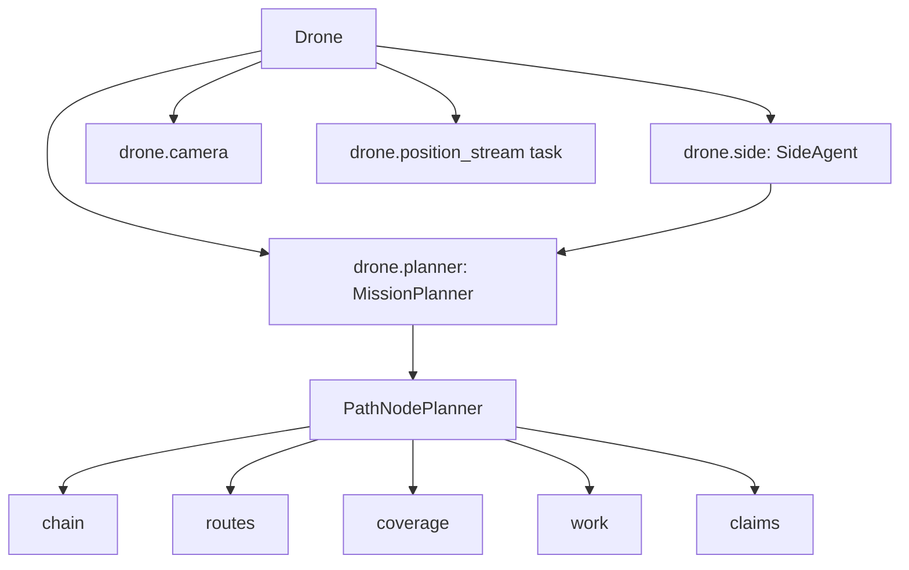

# 2. Takeoff: building the planner, the camera and the position stream

> Part of the [execution walkthrough](README.md). Previous: [1. Process start](01-process-start.md). Next: [3. The first CalcScanPath pass](03-first-calcscanpath.md).

**What this chapter covers.** The `Takeoff` state's **mission branch**. Before the drone leaves the ground it builds everything it will plan with: a local map frame, its own copy of its side's **planner** (`PathNodePlanner`), a **side agent** that talks to the side-mate, and the camera. Then it takes off and starts telling the other drones where it is.

> **Status.** The per-drone planner code (copies, claims, keep-apart) is in final verification; sections 2.4 and 2.5 describe it as read. **The obstacle geometry underneath the planner is still `ZoneMap` and is due to be replaced** (see 2.4, "the geometry underneath"); the new `Field` is not wired in.

## 2.1 The Takeoff state waits for a command

Takeoff is a loop that waits for the operator (or the app) to say what kind of flight this is:

{{snip: state_machine/states/impl/takeoff_impl.py :: app_commands: tuple[CMD_MSG, ...] => in app_commands :: while True: => logging.debug("Takeoff waiting}}

- `interdrone.get_cmd_msg()` is the mailbox from chapter 1. The three interesting values are `DEMO` (fly the POIF circles), `MISSION` (the mapping mission, this walkthrough) and `TAKEOFF` (just go up and land).
- The app sends `START_MISSION` to drone 1. Drone 1's receive loop sets `cmd_msg = MISSION` and forwards `START_MISSION` to the others, who set their own `cmd_msg` and reply `START_MISSION_ACK`. In `"Prompted"` mode, typing `mission` at the console does the same thing.

## 2.2 The mission branch

{{snip: state_machine/states/impl/takeoff_impl.py :: if self.interdrone.get_cmd_msg() == CMD_MSG.MISSION or => configureField(self) :: if self.flight_settings.sim_mode is SimMode.AIRSIM: => self.drone.camera = camera :: if self.drone.id == 1: => await self.drone.takeoff(MISSION_ALTITUDE_M) :: self.drone.startTime = monotonic() => return CalcScanPath}}

In order:

1. **`configureField(self)`** builds the planner (2.3 to 2.5). It runs *on the ground*, on every drone, so a bad field definition fails before takeoff.
2. **Camera.** In AirSim (simulator) mode an `AirSimCamera` is built; otherwise an `RPICamera` (Raspberry Pi camera with on-camera mine detection). Both are imported inside the branch so `run.py` still imports on a laptop without `picamera2`. The camera is stored on `self.drone.camera`; `Scan` and `DroneShare` read it from there.
3. **Start handshake.** Drone 1 sends `START_MISSION` to the others and waits until each has answered (`all_mission_start()`); the other drones send theirs to drone 1.
4. **`takeoff(MISSION_ALTITUDE_M)`.** The mapping mission flies at `MISSION_ALTITUDE_M = 2.0` metres (`state_machine/drone.py`). Everything about photo size comes from that: the planner assumes a photo taken at 2 m covers a fixed rectangle on the ground (2.2b below).
5. **`startTime = monotonic()`**: starts the 7-minute mission clock (`Drone.time_exceeded`, chapter 10).
6. **Position stream.** Every peer needs to know where this drone really is (to keep apart, and so the side-mate can work out claims). `interdrone.stream_positions(peers)` sends `POSITION_REPORT` at 5 Hz until `Land` cancels it:

{{snip: state_machine/interdrone.py :: async def stream_positions => await asyncio.sleep(1.0 / hz)}}

7. **`asyncio.sleep(5)`**, then `return CalcScanPath(...)`. Note the comment in the source: CalcScanPath starts the planner the first time it runs (`planner.start_if_needed`); there is no separate "initial" state.

Note: `Drone.takeoff(takeoff_alt, margin=1.5)` commands `takeoff_alt + margin` (3.5 m here) but returns as soon as the drone is above `takeoff_alt` (2.0 m). The `DEMO` branch passes `margin=0.0` for exactly this reason (its comment explains); the mission branch does not, so the drone keeps climbing toward 3.5 m during the `sleep(5)` and the first leg of `Scan` brings it back down to 2 m.

**2.2b: the assumed photo size.** `configureField` imports `SHAPE_SIZE_FT` and `OVERLAP` from `calc_scan_path_impl.py`. Where do they come from?

{{snip: state_machine/states/impl/calc_scan_path_impl.py :: altitude_ft = altitude_m * _METERS_TO_FT => return (along_ft, across_ft) :: SHAPE_SIZE_FT = => OVERLAP = 0.1}}

- The formula is `2 * altitude * tan(fov / 2)` for a camera looking straight down at flat ground. With `hFovDeg`/`vFovDeg` from `vision/config.json` at 2 m, the code's own comment says the result is about **(8.52, 6.44) ft**.
- `along` (8.52 ft) is the extent along the field's y axis (the direction the drones travel, bottom to top) and `across` (6.44 ft) is the extent along x. The comment in the source admits the h_fov/v_fov to along/across assignment is unconfirmed against the real camera mount.
- This is only used to **plan** where to hover. When a photo is actually taken, `Scan` measures the *real* footprint from the camera geometry (chapter 4).
- `OVERLAP = 0.1`: consecutive photos along a path overlap by 10 %.

## 2.3 configureField -> MissionPlanner

{{snip: state_machine/states/impl/takeoff_impl.py :: def configureField => state.interdrone)}}

`make_planner` turns the flight settings into a `MissionPlanner`:

{{snip: flight/pathfinding/mission_planner.py :: def make_planner => overlap=overlap)}}

- `corners`: the four field corners in lat/lon from `mission_field_corners`.
- `edge`: `Edge.BOTTOM` for the START side (drones 1, 2) and `Edge.TOP` for the END side (drones 3, 4).
- `side_drones`: this side's drone ids (`(1, 2)` for drone 1). These are the keys of the **claims** (chapter 3).
- `has_partner`: `True` when `partner_side_drones` is non-empty, i.e. in a 3- or 4-drone mission.

`MissionPlanner` is a **lat/lon wrapper**. Everything outside it (states, messages) speaks (lat, lon). Everything inside (`PathNodePlanner`) speaks **local feet**. Its `__init__`:

{{snip: flight/pathfinding/mission_planner.py :: def __init__(self, corners_latlon => self._started = False}}

### The field frame (`frame.py`)

{{snip: flight/pathfinding/frame.py :: The field's local frame => Every drone builds the same frame :: def validate_field_corners => raise ValueError( :: hull = quad.convex_hull => f"{quad.area:.0f} sq ft of a {hull.area:.0f} sq ft hull){hint}")}}

- The frame is a flat **x/y grid in feet**. Corner 1 is the origin, the edge from corner 1 to corner 2 is +x (the bottom edge), and +y runs toward corners 3 and 4 (the top).
- Every drone builds the same frame from the same corners, so a point like "(42.6, 130.0)" means the same place on every drone. Anything sent between drones is still lat/lon; each drone converts on arrival (`latlon_to_local`).
- `field_transformer` measures the true length of the bottom edge first, so one foot in the planner is one foot on the ground.
- `validate_field_corners` runs at planner construction: the corners must go **counter-clockwise** (origin, +x corner, the far corner on the +x side, then the far corner above the origin). A bow-tie ("Z" order) or a clockwise list raises `ValueError` here, on the ground.

For the golf-field corners in `mission_config.json`, once ordered 1, 2, 4, 3 (see the Note below), the frame is about **82 ft wide and 300 ft long** (`field_w`, `field_h`). The bottom edge is y = 0, the top edge y = `field_h`.

Note: as of writing, the corners in the working-tree `mission_config.json` and in `mission_config_full.json` are listed in the order 1, 2, 3, 4 which traces a bow-tie, and `validate_field_corners` **rejects** them with "the last two corners look swapped". Swapping the last two makes them valid (the toy run below does that). Until the config is fixed, the mission branch of `Takeoff` would raise `ValueError` inside `configureField`.

### Entry point and edge

Back in `MissionPlanner.__init__`: `entry_x` is where this side enters, taken from `start_coord` in the mission config and **clamped into the field's x range**. Both sides use the same `start_coord`, so the bottom side's entry is `(entry_x, 0)` and the top side's is `(entry_x, field_h)`.

Note: in the checked-in `mission_config.json` the `start_coord` (lat 36.02, lon -95.94) is nowhere near the field corners (lat 34.62, lon -86.81), so the clamp silently pins `entry_x` to a field edge. This is a config oddity, not a code bug, but it means the planner's entry would not be where the drones actually stand.

**Goes next to ->** `PathNodePlanner.__init__` (2.4).

## 2.4 PathNodePlanner: what one drone plans with

`PathNodePlanner` (`flight/pathfinding/pathnode/planner.py`) is one side's route-and-work planner in local feet. Each drone owns a **private copy** for its side. Its constructor builds nine parts:

{{snip: flight/pathfinding/pathnode/planner.py :: self.config = config or => self.work = Work(}}

| Part | File | What it is, in plain words |
|---|---|---|
| `config` | `config.py` | The tunable settings (`PlannerConfig`), see below. |
| `claims` | `claims.py` | The **ClaimBook**: decides which drone of the side flies which photos. |
| `routes` | `routes.py` | Known obstacles and "shortest path around them". |
| `target` | `target.py` | What the forward gap aims at: the partner side's point A, or the far edge. |
| `coverage` | `coverage.py` | Which 2 ft squares have been photographed, misses, where to place photos. |
| `chain` | `chain.py` | The route so far: path nodes joined by links. |
| `shortcuts` | `shortcuts.py` | Replaces long checked stretches with shorter paths (chapter 8). |
| `work` | `work.py` | The photos still to take, sorted into priority groups. |
| `log` | `log.py` | Counters and a bounded event log (a debugging aid). |

### The chain: how the route is stored

{{snip: flight/pathfinding/pathnode/chain.py :: The chain: one side's route => deleted by a mine.}}

Key words (also in the [glossary](11-glossary.md)):

- **Path node**: a corner point of the route.
- **Link**: the stretch between two consecutive nodes. It is one of three kinds:
  - **CHECKED**: photographed ground we know is safe.
  - **PENDING**: a planned detour around a mine that still has to be photographed.
  - **FORWARD**: the single "gap still to explore": from **point A** to the **target**.
- **Point A**: the frontier, the last node before the forward link. "How far this side has got."
- **Target**: a virtual end node the forward gap aims at. With a partner side it is the partner's latest point A; without one it is a point on the far edge.

At the very start (this is what the constructor builds):

{{snip: flight/pathfinding/pathnode/planner.py :: y0 = 0.0 if self.start_edge => [Link(LinkKind.FORWARD, route)])}}

So the chain is `[entry] --forward-- [target]`: entry and target only, joined by one straight FORWARD link (nothing is known yet, so the shortest path is straight). The toy run below prints this for the golf field:

{{run: demos/toy_setup.py}}

- For drone 1 the target is `(42.6, 299.7)` at the top edge, directly above the entry: "aim at the partner's entry until they tell me where they really are". Drone 3 mirrors it.
- With no partner (`partner = False`) the target is a point on the far edge, chosen by `Target.route_from` (straight ahead if clear).
- `is_partner = True` means the target is really the partner's point A, so the gap may be declared closed against it (chapter 9). Against a *stand-in* (when the partner's point A lies inside an obstacle this side knows) it stays `False`.

### Settings (`PlannerConfig`)

{{snip: flight/pathfinding/pathnode/config.py :: shape_size_ft: tuple = (6.0, 4.0) => keep_clear_ft: float = 7.5}}

`MissionPlanner` only overrides `shape_size_ft` and `overlap`; every other value is the default shown. The ones that matter most:

- `coverage = CORRIDOR`: a link counts as checked once the 2 ft squares it *touches* are photographed (`BAND` would also require every square a mine could endanger it from).
- `adjacent_ring = 1`, `outer_ring = 2`: after the path itself is checked, optional extra photos cover squares up to 1 (then 2) squares away from the checked route, as a safety margin.
- `shortcut_*`: when to try a shortcut (chapter 8).
- `keep_away_ft = 10.0`, `keep_clear_ft = 7.5`: how close a drone may plan a photo to another drone (chapter 3, keep-apart). Both are `PlannerConfig` fields, chosen to stay above the flight code's collision hold radius (`COLLISION_RADIUS` 2.01 m = 6.6 ft, chapter 4); `keep_away_ft` > `keep_clear_ft` so a tie has a winner.

Fixed constants (also `config.py`): `CELL = 2 ft` (in `geometry.py`), `MISS_CENTRE = 1` and `MISS_BLOCK = 3` (chapter 4), `MAX_BRIDGE_FT = 30`.

### The geometry underneath (flagged: being replaced)

`Routes` (`routes.py`) is the interface the planner uses for obstacles:

{{snip: flight/pathfinding/pathnode/routes.py :: class Routes: => self._inside = {} :: def contains(self, x, y): => return self.zones.crosses(poly) :: def shortest(self, a, b): => return list(route[0]),}}

- `add_mine(x, y)` / `add_square(c, r)`: register a new obstacle (a mine's **danger zone**, or a 2 ft square the planner gave up on).
- `contains(x, y)`: is this point inside a known obstacle?
- `crosses(poly)`: does this polyline cut through an obstacle?
- `shortest(a, b)`: **the shortest path from a to b around every known obstacle**, as a list of points plus, for each corner it bends around, the id of the obstacle group it wraps.
- It caches paths and only drops the ones a new obstacle crosses.

> **In flux.** Underneath, `Routes` currently holds a `ZoneMap` (`pathnode/geometry.py`). A rebuilt geometry (`flight/pathfinding/nodeField/`: `Field`, `FieldConnections.nodeGraph`, `MineNode`, `PolygonObstacle`, `unionObstacle`, `BlockMine`; and `protoMine.py`) is finished but **not wired in yet**; it will replace `ZoneMap`. This walkthrough treats path-finding as "shortest path around known obstacles" through `Routes` and does not describe `ZoneMap`'s internals. A later revision will cover `Field` once it is wired.
>
> What the planner relies on from the geometry, whatever implements it: the danger zone of a mine is the whole set of 2 ft squares within `SAFETY_RADIUS_FT = 3` of the mine's square (snapped to the square's centre); overlapping zones merge into one group with an id; shortest paths bend only around zone corners.

## 2.5 SideAgent: the drone's messenger

Back in `configureField`, the last line builds `SideAgent(planner, drone, flight_settings, interdrone)` and stores it as `drone.side`. The planner never sends a message; the side agent does everything the drone says to and hears from others.

{{snip: flight/pathfinding/side_agent.py :: POINT_A_HEARTBEAT_S = => MATE_LOST_S = 20.0 :: def __init__(self, planner, drone, flight_settings, interdrone): => self._mines_synced_at = None}}

- `me`, `mate`, `partners`: this drone's id, its side-mate's id (or `None`), and the other side's drone ids.
- Timing constants: point A is resent at least every 1 s, this drone's job is re-announced at least every 1 s, the full mine list every 5 s; a position report older than 2 s is not trusted; a side-mate silent for 20 s is **lost** and its work goes to this drone.
- `speaker`: the lowest-id drone of the side still heard from. It is the one that talks *for the side* to the other side (point A, the full mine list).

{{snip: flight/pathfinding/side_agent.py :: def speaker(self): => return self.mate is None}}

- Drone 1 (the lower id) is always its own side's speaker (`self.me < self.mate`). Drone 2 speaks only when `mate_lost` is true, i.e. from drone 2's point of view drone 1 has been silent for 20 s. The same holds for drone 3 (speaker) and drone 4 (only if 3 is lost). While alone (`mate is None`) a drone is always its side's speaker.

The whole fixed inbox/outbox order of the agent is described in chapters 3 and 7.

**Goes next to ->** [Chapter 3: `CalcScanPath`](03-first-calcscanpath.md).

## 2.6 Summary of what exists after Takeoff

