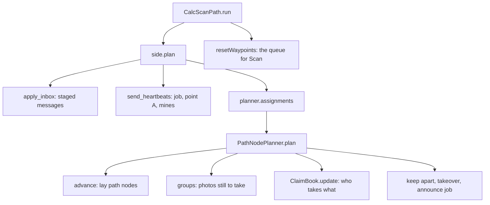

# 3. The first CalcScanPath pass: from "nothing known" to a queue of waypoints

> Part of the [execution walkthrough](README.md). Previous: [2. Takeoff](02-takeoff-and-planner-setup.md). Next: [4. Scan](04-scan.md).

**What this chapter covers.** `CalcScanPath` is the **planning step**: "given everything I know right now, which photo spots should *this* drone visit next, in what order?" This is the core of the mission, so we go deep. We follow **drone 1's first pass**, when nothing has been photographed yet. Chapter 6 revisits the same functions after a mine is found.

> **Status.** The per-drone planner code (claims, keep-apart including cross-side keep-apart, idle takeover, `_make_way`) is in final verification; the text describes the code as read. The numbers in the toy runs are real output of that code at the time of writing.

## 3.0 The whole pass on one page

Definitions used below:

- **Photo spot / waypoint**: a lat/lon where the drone hovers and takes one photo.
- **Group**: photo spots are sorted into five priority groups (PATH, BIG_SHORTCUT, ADJACENT, SHORTCUT, OUTER). Lower number = more urgent.
- **Claim**: the decision that "drone X takes this path". Each drone works out the claims itself, from where both side-mates are and what each announced.
- **Job**: the path (or single photo) a drone is working on right now. It **announces** its job to its side-mate (`SIDE_JOB` message) so the mate's copy does not hand out the same job.

## 3.1 CalcScanPath.run

`Takeoff` returned `CalcScanPath(...)`; the state machine calls its `run()`:

{{snip: state_machine/states/impl/calc_scan_path_impl.py :: if self.drone.time_exceeded(self.flight_settings.max_flight_time): => return Scan(self.drone}}

Line by line:

- **Time check.** If the 7-minute budget is gone, skip everything and go to `EndRun` (chapter 10).
- **`replan_needed = None`.** `Drone.replan_needed` is a flag the *receive loop* sets when data arrives that could invalidate the current queue (chapter 7). Clearing it here says "whatever set it is about to be handled by the recompute below".
- **`planner.start_if_needed()`.** First call: marks the planner started and returns `False` only if no route exists at all (fully blocked); then `_flag_no_valid_path` sets `Drone.no_valid_path_found`, which later makes `AppShare` report "no path" instead of an empty success.
- **`own = await side.plan()`.** *The* planning call (3.2). Returns this drone's queue of `(lat, lon)` spots in flying order.
- **`planner.failure`**: planning gave up (no route left). Go to `ExpandNodes`.
- **`planner.done()`**: nothing left to do on this side. `_finish_scan` (chapter 10) then `ExpandNodes`.
- **`resetWaypoints(_build_waypoints(...))`**: replace the drone's whole waypoint queue with fresh `Waypoint` objects:

{{snip: state_machine/states/impl/calc_scan_path_impl.py :: def _build_waypoints => for i, (lat, lon)}}

  A `Waypoint` (`flight/waypoint.py`) has a random `waypoint_id`, the drone id, lat/long and a name `scan_<i>`. **Every pass creates a brand-new queue**; nothing is edited in place. That matters for `Scan` (chapter 4): it removes a waypoint from the queue by *identity* (the object it flew to), not by position.
- **Empty queue.** If `own` is empty the drone waits `IDLE_POLL_S = 0.1` s before `Scan` bounces straight back (waiting for the partner's point A or its mate's photos).

**Goes next to ->** `SideAgent.plan()`.

## 3.2 SideAgent.plan: one planning pass

{{snip: flight/pathfinding/side_agent.py :: async def plan(self): => return plan[self.me]}}

Five steps:

1. `_check_mate()`: updates `mate_lost` (mate silent for 20 s once the mission has been running 20 s).
2. `apply_inbox()`: applies everything the receive loop **staged** since the last pass (3.2a).
3. `send_heartbeats()`: sends this drone's job announcement, and (if it is the speaker) point A and the mine list to the other side (3.2b).
4. Builds the inputs for the planner: `held` (the jobs the mate and the other side announced), `others` (where the other side's drones are), and `self.positions()` (where this side's drones are).
5. `planner.assignments(...)` (3.3), then announce the (possibly changed) job again.

### 3.2a apply_inbox: staged messages, in a fixed order

{{snip: flight/pathfinding/side_agent.py :: def apply_inbox(self): => planner.partner_point_a(*point_a)}}

Order matters: **the other side's mines come first**, so no path node is laid over ground about to turn out unsafe; then the side-mate's photos (each is `mate_photo`); then the other side's photo footprints and finally its point A. On the very first pass most of this is empty; the exception is drone 1's first `CROSS_PAIR_POINT_A` from drone 3, which may already be waiting. Chapter 7 walks through each of these stages with a concrete case.

### 3.2b send_heartbeats: telling others what I'm doing

{{snip: flight/pathfinding/side_agent.py :: async def send_heartbeats => self._mines_synced_at = now :: async def _announce_job => self._job_sent = (job, now)}}

- **Job announcement (everyone).** `current_job(me)` is `claims.heads[me]`: the `(group, key, (x, y))` of the next photo this drone will fly, or `None`. It is sent to the side-mate *and* to the other side's drones (`SIDE_JOB`) when it changes and at least once per second, so a lost "I have no job" cannot keep a mate waiting forever. On the first pass it is `None` (nothing planned yet), so drone 1 sends "no job".
- **Speaker's streams (only the speaker, only with a partner side).** The speaker sends `CROSS_PAIR_POINT_A` (this side's frontier) to the other side when it changes and every second, and `CROSS_PAIR_MINE_SYNC` (every mine it knows) every 5 s. Drone 1 is its side's speaker. Drone 2 sends only its job.
- The messages are built in `Interdrone.send_side_job`, `send_cross_pair_point_a`, `send_cross_pair_mine_sync`; each ends in `Interdrone.send()`, which hands the `Message` to the networking thread. Only `SHARE_PHOTOS` and `CROSS_PAIR_MINE_RELAY` are resent if the socket fails; the others are best-effort streams.

### 3.2c Where are the drones? (`positions`, `other_side_positions`)

{{snip: flight/pathfinding/side_agent.py :: def positions(self): => (start["lat"], start["lon"]) +1 :: def other_side_positions(self): => return out}}

- Own position: the live GPS value from the autopilot.
- Side-mate: its latest `POSITION_REPORT` if fresher than 2 s; else where its last **photo** was taken; else the side's start point. `None` if it is lost.
- Other side: only **fresh** position reports; a stale or silent drone is left out (ignored).

**Goes next to ->** `MissionPlanner.assignments`.

## 3.3 MissionPlanner.assignments: lat/lon in, lat/lon out

{{snip: flight/pathfinding/mission_planner.py :: def assignments(self, positions => for d in self.drones}}

- Converts all positions from lat/lon to local feet (`latlon_to_local`). A drone missing from `positions` is treated as being at **point A**; one mapped to `None` is lost.
- Calls `session.assignments(...)`, which is one line: `SideSession.assignments` returns `self.planner.plan(positions, held, me, others)`.
- Converts each drone's queue of `(x, y, group)` back to lat/lon, dropping the group.

**Goes next to ->** `PathNodePlanner.plan` (3.4).

## 3.4 PathNodePlanner.plan

This is the heart. In order: `advance` -> `groups` -> `claims.update` -> keep-apart -> takeover -> job announcement.

`PathNodePlanner.plan` does the first two itself and hands the rest to its `SideCoordinator` (`coordination.py`), which owns the ClaimBook and the keep-apart / make-way / takeover policy:

{{snip: flight/pathfinding/pathnode/planner.py :: self.advance()      # anything already checked => return self.coordinator.plan(}}

and `SideCoordinator.plan` is steps 3-6:

{{snip: flight/pathfinding/pathnode/coordination.py :: plan = self.claims.update( => return self.last_plan}}

### Step 1: advance() (nothing photographed yet)

{{snip: flight/pathfinding/pathnode/planner.py :: def advance(self): => self.shortcuts.update(self.met)}}

`advance` lays **path nodes over everything now checked**: the forward gap from point A, and every pending span from its start. It uses `coverage.all_seen`, "are all the squares this stretch touches photographed?". `chain.advance_link` walks along the link's polyline in 0.5 ft steps and stops at the first unphotographed step:

{{snip: flight/pathfinding/pathnode/chain.py :: def advance_link => def advance_link +40}}

- `good == 0`: nothing at the start is checked yet, so nothing changes. That is the case now.
- Some prefix checked: the link is **split** into a new CHECKED head (with new path nodes laid along it) and the unchecked tail, which stays the same `Link` object.
- Everything checked: `convert_checked` turns the whole link into CHECKED links.
- `Never close the gap against a stand-in target`: `advance` only closes the forward gap when the target is the partner's real point A (`target.may_close()`) or there is no partner (chapter 9).
- Finally `shortcuts.update(met)` (chapter 8). On the first pass there are no candidates.

So on the first pass `advance()` does nothing and the chain is still `entry --forward-- target`.

### Step 2: groups(): what photos are still to take?

{{snip: flight/pathfinding/pathnode/work.py :: def groups(self): => return groups}}

Read this as five lists, one per priority group:

`Work` is an ordered list of **work sources** (`work_sources.py`, abstract `WorkSource` with `group`, `entries()`, `needs()`); each fills one group:

- **PATH** (group 0), `PathSource`: for every *unchecked* link (the forward gap, and every pending span), `coverage.places_along(k.poly)`: the ordered list of photo spots that would check it. The key names the path: `"forward"` or `("span", end_node_xy)`.
- **ADJACENT / OUTER**, `RingSource`: free-standing photo spots for squares 1 ring (then 2 rings) out from the *checked* route. Empty now: no checked route yet.
- **BIG_SHORTCUT / SHORTCUT**, `ShortcutSource` (one per tier): the shortcut being tried (chapter 8). Empty now.
- The result is cached on `state_key()` = (coverage version, obstacles version, chain signature, shortcut signature), so a pass that changed nothing is nearly free. `_copy` returns copies so callers can't mutate the cache.

**How photo spots are placed** (`Coverage.places_along` delegates to its `PhotoPlacement`, `placement.py`; `PlannerConfig.coverage` picks `CorridorPlacement` or `BandPlacement`):

{{snip: flight/pathfinding/pathnode/coverage.py :: def touched(self, poly): => return cells}}

{{snip: flight/pathfinding/pathnode/placement.py :: def places_along(self, poly, plan=True): => return self._place(poly, need, plan) :: class CorridorPlacement => return self.cov.touched(poly) :: def _place(self, poly, need, plan): => return sorted(placed, key=key)}}

- The map is a grid of **2 ft squares** (`CELL`). `touched(poly)` is every square the polyline passes through (traced both directions, to be deterministic).
- `need(poly)` (the placement's) is what must be photographed for the stretch to count as checked. In the default `CORRIDOR` mode (`CorridorPlacement`) this is just the touched squares.
- `places_along` (shared by all placements) keeps the still-unseen needed squares and asks the placement's `_place`. `CorridorPlacement._place` lets `path_cover_unseen` (`path_cover.py`) return photo centres whose footprints cover the unseen stretches, keep only centres that add something, then give any square still uncovered (or one a previous photo **missed**, chapter 4) a photo centred on it. The result is sorted by arc length along the path, so it is in **walking order from the path's start**.
- A photo only counts a square as covered if the square is **entirely** inside the footprint (`footprint_cells`).

In the toy run below (a 20 ft x 60 ft field, one side of two drones) the forward gap is one straight line and yields 11 photo spots about 5.8 ft apart.

{{run: demos/toy_first_pass.py}}

### Step 3: ClaimBook.update: who takes which path?

The planner passes `self.groups()` to the **ClaimBook**. Its rules, from the top of `claims.py`:

- A **sequence** is the photos along one path, in flying order. It is claimed **whole** by one drone.
- Groups are dealt in priority order; a drone flies everything it holds in a higher group before anything lower.
- Picture a radius growing from 0: a drone may claim a sequence once its route to the sequence's start (from where it is, through everything it already holds) is within the radius. Implemented without stepping the radius: **repeatedly, the drone that can start an unclaimed sequence soonest takes it.**
- Within a group a drone flies its paths nearest-start first, except the forward gap, which goes **last** (it is open-ended).
- **Deterministic**: ties go by drone order, then by sequence start. Two drones with the same inputs compute the same claims.

First the input is normalised and held jobs are recorded:

{{snip: flight/pathfinding/pathnode/claims.py :: def update(self, groups, positions, held=None): => self._inherit(groups, active)}}

- Duplicate points inside a sequence are dropped (`dict.fromkeys`), as are duplicate free-standing photos.
- `active` = drones whose position is not `None`. A lost drone holds nothing.
- `held`: the job announced by the side-mate (from `SIDE_JOB`) **replaces this copy's own record** of that drone's job (`self.heads[d]`). `_tupled` turns JSON lists back into tuples.
- `_inherit` keeps each active drone's **current job**: the path (by key) or free-standing photo (matched within `MATCH_FT = 2` ft) its next photo belonged to. A kept path keeps its owner however much its photos move, so a replan doesn't hand it to whoever happens to be a foot nearer.

Then every group is dealt:

{{snip: flight/pathfinding/pathnode/claims.py :: for g, seqs in enumerate(groups): => cost[d], tail[d] = start + path_length(seq)}}

- For each group, `open_seqs` are the sequences nobody holds yet.
- For each active drone, `_queue(d, positions[d], g)` builds its route through everything it already holds in groups `0..g`; `tail[d]` is where that route ends, `cost[d]` its length.
- The `while open_seqs` loop finds the best (drone, sequence) pair: `rank = (cost[d] + dist(tail[d], seq_start), order, seq_start)`. The **smallest rank wins**: the drone that can reach that sequence's start soonest, counting the work it already holds. That drone's tail moves to the sequence's end, so its next claim is measured from there.
- Effect: "nothing is sent across the field while another drone is nearer".

Finally each drone's queue is built, and its **head** (next photo) recorded:

{{snip: flight/pathfinding/pathnode/claims.py :: def _queue(self, drone, start, upto): => return route, length :: out = {} => return out}}

- `_queue` orders a drone's claims: within each group, nearest-start-first, with the `"forward"` path last.
- `heads[d] = (group, key, (x, y))`: the job that is announced next.

In the toy run, **pass 1**: drone 1 is at (10, 0), drone 2 at (19.5, 0). The only sequence is `"forward"` (11 photos). Drone 1's copy gives all of it to drone 1 (its start is nearer): drone 2's queue in that copy is empty. *Drone 2's own copy* first has the same result, then hits step 5 below.

### Step 4: keep-apart

Claims keep the two side-mates on **different work**, not physically apart. `_keep_apart` drops photos that would put two drones too close:

{{snip: flight/pathfinding/pathnode/coordination.py :: def _keep_apart => return out}}

- `gap = keep_away_ft = 10 ft`, `clear = keep_clear_ft = 7.5 ft` (both `PlannerConfig` fields, chosen to stay above the flight code's hold radius `COLLISION_RADIUS` = 2.01 m = 6.6 ft: a photo nearer than that to a peer would make `gotoWaypoint` hold, and abort after 15 s, chapter 4). Ties go to the **lower id**, so two drones can never block each other.
- A **higher-id** drone skips photos within 10 ft of a lower drone's position and of its next photo (only within 7.5 ft if that lower drone is idle).
- A **lower-id** drone skips only photos within 7.5 ft of a higher drone's position.
- `others` (the *other side's* drones, from fresh `POSITION_REPORT`s) are handled the same way: a lower-id other-side drone counts like a lower side-mate, using its announced job (`other_held`) as its "next photo". This is the cross-side keep-apart: drones 1 and 2 keep clear of 3 and 4 by the same rule.
- Dropped photos stay work for later; they are only missing from *this pass's queue*.
- **Legs, not just photos** (`_flyable`): a photo is also dropped if the leg to it from the drone's previous photo (the first leg: its position) closes in to within 7.5 ft of another drone's *position*. The flight code holds such a leg until the peer moves, and an idle peer never does (the hold aborts after 15 s). A leg that only leaves a peer the drone is already that near is fine.
- **Making way** (`_make_way`): an idle drone also moves off when it stands within 7.5 ft of the leg to a side-mate's first photo that was dropped for that reason (`_blocked_legs`), and a drone already on a spare spot (`_is_spare`) stays put: hopping to the nearest ring point of whichever job is nearest could flip-flop between two spots, and Scan re-photographed the current position hundreds of times a second.

### Step 5: idle takeover

Back in `plan`: a drone whose copy gave it **nothing to fly** takes its side-mate's queued work, **except the job the mate announced**:

- Why: the mate's copy may not know about that work (the copies can differ while messages are in flight), so nobody else would fly it.
- `announced` is the set of **head photo points** of the mate's announced job. Only *that single next photo* is protected; everything after it in the mate's queue is taken.
- The taken photos are removed from the mate's entry in this copy, and keep-apart is re-run.

In the toy run (passes 2 and 3) this reaches a steady state: drone 1's copy lists the whole forward path for drone 1 starting at (10.9, 2.7); drone 2's copy has drone 2 flying the same path from (11.0, 14.3) onward, since it announced drone 1's head photo as protected and keep-apart dropped (11.0, 8.5). Effectively **both drones work the forward gap, drone 2 starting further up**. As photos are shared (chapter 7) each copy stops listing ground the mate has covered.

Note: the two copies' queues overlap in steady state by design of the takeover rule; it is resolved by `SHARE_PHOTOS`, not by claims. A side-mate **not yet heard from** is now left out of `held` (unknown), rather than treated as having announced "no job": `SideAgent.plan` only puts the mate in `held` once `peer_jobs` has an entry for it. Only a mate that actually announced `None` lands in `idle`.

### Step 6: _make_way

When a drone has nothing it may fly because of keep-apart, `_make_way` moves it aside instead of letting it hover in a standoff:

{{snip: flight/pathfinding/pathnode/coordination.py :: def _make_way => self.last_plan[me] = [(spot[0], spot[1], len(GROUPS) - 1)]}}

- It fires only when `me` has an empty queue after keep-apart. The "who gives way" rules are in the docstring; the first is now: the higher-id drone yields when a **lower-id drone's announced job** (its next photo) is within `keep_away_ft` of it, not only its next photo as before. Announced jobs of the other side's drones count too (`held` includes them).
- The chosen spot is on ground where no photo is needed, clear of the job and other drones, at radius `max(keep_away, keep_clear) + 0.5` plus 1, 4 or 8 ft around the job. It is queued in the *last* group (`len(GROUPS) - 1`) so it is never mistaken for a job.

### Step 7: announcing the job

The last lines of `plan` set `claims.heads[d]` to what each drone will **actually fly first** (after keep-apart), except that a drone held back by keep-apart announces the job it *waits for*, so the other drone makes way. Those heads are what `SideAgent._announce_job` sends as `SIDE_JOB` on the next call.

**Goes next to ->** back in `CalcScanPath.run`.

## 3.5 Back to CalcScanPath: the queue for Scan

`plan[self.me]` (drone 1's queue) comes back through `MissionPlanner` as `[(lat, lon), ...]`. `run` builds `Waypoint` objects, `resetWaypoints`, and returns `Scan(...)`. The first pass produced, for the toy field:

- `own` = the forward-gap photo spots for drone 1 (up to keep-apart), in order from the entry.
- `heads[1]` = `(0, 'forward', (x, y))`, announced to drone 2, 3 and 4 by the second `_announce_job` call in `plan`.

**Goes next to ->** [Chapter 4: Scan](04-scan.md).

## 3.6 How drones 2, 3 and 4 differ

- **Drone 2** runs the same code with `side_drones = (1, 2)`. Its planner is an independent copy; it gets the same `groups`, and its claims can differ from drone 1's (it holds drone 1's *announced* job). It is not the speaker, so it sends only `SIDE_JOB`.
- **Drone 3/4** run on `Edge.TOP`: the entry is at `y = field_h` and photos are ordered from there (ADJACENT/OUTER use "nearest the entry edge first": `tiles()` sorts by `abs(y - y0)`). Drone 3 is the top side's speaker and sends **its** point A to drones 1 and 2.
- In a mission with no partner side the `target` is the far edge and no cross-side messages are sent.
