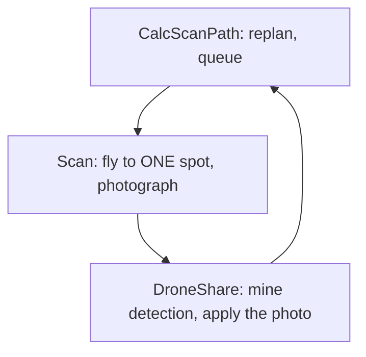

# 4. Scan: flying to one photo spot and taking the picture

> Part of the [execution walkthrough](README.md). Previous: [3. The first CalcScanPath pass](03-first-calcscanpath.md). Next: [5. DroneShare and the mine rule](05-droneshare-and-mine-rule.md).

**What this chapter covers.** `Scan` flies to the **first** waypoint in the queue that `CalcScanPath` built, takes a photo, and works out what the camera *really* saw. It records that as coverage. It also covers how the drone avoids the other drones while flying.

`Scan` handles **one waypoint per visit**. The mission loop is a cycle through the state machine:

## 4.1 Scan.run

{{snip: state_machine/states/impl/scan_impl.py :: if self.drone.time_exceeded(self.flight_settings.max_flight_time): => return DroneShare(}}

- **Time check** (again): straight to `EndRun` if the budget is gone.
- **Back to CalcScanPath instead of flying** if `replan_needed` is set *or* the queue is empty. `replan_needed` is only checked **here, at the start of a Scan visit**; it is **not** polled during the flight. In practice `DroneShare` sends every drone back to `CalcScanPath` after every photo anyway, so the flag mainly matters for a message that arrives *between* `CalcScanPath` clearing it and `Scan` starting (chapter 7). The `asyncio.sleep(0)` is deliberate: several drones in one process would otherwise starve the receive loop.
- **`gotoWaypoint`**: fly to the head of the queue (4.2). `MISSION_ALTITUDE_M` (2 m) is passed explicitly; the function's default is the POIF altitude (6 m).
- **`FormationLost`**: the collision-avoidance code decided the swarm is no longer safe. `Scan` logs it and returns `Land`.
- `last_reached_waypoint = reached`: hands the waypoint to `DroneShare` (each state's `run()` starts fresh, with no shared variables).
- **`_capture_and_mark_seen`**: the photo (4.3).

Note: `Scan` only catches `FormationLost`. If `move_to` raises `LegStalled` (the drone stopped closing on the waypoint) or `FlightInterrupted` (the autopilot left `GUIDED`), nothing in the mapping states catches it (the POIF state does), so the exception ends the state machine task with the drone still airborne.

**Goes next to ->** `Drone.gotoWaypoint`.

## 4.2 gotoWaypoint: fly the leg, but only if it is clear

The queue is `Drone.waypoints`. `gotoWaypoint` always flies to `waypoints[0]`.

{{snip: state_machine/drone.py :: peer_states = list(peer_states) => leg_from = self.currentPosition() :: conflicts = self.conflictsForLeg( => if conflicts:}}

`conflictsForLeg` asks: **is any other drone too close to the straight line I am about to fly?** The peers are `interdrone.drone_states`, one `DroneState` per other drone, filled by the receive loop.

{{snip: state_machine/drone.py :: occupied = state.believed_occupancy(PEER_STALE_S) => stale = state.is_stale(PEER_STALE_S) :: clearance = segment_distance(leg_start, leg_end => reason="swept_path", +2}}

- `believed_occupancy` (in `drone_state.py`) is "where is this drone right now?":

{{snip: state_machine/drone_state.py :: def believed_occupancy => return self.occupied_segment()}}

  In the mapping mission **nobody sends `NEW_WAYPOINTS` or `REACHED_WAYPOINT`** (only POIF does; the only `send_new_waypoints` callers are in `poif_impl.py`), so `occupied_segment()` is `None` and the only usable information is the **live position** from `POSITION_REPORT`. A peer with no position report in the last 12 s (`PEER_STALE_S`) is skipped entirely ("holding on a frozen belief is its own deadlock").
- `in_formation` is always false here (`points_per_lap` is `None`), so every peer takes the "outside the window" branch: the peer counts as occupying that point.
- `clearance` is the distance from the leg (a segment) to that point. A **conflict** is `clearance < COLLISION_RADIUS`:

{{snip: flight/waypoint.py :: MIN_SEPARATION_M: float => MIN_SEPARATION_M: float :: POSITION_UNCERTAINTY_M: float => POSITION_UNCERTAINTY_M: float :: COLLISION_RADIUS: float => COLLISION_RADIUS: float :: SEPARATION_ABORT_M: float => SEPARATION_ABORT_M: float}}

  So `COLLISION_RADIUS` = 32 in (0.81 m) + 2 x 0.6 m = about **2.01 m**. The hard floor `SEPARATION_ABORT_M` is 1.2 m.

  **Tie to keep-apart:** `COLLISION_RADIUS` is about 6.6 ft. The planner's `keep_away_ft` (10 ft) and `keep_clear_ft` (7.5 ft) are deliberately above it, so a queued photo is never one the flight code would hold on: a photo planned closer than 6.6 ft to a peer would make `gotoWaypoint` hold until the peer moves and abort with `FormationLost` after 15 s (chapter 3, step 4).

**If there is a conflict, the drone holds** in the air and re-checks 10 times a second until the leg is clear:

{{snip: state_machine/drone.py :: while conflicts: => now = time.monotonic() :: if conflicts and now - hold_started >= HOLD_ABORT_S: => raise FormationLost( +5}}

- `_check_still_ours()` raises `FlightInterrupted` if the autopilot left `GUIDED` or disarmed.
- A hold that lasts 15 s (`HOLD_ABORT_S`) raises `FormationLost`: two drones "can't block each other", so a hold that long means a peer has stopped moving; `Scan` lands.

**If clear, fly.** `move_to` commands the flight controller and polls:

{{snip: state_machine/drone.py :: def leg_guard() -> None: => abort_check=leg_guard, +1}}

- `move_to` (`flight/pathfinding/utils/goto.py`) sends `simple_goto` at 2 m/s (`LEG_GROUNDSPEED_M_S`) and polls every 0.25 s. Arrival means: horizontal distance under `LEG_TOLERANCE_M = 0.35 m` **and** altitude within tolerance. If the drone stops closing for 5 s (`STALL_TIMEOUT_S`) but is within `LEG_MAX_TOLERANCE_M = 0.6 m`, that counts as arrived; otherwise it re-sends the goto once, then raises `LegStalled`. A leg may take at most 60 s.
- `leg_guard` runs on every poll: `checkSeparation` measures the real distance to every peer with a fresh position report and, if any is under 1.2 m, **latches** `formation_abort` and raises `FormationLost`:

{{snip: state_machine/drone.py :: me = self.currentPosition() => if distance < SEPARATION_ABORT_M: +1 :: if breaches and self.formation_abort is None: => collision_log.critical( +1}}

**Removing the waypoint.** After arrival:

{{snip: state_machine/drone.py :: # The queue can be replaced mid-leg => return curWaypoint}}

- **By identity, not by position.** The source comment says the queue "can be replaced mid-leg (a replan while flying)", so the code deletes the very object this leg flew to, and only if it is still queued, never "whatever is at the head now". In the flow described here the only caller of `resetWaypoints` is `CalcScanPath`, which cannot run while `Scan` is awaiting the leg, so this is a safety measure rather than something that happens today.
- The function returns the waypoint; `Scan` stores it as `drone.last_reached_waypoint`.

## 4.3 The photo: what did the camera *really* cover?

`CalcScanPath` planned with a fixed rectangle (8.52 x 6.44 ft). The real footprint depends on altitude, attitude and heading, so `Scan` measures it:

{{snip: state_machine/states/impl/scan_impl.py :: image = camera.capture_image(only_metadata=False) => self.drone.last_captured_image = image :: location = vehicle.location.global_relative_frame => roll=math.degrees(attitude.roll), +1 :: width, height = image.image.size => self.drone.last_photo_corners_latlon = corners}}

- `capture_image` takes the picture. If it fails (no camera, no image), the function returns and `last_photo_corners_latlon` stays `None`. That is a **failed photo** (chapter 5).
- The altitude for the geometry is the **rangefinder** (real height above ground), falling back to `MISSION_ALTITUDE_M` with a warning; attitude comes from the autopilot in radians and is converted to degrees.
- `camera.get_image_corner_coordinates(...)` ray-casts the four image corners to the ground and returns lat/lon. If any ray does not reach the ground, no footprint is recorded.
- The four corners are reordered to walk the perimeter (top-left, top-right, bottom-right, bottom-left), or the coverage fill's polygon test would see a self-crossing shape.
- **`planner.own_footprint(corners)`** hands the footprint to the planner. Call chain: `MissionPlanner.own_footprint` -> `SideSession.own_footprint` -> `PathNodePlanner.record_footprint`:

{{snip: flight/pathfinding/mission_planner.py :: def own_footprint => self.session.own_footprint(self._local(corners_latlon))}}

{{snip: flight/pathfinding/pathnode/planner.py :: def record_footprint => self._misses(cx, cy, needed) :: def _misses => self._block_square(c, r) :: def _block_square => mine_rule.apply(self, self.routes.add_square(c, r), Source.PARTNER)}}

- `needed = self.work.needed_squares()` **before** recording: every not-yet-photographed square any group still wants (unchecked links, shortcut trials, and both rings).
- `coverage.record(corners)` marks every 2 ft square **fully inside** the footprint as seen (grown by 1/1000 ft to absorb lat/lon round-off) and returns the footprint centre:

{{snip: flight/pathfinding/pathnode/coverage.py :: def record(self, corners): => return cx, cy}}

- `_misses` then counts a **miss** for each *needed* square this photo was *aimed at* (centre within `aim_radius` of the photo centre) but that is **still unphotographed**:

{{snip: flight/pathfinding/pathnode/coverage.py :: def count_misses => return hopeless}}

- **1 miss** (`MISS_CENTRE`): from the next `places_along`, that square gets a photo **centred on itself** instead of a normal placement.
- **3 misses** (`MISS_BLOCK`): the square is **given up**: it becomes an obstacle (`routes.add_square`) and the **mine rule** runs on it with `Source.PARTNER` (so it only re-bridges the route, it does not make point A jump; chapter 5). This is what stops the same photo being handed out forever when the camera keeps missing a square.

### The climb-retry loop

If the footprint still does not cover the square this waypoint was sent to check, the drone climbs and photographs again:

{{snip: state_machine/states/impl/scan_impl.py :: if planner.cell_seen_at(waypoint.lat, waypoint.long) is not False: => next_altitude_agl_m = altitude_agl_m + CAMERA_CLIMB_STEP_M +3 :: await move_to( => altitude_tolerance=_CLIMB_ALTITUDE_TOLERANCE_M, +1}}

- `cell_seen_at` returns `True` (covered), `False` (still unphotographed) or `None` (the square is off the field: no altitude can fix that). Only `False` triggers a retry.
- Each retry climbs `CAMERA_CLIMB_STEP_M = 0.5 m`, up to `MAX_CAMERA_CLIMB_ATTEMPTS = 8` or `max_flight_height` (from the mission config), then logs `photo_coverage_incomplete` and continues.
- The drone does **not** come back down; the next `gotoWaypoint` leg targets 2 m again.

Note: every retry calls `planner.own_footprint` again, and **every call counts misses** (`record_footprint` -> `count_misses`). A square that stays uncovered through three captures reaches `MISS_BLOCK = 3` and is blocked as an obstacle, even though the loop allows up to eight attempts. Whether that is intended is not stated anywhere (the `MissionPlanner.own_footprint` docstring only says the call "may repeat while it climbs").

**A worked example (toy run).** In the toy field of chapter 3, drone 1 photographs the first spot, (10.9, 2.7). Its footprint spans y = -1.56 to 6.96. Whole 2 ft squares are seen up to y = 6 (rows 0 to 2). `advance()` then checks the forward link in 0.5 ft steps and stops at the first step that would touch an unseen square: the step from 6.0 to 6.5 touches row 3, so the checked prefix ends at **y = 5.5**. Result: the chain becomes `entry --checked-- (10.0, 5.5) --forward-- target`, with a new path node laid at (10.0, 5.5). The `toy_after_mine` run printed in [chapter 6](06-calcscanpath-after-mine.md) shows exactly this ("pass 2").

**Goes next to ->** [Chapter 5: `DroneShare`](05-droneshare-and-mine-rule.md).

## 4.4 How the other drones differ

- All four drones run this identical `Scan` code. Drones on the top side simply fly toward lower y.
- `POSITION_REPORT`s from *all* other drones (both sides) feed the collision check, because `stream_positions(peers)` sends to `other_drones_in_mission`.
