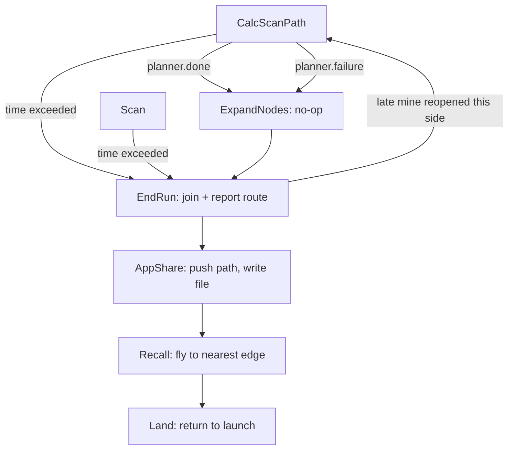

# 10. Finishing: done(), ExpandNodes, EndRun, AppShare, Recall, Land

> Part of the [execution walkthrough](README.md). Previous: [9. Two sides meeting](09-two-sides-meeting.md). Next: [11. Glossary](11-glossary.md).

**What this chapter covers.** How the mapping loop ends (three ways), what each ending state does, how the two sides' routes become one report, and how the drones get home.

> **Status.** `ExpandNodes` is a **no-op** today (expanding mines is not implemented yet, see 10.2). `EndRun`'s join protocol relies on the per-drone planner copies, which are in final verification.

## 10.1 How the loop ends

Three exits from `CalcScanPath` / `Scan` (chapters 3 and 4):

1. **`planner.failure`**: no route exists any more (fully blocked, or the entry is walled in). `CalcScanPath` flags `Drone.no_valid_path_found` and goes to `ExpandNodes`.
2. **`planner.done()`**: the normal finish.
3. **Time limit**: `FlightSettings.max_flight_time` = 7 minutes since `Drone.startTime` (set in `Takeoff`). Checked at the top of `CalcScanPath` and of `Scan`; jumps **straight to `EndRun`** (skipping `ExpandNodes`).

`done()` is a strong condition:

{{snip: flight/pathfinding/pathnode/planner.py :: def done(self): => left_to_try(self.met)) :: def route_verified(self): => return self.met and self.chain.all_checked()}}

- **met**: the forward gap is closed (chapter 9).
- **no pending spans** (`chain.has_pending()` is false).
- **rings photographed**: no ADJACENT and no OUTER work left.
- **no shortcut** left to try or in trial.
- `route_verified()` is weaker: the route is whole and *every link is checked*, even with optional rings or shortcuts outstanding.

When `done()` first turns true, `CalcScanPath` calls `_finish_scan`:

{{snip: state_machine/states/impl/calc_scan_path_impl.py :: async def _finish_scan => await self.interdrone.send_checksum(planner.mine_hash(), partners)}}

- `Drone.mission_path` is set to the current route (lat/lon) and, on **drone 1 only**, pushed to the app (`push_mission_path`, 10.4).
- With a partner side, the mine hash is sent as `FIELD_CHECKSUM`. The other side's receive loop compares it with its own `mine_hash()` and replies `FIELD_CHECKSUM_ACK(matched)`; a mismatch is only logged.

## 10.2 ExpandNodes (currently a no-op)

{{snip: state_machine/states/impl/expand_nodes_impl.py :: planner = self.drone.planner => return EndRun(}}

{{snip: flight/pathfinding/mission_planner.py :: def expand_margin => return None}}

- The intent (from the module comments): grow every known mine's danger zone by `MINE_RADIUS_EXPANSION_FT = 2.0` ft as a final, deliberately conservative margin for the route about to be reported.
- **Reality**: `MissionPlanner.expand_margin` logs "ExpandNodes margin not applied (next phase)" and returns `None`, so `nodes_expanded` is never logged and the state always returns `EndRun`. The constant's own comment calls the value "a placeholder guess".
- A future implementation will need to re-run the mine rule (chapter 5) for the larger zones, which is why `ExpandNodes` sits between the last `done()` and the report.

## 10.3 EndRun

`EndRun.run` has two branches:

{{snip: state_machine/states/impl/end_run_impl.py :: planner = self.drone.planner => return AppShare(}}

- **No partner side** (1 or 2 drones): `mission_path = planner.route_latlon()`, the chain's whole route (all links, including any PENDING or FORWARD stretch left when a time-out cut the scan short; nothing marks those as unverified in this branch).
- **Partner side**: `_join_with_partner` (below). It returns `CalcScanPath` if a late relayed mine re-opened this side, else `None` with `mission_path` set.

### The join protocol

Who does what (4-drone mission):

| Drone | Role at the join | Leaves EndRun when |
|---|---|---|
| **1** | *reporter* (holds the app link): joins the halves | its join has stayed valid `JOIN_CONFIRM_S` = 3 s |
| **3** | top side's **speaker**: sends its route (`CROSS_PAIR_CHAIN`, resent every 1 s) | it gets a `CROSS_PAIR_CHAIN_ACK` whose mine hash matches its own, and its mate is not busy |
| **2**, **4** | send nothing; keep applying relayed data | same ack rule as drone 3 |

Constants:

{{snip: state_machine/states/impl/end_run_impl.py :: CHAIN_RESEND_S = 1.0 => JOIN_CONFIRM_S = 3.0}}

Setup and the loop head (every drone, every 0.2 s):

{{snip: state_machine/states/impl/end_run_impl.py :: drone, fs, side = self.drone => joined_at = None :: while True: => return CalcScanPath(drone, fs, self.interdrone)}}

- `side.apply_inbox()` and `side.send_heartbeats(MINE_SYNC_S)`: **the same inbox and heartbeat code as `CalcScanPath`**, so mines and photos still flow (here the full mine list every 1 s).
- If time is not up and `not planner.failure and not planner.done()`, this side has **been reopened** (a late relayed mine, or the halves did not connect): `route_joined = False`, event `end_run_reopened`, and back to `CalcScanPath` to finish scanning.
- Once time **is** up, `timed_out_at` starts a `JOIN_GRACE_S` = 10 s countdown after which everyone leaves regardless.

**Drone 1, the reporter:**

{{snip: state_machine/states/impl/end_run_impl.py :: if is_reporter: => if joined is not None and time.monotonic() - joined_at >= JOIN_CONFIRM_S: +1}}

- `partner_route`, `partner_route_complete` and `partner_route_mine_hash` were stored by the receive loop when `CROSS_PAIR_CHAIN` arrived (chapter 7).
- A join is attempted only when: a partner route arrived, it is **complete** (the top side verified it), it was planned around **exactly the mines drone 1 knows** (equal `mine_hash`), and drone 1's own side is done and its mate is not busy (or time is up). This avoids joining across a mine still in flight to either side.
- `check_join_latlon` (chapter 9, 9.6) joins them, or re-opens drone 1's side toward the partner's route end if they do not connect (drone 1 then returns to `CalcScanPath`).
- On success, drone 1 sets `route_joined`, sends `CROSS_PAIR_CHAIN_ACK(mine_hash)` to the other side **and its own mate**, and must keep the join valid for 3 s: a mine arriving meanwhile that lands on the joined route (`join_dropped`), or a change of the partner's mine hash, drops it.
- Later `CROSS_PAIR_CHAIN` resends are acked directly by the receive loop (`if self.drone.route_joined: send_cross_pair_chain_ack`), so a lost ack cannot strand the other side.

**Everyone else:**

{{snip: state_machine/states/impl/end_run_impl.py :: if drone.partner_route_ack_hash == planner.mine_hash() => last_chain_sent = now :: if timed_out_at is not None and time.monotonic() - timed_out_at >= JOIN_GRACE_S: => await asyncio.sleep(JOIN_POLL_S)}}

- Non-reporters leave when the ack's mine hash equals their own **and** their side-mate is not busy (`mate_busy`: the mate announced a job and is not lost, so its photos may still add mines).
- The speaker of the top side (`sends_chain = start_side == END and side.speaker`) sends `route_latlon()`, `route_verified()` (as `complete`), and `mine_hash()`.

After the loop:

{{snip: state_machine/states/impl/end_run_impl.py :: # Ack even when the join failed => return None}}

- Drone 1 **always acks** (even a failed join, "the partner can't fix it, and should go home"), then reports the joined route, or, if none, its own half with `Drone.reported_half_route = True` and an error log.
- Every other drone reports its own side's route (nobody but drone 1's is read externally).

## 10.4 AppShare

{{snip: state_machine/states/impl/app_share_impl.py :: await self.interdrone.push_mission_path() => _write_path_file(self.drone)}}

`push_mission_path` (drone 1 only):

{{snip: state_machine/interdrone.py :: async def push_mission_path => await self.send_paths_to_app("", map_data_ready=False)}}

- `Drone.get_mission_iarc_path()` -> `MissionPlanner.iarc_path` -> `format_iarc_path`: converts the lat/lon route to local feet and rasterises it onto the 2 ft grid, then run-length encodes it as `S,<start column>,<buffer width>` followed by `U/D/L/R,<squares>` lines. A virtual entry cell **outside** the field is prepended so the first command enters it. A discontinuity is logged, not raised (`strict=False`), "raising out of EndRun/AppShare would leave the drone hovering".
- `send_paths_to_app` sends `SEND_PATHS_TO_APP` to the app (address `0`).
- With no path (`mission_path` empty) it sends `map_data_ready = False`. If `no_valid_path_found` is set, `_write_path_file` writes "NO VALID PATH FOUND" instead. Every drone (not just drone 1) writes `drone_<id>_path.txt` into its log directory.

The toy 4-drone mission's report (real output):

{{run: demos/toy_iarc.py}}

## 10.5 Recall and Land

{{snip: state_machine/drone.py :: async def recall(self) -> None: => await asyncio.sleep(0.5) +0}}

- `Recall` flies (`Drone.recall`) to the **nearest of the four field edges** in the planner's local frame, at `MISSION_ALTITUDE_M`, and exits the field along that shortest path instead of cutting back across ground that may not be fully swept.
- `Land` then cancels the position stream, sets airspeed and calls `Drone.return_to_launch`, which flies to the home lat/lon at **23 m** relative altitude (`LocationGlobalRelative(home.lat, home.lon, 23)`), switches to `RTL` and waits until below 0.2 m.

{{snip: state_machine/states/impl/land_impl.py :: if self.drone.position_stream is not None: => await self.drone.return_to_launch()}}

- `Land.run` returns `None` (not `Start`, despite its docstring), so `StateMachine._run` ends, `state_machine_task` is done, and after `RESTART_GRACE_S` (2 s) `run_manager` returns: the process exits.
- `Land` is also entered from `Scan` on `FormationLost`, from the app's `LAND`, and (as `EmergencyLand`, which descends in place) from `EMERGENCY_LAND`. Those interrupt the machine as described in chapter 1, 1.6.

## 10.6 The time-limit path in one paragraph

At 7 minutes, `CalcScanPath` or `Scan` (whichever is next to run; a leg in the air is not aborted) returns `EndRun`. In `_join_with_partner`, `timed_out_at` is set on the first loop pass. Drone 1 no longer waits for `done()` or a quiet mate (`timed_out_at is not None` satisfies that part of the condition) and uses `join_latlon` rather than `check_join_latlon`, so it never re-opens. It **still needs** a partner route that is marked complete and was planned around the same mines (`mine_hash` equal); without one it keeps waiting. Everyone leaves at the latest `JOIN_GRACE_S` = 10 s after the time-out. Drone 1 then reports the joined route if it has one, else its own half flagged `reported_half_route`.
